# 大厂令牌方案公开资料调研：JWT、不透明令牌、会话与 STS 怎样搭配

**核对日期：2026-10-24。** 本文调研 Google、Microsoft、AWS、GitHub、字节跳动旗下飞书、阿里云、腾讯云、Slack 与 Uber 的官方文档和工程披露，回答“大厂在什么场景下使用什么令牌，以及这些设计解决什么问题”。

可以确认的现象是：**不同凭证承担不同职责，JWT、不透明访问令牌、会话 Cookie、临时云凭证与请求签名会共同出现。** 有的产品已经从旧字符串格式迁移到 JWT，但客户端依然需要把访问令牌当作不透明凭证使用。

本文没有各公司所有系统的统计数据，不能给出“全公司统一使用某方案”或“某方案市场占比最高”的结论。每个案例均限定到具体产品、接口或公开披露的架构。

## 阅读目录

- [1. 结论与证据边界](#evidence)
- [2. 先把令牌方案拆成五个维度](#dimensions)
- [3. 厂商与产品方案总览](#overview)
- [4. Google：不透明访问令牌与 JWT 身份令牌并存](#google)
- [5. Microsoft：JWT 与持续访问评估配合](#microsoft)
- [6. AWS Cognito：JWT 加刷新、轮换与撤销](#cognito)
- [7. GitHub：应用 JWT、安装令牌与 PAT](#github)
- [8. 飞书：新版租户凭证已经采用 JWT](#feishu)
- [9. 阿里云、腾讯云与 AWS：STS 临时凭证加请求签名](#cloud-sts)
- [10. Slack：把长期凭证改成可轮换的短期访问能力](#slack)
- [11. Uber 内部实践：按下一跳签发 JWT](#uber)
- [12. 横向对比：撤销、缓存与故障边界](#comparison)
- [13. 怎样落到 Java 后端项目](#java-design)
- [14. 迁移与验证时需要检查什么](#migration)
- [15. 常见误区与复述模板](#questions)
- [16. 官方来源索引](#sources)

------

## 1. 结论与证据边界

### 本次调研得到的五个结论

1. **JWT 已被多种公开产品采用，但不是访问令牌的唯一形式。** Google 的用户访问令牌与服务账号访问令牌被明确列为不透明令牌；ID Token 和部分服务账号凭证则采用 JWT。
2. **“令牌内部是 JWT”与“客户端应该解析它”是两个问题。** GitHub、Microsoft 的访问令牌接入契约都强调客户端不应依赖其内部格式。
3. **令牌验签与实时撤销是两项能力。** Cognito 明确说明，平台已撤销的 JWT 仍可能通过仅检查签名和有效期的通用 JWT 验证器。
4. **云资源授权经常使用临时密钥组合与请求签名。** AWS STS、阿里云 STS、腾讯云临时密钥都不能简单等同于一个普通 Bearer 字符串。
5. **内部多跳调用需要保留委托关系。** Uber 的公开实践将工作负载身份、Agent 身份和用户发起上下文组合起来，并为下一跳交换短期 JWT。

上述结论分别由后文 G1、H3、M1、A3、A4/A5、C1、T1、U1 的来源支持。这里总结的是已核对样本中的设计，不是全行业部署比例。

### 三类内容分开阅读

| 标记     | 代表什么                   | 能说明什么                               |
| -------- | -------------------------- | ---------------------------------------- |
| 产品规范 | 官方接口、SDK 与产品文档   | 对接该产品时成立的行为与约束             |
| 工程披露 | 官方技术文章描述的系统     | 文中所述时间与场景下的具体实践           |
| 工程推导 | 本文根据需求与机制进行分析 | 可供项目选型参考，不代表某厂商的部署事实 |

没有官方来源支持的数据库类型、Redis 拓扑、缓存命中率、QPS、密钥轮换周期和全公司统一登录策略，一律视为**未确认**。文中图均为依据资料重新绘制的教学简图，不代表厂商完整生产拓扑。

## 2. 先把令牌方案拆成五个维度

把“JWT、OAuth2、Session、Cookie、Bearer”列成互斥选项，会让调研失去比较基础。

| 维度     | 常见选项                                        | 真正要回答的问题     |
| -------- | ----------------------------------------------- | -------------------- |
| 凭证用途 | Access Token、ID Token、Refresh Token、会话凭证 | 这份凭证用于做什么   |
| 表示格式 | JWT、其他自包含结构、不可依赖内部格式的字符串   | 信息怎样编码与保护   |
| 携带位置 | Cookie、Authorization 请求头、平台专用字段      | 请求怎样带上凭证     |
| 验证机制 | 本地验签、状态查询、自省、撤销检查、请求签名    | 服务怎样判断请求可信 |
| 生命周期 | 到期、刷新、轮换、撤销、事件驱动失效            | 何时还能继续使用     |

**图 1：同一份访问能力可以组合不同机制。**

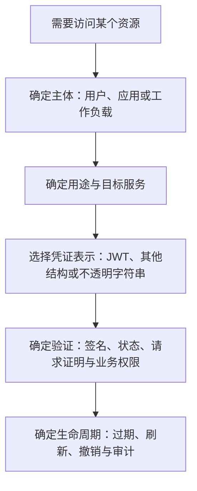

另一个关键区别是：

- **格式不透明**：平台不承诺客户端能够理解或验证其中的数据；不一定意味着数据库里只有一个随机编号。
- **使用契约不透明**：即使当前凭证内部采用 JWT，客户端仍应只保存和传递它，不依赖内部字段决定业务。

GitHub 的最新格式变更就是第二种情况的直接案例。JWT 的表示与客户端契约应分开讨论，资源服务器则必须按适用规范正确验证令牌。

## 3. 厂商与产品方案总览

| 厂商与具体场景                      | 官方确认的方案                                        | 最值得学习的边界                                                                                                                                                                                                                                                                                      |
| ----------------------------------- | ----------------------------------------------------- | ----------------------------------------------------------------------------------------------------------------------------------------------------------------------------------------------------------------------------------------------------------------------------------------------------- |
| Google Cloud 用户、服务账号访问 API | 不透明 Access Token；部分服务账号场景支持自行签发 JWT | 不是所有 Google 凭证都能按 JWT 解析 [G1](https://docs.cloud.google.com/docs/authentication/token-types)                                                                                                                                                                                               |
| Google OIDC 登录                    | JWT ID Token                                          | 身份结果与 API 访问能力分工 [G2](https://developers.google.com/identity/openid-connect/openid-connect)                                                                                                                                                                                                |
| Google Firebase 服务端会话          | JWT 格式的 Session Cookie                             | Session 与 JWT 可以组合 [G3](https://firebase.google.com/docs/auth/admin/manage-cookies)                                                                                                                                                                                                              |
| Microsoft Entra 与支持 CAE 的资源   | 注册 API 的 JWT 令牌；适用场景叠加持续访问评估        | 资源可在到期前拒绝令牌 [M1](https://learn.microsoft.com/en-us/entra/identity-platform/access-tokens)、[M2](https://learn.microsoft.com/en-us/entra/identity/conditional-access/concept-continuous-access-evaluation)                                                                                  |
| AWS Cognito User Pools              | JWT Access/ID Token，Refresh Token 及可选轮换         | 平台撤销不等于任意离线验签器知晓撤销 [A1](https://docs.aws.amazon.com/cognito/latest/developerguide/amazon-cognito-user-pools-using-the-access-token.html)、[A3](https://docs.aws.amazon.com/cognito/latest/developerguide/token-revocation.html)                                                     |
| GitHub App 与个人 API 调用          | 应用认证 JWT、安装访问令牌、PAT                       | 安装令牌已发生 JWT 格式迁移 [H3](https://github.blog/changelog/2026-10-02-stateless-github-app-installation-tokens-rolled-out/)                                                                                                                                                                       |
| 飞书新版自建应用租户凭证            | JWT 格式 tenant_access_token，OAuth 客户端凭据流程    | 新接口响应字段与长度限制需要迁移 [F1](https://open.feishu.cn/document/uAjLw4CM/ukTMukTMukTM/authentication-management/access-token/tenant_access_token)                                                                                                                                               |
| AWS、阿里云、腾讯云资源 API         | 临时访问密钥、安全令牌及相应请求签名                  | STS 凭证组合不是普通 Bearer Token [A4](https://docs.aws.amazon.com/STS/latest/APIReference/API_Credentials.html)、[C1](https://help.aliyun.com/zh/oss/developer-reference/use-temporary-access-credentials-provided-by-sts-to-access-oss)、[T1](https://cloud.tencent.com/document/product/436/14048) |
| Slack 应用令牌轮换                  | 开启轮换后使用过期 Access Token 与 Refresh Token      | 不依赖 JWT 也能讨论完整生命周期 [S1](https://docs.slack.dev/authentication/using-token-rotation/)                                                                                                                                                                                                     |
| Uber 内部 Agent 调用链              | 工作负载身份加逐跳交换的短期 JWT                      | 下一跳受众和委托链需要验证 [U1](https://www.uber.com/us/en/blog/solving-the-agent-identity-crisis/)                                                                                                                                                                                                   |

表中“支持某能力”没有被扩展成“该厂商全部业务都这样实现”。腾讯部分其他产品、微信、阿里电商用户登录态等具体内部方案不在本次已确认范围内。

## 4. Google：不透明访问令牌与 JWT 身份令牌并存

### 用户身份认证与 API 授权分工

Google Cloud 的令牌类型文档明确将用户 Access Token、服务账号 Access Token 列为不透明格式；用户 ID Token 则采用 JWT。部分服务账号场景还允许使用面向特定 API 的自行签发 JWT。这几个对象的用途和接收方不同。[G1](https://docs.cloud.google.com/docs/authentication/token-types)

Google OIDC 登录要求接入方验证身份令牌，检查签名、签发者、受众和有效期等条件；不能用“拿到了某个字符串”替代身份验证。[G2](https://developers.google.com/identity/openid-connect/openid-connect)

**图 2：同一平台按用途提供不同凭证。**

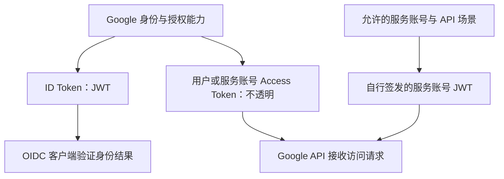

**工程推导：**接入方应依据令牌用途选择验证流程；自行签发 JWT 能否直接调用 API，需要该 API 支持，不能推广到全部 Google API。

### Firebase：会话 Cookie 的内容也可以是 JWT

Firebase 官方提供 JWT 格式的服务端 Session Cookie，可设置会话有效期，并提供额外的撤销检查。普通验签可以使用缓存公钥，开启撤销检测则增加远程检查。[G3](https://firebase.google.com/docs/auth/admin/manage-cookies)、[G4](https://firebase.google.com/docs/auth/admin/manage-sessions)

**图 3：会话机制与令牌格式是两个维度。**

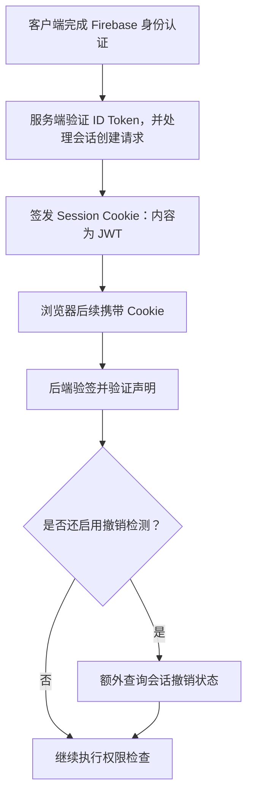

不能据此把“使用 Cookie”理解为“必定是 Redis 中的随机 Session ID”，也不能认为“使用 JWT 就一定没有会话和状态检查”。浏览器自动携带 Cookie 的架构仍需要适用的 CSRF 防护。

## 5. Microsoft：JWT 与持续访问评估配合

### 资源服务器验证，客户端遵守访问令牌契约

Microsoft identity platform 文档介绍了注册 API 使用的访问令牌版本与声明。同时特别说明：客户端应把访问令牌视为不透明字符串；发给微软自有 API 的令牌也不保证总是可解码 JWT，不能套用自建 API 的验证规则。[M1](https://learn.microsoft.com/en-us/entra/identity-platform/access-tokens)

这与“平台会签发 JWT”并不矛盾：资源服务器理解其收到的凭证，调用客户端不依赖内部格式。

### CAE：到期前也可以重新评估访问

Continuous Access Evaluation 让受支持的资源与客户端处理关键身份事件和策略变化。资源可能拒绝尚未到期的访问令牌，并用 `401` 与 claims challenge 要求客户端重新取得符合条件的凭证。[M2](https://learn.microsoft.com/en-us/entra/identity/conditional-access/concept-continuous-access-evaluation)

**图 4：持续访问评估增加事件和策略反馈。**

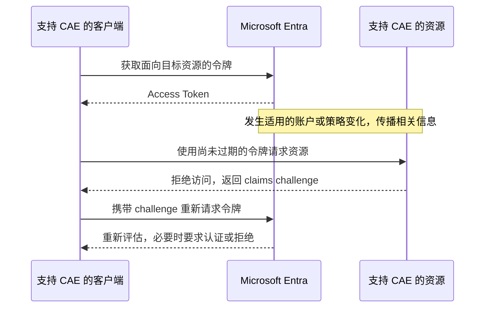

**证据边界：**CAE 有明确的资源、客户端与事件适用范围，事件传播也存在时间边界，不是给任意 JWT API 加一个开关就能获得的全局瞬时撤销。

**工程推导：**实时封禁要求验证链能够获知状态变化。选择 JWT 并不免除撤销状态同步、客户端错误处理和策略执行的设计。

## 6. AWS Cognito：JWT 加刷新、轮换与撤销

Cognito User Pools 的 Access Token 是 JWT，携带授权范围等信息；ID Token 与 Access Token 应分别验证，不应混用。官方还提供刷新令牌及可选轮换能力。[A1](https://docs.aws.amazon.com/cognito/latest/developerguide/amazon-cognito-user-pools-using-the-access-token.html)、[A2](https://docs.aws.amazon.com/cognito/latest/developerguide/amazon-cognito-user-pools-using-the-refresh-token.html)

启用刷新轮换时，新刷新令牌的有效期限于原有刷新会话的剩余时长，不是每刷新一次就无限续命。相应 API 与旧的刷新认证流程也存在兼容性约束，接入时需要按文档选择。

### 平台撤销与离线验签的差异有官方说明

Cognito 文档明确提醒：平台撤销后的令牌不能继续用于要求其令牌的 Cognito API，但仅验证签名和到期时间的通用 JWT 库仍可能把它判断为有效。[A3](https://docs.aws.amazon.com/cognito/latest/developerguide/token-revocation.html)

**图 5：相同 JWT 在两种验证链中的结果可能不同。**

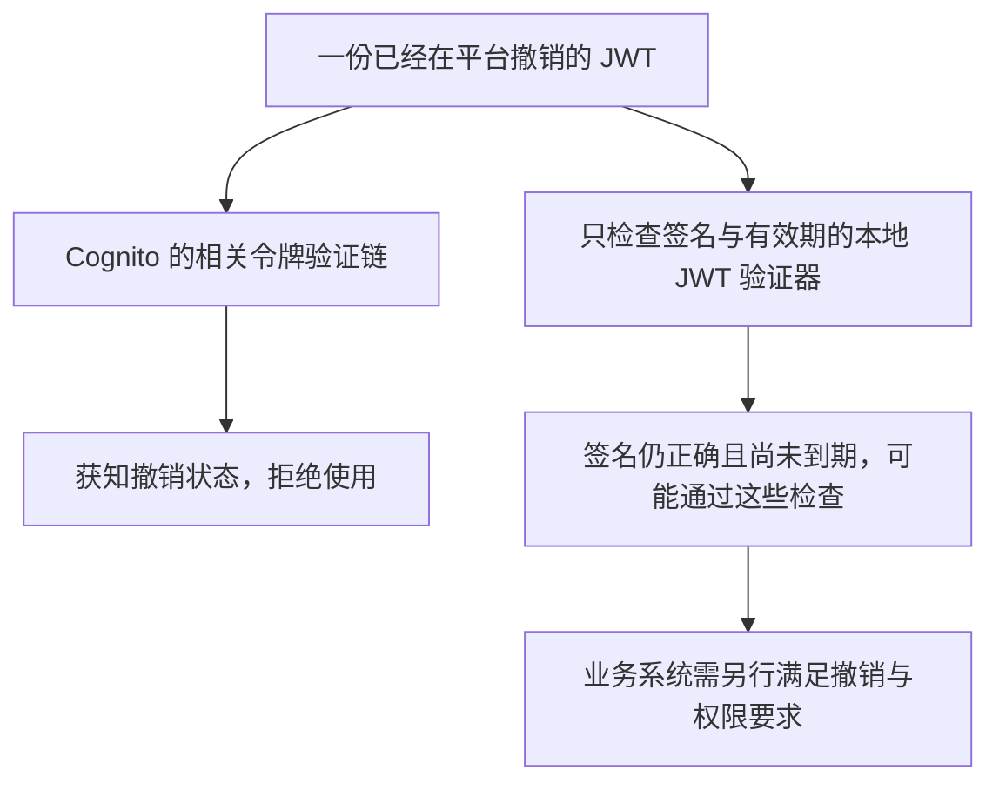

这里的“可能通过”不意味着令牌没有被平台撤销，而是另一条验证链缺少对应信息。

**工程推导：**不能只给出一个 `revoke` 接口，就声称所有业务 API 都已经支持立即退出。验收应包含实际业务服务能否感知撤销。

## 7. GitHub：应用 JWT、安装令牌与 PAT

### 两个 JWT 可以有完全不同的职责

GitHub App 先用应用私钥生成认证 JWT，再请求指定 installation 的访问令牌。后者受安装授权、仓库范围和权限约束，官方文档给出的有效期为一小时。[H1](https://docs.github.com/en/apps/creating-github-apps/authenticating-with-a-github-app/generating-a-json-web-token-jwt-for-a-github-app)、[H2](https://docs.github.com/en/apps/creating-github-apps/authenticating-with-a-github-app/generating-an-installation-access-token-for-a-github-app)

**图 6：应用身份与安装访问权限分成两层。**

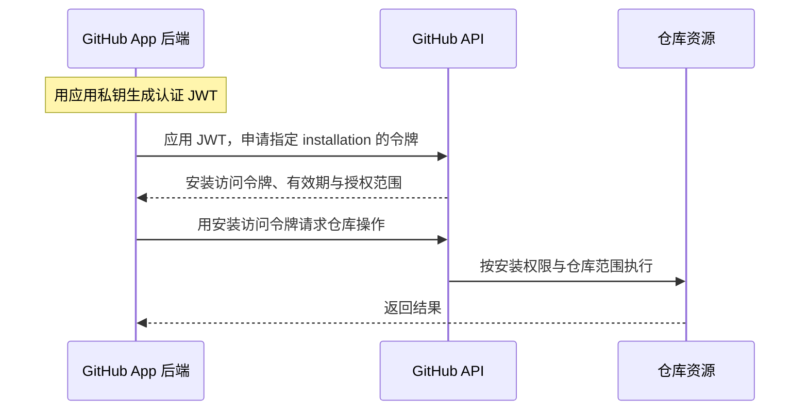

### 必须更新的 2026 年格式变化

GitHub 于 **2026-10-02** 宣布完成安装访问令牌的新格式推广：默认新签发令牌使用 `ghs_APPID_JWT` 形式，长度约 520 字符，替代过去的约 40 字符格式。权限与一小时有效期等语义没有因此改变。官方仍要求客户端把安装令牌作为不透明字符串处理。[H3](https://github.blog/changelog/2026-10-02-stateless-github-app-installation-tokens-rolled-out/)

**图 7：迁移改变表示格式，不自动改变授权语义。**

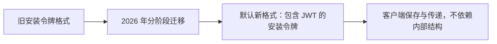

**工程推导：**定长数据库列、Token 正则、Header 长度上限和日志遮盖规则都属于迁移范围，不能只改签发接口。

### PAT 是个人访问凭证，不能替代所有应用身份

GitHub PAT 代表创建它的用户，权限受用户自身权限与 Token 授权限制。官方推荐在可行时使用 fine-grained PAT；面向组织或长期集成的场景，应评估 GitHub App，而不是把某个员工的个人凭证当作永久服务身份。[H4](https://docs.github.com/en/authentication/keeping-your-account-and-data-secure/managing-your-personal-access-tokens)

**未确认：**本次来源没有证明所有 PAT 采用与安装令牌相同的内部格式，也没有披露全部 Token 状态的存储实现。

## 8. 飞书：新版租户凭证已经采用 JWT

### 本次核对到的是新版自建应用接口

飞书官方页面更新于 **2026-10-14**，明确说明该版本的 `tenant_access_token` 采用 JWT。它使用客户端凭据授权，目标租户由自建应用确定。[F1](https://open.feishu.cn/document/uAjLw4CM/ukTMukTMukTM/authentication-management/access-token/tenant_access_token)

| 项目         | 本次核对的新版行为                                                 |
| ------------ | ------------------------------------------------------------------ |
| Token 端点   | `https://accounts.feishu.cn/oauth/v3/token`                        |
| 授权类型     | `grant_type=client_credentials`                                    |
| 返回令牌字段 | `access_token`，含义为 tenant_access_token                         |
| 有效期字段   | `expires_in`，应依响应计算                                         |
| 客户端认证   | 支持 `client_secret_basic` 或 `client_secret_post`，一次请求选一种 |
| 长度迁移     | 官方建议存储与传输链路至少预留 4 KB                                |

这些条件适用于该版本接口，不应推广成飞书所有历史 Token 的统一格式。4 KB 是这一产品文档的接入建议，也不是所有 JWT 的通用长度上限。

### 应用身份和用户身份不能互换

飞书文档以应用身份、用户身份区分 API 和事件订阅的授权边界；`tenant_access_token` 不等于“当前登录用户的全部权限”。[F2](https://open.feishu.cn/document/uAjLw4CM/ukTMukTMukTM/event-subscription-guide/event-subscriptions)

**图 8：相同业务 API 体系中可以存在不同主体。**

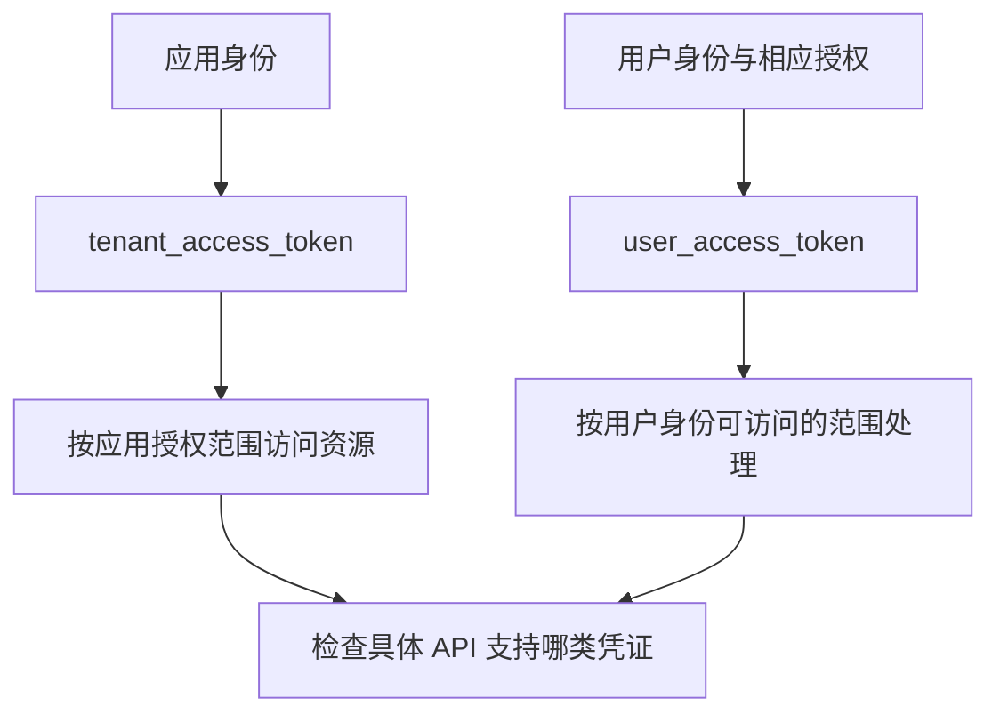

**工程推导：**缓存不能只用 `access_token` 这个字段名作全局键，要区分平台、应用、租户、主体和授权配置。多个租户或用户共享一个缓存槽位，可能造成串用凭证。

**未确认：**不能只根据新版 tenant Token 推断所有 user Token 的格式、验签接口或服务端存储拓扑。

## 9. 阿里云、腾讯云与 AWS：STS 临时凭证加请求签名

### 临时凭证通常是一组数据

| 平台           | 凭证组合                                                       | 用法与依据                                                                                                                                                                                   |
| -------------- | -------------------------------------------------------------- | -------------------------------------------------------------------------------------------------------------------------------------------------------------------------------------------- |
| AWS STS        | `AccessKeyId`、`SecretAccessKey`、`SessionToken`，另有到期信息 | 用临时凭证完成适用的 AWS 请求签名 [A4](https://docs.aws.amazon.com/STS/latest/APIReference/API_Credentials.html)、[A5](https://docs.aws.amazon.com/IAM/latest/UserGuide/reference_sigv.html) |
| 阿里云 STS     | 临时 AccessKey ID、AccessKey Secret、SecurityToken             | 在授权范围内通过 SDK 访问 OSS 等资源 [C1](https://help.aliyun.com/zh/oss/developer-reference/use-temporary-access-credentials-provided-by-sts-to-access-oss)                                 |
| 腾讯云临时密钥 | `TmpSecretId`、`TmpSecretKey`、`Token`                         | 按 COS 文档使用临时凭证计算相应签名 [T1](https://cloud.tencent.com/document/product/436/14048)                                                                                               |

令牌字段名相似，不代表三个平台采用相同协议。它们的签名算法、请求规范化、策略语法和 SDK 行为应分别按官方文档处理。

### 申请权限与使用权限分开

**图 9：三类云平台临时授权的教学抽象。**

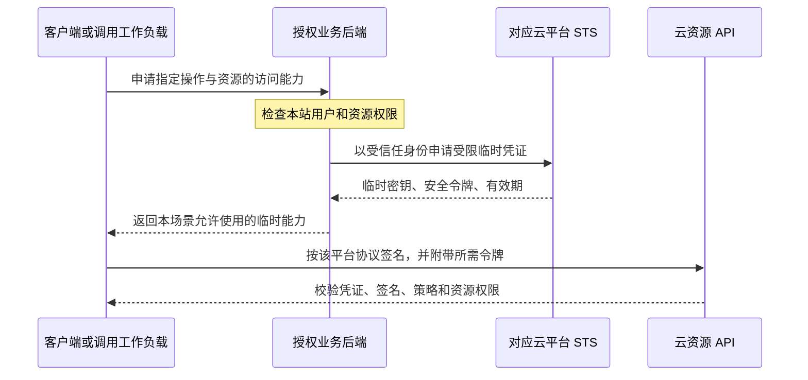

这是常见授权关系的抽象，不表示所有调用都必须经过图中的业务后端。运行在云内的工作负载也可以通过相应角色和凭证提供链取得临时身份。

### 各平台的事实边界

阿里云 OSS 文档演示通过角色和 STS 为合作方授予受限、限时上传能力，而不把长期 AccessKey 交给合作方。[C1](https://help.aliyun.com/zh/oss/developer-reference/use-temporary-access-credentials-provided-by-sts-to-access-oss)

阿里云 CLI 的 `StsToken` 配置模式使用调用方提供的临时凭证，该模式不会自动刷新。不能据此推断所有阿里云 SDK 或其他凭证提供方式都不自动刷新。[C2](https://help.aliyun.com/zh/cli/temporary-security-credentials-sts-token)

腾讯云 COS 文档要求使用临时密钥中的相应字段，并通过策略限制 action 与 resource。临时凭证不意味着可以省略最小权限设计。[T1](https://cloud.tencent.com/document/product/436/14048)

AWS SigV4 将请求内容与认证信息关联，推荐使用 SDK 或 CLI 完成签名。SDK 需要完整且未过期的临时凭证组合，仅提供 SessionToken 并不能代替整套认证。[A5](https://docs.aws.amazon.com/IAM/latest/UserGuide/reference_sigv.html)

**工程推导：**对象存储直传可以授予特定路径和操作的短期能力，避免让应用服务器转发全部文件内容。实际吞吐收益和成本需要结合文件大小与网络实测，本文没有给出厂商内部性能结论。

## 10. Slack：把长期凭证改成可轮换的短期访问能力

Slack 对适用应用提供 Token Rotation。官方文档说明，未开启轮换的相应访问令牌不自动到期；开启轮换后，访问令牌有效期为 12 小时，并通过 Refresh Token 取得后续凭证。[S1](https://docs.slack.dev/authentication/using-token-rotation/)

**图 10：轮换时必须更新两份凭证。**

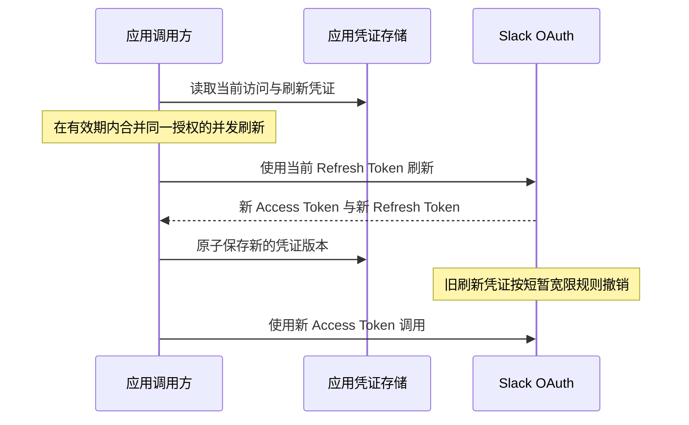

文档还说明，刷新不会立即让原 Access Token 失效，重复提前刷新会受到活跃 Token 数量规则约束。不能把“刷新成功”理解为“所有旧凭证同时立即作废”。

**工程推导：**需要管理并发刷新、持久化失败和进程重启后的恢复。只在代码里每隔一段时间调用刷新接口，没有可靠保存新 RT，仍然会中断集成。

**未确认：**该文档没有为本文提供所有 Slack 令牌内部编码的统一保证，因此不根据前缀猜测是否采用 JWT。

## 11. Uber 内部实践：按下一跳签发 JWT

这部分是**工程披露**，不同于前文产品接入规范。Uber 于 **2026-05-21** 发布的文章描述了内部 Agent 身份体系：工作负载从 SPIRE 获得 SVID，STS 验证 Agent 与工作负载关系，再为下一跳签发短期 JWT，并保留 actor chain。[U1](https://www.uber.com/us/en/blog/solving-the-agent-identity-crisis/)

**图 11：委托上下文在受控交换中逐跳传递。**

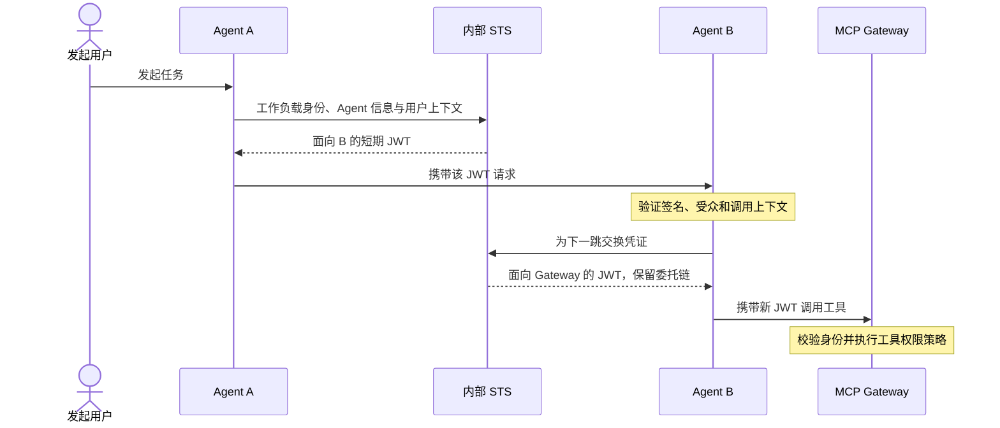

文章说明该机制借鉴 OAuth Token Exchange，并按内部需求定制；同时介绍了已实现部分与后续演进方向。**它支持“该内部场景采用逐跳 JWT”的结论，不能推广为 Uber 全部 API 的统一方案。**

**工程推导：**多跳请求应验证目标受众和委托权限，避免把一份高权限外部令牌原样透传到每个内部系统。签名的身份上下文也不等于自动批准所有工具操作。标准 Token Exchange 的委托语义可对照 [R2](https://www.rfc-editor.org/rfc/rfc8693.html)。

## 12. 横向对比：撤销、缓存与故障边界

### 选择格式前，先明确验证链知道什么

| 方案或机制                 | 正常请求依赖什么                 | 撤销与权限变化的边界                 |
| -------------------------- | -------------------------------- | ------------------------------------ |
| 随机会话凭证 + 服务端状态  | 可用的会话存储及必要缓存         | 状态更新后还要考虑缓存与节点同步     |
| JWT 本地验证               | 可信密钥、声明验证与业务权限     | 仅验签无法得知尚未同步的撤销事件     |
| 不透明令牌 + introspection | 可用的自省服务或验证缓存         | 缓存降低请求量，同时引入状态陈旧窗口 |
| JWT + 在线撤销检查         | 本地验证与撤销状态查询           | 将实时控制重新纳入验证链             |
| CAE 等事件反馈             | 支持的客户端、资源与事件传播     | 有适用范围与传播时延                 |
| 云临时凭证 + 请求签名      | 完整凭证、正确签名、平台权限策略 | 到期、策略及撤销语义按平台规定       |

这是机制层面的比较，不代表这些方案在所有场景都有相同延迟或成本。自省缓存的取舍见 [R4](https://www.rfc-editor.org/rfc/rfc7662.html#section-4)，本地验证与平台撤销的差异见 [A3](https://docs.aws.amazon.com/cognito/latest/developerguide/token-revocation.html)。

**图 12：有效访问要通过多层判断。**

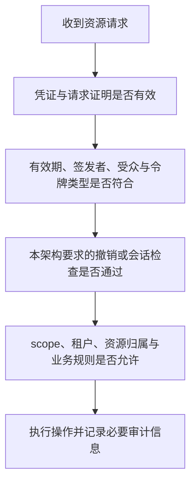

### 令牌自包含不等于权限永久正确

“签名正确、没有过期”只能证明一部分事实。用户被禁用、管理员撤回角色、资源换了租户等变化，可能需要另外的状态或策略检查。

公钥可缓存与权限可缓存也不是同一个问题。公钥缓存解决验签依赖，权限缓存决定能容忍多久的授权陈旧窗口，二者应分别设计。

### Bearer、DPoP 与请求签名继续分开

JWT 或不透明令牌都可能以 Bearer 方式使用。DPoP 在应用层增加持有绑定私钥的证明；云 API 的请求签名则属于各平台规定的认证协议。它们都不能只凭“有签名”三个字认作同一种机制。[R3](https://www.rfc-editor.org/rfc/rfc9449.html)

## 13. 怎样落到 Java 后端项目

下面是**工程推导**，用于把调研结果转化成选型问题，不是声称某家公司采用本文画出的完整架构。

### 普通网站与管理后台

如果主要服务浏览器，强调主动退出、权限管理和开发复杂度，可以从本站会话或随机令牌加服务端状态开始评估。前后端分离本身不强制使用 JWT。

接入外部 OAuth/OIDC 时，可以让后端处理上游令牌，浏览器只持有本站会话。本站会话与第三方刷新令牌分开存储和失效。

**图 13：本站会话与外部访问能力分开管理。**

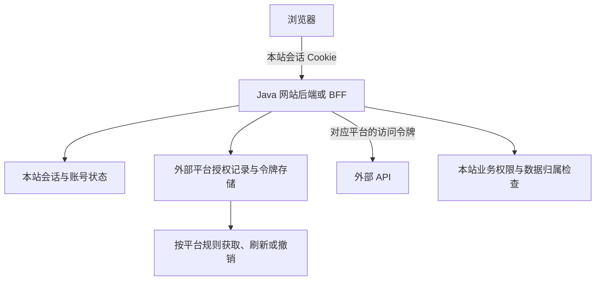

Cookie 的 `Secure`、`HttpOnly`、`SameSite` 和 CSRF 防护应根据访问方式配置。不能仅凭“JWT”“无状态”或“前后端分离”就关闭这些保护。

### 多个服务需要独立验证

当多个 API 需要验证受控签发的身份声明时，可以评估短期 JWT。设计时至少明确：

- 每种令牌的可信 issuer、audience、用途、算法与密钥来源。
- 业务服务需要实时检查哪些状态，允许多长的陈旧窗口。
- 禁用用户、撤销会话和密钥轮换后，各服务会怎样变化。
- 下游服务是否需要交换面向下一跳的凭证，而不是收到什么就转发什么。

### 对接多个开放平台

建议将平台授权记录与令牌物理值分开：

| 数据类别   | 示例                                     | 作用                     |
| ---------- | ---------------------------------------- | ------------------------ |
| 授权归属   | provider、client、tenant、subject、grant | 防止不同租户与主体串用   |
| 生命周期   | expiresAt、refreshVersion、revokedAt     | 协调刷新、撤销和并发更新 |
| 秘密材料   | 访问与刷新令牌、必要客户端凭据           | 受控保存、避免明文日志   |
| 可观测信息 | 脱敏指纹、最近错误码、更新时间           | 排障而不泄露完整秘密     |

这些字段是教学设计示例，不是统一规范。可以按项目需要裁剪；不要把上游令牌的内部 Payload 当作长期稳定的数据模型。

### 用业务约束选择，而不是按公司名抄格式

**图 14：先选控制目标，再评估表示格式。**

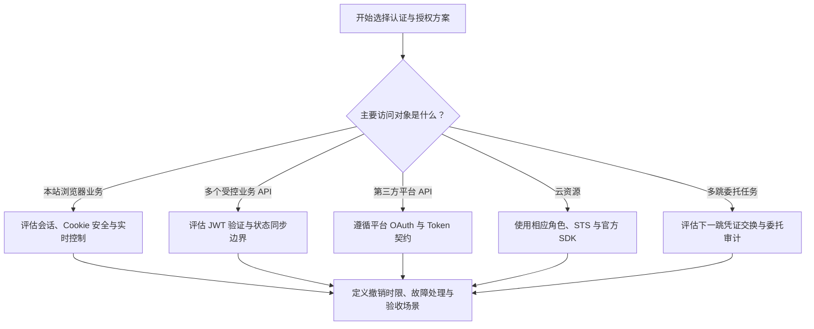

Spring Security 的 Client、Login、Resource Server 对应不同协议职责，可结合站内 [OAuth2 授权流程教程](OAuth2授权流程与PKCE详解.md#spring-security) 阅读。这里没有提供已经与各厂商联调完成的代码。

## 14. 迁移与验证时需要检查什么

GitHub 与飞书的新版凭证说明，令牌格式变化会影响一整条链路。以下是基于公开变更与生命周期机制整理的验收项目。

| 检查项       | 应验证的行为                                      |
| ------------ | ------------------------------------------------- |
| 存储长度     | 数据库、缓存、序列化和密钥存储能完整保存新凭证    |
| 传输长度     | 代理、网关与服务 Header 限制不会截断凭证          |
| 客户端假设   | 不依赖固定字符数、旧前缀或未经承诺的 Payload      |
| 返回字段     | 正确读取新接口的 access_token、expires_in 等字段  |
| Token 混用   | Access Token、ID Token、应用认证 JWT 与 RT 不串用 |
| 并发刷新     | 多个请求和多实例不会把旧 RT 反复覆盖回存储        |
| 退出与封禁   | 实际业务 API 在要求的时限内感知状态变化           |
| 密钥轮换     | 受信任的新 kid 能更新，未知密钥不会无条件放行     |
| 验证服务故障 | 按业务风险确定拒绝、缓存与重试边界                |
| 日志与告警   | 不输出完整凭证，遮盖规则覆盖新格式                |

对有副作用的业务请求，刷新成功后是否重试还要考虑幂等性。不能把“401 后刷新并自动重发”无条件套到付款、下单等操作。

本文只验证文档内容、示例结构和站点呈现；没有创建这些平台的真实应用，也没有执行凭证签发、撤销或跨云性能测试。

## 15. 常见误区与复述模板

| 常见说法                           | 更准确的表达                                                             |
| ---------------------------------- | ------------------------------------------------------------------------ |
| 大厂都用 JWT                       | 已确认多个产品采用 JWT，也有不透明访问令牌和云临时凭证；全公司占比未确认 |
| JWT 就一定不查状态                 | 是否查询撤销、会话与业务权限是另一个设计维度                             |
| Session 与 JWT 二选一              | Firebase 提供 JWT 格式的 Session Cookie                                  |
| 客户端能解码就应该读 Payload       | 访问令牌的客户端契约可能要求不依赖内部格式                               |
| Token 格式变了，只改解析器即可     | 还要检查存储、Header、正则、日志与响应字段                               |
| 撤销 RT 后所有 API 立刻拒绝旧 AT   | 要检查平台撤销语义与资源服务器如何感知                                   |
| STS 返回一个 Token，放 Bearer 就行 | 云临时凭证通常是一组字段，要遵循对应签名协议                             |
| 签名正确就能操作任意资源           | 还需要检查受众、范围、租户和资源归属                                     |

可用于面试或方案讨论的复述：

> 公开资料中，大厂通常按具体场景组合身份与访问凭证。Google 区分不透明 Access Token 与 JWT ID Token；GitHub 和飞书都有新的 JWT 凭证格式，但客户端仍要遵守产品契约。Cognito 与 Microsoft 的案例表明，JWT 验签之外还要设计撤销和策略变化处理。云资源场景常使用 STS 临时凭证与请求签名，多跳委托还需要目标受众与调用链归属。因此选型重点是凭证用途、验证边界、撤销时限和运维成本，而不是只比较字符串是不是 JWT。

这段话概括的是本文可追溯样本，不应省略其产品和场景限定。

## 16. 官方来源索引

全部来源均在 2026-10-24 核对。未注明发布日期的条目以读取时的官方页面为准；实时文档后续可能变更。F1 为动态文档，本次通过浏览器读取正文确认版本、端点、JWT 说明与响应字段。

| 编号 | 官方来源                                                                                                                                                                  | 证据覆盖                                             |
| ---- | ------------------------------------------------------------------------------------------------------------------------------------------------------------------------- | ---------------------------------------------------- |
| G1   | [Google Cloud Token types](https://docs.cloud.google.com/docs/authentication/token-types)                                                                                 | 各类令牌的用途、格式与区别                           |
| G2   | [Google OpenID Connect](https://developers.google.com/identity/openid-connect/openid-connect)                                                                             | Google 身份登录与 ID Token 验证                      |
| G3   | [Firebase Manage Session Cookies](https://firebase.google.com/docs/auth/admin/manage-cookies)                                                                             | JWT 会话 Cookie、验证和撤销检查                      |
| G4   | [Firebase Manage User Sessions](https://firebase.google.com/docs/auth/admin/manage-sessions)                                                                              | 用户会话与撤销检测                                   |
| M1   | [Microsoft identity platform Access tokens](https://learn.microsoft.com/en-us/entra/identity-platform/access-tokens)                                                      | 访问令牌契约、格式与验证责任                         |
| M2   | [Microsoft Entra Continuous Access Evaluation](https://learn.microsoft.com/en-us/entra/identity/conditional-access/concept-continuous-access-evaluation)                  | 支持范围、事件与 claims challenge                    |
| A1   | [Cognito Understanding the access token](https://docs.aws.amazon.com/cognito/latest/developerguide/amazon-cognito-user-pools-using-the-access-token.html)                 | JWT Access Token 与分别验证                          |
| A2   | [Cognito Refresh tokens](https://docs.aws.amazon.com/cognito/latest/developerguide/amazon-cognito-user-pools-using-the-refresh-token.html)                                | 刷新、轮换、剩余有效期与兼容约束                     |
| A3   | [Cognito Ending user sessions with token revocation](https://docs.aws.amazon.com/cognito/latest/developerguide/token-revocation.html)                                     | 平台撤销与通用 JWT 验证的差别                        |
| A4   | [AWS STS Credentials](https://docs.aws.amazon.com/STS/latest/APIReference/API_Credentials.html)                                                                           | 临时凭证的组成字段                                   |
| A5   | [AWS Signature Version 4](https://docs.aws.amazon.com/IAM/latest/UserGuide/reference_sigv.html)                                                                           | 云 API 请求签名与 SDK 使用                           |
| H1   | [GitHub App 认证 JWT](https://docs.github.com/en/apps/creating-github-apps/authenticating-with-a-github-app/generating-a-json-web-token-jwt-for-a-github-app)             | 应用私钥、认证 JWT 与用途                            |
| H2   | [GitHub App 安装访问令牌](https://docs.github.com/en/apps/creating-github-apps/authenticating-with-a-github-app/generating-an-installation-access-token-for-a-github-app) | 安装范围、权限与一小时有效期                         |
| H3   | [GitHub 安装令牌新格式推广完成](https://github.blog/changelog/2026-10-02-stateless-github-app-installation-tokens-rolled-out/)                                            | 2026-10-02 公告：新格式、长度与兼容要求              |
| H4   | [GitHub Managing personal access tokens](https://docs.github.com/en/authentication/keeping-your-account-and-data-secure/managing-your-personal-access-tokens)             | 个人身份、细粒度权限与 GitHub App 区别               |
| F1   | [飞书自建应用获取 tenant_access_token](https://open.feishu.cn/document/uAjLw4CM/ukTMukTMukTM/authentication-management/access-token/tenant_access_token)                  | 2026-10-14 更新：JWT、新端点与字段                   |
| F2   | [飞书事件订阅概述](https://open.feishu.cn/document/uAjLw4CM/ukTMukTMukTM/event-subscription-guide/event-subscriptions)                                                    | 应用身份与用户身份的资源范围                         |
| C1   | [阿里云使用 STS 临时访问凭证访问 OSS](https://help.aliyun.com/zh/oss/developer-reference/use-temporary-access-credentials-provided-by-sts-to-access-oss)                  | 临时凭证、角色与受限资源访问                         |
| C2   | [阿里云 CLI 临时安全凭证 StsToken](https://help.aliyun.com/zh/cli/temporary-security-credentials-sts-token)                                                               | 特定 CLI 模式的凭证配置与刷新边界                    |
| T1   | [腾讯云 COS 临时密钥生成及使用指引](https://cloud.tencent.com/document/product/436/14048)                                                                                 | 临时凭证字段、签名与权限策略                         |
| S1   | [Slack Using token rotation](https://docs.slack.dev/authentication/using-token-rotation/)                                                                                 | 开启轮换后的有效期、RT 更新与旧凭证规则              |
| U1   | [Uber Solving the Identity Crisis for AI Agents](https://www.uber.com/us/en/blog/solving-the-agent-identity-crisis/)                                                      | 2026-05-21 工程披露：工作负载身份、逐跳 JWT 与委托链 |
| R1   | [RFC 9700 OAuth 2.0 Security BCP](https://www.rfc-editor.org/rfc/rfc9700.html)                                                                                            | OAuth 访问与刷新令牌的安全边界                       |
| R2   | [RFC 8693 OAuth 2.0 Token Exchange](https://www.rfc-editor.org/rfc/rfc8693.html)                                                                                          | 标准令牌交换与委托语义                               |
| R3   | [RFC 9449 DPoP](https://www.rfc-editor.org/rfc/rfc9449.html)                                                                                                              | 应用层发送者约束与持有证明                           |
| R4   | [RFC 7662 Token Introspection](https://www.rfc-editor.org/rfc/rfc7662.html)                                                                                               | 自省接口与状态缓存的时效权衡                         |

相关学习入口：

- [OAuth2 授权流程与 PKCE 详解](OAuth2授权流程与PKCE详解.md)：授权码、PKCE、刷新与 OIDC 主流程。
- [JWT 与 JJWT](../../../开发常用工具/JWT与JJWT.md)：JWT 声明、密钥与 Java 验证基础。
- [Spring Security 概述](SpringSecurity概述.md)：认证、授权与框架职责。
