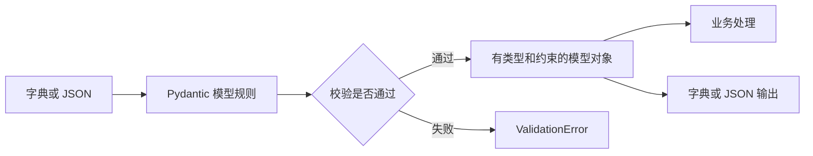

# Pydantic 从入门到实战：数据校验、模型与 FastAPI

Pydantic 是 Python 的第三方数据校验库。它读取类型注解，把字典、JSON 等外部输入校验、转换为有明确结构的 Python 对象，并支持序列化和生成 JSON Schema。

例如，接口收到 `{"quantity": "2"}`，业务代码需要的是整数 `2`。Pydantic 可以完成转换；遇到 `"两件"` 这样的输入，则返回结构化的校验错误。

> 适用环境：Python 3.10+、Pydantic v2。别名配置示例使用 v2.11+ 的 `validate_by_name`。正文采用 v2 API，不混用旧版的 `validator`、`parse_obj()` 和 `.dict()`。核心模型可以独立运行，不必先学习 FastAPI。

示例核验环境：Python 3.12.13、Pydantic 2.14.1、FastAPI 0.144.0、pydantic-settings 2.16.0。安装命令保留主版本范围，项目中可根据实际验证结果锁定具体版本。

前置知识：[函数、类型注解与面向对象](./03-函数与面向对象.md)。相关章节：[常用第三方库](./06-常用第三方库.md)、[FastAPI 后端开发](./08-FastAPI后端开发.md)。

## 目录

- [1. Pydantic 解决什么问题](#1-pydantic-解决什么问题)
- [2. 安装与运行环境](#2-安装与运行环境)
- [3. 第一个模型](#3-第一个模型)
- [4. 字段类型、默认值与约束](#4-字段类型默认值与约束)
- [5. 读取校验错误](#5-读取校验错误)
- [6. 嵌套模型与批量数据](#6-嵌套模型与批量数据)
- [7. 类型转换、严格模式与额外字段](#7-类型转换严格模式与额外字段)
- [8. 编写自定义校验器](#8-编写自定义校验器)
- [9. 序列化与字段别名](#9-序列化与字段别名)
- [10. 部分更新与字段是否传入](#10-部分更新与字段是否传入)
- [11. FastAPI 完整示例](#11-fastapi-完整示例)
- [12. 从对象读取数据与加载配置](#12-从对象读取数据与加载配置)
- [13. 常见误区与版本迁移](#13-常见误区与版本迁移)
- [14. 练习与验收](#14-练习与验收)
- [15. 官方资料](#15-官方资料)

------

## 1. Pydantic 解决什么问题

### 1.1 类型注解本身不会检查运行时数据

普通 Python 函数可以声明类型：

```python
def double_quantity(quantity: int) -> int:
    return quantity * 2


print(double_quantity("2"))  # 运行时得到字符串 "22"
```

编辑器或静态类型检查器可以指出调用不符合注解，但 Python 解释器不会仅因 `quantity: int` 就阻止字符串进入函数。标准库的普通 `dataclass`、`TypedDict` 也不会自动提供 Pydantic 这样的运行时字段校验。

外部数据还可能出现字段缺失、金额为负、未知字段、嵌套结构错误等情况。逐个手写 `if`、转换和错误信息会分散规则，Pydantic 用模型集中声明这些规则。

### 1.2 数据经过模型后发生了什么



核心步骤是：声明数据结构 → 输入数据 → 执行校验和允许的转换 → 使用模型对象。

默认模式允许部分转换，因此“校验通过”不等于“原始输入的类型完全正确”。保证的范围是声明的字段规则，数据库记录是否存在、用户是否有操作权限仍需要业务代码处理。[官方模型说明](https://docs.pydantic.dev/latest/concepts/models/)

### 1.3 与 Java 后端概念对照

| 熟悉的 Java 概念 | Pydantic 中的对应思路 |
| --- | --- |
| 请求 DTO、响应 VO | 用不同的 `BaseModel` 子类表达输入和输出 |
| Bean Validation 的字段约束 | 类型注解、`Field` 和校验器 |
| Jackson 的对象与 JSON 转换 | `model_validate_json()`、`model_dump_json()` 等 |
| 字段命名映射 | `alias`、`validation_alias`、`serialization_alias` |
| 配置对象绑定 | 独立包 `pydantic-settings` |

这是职责上的类比，两套框架的转换规则和生命周期并不相同。Pydantic 的 `BaseModel` 表达数据结构；数据库表映射、SQL 和事务由 SQLAlchemy 等 ORM 或数据库驱动负责。

------

## 2. 安装与运行环境

Windows PowerShell 中，在练习目录执行：

```powershell
py -3 --version
py -3 -m venv .venv
.\.venv\Scripts\python.exe -m pip install "pydantic>=2.11,<3"
.\.venv\Scripts\python.exe -c "import pydantic; print(pydantic.__version__)"
```

确认解释器至少为 Python 3.10，版本输出以 `2.` 开头。直接调用虚拟环境中的解释器，可以避免激活脚本被 PowerShell 执行策略拦截，也能明确依赖安装在哪个环境。

macOS / Linux 可使用 `python3 -m venv .venv`，随后把命令中的解释器路径换为 `.venv/bin/python`。

将下一节代码保存为 `demo.py`，执行：

```powershell
.\.venv\Scripts\python.exe demo.py
```

不要把脚本命名为 `pydantic.py`，否则它可能遮蔽第三方包。不同小节的示例默认分别保存、独立运行；标注“接着上一段”时才依赖上一段代码。实际项目应通过依赖文件或锁文件记录已验证的版本。[官方安装说明](https://docs.pydantic.dev/latest/install/)

------

## 3. 第一个模型

```python
from pydantic import BaseModel, Field


class Product(BaseModel):
    name: str
    quantity: int = Field(gt=0)
    enabled: bool = True


raw = {"name": "键盘", "quantity": "2"}
product = Product.model_validate(raw)

print(product.name)              # 键盘
print(product.quantity)          # 2
print(type(product.quantity))    # <class 'int'>
print(product.enabled)           # True
print(product.model_dump())
# {'name': '键盘', 'quantity': 2, 'enabled': True}
```

逐行理解：

1. `class Product(BaseModel)`：继承 Pydantic 的模型基类，获得校验和序列化能力。
2. `name: str`：声明必填字符串字段。
3. `quantity: int = Field(gt=0)`：声明必填整数，且必须大于零。
4. `enabled: bool = True`：没有传入时，使用默认值 `True`。
5. `model_validate(raw)`：读取输入并创建 `Product` 实例。
6. `model_dump()`：将模型转为字典。

也可以使用关键字参数构造：`Product(name="键盘", quantity=2)`。手上已经有字典时，`model_validate()` 能直接表达“验证这份输入”的意图。

JSON 字符串使用 `Product.model_validate_json('{"name":"键盘","quantity":2}')`。字典与 JSON 字符串是不同的数据形式，选择对应入口即可。[模型校验入口](https://docs.pydantic.dev/latest/concepts/models/#validating-data)

------

## 4. 字段类型、默认值与约束

### 4.1 常见类型

| 声明 | 表达的结构 |
| --- | --- |
| `str`、`int`、`bool` | 文本、整数、布尔值 |
| `list[str]` | 字符串列表，校验列表中的元素 |
| `dict[str, int]` | 字符串键、整数值的字典 |
| `datetime`、`date` | 时间、日期，可按规则解析字符串 |
| `Decimal` | 十进制数，适合需要十进制语义的数值 |
| `Literal["draft", "published"]` | 只允许列出的字面值 |
| `EmailStr` | 邮箱格式校验，需要可选依赖 |
| 另一个 `BaseModel` 子类 | 嵌套结构 |

使用 `EmailStr` 前执行 `python -m pip install "pydantic[email]>=2.11,<3"`，其中 `python` 应指向练习虚拟环境。邮箱格式通过不代表邮箱存在或归用户所有。

### 4.2 允许 None 与允许省略是两件事

在 Pydantic v2 中：

| 声明 | 可以省略 | 可以传 `None` |
| --- | --- | --- |
| `name: str` | 否 | 否 |
| `name: str = "匿名"` | 是 | 否 |
| `name: str \| None` | 否 | 是 |
| `name: str \| None = None` | 是 | 是 |

`str | None` 扩大允许的值范围；`= None` 提供缺省值。`Optional[str]` 与 `str | None` 含义相同，不会自动提供默认值。[字段默认值说明](https://docs.pydantic.dev/latest/concepts/fields/#default-values)

### 4.3 用 Field 声明规则

```python
from decimal import Decimal
from typing import Literal

from pydantic import BaseModel, Field


class ProductCreate(BaseModel):
    name: str = Field(min_length=1, max_length=80)
    price: Decimal = Field(gt=0, max_digits=10, decimal_places=2)
    quantity: int = Field(ge=1, le=99)
    status: Literal["draft", "published"] = "draft"
    tags: list[str] = Field(default_factory=list, max_length=5)


product = ProductCreate(name="鼠标", price="89.90", quantity=2)
print(product.price)  # 89.90
print(product.tags)   # []
```

`gt/ge/lt/le` 分别表示大于、大于等于、小于、小于等于。`min_length/max_length` 可以限制字符串长度或集合元素数量。

`decimal_places=2` 限制小数精度，**不会自动把所有金额四舍五入为两位小数**。金额计算仍要明确币种、舍入和数据库精度规则，输入十进制金额时可采用十进制字符串。

`default_factory=list` 表示每次创建模型时生成一个新列表。Pydantic 会对某些可变默认值进行复制，不应直接照搬“所有默认列表都会共享”的结论；工厂写法能更清楚地表达意图。

默认值通常不会自动再次校验。需要检查默认值时，在字段上设置 `Field(default=..., validate_default=True)`，或在模型配置中启用 `validate_default`。[字段约束与默认值校验](https://docs.pydantic.dev/latest/concepts/fields/)

------

## 5. 读取校验错误

```python
from pydantic import BaseModel, Field, ValidationError


class Purchase(BaseModel):
    quantity: int = Field(gt=0)


try:
    Purchase.model_validate({"quantity": 0})
except ValidationError as exc:
    for error in exc.errors():
        print(error["loc"], error["type"], error["msg"])
        # ('quantity',) greater_than Input should be greater than 0
```

主要看三个字段：

- `loc`：错误位置；嵌套数据中可能是 `('items', 0, 'quantity')`。
- `type`：错误代码，例如 `missing`、`int_parsing`、`greater_than`。
- `msg`：便于阅读的错误说明，完整措辞可能随版本变化。

普通脚本调用模型，失败时抛出 `ValidationError`。FastAPI 会处理请求参数校验失败，并在默认行为下返回 HTTP 422。这个 HTTP 状态码由 Web 框架的请求处理决定。

对外展示错误时，可以按位置和错误代码组织中文提示。错误详情可能包含原始输入，记录日志或返回给客户端前，应按数据内容处理密码等敏感字段。[错误结构说明](https://docs.pydantic.dev/latest/errors/errors/)

------

## 6. 嵌套模型与批量数据

### 6.1 嵌套的订单输入

```python
from pydantic import BaseModel, Field, ValidationError


class OrderItem(BaseModel):
    product_id: int = Field(gt=0)
    quantity: int = Field(gt=0)


class OrderCreate(BaseModel):
    buyer_id: int = Field(gt=0)
    items: list[OrderItem] = Field(min_length=1)


order = OrderCreate.model_validate({
    "buyer_id": "8",
    "items": [{"product_id": "101", "quantity": "2"}],
})

print(type(order.items[0]).__name__)  # OrderItem
print(order.items[0].quantity)       # 2
print(order.model_dump())            # 嵌套模型也会递归转为字典

try:
    OrderCreate.model_validate({
        "buyer_id": 8,
        "items": [{"product_id": 101, "quantity": 0}],
    })
except ValidationError as exc:
    print(exc.errors()[0]["loc"])  # ('items', 0, 'quantity')
```

输入里的字典会转换成 `OrderItem` 实例，列表中每一项都按同一规则校验。[嵌套模型说明](https://docs.pydantic.dev/latest/concepts/models/#nested-models)

### 6.2 用 TypeAdapter 校验列表

接着上一段，如果数据最外层就是列表，不必专门创建只包一层 `items` 的模型：

```python
from pydantic import TypeAdapter

adapter = TypeAdapter(list[OrderItem])
items = adapter.validate_python([{"product_id": "101", "quantity": 2}])
print(items[0].product_id)  # 101
```

`TypeAdapter` 为 `list[OrderItem]` 等类型提供校验、序列化和 JSON Schema 能力，适合批量数据或没有固定对象外壳的输入。[TypeAdapter 官方说明](https://docs.pydantic.dev/latest/concepts/type_adapter/)

------

## 7. 类型转换、严格模式与额外字段

### 7.1 默认转换有明确规则

默认模式下，数字字符串可以转换为整数，日期字符串可以解析为日期；并不是任意类型都能相互转换。例如 v2 默认不会因为字段标成 `str` 就把所有数字转换为字符串。

需要明确输入契约时，按接口要求选择严格程度，具体转换以[官方转换表](https://docs.pydantic.dev/latest/concepts/conversion_table/)为准。

```python
from pydantic import BaseModel, ConfigDict, Field, ValidationError


class StrictPurchase(BaseModel):
    model_config = ConfigDict(strict=True, extra="forbid")

    quantity: int = Field(gt=0)


for data in [{"quantity": "2"}, {"quantity": 2, "debug": True}]:
    try:
        StrictPurchase.model_validate(data)
    except ValidationError as exc:
        print(exc.errors()[0]["type"])
        # 依次输出 int_type、extra_forbidden
```

可以用 `Field(strict=True)` 仅限制某个字段，也可以在一次调用中传入 `model_validate(data, strict=True)`。

严格模式的规则与输入形式有关：JSON 没有原生日期类型，严格 JSON 校验仍可能接受日期字符串，不能把严格模式概括为“完全禁止一切转换”。[严格模式说明](https://docs.pydantic.dev/latest/concepts/strict_mode/)

### 7.2 多余字段如何处理

| `ConfigDict(extra=...)` | 行为 |
| --- | --- |
| `"ignore"` | 默认行为，忽略未声明的字段 |
| `"forbid"` | 拒绝未声明的字段 |
| `"allow"` | 保留额外字段；其值默认不按额外类型规则校验 |

例如客户端拼错 `quantity` 时，`extra="forbid"` 能明确指出未知字段。兼容上游新增字段的消费场景，则可能更适合忽略策略，需要结合业务契约选择。

配置以当前模型为边界。外层模型的 `extra="forbid"` 不会自动改写一个独立定义的嵌套模型配置；需要统一策略时，可让相关模型继承公共基类。[额外数据规则](https://docs.pydantic.dev/latest/concepts/models/#extra-data)

------

## 8. 编写自定义校验器

### 8.1 field_validator 检查单个字段

内置约束无法完整表达规则时，再写自定义校验器：

```python
from pydantic import BaseModel, field_validator


class AccountCreate(BaseModel):
    username: str

    @field_validator("username", mode="after")
    @classmethod
    def normalize_username(cls, value: str) -> str:
        value = value.strip()
        if not 3 <= len(value) <= 20:
            raise ValueError("用户名去除首尾空白后应为 3 到 20 个字符")
        return value


account = AccountCreate(username="  reader_01  ")
print(account.username)  # reader_01
```

`mode="after"` 在字段自身的类型校验之后执行，这里拿到的是字符串；`mode="before"` 接触原始输入，需要自行考虑输入可能是任意类型。

校验器成功时必须返回值，失败时可抛出 `ValueError`。不要把它当成只返回 `True/False` 的判断函数。v2 中校验器里的 `TypeError` 不会自动包装为 `ValidationError`。

顺序也会影响结果：字段本身的 `Field(min_length=...)` 会先于这个 `after` 校验器运行。因此本例把“去空白后的长度”放在同一个校验器里检查。[字段校验器说明](https://docs.pydantic.dev/latest/concepts/validators/)

### 8.2 model_validator 检查字段之间的关系

```python
from datetime import date

from pydantic import BaseModel, model_validator
from typing_extensions import Self


class Booking(BaseModel):
    start_date: date
    end_date: date

    @model_validator(mode="after")
    def check_period(self) -> Self:
        if self.end_date <= self.start_date:
            raise ValueError("结束日期必须晚于开始日期")
        return self


booking = Booking(start_date="2026-11-01", end_date="2026-11-03")
print(booking.end_date > booking.start_date)  # True
```

`after` 模型校验器使用实例方法，在模型字段校验通过后检查整体关系，并返回 `self`。`typing_extensions.Self` 用于兼容 Python 3.10；Python 3.11+ 也可从 `typing` 导入 `Self`。

数据库查询、库存扣减、唯一性校验和远程调用应放在业务层，并配合事务或数据库约束处理并发。模型校验器适合表达数据自身的规则。[模型校验器说明](https://docs.pydantic.dev/latest/concepts/validators/#model-validators)

------

## 9. 序列化与字段别名

### 9.1 字典与 JSON 的区别

```python
from datetime import date
from decimal import Decimal

from pydantic import BaseModel


class Invoice(BaseModel):
    amount: Decimal
    issued_on: date


invoice = Invoice(amount="19.90", issued_on="2026-11-01")
print(invoice.model_dump())
# {'amount': Decimal('19.90'), 'issued_on': datetime.date(2026, 11, 1)}
print(invoice.model_dump(mode="json"))
# {'amount': '19.90', 'issued_on': '2026-11-01'}
print(invoice.model_dump_json())
# {"amount":"19.90","issued_on":"2026-11-01"}
```

| 方法 | 返回结果 |
| --- | --- |
| `model_dump()` | Python 字典，可保留 `date`、`Decimal` 等对象 |
| `model_dump(mode="json")` | 使用 JSON 兼容值的 Python 字典 |
| `model_dump_json()` | JSON 字符串 |

接着上一段，`Invoice.model_validate_json(invoice.model_dump_json())` 可以读取模型输出的 JSON。`model_json_schema()` 则生成描述字段、必填项和约束的 JSON Schema，返回的是规则说明，不是实例数据。[序列化说明](https://docs.pydantic.dev/latest/concepts/serialization/)、[JSON Schema 说明](https://docs.pydantic.dev/latest/concepts/json_schema/)

### 9.2 外部 camelCase，内部 snake_case

```python
from pydantic import BaseModel, ConfigDict, Field


class UserView(BaseModel):
    model_config = ConfigDict(validate_by_name=True, validate_by_alias=True)

    user_id: int = Field(alias="userId")


user = UserView.model_validate({"userId": 7})
print(user.user_id)                         # 7
print(user.model_dump())                    # {'user_id': 7}
print(user.model_dump(by_alias=True))       # {'userId': 7}
print(UserView(user_id=8).user_id)           # 8
```

这里的 `validate_by_name` 配置需要 Pydantic v2.11+。同时启用字段名和别名，允许两种输入名称；输出是否使用别名通过 `by_alias=True` 明确指定。

`alias` 同时提供输入和输出别名；只修改输入名用 `validation_alias`，只修改输出名用 `serialization_alias`。模型属性仍通过 Python 字段名访问。[别名说明](https://docs.pydantic.dev/latest/concepts/alias/)

------

## 10. 部分更新与字段是否传入

PATCH 场景常需要区分“不修改备注”和“清空备注”：

```python
from pydantic import BaseModel


class NotePatch(BaseModel):
    remark: str | None = None


omitted = NotePatch.model_validate({})
cleared = NotePatch.model_validate({"remark": None})

print(omitted.remark, cleared.remark)            # None None
print(omitted.model_fields_set)                 # set()
print(cleared.model_fields_set)                 # {'remark'}
print(omitted.model_dump(exclude_unset=True))    # {}
print(cleared.model_dump(exclude_unset=True))    # {'remark': None}
print(cleared.model_dump(exclude_none=True))     # {}
```

两个模型的属性值都是 `None`，但是否传入字段的记录不同：

- `exclude_unset=True`：排除未显式设置的字段，保留显式传入的 `None`。
- `exclude_none=True`：排除所有值为 `None` 的字段，会丢失“清空字段”的意图。

是否允许清空，应由字段契约决定。创建请求和更新请求通常使用不同模型，不能把“所有字段都加 `None`”当作完整的更新规则。

`model_copy(update=...)` 的更新数据不会自动重新校验。需要重新检查合并结果时，可先合并旧模型的 `model_dump()` 和更新字典，再交给目标模型的 `model_validate()`。[序列化排除规则](https://docs.pydantic.dev/latest/concepts/serialization/#excluding-and-including-fields-based-on-their-value)

------

## 11. FastAPI 完整示例

### 11.1 请求模型、业务处理与响应模型

安装依赖：

```powershell
.\.venv\Scripts\python.exe -m pip install "fastapi[standard]" "pydantic>=2.11,<3"
```

保存为 `main.py`：

```python
from typing import Literal

from fastapi import FastAPI
from pydantic import BaseModel, ConfigDict, Field, field_validator

app = FastAPI(title="Pydantic 入门示例")


class TaskCreate(BaseModel):
    model_config = ConfigDict(extra="forbid")

    title: str = Field(max_length=80)
    priority: Literal["low", "normal", "high"] = "normal"

    @field_validator("title", mode="after")
    @classmethod
    def normalize_title(cls, value: str) -> str:
        value = value.strip()
        if not value:
            raise ValueError("任务标题不能为空")
        return value


class TaskRead(BaseModel):
    id: int
    title: str
    priority: Literal["low", "normal", "high"]
    completed: bool


@app.post("/tasks", response_model=TaskRead, status_code=201)
def create_task(data: TaskCreate):
    # 演示数据流：固定 ID，没有写数据库，重启后也没有持久记录。
    return {
        "id": 1,
        **data.model_dump(),
        "completed": False,
        "internal_source": "tutorial",
    }
```

这个示例有三个边界：

1. `TaskCreate` 决定客户端能提交什么，未声明 `completed`，客户端不能自行设置任务完成状态。
2. 路由函数接收已经校验的模型对象，业务代码通过 `data.title` 访问字段。
3. `TaskRead` 决定响应结构，`internal_source` 不在响应模型中，因此不会返回给客户端。

正式业务仍需鉴权、持久化和数据库约束。响应模型约束输出字段，并不代替权限校验。[FastAPI 请求体](https://fastapi.tiangolo.com/tutorial/body/)、[FastAPI 响应模型](https://fastapi.tiangolo.com/tutorial/response-model/)

### 11.2 启动与请求

```powershell
.\.venv\Scripts\python.exe -m uvicorn main:app --reload
```

在浏览器打开 [Swagger UI](http://127.0.0.1:8000/docs)，或新开 PowerShell 窗口发出请求：

```powershell
$payload = @{ title = '  学习 Pydantic  '; priority = 'high' } | ConvertTo-Json
Invoke-RestMethod -Method Post -Uri 'http://127.0.0.1:8000/tasks' -ContentType 'application/json; charset=utf-8' -Body ([System.Text.Encoding]::UTF8.GetBytes($payload))
```

编码转换显式采用 UTF-8，便于在不同 PowerShell 版本中发送中文。等价的响应 JSON 为：

```json
{
  "id": 1,
  "title": "学习 Pydantic",
  "priority": "high",
  "completed": false
}
```

在 Swagger UI 中分别提交以下请求，观察默认 HTTP 422 和 `detail` 中的错误位置：

```json
{"title": "   "}
```

```json
{"title": "学习 Pydantic", "priority": "urgent"}
```

```json
{"title": "学习 Pydantic", "completed": true}
```

三次失败分别对应空标题、未允许的优先级、额外字段。访问 `/openapi.json` 可以查看 FastAPI 将模型规则集成到 OpenAPI 后的文档。

------

## 12. 从对象读取数据与加载配置

### 12.1 from_attributes 读取普通对象或 ORM 对象

```python
from pydantic import BaseModel, ConfigDict


class UserRow:
    def __init__(self, user_id: int, username: str):
        self.id = user_id
        self.username = username
        self.password_hash = "demo_hash"


class UserRead(BaseModel):
    model_config = ConfigDict(from_attributes=True)

    id: int
    username: str


row = UserRow(3, "reader")
user = UserRead.model_validate(row)
print(user.model_dump())  # {'id': 3, 'username': 'reader'}
```

`from_attributes=True` 允许从对象属性读取字段，不要求输入一定是字典。这里用普通对象展示机制，同样的思路可用于 ORM 查询结果。

它只读取属性并校验，不负责查询数据库。ORM 属性若依赖懒加载，读取时仍可能产生额外查询或在会话关闭后失败，应先准备好响应所需的数据。[从对象属性校验](https://docs.pydantic.dev/latest/concepts/models/#arbitrary-class-instances)

### 12.2 pydantic-settings 加载环境配置

Pydantic v2 的设置管理位于独立包：

```powershell
.\.venv\Scripts\python.exe -m pip install pydantic-settings
```

保存为 `settings_demo.py`：

```python
from pydantic import Field
from pydantic_settings import BaseSettings, SettingsConfigDict


class Settings(BaseSettings):
    model_config = SettingsConfigDict(env_prefix="APP_")

    debug: bool = False
    port: int = Field(default=8000, ge=1, le=65535)


settings = Settings()
print(settings.debug)
print(settings.port)
```

PowerShell 中设置环境变量并执行：

```powershell
$env:APP_DEBUG = 'true'
$env:APP_PORT = '9000'
.\.venv\Scripts\python.exe settings_demo.py
```

应输出 `True` 和 `9000`。环境变量原本是文本，设置模型会按声明解析。把端口设为 `70000` 会触发校验错误。

若还要从 `.env` 读取，可在 `SettingsConfigDict` 中加入 `env_file=".env"`、`env_file_encoding="utf-8"`。本例只读取环境变量；普通 `BaseModel` 不会自动读取环境变量或 `.env`。[设置管理说明](https://docs.pydantic.dev/latest/concepts/pydantic_settings/)

------

## 13. 常见误区与版本迁移

### 13.1 创建时校验不等于永久保持合法

默认情况下，模型创建后的属性赋值不会自动再次校验。需要检查后续赋值，可以设置 `ConfigDict(validate_assignment=True)`。

不过赋值校验不能监控所有原地修改，例如对模型中的列表调用 `append()`。保持数据有效还需要合理的修改入口；`frozen=True` 也不等于嵌套列表和字典都不可变。[模型配置 API](https://docs.pydantic.dev/latest/api/config/)

### 13.2 不应绕过校验后再宣称数据安全

`model_construct()` 用于从已可信的数据创建模型，会绕过常规校验。普通外部输入应交给 `model_validate()` 或正常构造函数。

`Any` 不限制具体类型，自定义校验器也必须维持声明的类型和约束。模型能保证什么，取决于实际写下的规则。

### 13.3 v1 与 v2 常见写法对照

| v1 常见写法 | v2 写法 |
| --- | --- |
| `Model.parse_obj(data)` | `Model.model_validate(data)` |
| `Model.parse_raw(json_text)` | JSON 场景使用 `Model.model_validate_json(json_text)` |
| `model.dict()` | `model.model_dump()` |
| `model.json()` | `model.model_dump_json()` |
| `Model.schema()` | `Model.model_json_schema()` |
| `@validator(...)` | `@field_validator(...)` |
| `@root_validator(...)` | `@model_validator(...)`，按新签名改写 |
| 内部 `class Config` | `model_config = ConfigDict(...)` |
| `orm_mode = True`、`from_orm()` | `from_attributes=True`、`model_validate()` |
| `from pydantic import BaseSettings` | `from pydantic_settings import BaseSettings` |

迁移不仅是重命名，还涉及可空字段是否必填、校验器签名、转换规则等变化。维护旧项目时先确认依赖版本和已有契约，再分步迁移。[官方迁移指南](https://docs.pydantic.dev/latest/migration/)

------

## 14. 练习与验收

### 14.1 商品请求模型

编写 `ProductCreate`，要求：名称去除首尾空白后非空、价格大于零、库存为非负整数、标签最多五个、拒绝未知字段。

至少验证正常输入、负数价格、空白名称和未知字段四种情况。分别说明哪些约束用 `Field`，哪些使用校验器，以及是否允许数字字符串转换。

### 14.2 部分更新

编写商品备注的 PATCH 模型，对比 `{}`、`{"remark": null}`、`{"remark": "新品"}`。使用 `exclude_unset=True` 输出更新字典，解释省略与清空的区别。

### 14.3 接口验收

- [ ] 能用一句话说明 Pydantic 的职责及与 FastAPI、ORM 的关系。
- [ ] 能从字典和 JSON 字符串创建模型，并找到校验错误位置。
- [ ] 能解释 `str | None` 与 `str | None = None` 的区别。
- [ ] 能使用嵌套模型、`Field`、字段和模型校验器。
- [ ] 能区分 Python 字典、JSON 兼容字典、JSON 字符串。
- [ ] FastAPI 正常请求返回 201，非法请求返回默认 422。
- [ ] 响应没有 `internal_source`，客户端不能提交 `completed`。
- [ ] 能说明模型校验之外仍需实现的鉴权、数据库和业务规则。

------

## 15. 官方资料

以下均为官方文档，访问核对日期为 2026-10-18。`latest` 链接会随版本更新，具体行为应结合实际安装的版本核验。

- [Pydantic 概览](https://docs.pydantic.dev/latest/)：库的定位和主要能力。
- [模型](https://docs.pydantic.dev/latest/concepts/models/)：构造、嵌套、额外字段和对象属性。
- [字段](https://docs.pydantic.dev/latest/concepts/fields/)：默认值、约束和可选依赖类型。
- [校验器](https://docs.pydantic.dev/latest/concepts/validators/)：字段校验与跨字段规则。
- [严格模式](https://docs.pydantic.dev/latest/concepts/strict_mode/)与[转换表](https://docs.pydantic.dev/latest/concepts/conversion_table/)：允许哪些输入转换。
- [序列化](https://docs.pydantic.dev/latest/concepts/serialization/)与[别名](https://docs.pydantic.dev/latest/concepts/alias/)：输出结构和命名映射。
- [错误处理](https://docs.pydantic.dev/latest/errors/errors/)与[TypeAdapter](https://docs.pydantic.dev/latest/concepts/type_adapter/)：结构化错误及非模型类型。
- [设置管理](https://docs.pydantic.dev/latest/concepts/pydantic_settings/)与[v2 迁移](https://docs.pydantic.dev/latest/migration/)：配置读取及版本差异。
- [FastAPI 请求体](https://fastapi.tiangolo.com/tutorial/body/)与[响应模型](https://fastapi.tiangolo.com/tutorial/response-model/)：模型在 Web 接口中的应用。

[← 返回 Python 学习路线](./README.md) · [继续学习 FastAPI →](./08-FastAPI后端开发.md)
