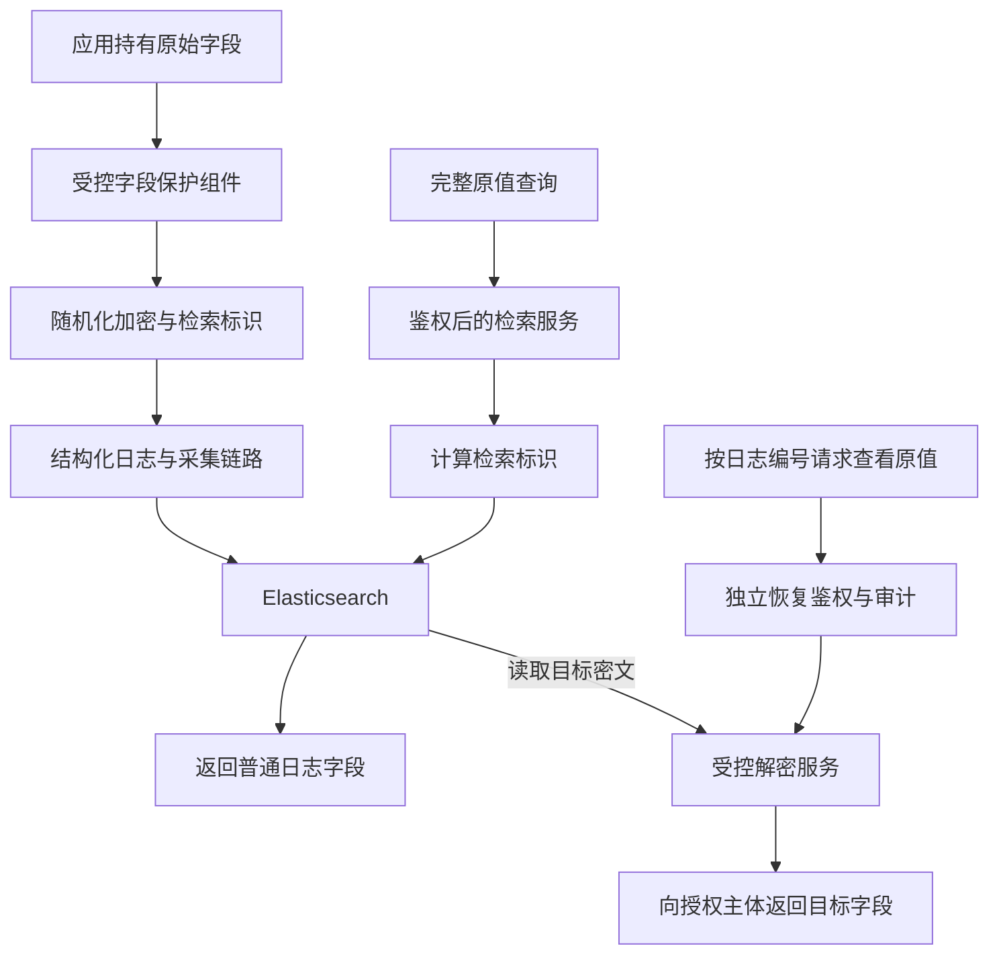

# 日志脱敏与可检索加密：原值检索、授权恢复与工程落地

> 调研日期：2026-10-18。范围：Google Cloud Sensitive Data Protection、AWS Database Encryption SDK、Amazon CloudWatch Logs、Elasticsearch，以及 HMAC、AES-SIV、AES-GCM 的公开资料。本文核验的是官方产品能力；后半部分给出独立的日志系统设计，未将其描述为任何公司的内部部署，也未进行产品部署或性能实测。

日志里的手机号经过保护后，仍可能需要回答两个问题：输入完整手机号，查出相关日志；或者从一条日志出发，在授权后查看当时的完整手机号。这两种能力分别是**检索**和**恢复**，实现方式和权限可以分开。

**没有原始业务数据库，并不必然失去恢复能力。只要日志保留可解密的完整密文，且密钥、版本和必要上下文仍在，就可以恢复原值；如果只剩星号或单向摘要，则没有通用的直接恢复方法。**

## 目录

- [一、调研结论与证据范围](#一调研结论与证据范围)
- [二、先明确需要保留哪种能力](#二先明确需要保留哪种能力)
- [三、Google 的假名化方案](#三google-的假名化方案)
- [四、AWS 的可搜索加密方案](#四aws-的可搜索加密方案)
- [五、日志平台的遮盖与替换](#五日志平台的遮盖与替换)
- [六、候选方案如何选择](#六候选方案如何选择)
- [七、日志系统参考设计](#七日志系统参考设计)
- [八、密钥轮换与历史日志迁移](#八密钥轮换与历史日志迁移)
- [九、查询能力与信息泄露的边界](#九查询能力与信息泄露的边界)
- [十、验证方法与成本评估](#十验证方法与成本评估)
- [十一、常见问题](#十一常见问题)
- [十二、官方资料索引](#十二官方资料索引)

------

## 一、调研结论与证据范围

| 问题 | 结论 | 依据 |
| --- | --- | --- |
| 能否隐藏明文，同时保留原值精确检索？ | 可以，使用稳定的密钥化标识，或专门的确定性加密 | Google 假名化文档、RFC 5297 |
| 没有业务原库，能否恢复日志中的原值？ | 可以，但日志必须保留可解密密文及必要元数据 | Google 重新识别能力 |
| 能否把检索权限与解密权限分开？ | 可以，采用独立检索标识和加密密文，并拆分服务权限 | 本文参考设计；AWS 提供相关产品实现作对照 |
| 是否已有大厂公开产品支持？ | 有，Google 提供假名化，AWS 提供可搜索加密与日志授权显示 | 对应官方文档 |
| 是否证明这些厂商内部所有日志都这样处理？ | 未确认，产品能力不能证明内部业务部署 | 证据范围限制 |

本文按三类内容组织：**官方已公开的能力、由算法性质推出的结论、需要项目验证的工程设计**。后续字段结构、Elasticsearch 查询和权限划分属于第三类。[Google 假名化文档](https://docs.cloud.google.com/sensitive-data-protection/docs/pseudonymization)、[AWS 可搜索加密文档](https://docs.aws.amazon.com/database-encryption-sdk/latest/devguide/searchable-encryption.html)

“脱敏”是宽泛称呼。可逆加密、稳定代号和遮盖显示都能减少明文暴露，但不能因此将数据视为已经彻底匿名化。

## 二、先明确需要保留哪种能力

以一个虚构手机号 `13812345678` 为例：

| 能力 | 输入 | 输出 | 是否必须保存可逆信息 |
| --- | --- | --- | --- |
| 精确检索 | 完整手机号 | 对应日志列表 | 否，稳定的检索标识即可 |
| 关联分析 | 某条日志的稳定标识 | 同一标识出现过的其他日志 | 否 |
| 授权恢复 | 某条日志的密文 | 该日志当时的原始值 | 是 |
| 部分匹配 | 手机号后四位 | 一批候选日志 | 需要额外的查询设计 |

一个容易混淆的地方是：**输入手机号算出摘要并命中日志，不等于把摘要还原成手机号。** 前者由调用方提供原值；后者要求系统从保存的信息中恢复原值。

还要区分“没有原始数据源”的两种状态：

- **没有业务原库，但日志有可逆密文**：恢复依赖密钥和日志自身，不必查询业务库。
- **业务原库、密文、映射关系全部没有**：仅靠星号或单向摘要，不能准确重建缺失信息。

新的保护方案必须在原值仍可获取时实施，无法事后为已经丢失的信息补出密文。

------

## 三、Google 的假名化方案

### 官方提供什么

Google Cloud Sensitive Data Protection 将敏感值替换成密码学生成的代号，称为 Pseudonymization，也称 Tokenization。官方支持三种方法：[Google Pseudonymization](https://docs.cloud.google.com/sensitive-data-protection/docs/pseudonymization)

| 方法 | 输出特点 | 能否恢复 | 相同输入能否稳定关联 |
| --- | --- | --- | --- |
| HMAC-SHA-256 | 固定长度摘要的编码值 | 不能直接逆运算 | 同一密钥下可以 |
| AES-SIV 确定性加密 | 编码后的密文，不保留原长度 | 可以 | 密钥与上下文一致时可以 |
| FPE 格式保留加密 | 保留指定字符集与长度 | 可以 | 密钥与上下文一致时可以 |

这里的 Tokenization 指替换敏感值，不是登录令牌，也不是大模型分词。该产品通过密码学变换生成代号，不要求为每个原值另建一条映射记录。

### 为什么确定性加密可以检索

在确定性模式下，密钥、原文与关联数据相同，AES-SIV 产生相同密文。因此可以将查询输入按同样规则加密，再进行等值匹配。恢复时，使用对应密钥和上下文解密。AES-SIV 的算法定义见 [RFC 5297](https://www.rfc-editor.org/rfc/rfc5297.html)。

这不代表任意 AES 加密都可以这样使用。普通的随机化加密可能让相同原值每次得到不同密文，直接比较密文便无法完成等值检索。不能通过固定 AES-GCM 的 nonce 来强行制造确定性。

### 上下文决定关联范围

Google 的确定性加密支持 context tweak，可以将稳定关联限制在某个上下文内。例如，同一邮箱在同一活动中得到相同代号，在不同活动中得到不同代号；恢复也需要相应上下文。[Google 上下文说明](https://docs.cloud.google.com/sensitive-data-protection/docs/pseudonymization#using_context_tweaks)

工程上可以据此考虑按租户或环境划分关联范围。如果把每条日志独有的 `log_id` 都放入确定性加密上下文，同一手机号的密文也会随日志变化，便失去了直接跨日志等值匹配的条件。

FPE 主要适用于旧系统严格要求固定长度、固定字符集的兼容场景。日志通常能容纳更长字符串，应先评估 AES-SIV 等方案。Google 也说明 FPE 的安全保证弱于其 AES-SIV 方案，不能仅因输出仍像一个号码就优先使用 FPE。[Google 变换参考](https://docs.cloud.google.com/sensitive-data-protection/docs/transformations-reference)

Google 另有数据去标识化、配置与密钥管理、重新识别流水线的参考架构。它说明恢复可以作为独立流程建设，但该架构是数据处理参考方案，并非 Google 内部日志部署证据。[Google 参考架构](https://docs.cloud.google.com/architecture/de-identification-re-identification-pii-using-cloud-dlp)

## 四、AWS 的可搜索加密方案

### 密文与检索标识分别保存

AWS Database Encryption SDK 的可搜索加密，在加密字段旁保存名为 **beacon** 的检索标识。数据库保存随机化密文，查询通过额外标识定位候选记录，不必先解密全库。[AWS Searchable encryption](https://docs.aws.amazon.com/database-encryption-sdk/latest/devguide/searchable-encryption.html)

概念上可理解为：

```text
原值 ── 随机化加密 ──> 密文字段
  └── 密钥化检索变换 ──> beacon ──> 数据库索引
```

该 SDK 文档主要面向其支持的数据库场景，不能直接当作 Elasticsearch 日志插件使用；可借鉴的是密文与检索辅助信息分离的思路。

### Beacon 不是简单的完整摘要

官方 beacon 基于 HMAC，并有截断、分区等设计：截断让不同原值可能落入同一候选集合；分区使相同值在不同分区产生不同标识。查询端需要覆盖相关分区，并对候选结果解密、过滤误命中。标准 beacon 支持单字段等值查询。[AWS Beacons](https://docs.aws.amazon.com/database-encryption-sdk/latest/devguide/beacons.html)

这些机制是在信息泄露、查询扇出和候选过滤成本之间取舍。直接保存完整 HMAC 可以让查询更简单，但会清楚暴露同一值的出现频率。本文后面的完整 HMAC 示例是独立的简化设计，**不等同于 AWS beacon 的实现，也不具备其全部保护措施**。

AWS 还明确指出，其文档中的可搜索加密与学术文献中某些 Searchable Symmetric Encryption 定义有所不同。比较不同产品时，应检查具体泄露模型和查询机制，不能只比较名称。[AWS 能力与风险说明](https://docs.aws.amazon.com/database-encryption-sdk/latest/devguide/searchable-encryption.html)

------

## 五、日志平台的遮盖与替换

### CloudWatch：保留数据，按权限显示

Amazon CloudWatch Logs 的数据保护策略在日志摄入时检测敏感内容，默认在出口遮盖；具有 `logs:Unmask` 权限的主体可以查看未遮盖值。策略不会追溯遮盖设置前已摄入的事件。[CloudWatch 数据保护](https://docs.aws.amazon.com/AmazonCloudWatch/latest/logs/mask-sensitive-log-data.html)

其 Logs Insights 支持 `unmask(@message)`，部分读取 API 也提供 `unmask` 参数。[CloudWatch 查看未遮盖数据](https://docs.aws.amazon.com/AmazonCloudWatch/latest/logs/mask-sensitive-log-data-viewunmasked.html)

这里的恢复能力来自平台保留了完整信息。如果应用上传前已经把号码改成星号，平台收到的便只有星号，授权显示也无法补回被删除的字符。该功能也不能直接等同于“日志存储端从未接触过明文”的客户端加密。

### Elasticsearch：替换文本不自动获得检索能力

Elasticsearch 的 `redact` ingest processor 用 Grok 规则匹配敏感文本，并替换成 `<EMAIL>` 等标记。官方示例中的 IP 地址会被替换为标记文本。[Elastic Redact processor](https://www.elastic.co/docs/reference/ingest-processor/redact-processor)

如果只保存替换结果，相应原值便不在该结果中。要保留原值检索或授权恢复能力，需要在替换前生成检索字段或密文，或者接入独立的保护服务。

因此，仅观察界面上出现星号，无法判断底层是哪种实现；需要检查应用输出、采集加工、实际存储字段和查询出口。

## 六、候选方案如何选择

以下是基于前述资料的方案比较，不是厂商内部选型统计。

| 方案 | 原值精确检索 | 授权恢复 | 主要工程代价 |
| --- | --- | --- | --- |
| 星号或固定文本替换 | 通常不支持 | 不支持 | 信息丢失 |
| 仅 HMAC 检索标识 | 支持 | 不支持 | 密钥管理、关联信息泄露 |
| 确定性加密 | 支持 | 支持 | 稳定密文泄露相等关系，密钥使用权限需控制 |
| 随机化加密＋HMAC 索引 | 支持 | 支持 | 多一个字段及索引，需要分别管理检索和恢复 |
| 随机代号＋受保护映射库 | 映射服务支持反查时可以 | 映射仍在时可以 | 映射库可用性、容量与一致性 |
| 平台保留完整日志＋出口遮盖 | 取决于平台查询语义 | 平台授权后可以 | 平台承担完整信息的保管责任 |

对于“已有 Elasticsearch 日志平台、需要完整号码精确查询、偶尔恢复原值”的需求，可以优先验证**随机化加密＋独立 HMAC 索引**。它能把日常查询与原值恢复分开，接入现有精确索引也较直接。

如果只需要定位日志、不需要恢复，则省略密文字段。如果要求存储观察者也难以识别相同值或频率，简单 HMAC 方案便可能不够，应进一步评估专门的加密检索系统和对应泄露模型。

------

## 七、日志系统参考设计

本节是面向结构化日志的工程设计示例。所有号码、标识和密文均为示意；伪代码没有绑定具体 SDK，也未作为生产实现执行。

### 写入前保护，查询时转换



保护应发生在原值首次进入持久化日志之前。如果先输出明文到应用文件，再由 Filebeat 或 Logstash 加密，应用磁盘与中间队列仍可能保留明文。采集端识别可以作为补充，但不替代结构化字段的源头保护。

### 分开定义检索值与恢复值

```text
raw = 接收到的原始手机号
normalized = normalizePhone(raw, normalization_version)

scope = encode("log-search", env, tenant_id, "phone", normalization_version)
phone_idx = Base64url(HMAC-SHA256(K_search, encode(scope, normalized)))

aad = encode(env, tenant_id, log_id, "phone", encryption_schema_version)
phone_enc = AEAD_Encrypt(K_data, unique_nonce, raw, aad)
```

这里有几个需要固定下来的约定：

- 检索使用标准化值，恢复保存当时的原始值，两者可以不同。
- `encode` 应采用长度前缀或其他无歧义序列化，不使用可能发生歧义的字符串直接拼接。
- 检索范围可以含租户、环境和字段名，避免不必要的跨范围关联；实际查询仍必须独立鉴权。
- `K_search` 与 `K_data` 独立管理，检索服务无需获得解密能力。HMAC 的密钥化构造见 [RFC 2104](https://www.rfc-editor.org/rfc/rfc2104.html)。
- AAD 是被认证但不加密的上下文，用于绑定目标日志和字段，其中不要放明文隐私。解密时必须使用写入时的相同上下文。

AEAD 可使用成熟 SDK 提供的 AES-GCM 等认证加密。AES-GCM 要求同一密钥下 nonce 不重复，密文、nonce、认证标签和密钥定位信息必须完整保留；不能照抄一个固定 nonce。[NIST SP 800-38D](https://csrc.nist.gov/pubs/sp/800/38/d/final)

### 日志记录示例

```json
{
  "@timestamp": "2026-10-18T10:00:00+08:00",
  "log_id": "log-demo-001",
  "env": "prod",
  "tenant_id": "tenant-demo",
  "service": "order-service",
  "traceId": "trace-demo",
  "event": "order.create.failed",
  "phone_idx": "<Base64url-HMAC-SHA256>",
  "phone_idx_key_version": "search-v3",
  "phone_normalization_version": "phone-v1",
  "phone_enc": {
    "alg": "AES-256-GCM",
    "schema_version": "enc-v1",
    "key_ref": "<可解析到密钥材料的受控引用>",
    "nonce": "<Base64-nonce>",
    "ciphertext": "<Base64-ciphertext>",
    "tag": "<Base64-authentication-tag>"
  },
  "message": "创建订单失败"
}
```

`key_ref` 的语义要由密钥方案确定。采用信封加密时，还需保存或能定位被包裹的数据密钥；只保存一个 KMS 主密钥名字，不能替代恢复所需的全部材料。普通日志中不保存原始密钥。

`message`、异常消息、URL 查询参数和堆栈补充信息中也不能再次夹带手机号。仅保护 `phone` 字段，却把整个请求对象打印到 `message`，会使保护失效。

### Elasticsearch 字段与查询

检索字段用 `keyword`，不进行分词。密文封装可以作为不解析的对象保存在 `_source` 中，下面仅展示相关字段映射：

```json
{
  "properties": {
    "phone_idx": { "type": "keyword" },
    "phone_idx_key_version": { "type": "keyword" },
    "phone_normalization_version": { "type": "keyword" },
    "phone_enc": { "type": "object", "enabled": false }
  }
}
```

`enabled: false` 只是不解析该对象，**并不从 `_source` 删除它，也不是访问控制**。完整索引模板还应显式定义时间、租户与其他业务字段。对应行为见 [Elastic enabled 参数](https://www.elastic.co/docs/reference/elasticsearch/mapping-reference/enabled)。

查询服务接收原值后，先鉴权并计算标识，再提交等值查询。以下示例只演示一个检索密钥版本，身份对应的租户范围由服务端确定：

```json
{
  "_source": ["@timestamp", "log_id", "traceId", "event", "message"],
  "query": {
    "bool": {
      "filter": [
        { "term": { "env": "prod" } },
        { "term": { "tenant_id": "tenant-demo" } },
        { "term": { "phone_idx_key_version": "search-v3" } },
        { "term": { "phone_normalization_version": "phone-v1" } },
        { "term": { "phone_idx": "<后端计算的检索标识>" } },
        { "range": { "@timestamp": { "gte": "now-1d" } } }
      ]
    }
  },
  "size": 100
}
```

源字段白名单是返回控制的一环，直接访问 Elasticsearch 的权限也必须受限。若普通用户能绕过网关访问索引，网关的字段过滤与审计便不能覆盖这些请求。

### 三类权限与恢复流程

| 主体 | 授予的能力 | 关键边界 |
| --- | --- | --- |
| 写入应用 | 调用受控保护接口 | 不向普通日志使用者分发长期密钥 |
| 日常排障人员 | 在租户、时间和结果数量限制内检索 | 不自动获得原值恢复权限 |
| 恢复服务与获授权人员 | 按目标日志、目标字段恢复 | 单独鉴权，记录事由与访问审计 |

对称密钥本身通常同时具有加密和解密能力。若进程拿到了原始 AES 密钥，不能只靠声明“仅允许加密”限制其密码学能力；这里的权限隔离依赖服务接口、运行身份和密钥管理边界。

恢复流程可按以下顺序建设：校验访问者和租户范围，校验可查看的日志及字段，记录审计，再由解密服务读取密文并验证 AAD、认证标签。审计记录操作人、目标编号、字段、原因和结果，不再次写入恢复出的明文。

------

## 八、密钥轮换与历史日志迁移

### 检索密钥与加密密钥分别轮换

HMAC 密钥变化后，同一原值的检索标识也会变化。因此每条记录必须能定位检索版本和标准化版本。过渡期可以：

1. 新日志使用新版本。
2. 查询服务针对保留期内仍有效的版本，分别计算查询标识。
3. 用“版本＋对应标识”的成对条件做 OR 查询，最后合并分页结果。
4. 旧日志过期或完成迁移后，再停止支持旧版本。

如果决定短期双写新旧标识，需要明确截止时间，以及新增存储和跨版本关联带来的影响。

加密密钥轮换则要保证旧密文仍能定位并使用对应密钥材料。信封加密下，重新包裹数据密钥与重新加密业务字段是不同操作，是否需要重写全部密文由实际 SDK 和密钥方案决定。

### 旧日志能迁移到什么程度

| 旧日志现状 | 可以补充什么 |
| --- | --- |
| 原值仍可从受控数据源取得 | 生成检索标识与可逆密文 |
| 已有可解密密文 | 在受控迁移中解密，再生成索引或重加密 |
| 只有 HMAC，原值已经丢失 | 可以继续用已知原值检索，不能直接补出原始密文 |
| 只有星号，没有其他原值来源 | 不能准确回填缺失字符 |

字段标准化也属于版本协议。例如手机号应明确国家码与地区规则；邮箱不能未经业务确认就把所有字符都转小写。写入与查询规则不同，会出现“原值正确却搜不到”的情况。

### 保留期与删除

密文、检索标识、备份和缓存要一起纳入保留策略。共享密钥被删除可能影响一批日志，不能把销毁共享密钥当作删除单个用户记录的等价操作。

日志里的密文还可能保存用户已经在业务库修改或删除的旧号码。它是独立的历史数据副本，需要单独管理保存期限。

## 九、查询能力与信息泄露的边界

### 精确匹配不能自然扩展成全文搜索

对完整号码计算一个 HMAC，通常只能做完整值的等值匹配。要按后四位、前缀或子串检索，必须额外构建对应标识、候选集合或专用索引。

拆分得越细，观察者能利用的结构通常越多。后四位只有一万个候选值，单独保护它与保护完整号码的风险不同。若存在可无限调用的检索接口，使用者也能逐个提交候选值；密钥化摘要不能代替接口权限和调用约束。

范围、排序和任意模糊检索需要单独选型。某个产品支持等值加密检索，不代表支持所有查询类型。

### 简单索引会暴露相等关系与频率

在同一作用域中，完整 HMAC 标识稳定，索引观察者可以看到哪些日志拥有相同标识，以及各标识出现多少次。结合外部信息，可能进一步推测原值。随机化加密虽然隐藏了密文之间的直接相等关系，旁边的稳定索引仍有这种泄露。

AWS 的文档专门分析了数据分布、字段相关性和候选过滤之间的取舍。城市、布尔状态等低基数字段，以及彼此高度相关的字段，需要格外谨慎。[AWS 数据集适用性说明](https://docs.aws.amazon.com/database-encryption-sdk/latest/devguide/searchable-encryption.html)

因此，方案评估至少要明确攻击者能看到什么：只有脱敏页面，还是完整索引和快照；能否观察查询；能否调用保护、检索或恢复接口；是否能访问密钥。对存储副本的保护与对应用进程失陷的保护，需要分别讨论。

### 哈希、密钥与匿名化不能混用概念

普通 SHA-256 是公开函数。手机号这样的有限候选空间可以被枚举并比较摘要，不能只凭“使用强哈希”判断保护有效。HMAC 使用秘密密钥，能阻止没有密钥、没有计算接口的观察者直接完成同样的离线比较；密钥或接口失守后，候选枚举风险仍在。

Base64 只是编码。确定性加密需要专门算法。可恢复密文和可关联标识仍是需要控制的数据，不能把它们叫作“已经无法关联任何人的匿名数据”。

------

## 十、验证方法与成本评估

以下是上线前的验收建议，不代表本文已经执行这些实验。实际实现应使用经过评估的密码学库，并在目标日志链路上验证。

| 验收项 | 操作 | 预期 |
| --- | --- | --- |
| 等值检索 | 同一标准化号码写入多条日志，再按原值查询 | 同一作用域与版本内完整命中 |
| 标准化一致性 | 使用带国家码、分隔符等业务允许的输入 | 按明确规则匹配，不错误合并不同号码 |
| 租户隔离 | 两个租户写入同一号码并交叉查询 | 不能越权读取；按设计隔离标识 |
| 随机化密文 | 同一号码多次保护 | nonce 不复用，密文按方案随机化 |
| 授权恢复 | 已批准主体按日志编号恢复字段 | 得到写入时原值，产生审计 |
| 完整性校验 | 修改密文、标签、AAD 或记录归属 | 解密失败，不返回部分明文 |
| 密钥轮换 | 混合新旧版本后查询、恢复 | 保留期内旧记录仍可用 |
| 故障处理 | 关闭保护服务或模拟密钥不可用 | 按预定策略处理，不降级为明文日志 |
| 链路泄露检查 | 检查文件、队列、异常、慢查询、导出和缓存 | 敏感原值没有从其他路径重复出现 |

保护组件故障时，可以只输出不含敏感字段的事件和失败状态，或进入受控重试流程；不能悄悄回退到明文。检索服务收到的完整查询条件，也不能再被访问日志、APM 或错误上报原样收集。

成本评估至少记录：

- 写入吞吐、保护耗时及日志丢失或积压情况；
- 检索索引增加的存储量，查询 P95/P99 与分页成本；
- 多密钥版本、多分区或候选过滤造成的额外查询；
- KMS 调用、数据密钥缓存、密文封装与备份成本；
- 恢复授权和审计流程的运维成本。

本文没有提供性能数字，因为这些结果取决于字段长度、日志量、SDK、索引结构和密钥调用方式，需要基准测试后给出。

## 十一、常见问题

### 没有业务原库，是不是就必须有映射表

不是。密码学可逆代号或加密密文可以依靠密钥恢复，不必逐条保存映射。随机代号没有携带可解密信息时，才依赖对应映射服务。无论采用哪条路线，必要恢复材料都必须保留。

### 已经有 HMAC 密钥，能不能直接解出手机号

HMAC 没有对应的解密运算。已知候选号码时可以重新计算并验证是否匹配；候选空间较小时，也存在枚举可能。因此它既不能被当作可逆存储，也不能被描述为在任何条件下都无法推测。

### 仅仅给日志磁盘开启加密是否足够

磁盘或存储加密主要保护介质和特定存储访问场景。已经获得正常日志查询权限的主体，仍可能看到逻辑明文。字段级保护、查询授权和出口遮盖分别作用于不同边界。

### 是否应该把所有敏感内容都加密后写日志

应先确定哪些字段确实有排障和追溯价值。密码、访问令牌、Cookie、私钥等认证秘密不应为了“以后可能排障”长期保存在普通日志中。对手机号等业务标识，也可以只保存检索标识，而不保留可恢复副本。

### 技术方案评审时怎样概括

先确定需要精确检索、关联分析还是授权恢复。精确检索可用密钥化稳定标识；恢复需要可逆密文或受保护映射。两者结合时，拆分检索与解密权限，明确相等关系泄露、密钥轮换、字段标准化和历史数据保留策略。大厂公开产品证明这些能力可实现，具体选型仍取决于系统的查询需求与威胁模型。

------

## 十二、官方资料索引

以下资料于 2026-10-18 核验。产品限制可能随版本变化，接入时应重新确认目标版本；算法文档用于理解构造，不代替成熟 SDK 的实现与安全评估。

| 编号 | 一手资料 | 本文使用范围 |
| --- | --- | --- |
| G1 | [Google：Pseudonymization](https://docs.cloud.google.com/sensitive-data-protection/docs/pseudonymization) | 单向与双向代号、稳定关联、上下文 |
| G2 | [Google：Transformation reference](https://docs.cloud.google.com/sensitive-data-protection/docs/transformations-reference) | HMAC、确定性加密、FPE 的变换类型 |
| G3 | [Google：去标识化与重新识别参考架构](https://docs.cloud.google.com/architecture/de-identification-re-identification-pii-using-cloud-dlp) | 独立流水线、配置与密钥管理 |
| A1 | [AWS：Searchable encryption](https://docs.aws.amazon.com/database-encryption-sdk/latest/devguide/searchable-encryption.html) | 随机化密文与检索辅助信息、数据分布风险 |
| A2 | [AWS：Beacons](https://docs.aws.amazon.com/database-encryption-sdk/latest/devguide/beacons.html) | HMAC、截断、分区、等值检索 |
| A3 | [CloudWatch：敏感日志遮盖](https://docs.aws.amazon.com/AmazonCloudWatch/latest/logs/mask-sensitive-log-data.html) | 摄入检测、出口遮盖、策略生效边界 |
| A4 | [CloudWatch：查看未遮盖数据](https://docs.aws.amazon.com/AmazonCloudWatch/latest/logs/mask-sensitive-log-data-viewunmasked.html) | `logs:Unmask` 与读取方式 |
| E1 | [Elastic：Redact processor](https://www.elastic.co/docs/reference/ingest-processor/redact-processor) | 摄入阶段文本匹配与替换 |
| E2 | [Elastic：enabled 参数](https://www.elastic.co/docs/reference/elasticsearch/mapping-reference/enabled) | 不解析对象仍保留在 `_source` |
| C1 | [RFC 2104：HMAC](https://www.rfc-editor.org/rfc/rfc2104.html) | 密钥化消息认证码构造 |
| C2 | [RFC 5297：SIV-AES](https://www.rfc-editor.org/rfc/rfc5297.html) | 确定性认证加密与关联数据 |
| C3 | [NIST SP 800-38D：GCM 与 GMAC](https://csrc.nist.gov/pubs/sp/800/38/d/final) | AES-GCM 的认证加密及 nonce 要求 |

## 相关笔记

- [分布式日志：从 traceId 到 Filebeat 与 Elasticsearch](在你的微服务项目中引入分布式日志技术.md)
