# Kafka 可扩展性与容量规划

Kafka 的扩展性来自分区可以分散到不同节点、消费组可以并行处理、数据可以保留后再追赶。它也有明确边界：一个普通分区仍有一个写入 Leader，扩容需要移动状态，消费者的业务下游可能比 Kafka 更早达到极限。

本文使用普通 Consumer Group 模型。所有算例均为**教学假设，不是 Kafka 性能基准，也不是任何公司的生产数据**。核验日期：2026-10-18。[返回专题](消息队列与Kafka学习路线.md) · [架构原理](Kafka架构设计详解.md) · [大厂调研](大厂Kafka改造与自研架构调研.md) · [交互实验室](https://jingxu-huan.github.io/learningnote/visualizations/kafka-architecture/)

## 目录

- [先判断哪一层需要扩展](#先判断哪一层需要扩展)
- [分区扩展与热点](#分区扩展与热点)
- [消费者扩展与业务并行](#消费者扩展与业务并行)
- [Broker扩容与状态迁移](#broker扩容与状态迁移)
- [容量估算](#容量估算)
- [积压与恢复时间](#积压与恢复时间)
- [多租户与跨地域扩展](#多租户与跨地域扩展)
- [分层存储与存算分离](#分层存储与存算分离)
- [怎样验证一次扩容](#怎样验证一次扩容)

------

## 先判断哪一层需要扩展

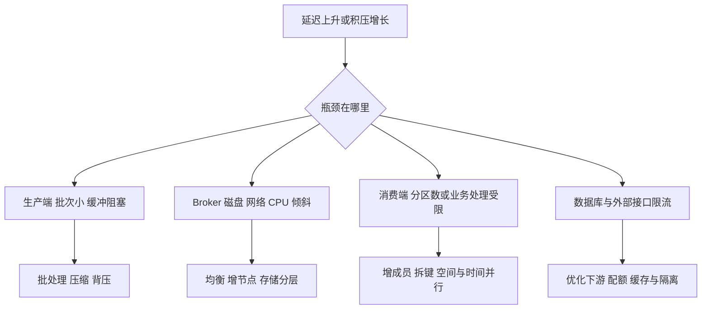

不要从“Kafka 慢”直接跳到“加分区”。先区分生产请求耗时、Broker 请求队列、分区读取进度和业务完成时间：消费者已经拉到了数据但一直等待 MySQL，这时增加 Kafka 节点很可能没有收益。

| 操作 | 主要增加什么 | 不会自动解决什么 |
| --- | --- | --- |
| 增加 Producer 实例 | 序列化和发送并发 | 单热 key 的分区上限、Broker 饱和 |
| 增加普通消费者成员 | 分区之间的业务并行 | 成员数超过分区数、下游容量不足 |
| 增加分区 | 可分配的日志和并行单位 | 历史数据再分布、单个 key 串行瓶颈 |
| 增加 Broker | 数据面 CPU、网络、磁盘 | 自动迁走既有数据、业务 key 分散 |
| 增加副本 | 冗余与故障恢复选择 | 同一分区的独立并行写入能力 |
| 增加 Controller | 控制面冗余配置 | 业务数据吞吐线性提升 |
| 增加消费组 | 独立业务订阅 | 同一组处理加速；反而增加读取负载 |

普通 Kafka 的分区与副本管理、节点添加、分区迁移和 Leader 均衡是不同操作。[官方基本运维](https://kafka.apache.org/43/operations/basic-kafka-operations/)

## 分区扩展与热点

### 分区数如何估算

可先以压测得到的单位能力计算下界，再考虑增长、故障和倾斜：

```text
P_write = ceil(峰值写入字节率 / 单分区目标写入字节率)
P_consume = ceil(峰值业务事件率 / 单消费者目标处理事件率)
P_start >= max(P_write, P_consume)
```

这些是初始估算。单消费者如果承担多个分区，总处理能力还受 CPU、线程和下游配额约束；分区能力也取决于消息大小、批次、压缩、确认方式和硬件。

例如每秒 120,000 条消息，实测一个消费实例在目标延迟下能处理 5,000 条/秒，理论上至少需要 24 个有效工作实例和足够分区。若要保留一部分实例故障后的余量，还需要继续上调预算。不能由此断言“所有 Kafka 集群都应配 24 个分区”。

### 分区数多不等于负载均匀

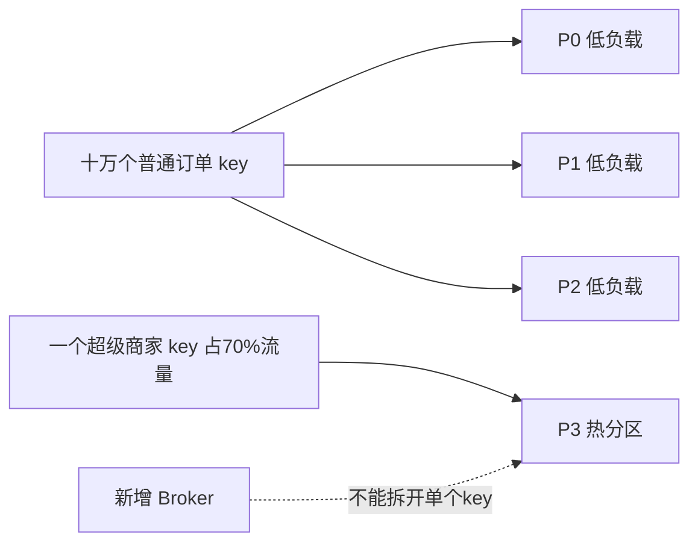

按 `merchantId` 路由可能把超级商家的全部请求挤到一个分区。改成 `orderId` 能分散独立订单，但会改变“同商家全局有序”的语义。加盐也一样：`merchantId + shard` 可以分流，随后要解决聚合、去重和顺序范围。

热点处理要先问业务真正要求什么：是同一个订单有序，同一个账户有序，还是全部交易严格有序？顺序范围越大，可并行空间越小。对于单账户严格串行的处理瓶颈，增加无关分区无法突破业务约束。

### 扩分区会改变路由

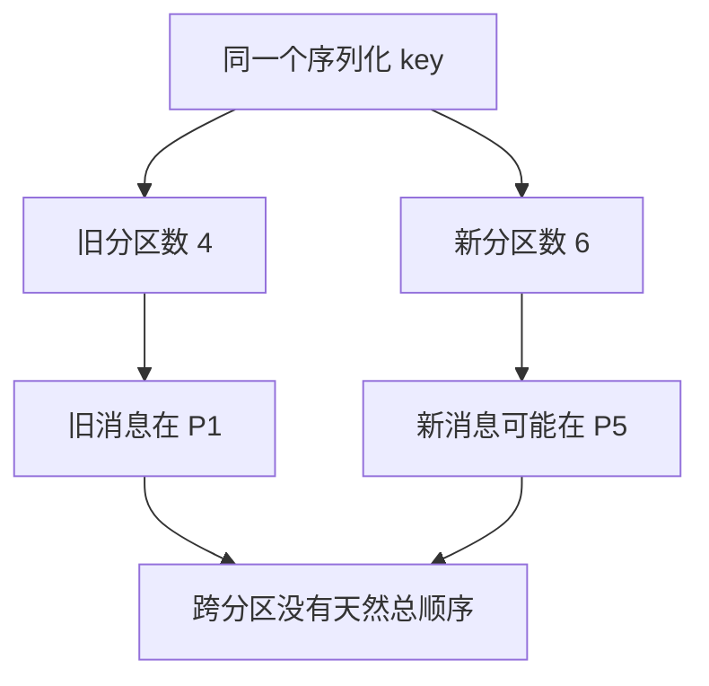

图为可能情况，并非针对某个真实 key 的哈希计算。扩分区只给未来的记录增加可选位置，不会自动把 P1 历史数据拆到 P5。需要跨扩容保持顺序时，可以评估稳定逻辑分片映射、按路由版本切换、双读去重或新 Topic 的受控迁移。[Producer 分区配置](https://kafka.apache.org/43/configuration/producer-configs/)

分区过多也有成本：更多副本与日志段、文件句柄、元数据、选主事件、消费者分配、事务状态和恢复工作。应围绕资源及恢复目标规划，避免直接将分区数设到一个很大的数字。

## 消费者扩展与业务并行

### 普通组的分配上限

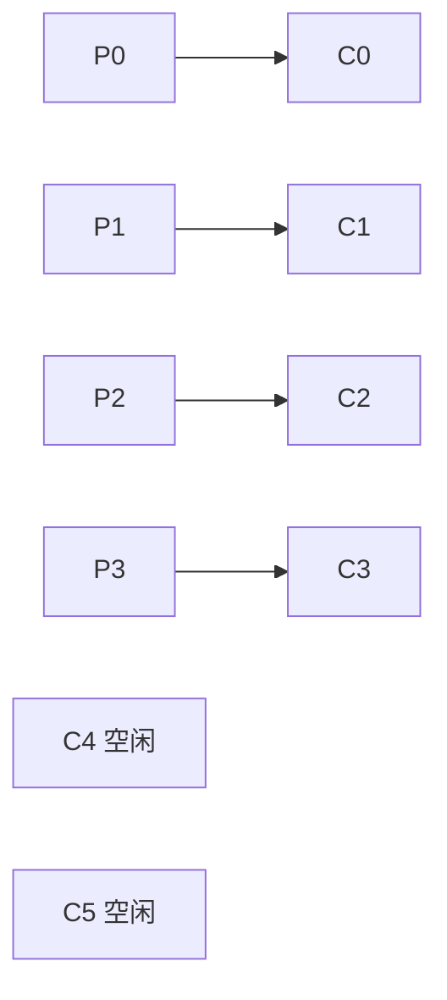

在一个只订阅这 4 个分区的普通消费组里，6 个成员不会得到 6 份独立分区工作。这是分区分配的上限，不是整个应用线程数的上限。

消费者内部可以并行处理独立记录，但仍需保持正确的位点与顺序语义。如果 100 卡住，而 101 到 110 已完成，提交进度不能越过未完成的 100。也不能无界缓存后续记录，寄希望于“总会追上”。

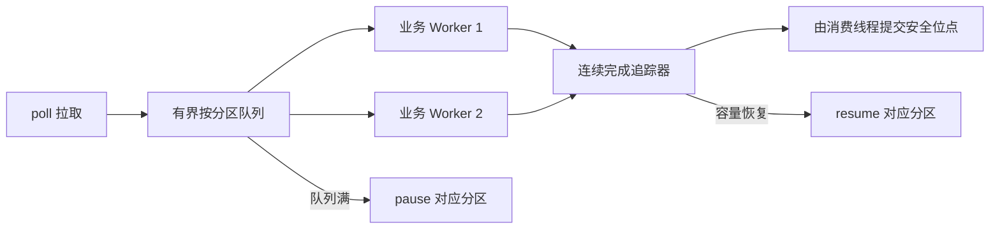

这里的 Worker 并行只适合业务允许的粒度。要严格保持某个 key 的执行顺序，可以按 key 分配串行执行队列；要保持整个分区完成顺序，则并行空间更小。[Consumer 使用约束](https://kafka.apache.org/43/configuration/consumer-configs/)

### 为什么会有消费代理

Uber 的 uForwarder 在 Kafka 与业务 gRPC 服务之间增加代理：代理持有分区分配，业务工作者按记录处理，代理跟踪结果与重试并推进安全位点。业务实例数量不再直接等于 Kafka 消费成员数量，但复杂度移入代理。

因此它能改变**业务工作者**的扩展方式，却没有令 Kafka 分区本身可以无限并行写入。它还需要处理队头阻塞、投递超时、重复、流控、死信和故障恢复。[Uber 消费代理设计](https://www.uber.com/us/en/blog/kafka-async-queuing-with-consumer-proxy/)

## Broker扩容与状态迁移

### 新机器有资源 不等于已有数据已搬过去

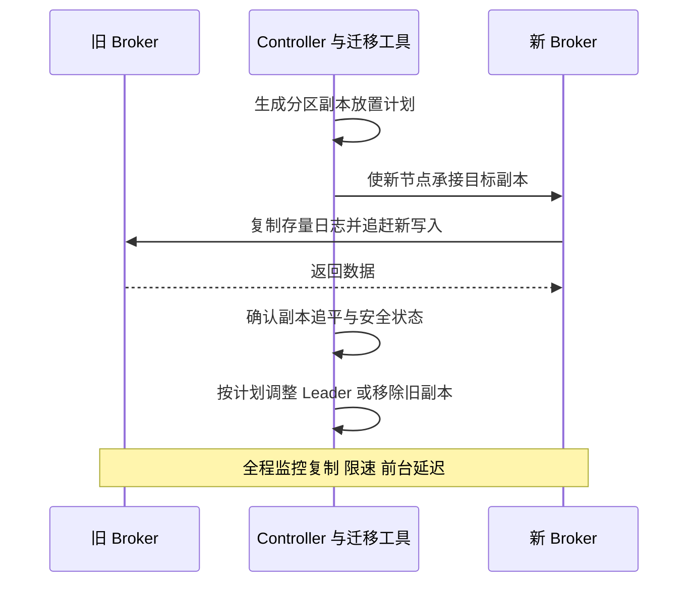

副本迁移和 Leader 迁移不同：仅把 Leader 转移到已存在且可用的副本，通常不需要复制整个分区；把副本移动到新节点，则需要搬运相应本地数据。分层存储可以减少需要复制的本地历史，但不能直接等同于所有状态都已卸载。

### 迁移速度需要扣掉新写入

```text
T_move >= D_backlog / (C_copy - W_new)
```

假设某目标副本还要复制 2TB，给它的持续复制预算为 200MB/s，同一分区继续产生 50MB/s：

```text
净追赶速度 = 200 - 50 = 150MB/s
迁移下界 = 2,000,000MB / 150MB/s
         ≈ 13,333s ≈ 3.70小时
```

这里使用十进制 TB/MB，忽略协议、索引和重试开销。若 `C_copy <= W_new`，在这个预算下无法追平。扩容恰逢高峰时，资源已经接近饱和，迁移又额外消耗网络、磁盘和缓存，这就是需要提前扩容与限速的原因。

### 均衡也要分目标

分区数量均匀，不代表流量、磁盘或 CPU 均匀。一个 2TB 的冷分区与一个 20GB 的热分区，瓶颈完全可能不同。Cruise Control 这类系统会建模副本负载，在机架、容量、网络与分布等多目标约束下生成方案。


“自动均衡”应包括观测、方案、执行和回滚/停止条件，而不只是一个平均分配公式。[Cruise Control 架构](https://github.com/linkedin/cruise-control/wiki/Overview)

## 容量估算

### 先统一单位和负载定义

| 变量 | 示例值 | 含义 |
| --- | ---: | --- |
| `R_avg` | 100,000 条/秒 | 长期平均入口事件率，用于保留容量估算 |
| `R_peak` | 300,000 条/秒 | 峰值入口事件率，用于吞吐预算 |
| `S` | 1,024 bytes | 压缩前平均事件大小，1KiB |
| `c` | 0.5 | 压缩后大小 / 压缩前大小，教学假设 |
| `RF` | 3 | 副本数 |
| `T` | 3天 | 保留窗口，259,200 秒 |
| `u` | 0.65 | 允许使用的磁盘比例，预留恢复和增长空间 |
| `G` | 3 | 全量读取的独立消费组数 |

本文 `MB=10^6 bytes`、`TB=10^12 bytes`；`MiB=2^20 bytes`、`TiB=2^40 bytes`。压缩率必须通过真实事件和批次测量，不能长期照用 0.5。

### 入口与保留容量

```text
B_avg = R_avg × S × c = 51.2MB/s
B_peak = R_peak × S × c = 153.6MB/s
D_payload = B_avg × T × RF = 39.81TB ≈ 36.21TiB
D_provisioned >= D_payload / u = 61.25TB ≈ 55.71TiB
```

这个结果只是载荷模型：还需加索引、段文件边界、事务与内部 Topic、压缩波动、增长、重试及运维额外空间。如果保留期内有持续峰值，不能一直用低谷平均值估算。压缩 Topic 的存储量也不能只按保留时间线性计算。

### 副本和多消费组的流量放大

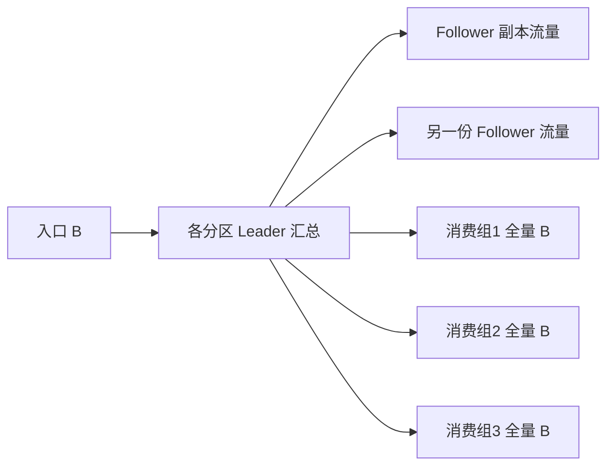

```text
集群副本复制出站 ≈ (RF - 1) × B_peak = 307.2MB/s
三组消费出站 ≈ G × B_peak = 460.8MB/s
Broker 汇总出站 ≈ 768MB/s
```

这里是用于初步规划的**集群内所有 Broker 出站之和**，不直接等于公网流量或云账单；没有把请求响应头、协议开销、重读和批次差异算进去。跨 AZ/地域计费还取决于副本和客户端位置。网络汇总有余量，也不能证明单个热 Leader 没有跑满网卡。

### 节点数取最紧的约束

```text
N_capacity = ceil(所需磁盘总量 / 单Broker可用磁盘量)
N_network  = ceil(目标汇总流量 / 单Broker目标流量预算)
N_cpu      = ceil(所需计算能力 / 单Broker目标计算能力)
N_start >= max(N_capacity, N_network, N_cpu, RF)
```

如果节点磁盘“可用量”已经扣掉 35%余量，不要再对同一项重复除以 `u`。还要模拟失去一台 Broker 或一个 AZ 后，剩余节点能否承接 Leader、复制和追赶负载。实际选择需要机型、磁盘、带宽、消息分布和故障演练共同验证。[硬件与系统建议](https://kafka.apache.org/43/operations/hardware-and-os/)

## 积压与恢复时间

### 稳态判断

```text
积压增长率 = max(入口速率 λ - 有效处理速率 μ, 0)
追赶时间 = 积压 L / (μ - λ)，仅在 μ > λ 时成立
```

如果入口 10,000 条/秒，故障恢复后业务只能处理 10,000 条/秒，积压不会减少。消费系统除了维持稳态，还必须具备额外追赶能力。

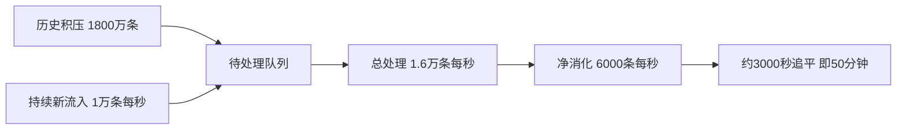

这仍是均匀负载下的下界。真实系统可能有热分区、重试、限流和数据库竞争。更实用的告警通常还包括**最老未完成事件年龄**和业务超时率，而不是只盯住一个总 lag 数字。

### 保留期必须覆盖恢复窗口

```text
所需保留窗口 > 发现时间 + 排障时间 + 修复时间 + 追赶时间 + 安全余量
```

保留期短于最大故障恢复时间时，消费者可能还没读到就遇到历史被清理。`auto.offset.reset` 决定找不到有效已提交位点时如何处理，它不是日常每次启动都从头读的开关。[Consumer 位点配置](https://kafka.apache.org/43/configuration/consumer-configs/)

## 多租户与跨地域扩展

### 多租户需要资源与权限两套隔离

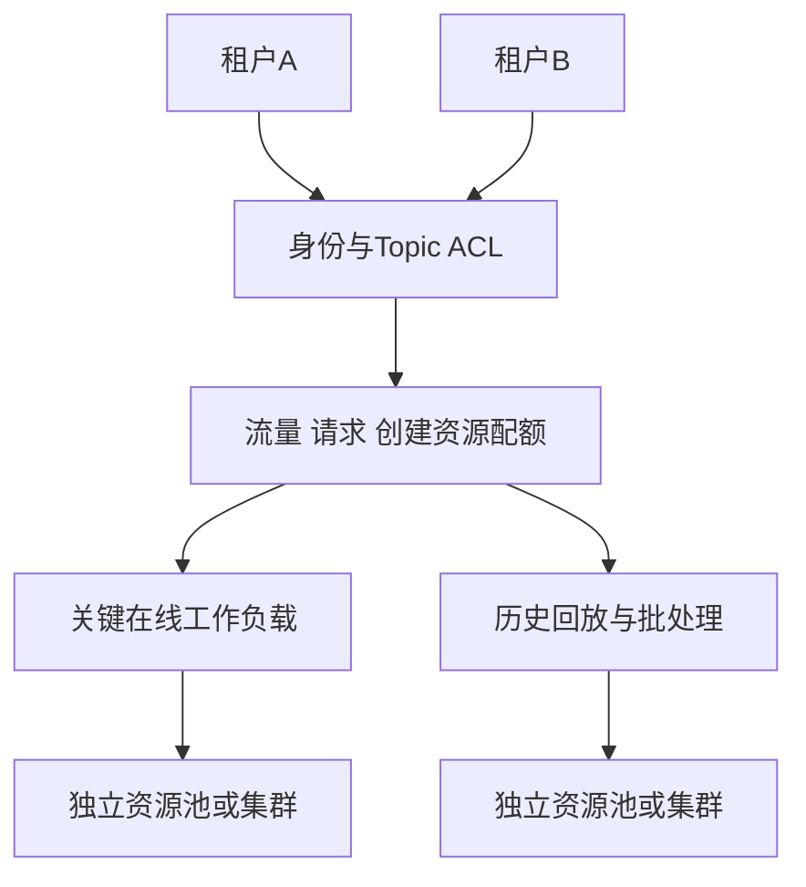

ACL 决定是否有权限，Quota 决定能消耗多少资源。只有 ACL，无法阻止合法但失控的客户端占满带宽；只有配额，也不能阻止越权读取。还要限制 Topic/分区膨胀、连接风暴、大消息、回放流量，并建立租户负责人、变更记录与成本归属。[多租户官方说明](https://kafka.apache.org/43/operations/multi-tenancy/)

### 跨地域采用独立集群再复制


跨地域时应分别定义 RPO（能接受丢失多长时间的数据）与 RTO（多久恢复服务）。异步复制不是天然 RPO=0；切换还涉及目标 Topic、消费位点映射、重复处理、Schema、ACL、事务身份和回切流程。不要默认源 offset 可以原样用在目标集群。[跨集群复制说明](https://kafka.apache.org/43/operations/geo-replication-cross-cluster-data-mirroring/)

## 分层存储与存算分离

### 原生分层存储

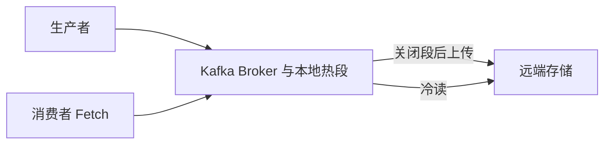

原生 Tiered Storage 让较老日志放到远端，降低长保留对本地磁盘的压力。热写入与服务路径仍涉及 Broker，本地状态仍存在。Kafka 提供扩展接口，实际采用什么 Remote Storage Manager 以及如何配置，需要与发行版和存储实现核对。

Kafka 4.3 文档列出的限制包括不支持 compacted topics 等，因此不能直接给所有状态 Topic 一键开启。分层还带来远端请求、缓存命中、段大小、权限、生命周期和删除一致性问题。[分层存储与限制](https://kafka.apache.org/43/operations/tiered-storage/)

### 更彻底的存算分离

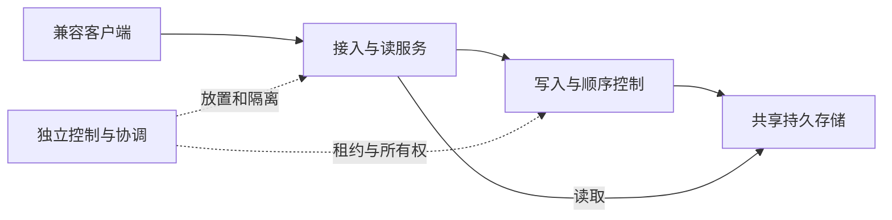

图是架构模式，不对应所有产品的精确实现。字节 BMQ、AutoMQ、Confluent 的不同产品走了不同路径：有的拆读写角色，有的改存储抽象，有的直接写对象存储。它们不能互相替代来证明功能或性能。

状态卸载减少了某些扩缩容中的数据搬运，但不会消除分布式状态：顺序、位点、租约、未完成请求、缓存、索引、事务和故障 fencing 仍然需要正确管理。新的成本也会从本地磁盘移动到远端请求、缓存和网络。

## 怎样验证一次扩容

下面是学习与方案评估方法，**本文没有替任何真实集群执行压测或扩容**。

| 阶段 | 观察内容 | 可以得出什么结论 |
| --- | --- | --- |
| 基线 | 固定负载的吞吐、p95/p99、错误、资源、倾斜 | 建立对照，而非只记最高吞吐 |
| 单变量扩容 | 只增加消费者、分区或 Broker 中的一类 | 识别收益究竟来自哪里 |
| 持续迁移 | 前台延迟、ISR、复制流量、净追赶 | 判断扩容是否干扰在线业务 |
| 故障恢复 | 节点或故障域失效、重平衡、积压恢复 | 验证剩余容量与恢复目标 |
| 业务核对 | 唯一 eventId 数、重复、副作用与最终状态 | 验证业务结果而不仅是链路有响应 |

固定消息大小分布、压缩算法、确认方式、副本数、分区数、TLS、机器和消费逻辑，再比较结果。只用 console producer 写几条消息，能够证明基本连通，不能证明容量、可靠性或生产可用性。

阅读[大厂调研](大厂Kafka改造与自研架构调研.md)时，可以拿本章做判断框架：一项改造是在减少哪个资源的放大、缩小哪个故障域、卸载哪部分状态，又新增了什么恢复和兼容性成本？
