# Kafka 架构设计详解

Kafka 的核心是一组**可以分区、复制和反复读取的持久日志**。生产者追加记录，Broker 保存日志，消费组记录自己的读取进度。Kafka 的吞吐、扩展方式和一致性边界，都能从这个结构推导出来。

> 本文按 Apache Kafka 4.3 的普通 Producer / Consumer Group 模型讲解，源码参照 `4.3.1`。早期 ZooKeeper 模式、Share Group、不同厂商的兼容实现有独立边界。核验日期：2026-10-18。[版本列表](https://kafka.apache.org/community/downloads/)

[返回专题](消息队列与Kafka学习路线.md) · [扩展与容量](Kafka可扩展性与容量规划.md) · [大厂调研](大厂Kafka改造与自研架构调研.md) · [源码与实验](Kafka源码导读与实战演练.md) · [交互实验室](https://jingxu-huan.github.io/learningnote/visualizations/kafka-architecture/)

## 目录

- [为什么采用日志模型](#为什么采用日志模型)
- [架构全景](#架构全景)
- [主题分区与副本](#主题分区与副本)
- [一条消息的写入链路](#一条消息的写入链路)
- [日志如何存储与读取](#日志如何存储与读取)
- [复制确认与故障切换](#复制确认与故障切换)
- [消费组与位点](#消费组与位点)
- [重平衡与慢消费者](#重平衡与慢消费者)
- [幂等与事务的边界](#幂等与事务的边界)
- [业务可靠性设计](#业务可靠性设计)
- [控制面与运维设计](#控制面与运维设计)
- [面试与设计复盘](#面试与设计复盘)

------

## 为什么采用日志模型

设想订单创建后，通知、风控和数仓都要知道。如果消息消费后就被删除，数仓重算和新订阅者补历史会比较困难。Kafka 把事件留在日志里，不同组各自保存进度，消费者读取通常不会删除原消息。

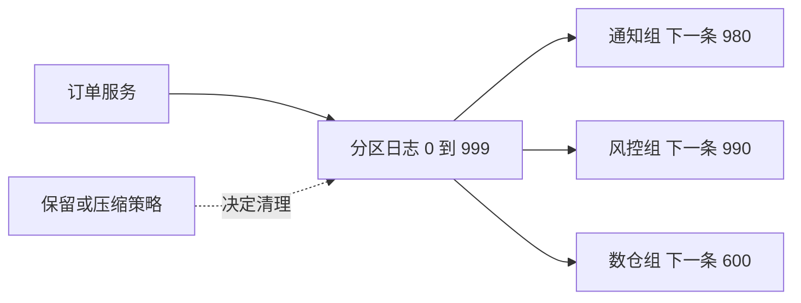

这给系统带来三个性质：下游彼此解耦；进度可以回退以重放；慢消费者会占用更长的历史窗口。代价是必须为历史数据、读放大和积压准备资源。

“Kafka 是消息队列”描述了用途；“Kafka 是分区日志”解释了实现。比较 RocketMQ、RabbitMQ 或任务调度系统时，应继续比较逐条确认、延迟、路由、顺序和回放语义，不能只比一个吞吐数字。[Kafka 官方设计说明](https://kafka.apache.org/43/design/design/)

## 架构全景

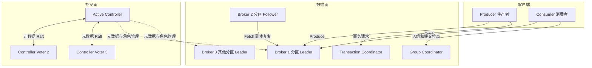

图中的箭头表示**请求方向**：Follower 和 Consumer 主动发 Fetch 请求，数据在响应中返回。Group Coordinator 和 Transaction Coordinator 通常是 Broker 承担的逻辑角色，图中单独画出是为了拆职责，并不表示必须额外部署两套服务。

| 组件 | 大白话解释 | 主要责任 | 不负责什么 |
| --- | --- | --- | --- |
| Producer | 事件发布方 | 序列化、选分区、攒批、重试 | 判断短信或支付业务是否执行成功 |
| Broker | 消息存储与服务节点 | 接收写入、保存日志、处理 Fetch、副本复制 | 代替业务服务执行数据库事务 |
| KRaft Controller | 集群管理者 | Broker 注册、分区状态、选主、元数据变更 | 转发每一条业务消息 |
| Group Coordinator | 某个消费组的协调者 | 组成员、分配协议、位点管理 | 执行消费者的业务代码 |
| Transaction Coordinator | 事务协调者 | 协调 Kafka 事务状态和提交标记 | 自动把外部 MySQL 事务纳入 Kafka 事务 |

KRaft 用 Raft 复制的是**集群元数据日志**。普通 Topic 的数据副本仍按 Kafka 的分区复制机制工作，不能把每个业务分区直接画成一个 KRaft 共识组。[KRaft 运维文档](https://kafka.apache.org/43/operations/kraft/)

## 主题分区与副本

### Topic 是分类 Partition 是日志

`order-events` 可以有 6 个分区。每个分区都有自己独立的 offset 序列，因此 `P0/offset=100` 和 `P1/offset=100` 是两个地址。消息定位至少需要 Topic、Partition、Offset 三个维度。

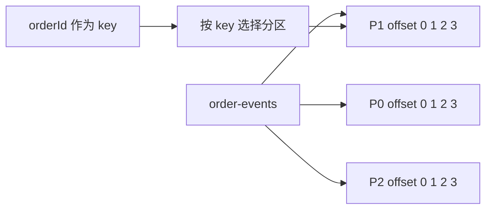

同一个 key 路由到同一分区，需要满足分区数量、序列化后的 key、分区算法和相关配置保持一致。跨生产者并发、应用执行顺序和失败重试也会影响业务观察到的顺序。

扩分区后，`hash(key) % 分区数` 的结果可能改变，旧消息不会自动重分布。因此“相同 key 永远在同一分区”是过强的表述。跨扩容保持业务顺序，可评估固定逻辑分片、路由版本、暂停切换和新 Topic 迁移。

### 分区负责并行 副本负责容错

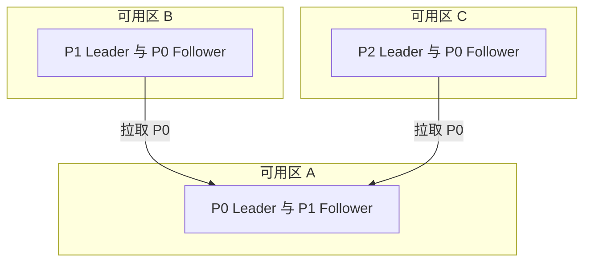

图只展示部分分区副本，用于说明角色分散。同一 Broker 可以是 P0 的 Leader，又是 P1 的 Follower。副本数为 3，表示一个分区有 3 份副本，通常分布到不同 Broker，并结合机架信息跨故障域放置；不代表有 3 个可以任意并发写入的 Leader。

## 一条消息的写入链路

### 生产者先定位 再攒批发送

Producer 连接 `bootstrap.servers` 获取元数据，知道目标分区的 Leader 在哪里后，会直接连接对应 Broker。入口地址只是发现种子，不是所有数据一直经过的中心代理。

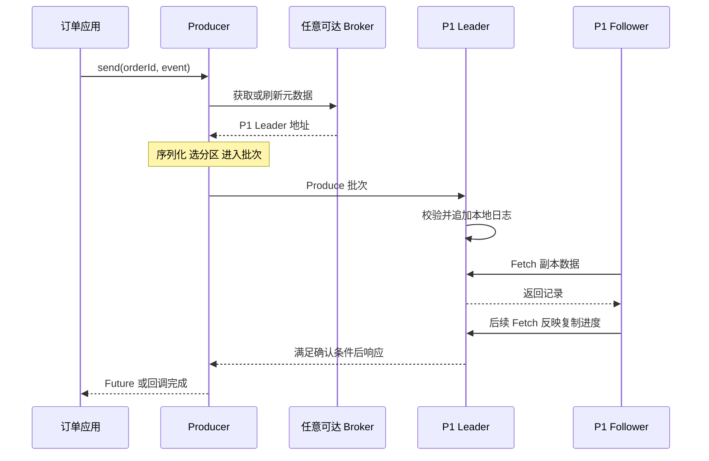

图中省略连接建立、授权、批次校验等细节。`send()` 返回一个 Future，不代表 Broker 已经保存成功。同步等待 Future 会改变应用吞吐；在业务线程里每发一条就 `get()`，通常会削弱异步批量发送的作用。[Producer API 源码与说明](https://github.com/apache/kafka/blob/4.3.1/clients/src/main/java/org/apache/kafka/clients/producer/KafkaProducer.java)

### 批次与压缩为什么有效

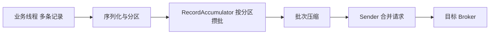

批量发送把多次网络和存储操作的固定开销摊薄。批次以分区为单位，请求则可以包含发往同一个 Broker 的多个分区批次。压缩通常以批次为单位，重复字段越多，越有机会减少网络与存储量。

| 参数 | 影响 | 调整时需要观察什么 |
| --- | --- | --- |
| `batch.size` | 每个分区批次的目标上限 | 批次利用率、内存、单条大小 |
| `linger.ms` | 未满批时允许等待的时间 | 低流量延迟与吞吐的权衡 |
| `compression.type` | 压缩算法 | CPU、压缩率、端到端延迟 |
| `buffer.memory` | 生产者缓冲预算 | 阻塞时间、应用背压 |
| `delivery.timeout.ms` | 一条记录的总投递时间预算 | 与重试、请求超时、批次等待配套 |

Kafka 4.0 起 `linger.ms` 默认值从 0 改为 5ms。配置示例必须注明版本，不能把多年以前的默认值直接复用到新客户端。`linger.ms` 也不是严格的端到端延迟上限，背压和重试可能继续增加等待。[Producer 配置](https://kafka.apache.org/43/configuration/producer-configs/)

## 日志如何存储与读取

### 分段文件与稀疏索引

一个分区的日志会拆成多个 Segment，通常向当前活跃段末尾追加。文件名中的基准 offset 用于定位段，而不是消息条数。

```text
order-events-1/
├── 00000000000000000000.log        记录批次
├── 00000000000000000000.index      offset 到文件位置的稀疏索引
├── 00000000000000000000.timeindex  时间到 offset 的稀疏索引
├── 00000000000000100000.log
├── 00000000000000100000.index
└── ...                            还有事务、快照等辅助文件
```

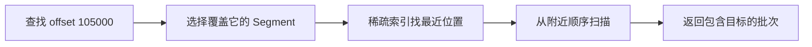

稀疏索引不需要为每条消息保存一个独立指针。它以较小索引换取一小段扫描。offset 是逻辑位置，压缩、控制记录或保留策略都可能使可见 offset 不连续，不能把 offset 差无条件当成业务消息条数。[日志实现说明](https://kafka.apache.org/43/implementation/log/)

### Page Cache 与零拷贝

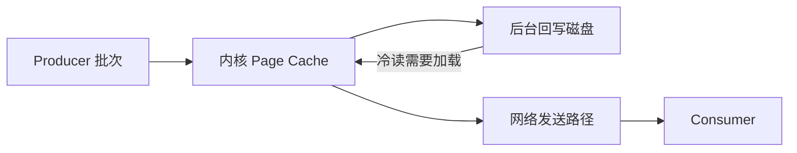

Page Cache 是操作系统给文件提供的缓存，Kafka 不必把全部消息展开为 JVM 对象长期留在堆里。尾部消费者可能直接受益于热缓存；大量回放冷数据则可能带来磁盘 IO 和缓存竞争。

适用的系统和网络路径可以使用 `sendfile` 等手段减少用户态与内核态之间的数据拷贝。TLS、格式转换、远端读取和具体实现会改变路径，所以“任何 Kafka 读取都完全零拷贝”并不准确。追加也不意味着每条消息确认前都执行一次物理磁盘刷盘。

### 删除与日志压缩

`cleanup.policy=delete` 根据保留时间或大小清理符合条件的旧段；`compact` 则尝试保留每个 key 的最新状态，适合变更日志和状态恢复。两者可以组合，但有各自的清理时机和语义。

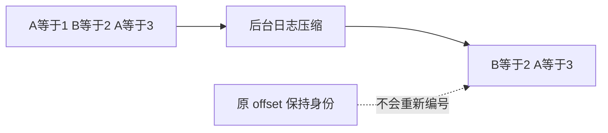

压缩不是即时去重，更不能充当下游业务幂等。删除标记 tombstone 也有保留窗口，长时间离线的状态消费者必须结合 `delete.retention.ms` 等条件评估恢复能力。[日志压缩设计](https://kafka.apache.org/43/design/design/#log-compaction)

## 复制确认与故障切换

### 先分清几个位置

| 名称 | 含义 |
| --- | --- |
| LEO，Log End Offset | 该副本日志下一次追加的位置，可能包含尚未提交的记录 |
| HW，High Watermark | 已提交范围的上边界；普通读取不会返回它之后尚未提交的数据 |
| LSO，Last Stable Offset | `read_committed` 读取受其限制；尚未完成的事务可能使它落后于 HW |
| ISR，In-Sync Replicas | 满足同步条件的副本集合，包含 Leader；集合随状态变化 |
| ELR，Eligible Leader Replicas | 在现代版本中追踪的额外安全选主候选，并非任意落后副本 |

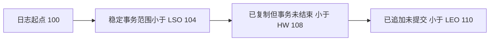

图用区间上界表达位置，端点本身代表“下一位置”。不涉及开放事务时，LSO 可以与 HW 相同。Leader 知道 Follower 已经持久追加到哪，通常还需要从后续复制请求中得知其进度，因此“Follower 收到数据”与“Leader 已能据此推进 HW”也不是一个瞬间。

### acks 与最小同步副本

| 设置 | 成功响应大致表示什么 | 主要风险 |
| --- | --- | --- |
| `acks=0` | 不等待 Broker 确认 | 生产者无法从响应得知写入失败 |
| `acks=1` | Leader 完成本地追加 | Leader 在复制完成前失效，可能丢失已确认记录 |
| `acks=all` | 满足当前同步副本的提交确认条件 | 仍依赖 ISR、最小副本、故障模型和应用正确处理结果 |

常见起点是副本数 3、`acks=all`、`min.insync.replicas=2`，再把副本放到独立故障域。**min ISR 是可继续接受相关写入的最低门槛，不是指定“收到任意两个响应立即成功”。**如果 ISR 为 3，不能将 `acks=all` 解释为只需其中任意 2 个；如果 ISR 收缩到 2，则按当前允许的同步集合判断。

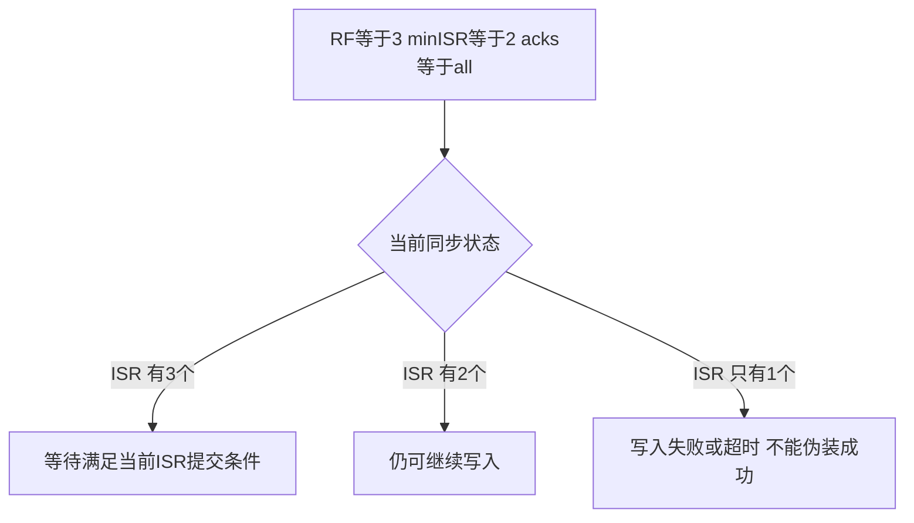

发送失败或超时不总能证明服务器没有写入：可能已经追加，只是响应丢失。业务需要用幂等键和可重试流程处理不确定结果。`acks=all` 也不是“多个机房同时永久损毁时仍绝对不丢”。

### 从 ISR 到 ELR

传统解释通常说安全选主从 ISR 中挑选，允许 unclean election 会引入数据丢失风险。Kafka 4.0 提供 ELR，4.1 起新集群默认启用该能力。配合严格的最小 ISR 规则，某些已经退出 ISR、但仍保存必要已提交数据的副本可以被安全追踪为候选。

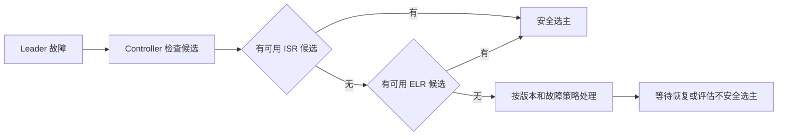

这是教学概图；还省略最后已知 Leader 等官方恢复分支。ELR 不是允许任意陈旧副本接管，且升级集群的功能级别、配置和清理 ELR 的动作需要单独核对。[ELR 官方说明](https://kafka.apache.org/43/operations/eligible-leader-replicas/)

## 消费组与位点

### 同组分工 不同组各读一份

普通 Consumer Group 中，一份分区分配在一个时刻最多交给该组的一个成员；同一成员可以负责多个分区。另一个消费组可以独立读取所有分区。

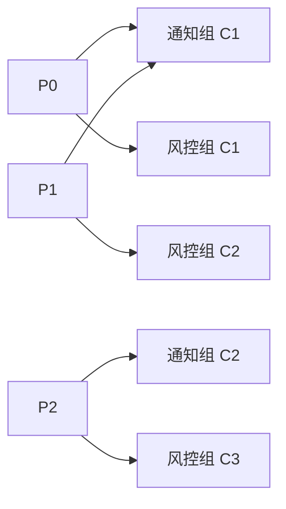

这不等于“一条消息只能被一个消费者读取”。限制有明确前提：**同一个普通消费组、同一时刻的分区分配**。消费者重试与崩溃恢复仍可能重复处理同一记录；Share Group 则采用不同模型。

### position 与 committed offset

`position` 是客户端下次要交付的读取位置；提交位点是恢复时使用的持久进度。`poll()` 可以让 position 提前移动，但业务线程可能还没有完成这一批数据。

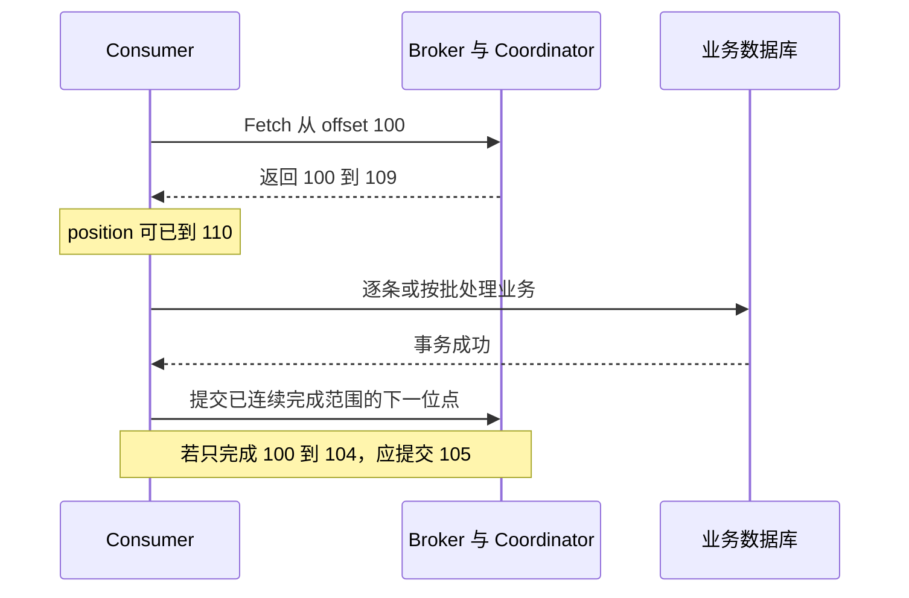

提交 offset=105 表示恢复时从 105 开始，通常意味着 105 之前已经完成。假如 100、102、103 已完成，101 尚未完成，不能因为看见 103 完成就提交 104，否则可能跳过 101。

| 时序 | 崩溃后可能出现什么 |
| --- | --- |
| 先提交，再做业务 | 提交后崩溃，业务没有执行，可能漏处理 |
| 先做业务，再提交 | 业务成功但未提交时崩溃，恢复后可能重复 |
| Kafka 输入输出及位点纳入同一 Kafka 事务 | 可以构成 Kafka 范围内的原子处理，需要消费者按隔离要求读取 |

`__consumer_offsets` 是保存组与位点相关状态的内部 Topic。消费者一般向该组的 Coordinator 提交请求，Coordinator 所在 Broker 与内部 Topic 的分区映射有关；它和 KRaft 元数据日志职责不同。[Consumer 配置与 API 约束](https://kafka.apache.org/43/configuration/consumer-configs/)

## 重平衡与慢消费者

消费者加入、退出、失联或订阅发生变化，可能触发分区重新分配。重平衡的实际影响取决于协议，不能笼统说“所有重平衡都会全组停机”。

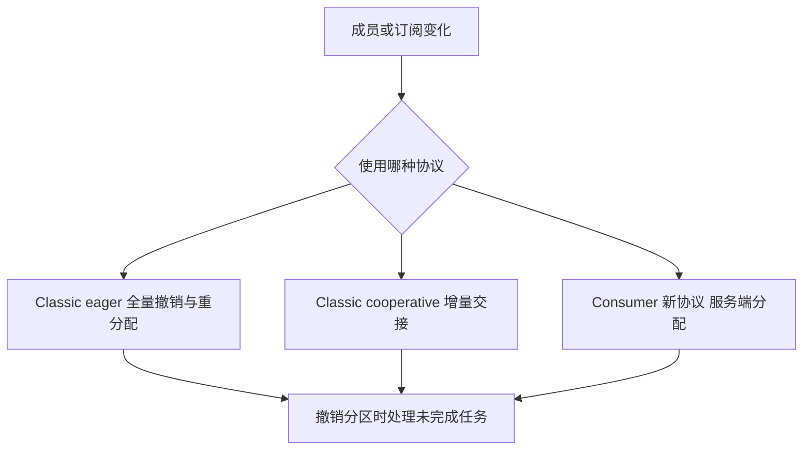

Kafka 4.0 起新的 Consumer Rebalance Protocol 已 GA；在本文参照的 4.3 客户端中，仍需用 `group.protocol=consumer` 显式启用。心跳和会话等部分参数改由服务端管理，不能把 Classic 配置原样照搬。[重平衡协议与迁移条件](https://kafka.apache.org/43/operations/consumer-rebalance-protocol/)

慢消费者需要先区分两个问题：它是否仍然存活，以及它能否以足够速度完成业务。心跳正常不代表业务没有积压。`max.poll.interval.ms`、`max.poll.records`、批次处理时间、业务线程池和在途任务数量必须一起考虑。

将 `poll()` 与业务线程池解耦时，建议使用**有界队列、按分区追踪完成进度、暂停与恢复、撤销时交接**。KafkaConsumer 不是可供任意业务线程同时操作的线程安全对象，长耗时任务也不能无上限预取。[消费者线程模型](https://kafka.apache.org/43/configuration/consumer-configs/)

## 幂等与事务的边界

### 三种不同的去重问题

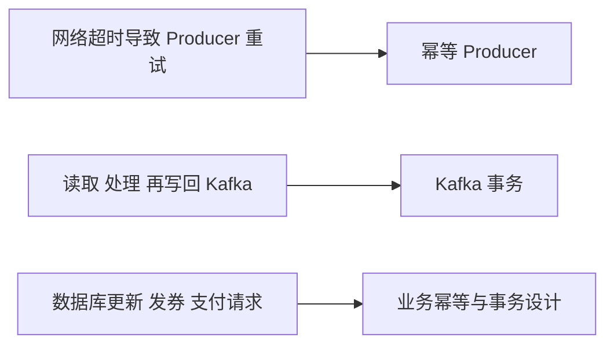

幂等 Producer 使用生产者身份和序列等信息识别协议范围内的重复发送。它不能自动识别“业务重启后，用新事件重新发起的同一笔退款”。后者需要稳定的业务事件 ID 或业务唯一约束。

Kafka 事务可以将输出记录与输入消费位点一同提交，常用于 Kafka → 处理 → Kafka。读取端使用 `isolation.level=read_committed` 才会隐藏中止事务的记录；未完成事务还可能阻塞稳定可见边界。事务协议也有版本演进，不能只复制旧版事务内部流程图。[事务协议说明](https://kafka.apache.org/43/operations/transaction-protocol/)

### Kafka 事务不会自动覆盖外部数据库

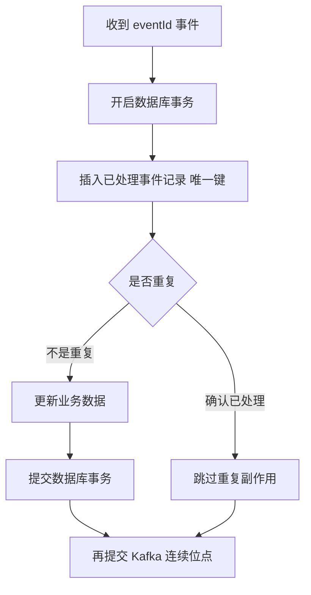

这里是通用业务设计示意：幂等记录与业务更新必须具有需要的原子性；唯一键冲突要和其他数据库失败区分。给外部接口发请求，还需要对方支持幂等键，或者增加状态机、查询与补偿。不能用一张本地去重表证明远端支付“恰好一次”。

## 业务可靠性设计

### Outbox 解决数据库与发消息之间的缺口

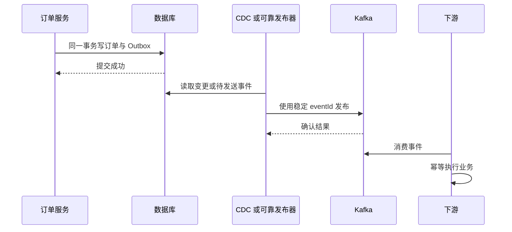

Outbox 把“必须同时完成的两次远程写入”转换为“一个本地事务 + 可恢复投递”。CDC 是读取数据库变更日志的机制；轮询发布器则需要认领、超时恢复和发送状态设计。发布重试仍可产生重复，因此下游必须幂等。[Debezium Outbox Event Router](https://debezium.io/documentation/reference/stable/transformations/outbox-event-router.html)

### 重试与死信

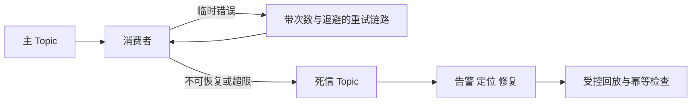

普通 Kafka Topic 并不自动提供完整的业务延迟和死信语义。客户端框架、消费代理或业务服务可以建设这些能力，但需要记录原 Topic、Partition、Offset、eventId、失败原因、次数和时间。使用重试 Topic 往往会改变原分区的业务执行顺序；严格顺序场景要明确选择阻塞、按键隔离还是接受乱序。

## 控制面与运维设计

### 一个可讨论的部署起点

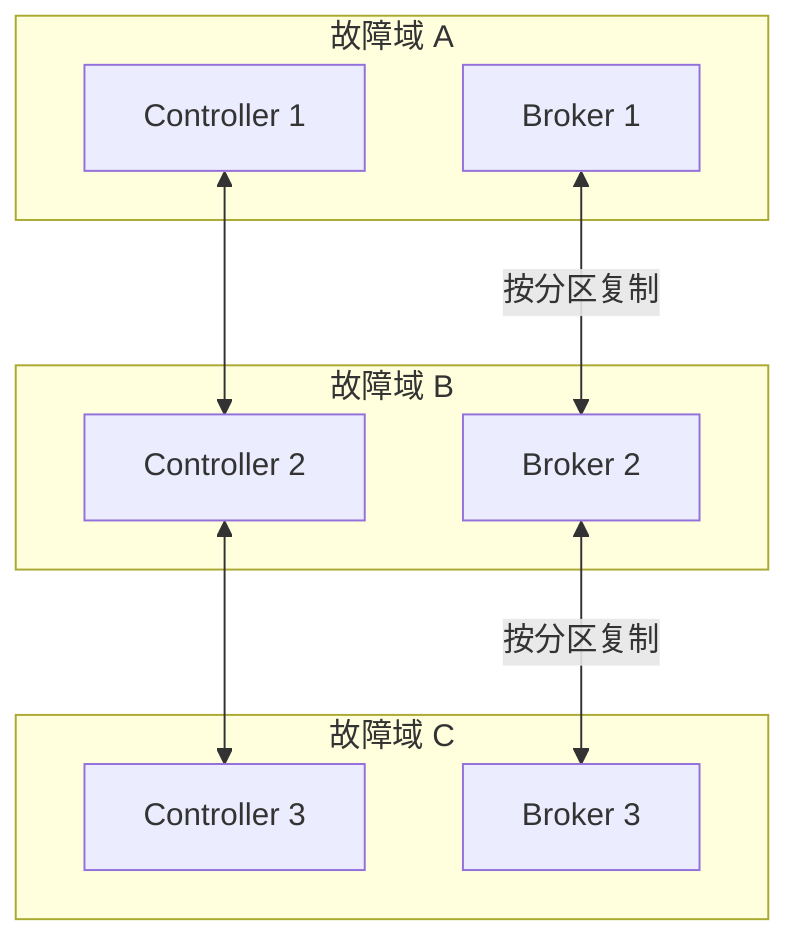

这是教学起点，不是容量处方：独立 Controller 有利于隔离控制面，3 个投票者的多数派为 2。Controller 不是越多越快；业务吞吐主要由数据面决定。副本跨机架放置、仲裁可用性、Broker 数量和恢复预算都要分别评估。[KRaft 部署建议](https://kafka.apache.org/43/operations/kraft/)

业务客户端必须能访问 `advertised.listeners` 宣告的地址。只开放一个 bootstrap 端口、但返回客户端无法到达的容器内地址，会导致“能建连却无法生产消费”。生产环境还要为客户端、副本与 Controller 通信分别设计监听、认证和授权。[监听配置](https://kafka.apache.org/43/security/listener-configuration/)

### 以消息链路组织监控

| 层次 | 需要回答的问题 | 示例信号 |
| --- | --- | --- |
| Producer | 是否被缓冲或重试拖慢 | 错误率、重试率、请求延迟、缓冲等待 |
| Broker | 是否有分区不可用或资源倾斜 | 离线分区、ISR 变化、磁盘、请求队列、网络 |
| Controller | 元数据是否及时推进 | 活跃 Controller、仲裁、事件处理与传播延迟 |
| Consumer | 是否能按业务时限完成 | 分区 lag、最老未完成事件年龄、处理耗时、重平衡 |
| 业务审计 | 是否真的到达和完成 | 事件数对账、重复率、端到端延迟、死信年龄 |

基础设施指标正常不意味着业务没有丢事件。把生产、复制、消费和业务落库分段计数，才有机会定位“消息在哪一跳少了”。Uber 的 Chaperone 就是这种链路审计方向的公开案例，详见大厂调研。[Kafka 监控文档](https://kafka.apache.org/43/operations/monitoring/)

## 面试与设计复盘

| 常见问法 | 有边界的回答 |
| --- | --- |
| Kafka 为什么快 | 分区并行、批处理、压缩、追加日志、Page Cache 与适用路径上的拷贝优化共同作用；取决于负载 |
| 加 Broker 就能扩容吗 | 新节点提供资源，现有分区仍需放置与迁移；单热分区和业务下游瓶颈可能不变 |
| 如何保证顺序 | 先定义顺序范围，再设计 key、分区、生产者并发和消费者执行；扩分区要处理路由变化 |
| 如何避免丢消息 | 分别检查生产结果、复制与故障域、保留期、消费提交、业务持久化及端到端审计 |
| 如何避免重复 | 区分 Producer 协议去重、Kafka 事务与外部业务幂等 |
| Controller 与 Coordinator 有何区别 | 前者管理集群元数据；后者管理消费组或事务，且不同组可由不同 Broker 协调 |
| 所有副本都宕机会怎样 | 看已提交数据、恢复副本、ELR、持久化和故障模型；不以单一参数承诺绝对结果 |

建议完成三个自测：画出 Produce 与 Fetch 请求方向；解释为什么处理完 104 要提交 105；说明 RF=3、minISR=2 为什么不等于任何时刻“两个副本响应即可”。然后进入[容量与扩容章节](Kafka可扩展性与容量规划.md)，把结构转换成可计算的资源需求。
