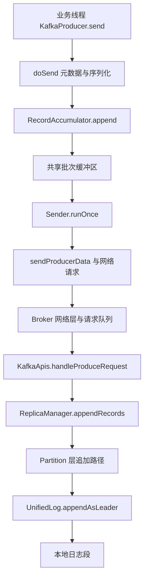
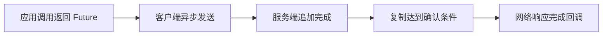
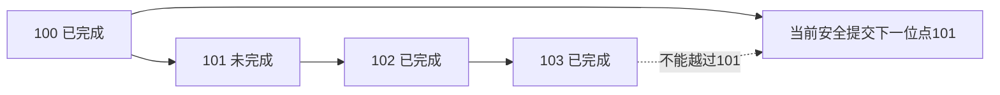

# Kafka 源码导读与实战演练

读 Kafka 源码可以从“一条消息怎样由 `send()` 进入分区日志”开始。先跟写入主干，再补确认、消费协调和控制面；不要把入口函数、网络线程、业务请求处理与磁盘追加混成一次同步调用。

> 源码固定：Apache Kafka `4.3.1`，提交 `26b251a451ce941d3d7a55e6487bcb7f16b5ad48`。下列路径和入口已按该标签核对；它们是阅读入口，不代表每一条分支和并发执行路径都已在本文穷尽。实验命令供读者本机练习，本次文档发布没有实际运行 Kafka 集群或执行故障压测。

[返回专题](消息队列与Kafka学习路线.md) · [架构详解](Kafka架构设计详解.md) · [容量规划](Kafka可扩展性与容量规划.md) · [大厂调研](大厂Kafka改造与自研架构调研.md)

## 目录

- [先看这几个文件](#先看这几个文件)
- [写入链路源码地图](#写入链路源码地图)
- [如何带着问题读代码](#如何带着问题读代码)
- [本地单节点练习](#本地单节点练习)
- [观察消费组与位点](#观察消费组与位点)
- [练习安全提交与幂等](#练习安全提交与幂等)
- [进一步的故障实验设计](#进一步的故障实验设计)

------

## 先看这几个文件

表中行号针对固定的 `4.3.1` 标签。切换版本后应该重新定位，尤其不要拿旧教程的 Scala 日志实现路径直接套到现代版本。

| 顺序 | 文件与入口 | 带着什么问题阅读 |
| --- | --- | --- |
| 1 | [`KafkaProducer.java` L975 `doSend`](https://github.com/apache/kafka/blob/4.3.1/clients/src/main/java/org/apache/kafka/clients/producer/KafkaProducer.java#L975) | 元数据、序列化、分区与入缓冲分别发生在哪里？ |
| 2 | [`RecordAccumulator.java` L275 `append`](https://github.com/apache/kafka/blob/4.3.1/clients/src/main/java/org/apache/kafka/clients/producer/internals/RecordAccumulator.java#L275) | 多条记录如何按分区形成批次？缓冲不足会怎样？ |
| 3 | [`Sender.java` L310 `runOnce`](https://github.com/apache/kafka/blob/4.3.1/clients/src/main/java/org/apache/kafka/clients/producer/internals/Sender.java#L310) | 网络发送线程什么时候取出可发送批次？ |
| 4 | [`Sender.java` L380 `sendProducerData`](https://github.com/apache/kafka/blob/4.3.1/clients/src/main/java/org/apache/kafka/clients/producer/internals/Sender.java#L380) | ready、drain、按 Broker 合并和请求发送怎样衔接？ |
| 5 | [`KafkaApis.scala` L396 `handleProduceRequest`](https://github.com/apache/kafka/blob/4.3.1/core/src/main/scala/kafka/server/KafkaApis.scala#L396) | 服务端如何校验 Produce 并交给副本管理？ |
| 6 | [`ReplicaManager.scala` L637 `appendRecords`](https://github.com/apache/kafka/blob/4.3.1/core/src/main/scala/kafka/server/ReplicaManager.scala#L637) | 本地追加、延迟确认和完成回调怎样关联？ |
| 7 | [`UnifiedLog.java` L1049 `appendAsLeader`](https://github.com/apache/kafka/blob/4.3.1/storage/src/main/java/org/apache/kafka/storage/internals/log/UnifiedLog.java#L1049) | Leader 身份、记录校验、offset 与日志追加怎样处理？ |
| 8 | [`GroupCoordinatorService.java` L483 `consumerGroupHeartbeat`](https://github.com/apache/kafka/blob/4.3.1/group-coordinator/src/main/java/org/apache/kafka/coordinator/group/GroupCoordinatorService.java#L483) | 新消费组协议如何进入协调服务？ |
| 9 | [`GroupCoordinatorService.java` L2070 `commitOffsets`](https://github.com/apache/kafka/blob/4.3.1/group-coordinator/src/main/java/org/apache/kafka/coordinator/group/GroupCoordinatorService.java#L2070) | 位点提交为何走协调逻辑，而不是更新业务 Topic？ |
| 10 | [`QuorumController.java` L952 `appendWriteEvent`](https://github.com/apache/kafka/blob/4.3.1/metadata/src/main/java/org/apache/kafka/controller/QuorumController.java#L952) | 控制面操作如何进入事件与元数据记录流程？ |

可继续看 [`KafkaRaftClient.java`](https://github.com/apache/kafka/blob/4.3.1/raft/src/main/java/org/apache/kafka/raft/KafkaRaftClient.java) 理解元数据 Raft；看 [`RemoteLogManager.java`](https://github.com/apache/kafka/blob/4.3.1/storage/src/main/java/org/apache/kafka/server/log/remote/storage/RemoteLogManager.java) 理解远端日志管理。两者属于不同责任域。

## 写入链路源码地图



这张图表示主干和线程边界，省略中间辅助调用。`RecordAccumulator` 与 `Sender` 之间是缓冲和异步调度，客户端到 Broker 之间是协议网络边界；它们不是同一个 Java 调用栈。

### 对照熟悉的后端分层

可以把 `KafkaApis` 暂时类比为请求分发层，把 `ReplicaManager` 理解为管理分区副本和操作协调的一层，把 `UnifiedLog` 理解为更靠近持久存储的抽象。这有助于找到入口，但不能套成 Spring 的 Controller → Service → MyBatis：Kafka 有独立网络线程、请求队列、追加回调和复制确认，执行模型不同。



阅读时每经过一个箭头，标记“当前是什么线程、持有什么状态、失败由谁完成结果”。它比记一串类名更有用。

## 如何带着问题读代码

### 第一次只读主干

先看 `doSend` 的元数据等待、序列化、分区选择和 accumulator 追加，再到 `sendProducerData` 找 `ready`、`drain` 与发送请求。第一次可以跳过指标、事务、异常映射和复杂兼容分支，先写出十行以内的流程草图。

### 第二次补失败与回调

在同一条链路上找五种失败：没有可用元数据、缓冲不足、请求超时、服务端拒绝、Leader 变化。观察哪些错误会触发重试，哪些会结束 Future，以及业务是否能区分“未写入”和“结果未知”。

### 第三次再读可靠性

追幂等与事务时，先写下生产者身份、批次序列、事务状态和 epoch 各自防止什么，再跟着记录和状态机走。追复制时，区分本地追加与已提交范围，避免看到一次文件写入就认为消息已经满足 `acks=all`。

| 阅读任务 | 应交付的理解结果 |
| --- | --- |
| 看 Producer | 画出业务线程、缓冲、Sender 三者关系 |
| 看 Broker 写入 | 标出校验、追加、等待与响应 |
| 看消费组 | 解释组状态与消费位点存在哪一类内部日志 |
| 看 Controller | 说明元数据操作与普通消息操作为何走不同路径 |
| 看分层存储 | 找出本地段生命周期、远端状态和冷读入口 |

## 本地单节点练习

### 准备隔离的练习容器

需要本机 Docker 可用。下面是 PowerShell 命令，使用独立名称 `kafka-study` 与本机回环端口；已有同名容器或端口被占用时，先检查自己的环境，不要直接删除已有数据。

```powershell
docker run -d --name kafka-study -p 127.0.0.1:9092:9092 apache/kafka:4.3.1
docker logs kafka-study
```

该官方镜像可用于单节点 KRaft 学习；这里没有挂载持久卷，也没有搭建多副本、TLS 和认证。它只能用于机制入门，不能演示生产集群的容错保证。[官方快速开始](https://kafka.apache.org/43/getting-started/quickstart/)、[官方 Docker 文档](https://kafka.apache.org/43/getting-started/docker/)

确认节点就绪后创建练习 Topic：

```powershell
docker exec kafka-study /opt/kafka/bin/kafka-topics.sh --bootstrap-server localhost:9092 --create --topic study-orders --partitions 3 --replication-factor 1
docker exec kafka-study /opt/kafka/bin/kafka-topics.sh --bootstrap-server localhost:9092 --describe --topic study-orders
```

观察分区数、Leader、Replicas 和 ISR。因为只有一个 Broker、副本数为 1，这里没有 Follower 冗余；停止它只会看到服务不可用，不能据此验证 RF=3 的安全选主。

### 发送有业务键的消息

```powershell
@'
order-100:CREATED
order-101:CREATED
order-100:PAID
order-102:CREATED
order-101:CANCELED
'@ | docker exec -i kafka-study /opt/kafka/bin/kafka-console-producer.sh --bootstrap-server localhost:9092 --topic study-orders --property parse.key=true --property key.separator=:
```

key 是冒号前的订单号。后续读消息时关注同一个订单的分区与 offset，不要只看控制台总体打印顺序。

## 观察消费组与位点

### 两个组独立读

```powershell
docker exec kafka-study /opt/kafka/bin/kafka-console-consumer.sh --bootstrap-server localhost:9092 --topic study-orders --group study-notify --from-beginning --timeout-ms 10000 --property print.key=true --property print.partition=true --property print.offset=true
docker exec kafka-study /opt/kafka/bin/kafka-console-consumer.sh --bootstrap-server localhost:9092 --topic study-orders --group study-risk --from-beginning --timeout-ms 10000 --property print.key=true --property print.partition=true --property print.offset=true
```

两个新组都能读取同一批保留数据，说明消费不会把消息从共享日志删掉。10秒无新数据后工具可能以超时状态退出，这是本例设置的停止条件。既有组已有有效提交位点时，`--from-beginning` 不会强行重置它。

```powershell
docker exec kafka-study /opt/kafka/bin/kafka-consumer-groups.sh --bootstrap-server localhost:9092 --describe --group study-notify
docker exec kafka-study /opt/kafka/bin/kafka-consumer-groups.sh --bootstrap-server localhost:9092 --describe --group study-risk
```

观察每个分区的 CURRENT-OFFSET、LOG-END-OFFSET 和 LAG。控制台工具的自动提交存在时机，短时间退出后看到的进度需要据实解释，不要假定刚打印的全部数据都已提交。

### 同一个组分配分区

在两个终端分别启动相同的消费命令，使用同一个新组名 `study-parallel`，不设置短超时，随后继续生产数据。第三个终端执行组的 `--describe`，观察分区分配。继续增加到 4 个同组成员，3 个分区下至少会有成员没有分区工作。

### 在练习组上回退进度

先停止 `study-notify` 的所有消费者，只操作本章自己创建的练习组。先看计划，再决定是否执行：

```powershell
docker exec kafka-study /opt/kafka/bin/kafka-consumer-groups.sh --bootstrap-server localhost:9092 --group study-notify --topic study-orders --reset-offsets --to-earliest --dry-run
docker exec kafka-study /opt/kafka/bin/kafka-consumer-groups.sh --bootstrap-server localhost:9092 --group study-notify --topic study-orders --reset-offsets --to-earliest --execute
```

这会改变练习组的持久消费进度。重新启动该组后，应能再次读取仍在保留范围内的记录。对真实业务执行同类操作，会重放副作用，必须先有幂等、范围与变更方案。[位点重置与管理操作](https://kafka.apache.org/43/operations/basic-kafka-operations/)

## 练习安全提交与幂等

下面是同步按批处理的**教学伪代码**，用于表达时序；`processIdempotently` 需要业务实现，并非复制后即可运行的完整程序。

```java
// 关闭自动提交；同一个消费线程执行 poll 和 commit。
props.put("enable.auto.commit", "false");

while (running) {
    ConsumerRecords<String, String> records =
        consumer.poll(Duration.ofMillis(500));

    for (ConsumerRecord<String, String> record : records) {
        processIdempotently(record); // 稳定 eventId + 数据库事务等业务方案
    }

    // 只在这批交付记录全部成功后提交；异常时不能继续盲目提交。
    // 此示例没有并行 Worker、部分成功、重试与重平衡交接逻辑。
    consumer.commitSync();
}
```

在“业务事务已提交、Kafka 位点尚未提交”的位置设置断点或结束练习进程，重启后观察重复投递。然后加入数据库唯一业务键，确认重复没有再次产生副作用。

如果把处理改成线程池后仍立即 `commitSync()`，就会破坏上面的前提：`poll()` 已交付的记录不一定完成。应增加按分区的连续完成追踪，再提交正确的下一位点。



## 进一步的故障实验设计

| 实验 | 环境与动作 | 需要验证的结果 |
| --- | --- | --- |
| 业务重复 | 处理完成后、提交前结束消费者 | 重放可见，幂等业务结果不重复 |
| 慢消费 | 对单个练习分区增加处理延迟 | 分区级 lag 与最老事件年龄上升 |
| 扩分区 | 记录 key 的旧分区，再将练习 Topic 从3扩到6 | 新消息可能重路由，旧数据位置不变 |
| Leader 故障 | 独立的多 Broker、RF=3、minISR=2 环境 | 确认配置、选主、错误和恢复数据 |
| 复制带宽受限 | 给迁移设置预算并持续写入 | 净追赶速度与迁移时长变化 |
| 跨集群切换 | 两套练习集群与复制链路 | 目标位点、重复、RPO/RTO 和回切 |

实验结束可以先用 `docker stop kafka-study` 停止练习容器，保留环境供复盘。需要移除容器时自行确认其中没有要保留的数据。单节点命令、源码阅读和交互模型都不能代替上述多节点与业务故障实验。

继续学习可从三条路线中选择：对照源码画一次写入调用链；在[交互实验室](https://jingxu-huan.github.io/learningnote/visualizations/kafka-architecture/)操作位点与容量；选[大厂调研](大厂Kafka改造与自研架构调研.md)的一项改造，比较它搬走了哪部分状态以及留下了哪些恢复义务。
