# 大厂 Kafka 改造与自研架构调研

大规模使用 Kafka 后，改造通常围绕成本、扩缩容、故障恢复、多租户和业务消费语义展开。“自己的 Kafka”可能是企业补丁发行版、运行平台、消费代理、存储改造，也可能是兼容 Kafka 协议的新引擎。这些方案改变的层次不同，不能混为同一种“重写 Kafka”。

> 调研核验日期：2026-10-18。依据企业工程文章、官方文档和项目仓库。本文把**公开披露**与**据此推导的工程分析**分开；历史文章只能证明其发布时披露的设计，不能证明该公司今天所有业务仍采用同一架构。性能、规模和成本数字不作跨公司的可比基准。

[返回专题](消息队列与Kafka学习路线.md) · [Kafka 架构](Kafka架构设计详解.md) · [可扩展性](Kafka可扩展性与容量规划.md) · [交互式演进对照](https://jingxu-huan.github.io/learningnote/visualizations/kafka-architecture/#evolution)

## 目录

- [先给改造分类](#先给改造分类)
- [LinkedIn的补丁与自动运维](#linkedin的补丁与自动运维)
- [Uber的复制审计与消费代理](#uber的复制审计与消费代理)
- [字节BMQ的分层与存算分离](#字节bmq的分层与存算分离)
- [Pinterest的Broker外分层存储](#pinterest的broker外分层存储)
- [Confluent的云平台与存储路线](#confluent的云平台与存储路线)
- [AutoMQ与Redpanda的不同路线](#automq与redpanda的不同路线)
- [大规模系统反复遇到的问题](#大规模系统反复遇到的问题)
- [如果要建设自己的Kafka平台](#如果要建设自己的kafka平台)
- [证据与阅读索引](#证据与阅读索引)

------

## 先给改造分类

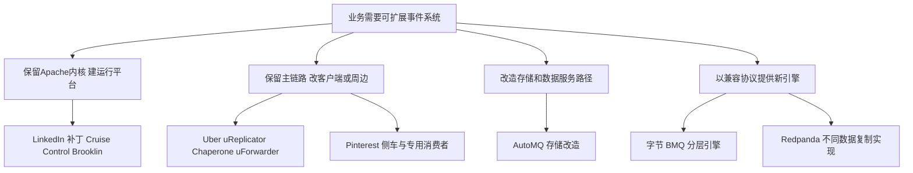

这张图按主要改造点归类，不表示各项目只有一个层次。Confluent Kora 是面向托管云的综合引擎，涉及计算、网络、存储、租户放置等多个方向，后文单独展开。

| 案例 | 主要改造层 | 公开资料能支持什么 | 不能直接推出什么 |
| --- | --- | --- | --- |
| LinkedIn | 发行分支与运行平台 | 企业补丁、均衡、复制、审计生态 | 从零替换 Kafka 协议和全部存储 |
| Uber | 复制与消费基础设施 | 更可控的跨集群复制、链路审计、gRPC 消费代理 | 已经全面替换 Kafka Broker |
| 字节 BMQ | 引擎分层与存储 | Proxy、写入 Broker、独立协调、分布式存储 | Apache Kafka 中原样存在这些组件 |
| Pinterest | 侧车上传与读客户端 | 冷历史可通过专用客户端直接读远端 | 任意原生 Kafka 客户端直接读 S3 |
| Confluent Kora | 托管云引擎 | 多租户、cell、弹性与不同存储路径 | 所有集群类型都采用同一确认和延迟策略 |
| AutoMQ | 基于 Kafka 演进的存储路径 | 项目公开的 S3 Stream 等改造 | 任意版本、API、运维工具无条件兼容 |
| Redpanda | 协议兼容的新实现 | 每个数据分区使用 Raft 复制等架构 | 与 Apache Kafka 的 ISR 内部机制相同 |

## LinkedIn的补丁与自动运维

### 公开披露

LinkedIn 在 2019-10-08 的文章中说明，内部维护以 `-li` 标识的 Kafka 发布分支，将生产需求补丁放入自己的发行流程，并尽量向上游贡献。它同时列出 Schema Registry、Brooklin、Cruise Control 和完整性审计等周边系统。[LinkedIn 的 Kafka 定制流程](https://www.linkedin.com/blog/engineering/open-source/apache-kafka-trillion-messages)

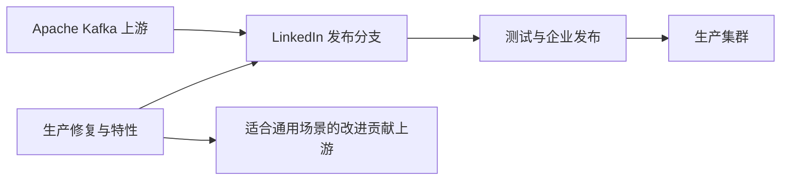

Cruise Control 的公开实现会采集 Broker 和分区资源信息，构建负载模型，用带优先级的目标生成均衡方案，再由执行器实施副本或 Leader 调整。故障域和容量等硬约束与均匀分布等目标不同；自动修复是否执行，还取决于异常类型和启用配置。[项目说明](https://github.com/linkedin/cruise-control)、[架构与执行器](https://github.com/linkedin/cruise-control/wiki/Overview)

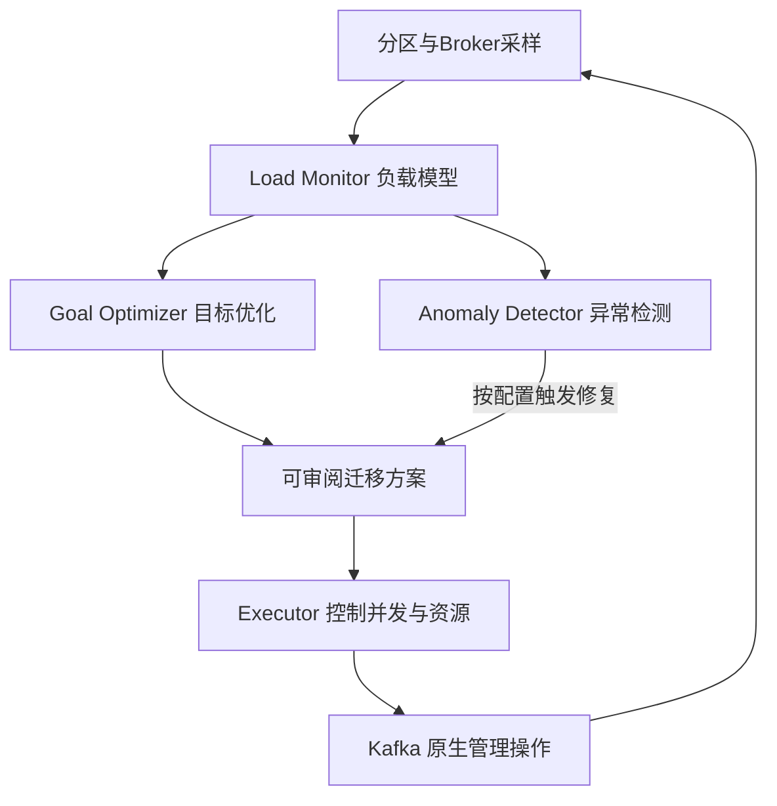

LinkedIn 另有文章介绍用 Brooklin 承担大规模跨集群镜像，并建设分区指标服务，给复制工作负载做更合理的放置。这反映了“管理复制任务本身的负载”也是一个独立问题。[Brooklin 负载均衡镜像](https://www.linkedin.com/blog/engineering/data-streaming-processing/load-balanced-brooklin-mirror-maker-replicating-large-scale-kaf)

### 工程分析

这条路线适合已经需要管理大量集群、租户和变更的组织。价值不一定来自修改日志格式，而可能来自更早发现热点、更安全地迁移、更快恢复冗余，以及让发布可复现。

维护私有分支也有持续成本：上游升级、缺陷修复、补丁冲突、回归覆盖、功能回退和跨版本运维都需要专人负责。一次补丁能解决当下的问题，并不证明长期 fork 比上游贡献更划算。

**可借鉴的建设顺序**：先建立真实分区指标与变更审计，再做受限均衡；先输出计划，明确容量与故障域约束，再扩大自动执行范围。不能从“项目支持自动修复”直接推导“安装后所有异常都会被自动修好”。

## Uber的复制审计与消费代理

### 复制层的改造

Uber 在早期 uReplicator 文章中，针对当时 MirrorMaker 的全局重平衡与停顿问题，用控制器管理分区到复制 Worker 的分配，让变化影响更小范围的任务。文章的对比对象是当时的旧版 MirrorMaker，不是今天所有 Kafka 复制工具。[uReplicator 官方文章](https://www.uber.com/us/en/blog/ureplicator-apache-kafka-replicator/)

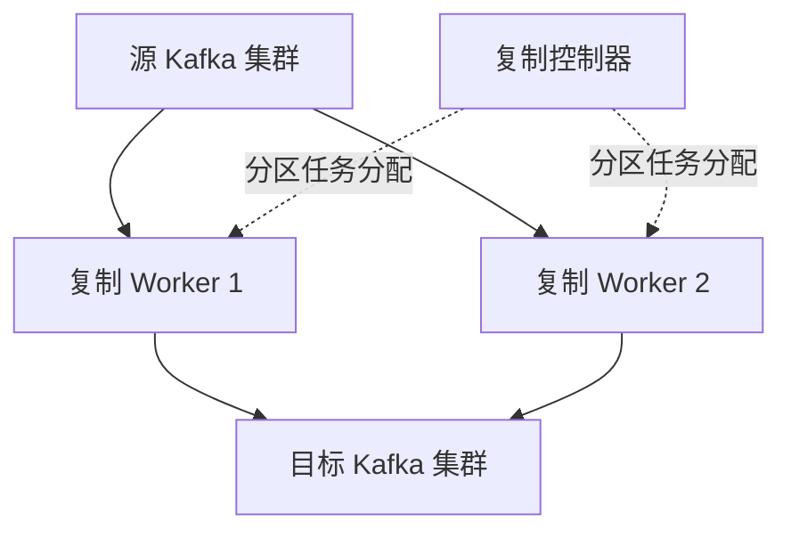

### 审计层的改造

Chaperone 用于观察消息链路的丢失、重复和端到端延迟。官方文章给出过“组件告警未触发，但链路数据缺口被审计发现”的案例。这说明仅检查 Broker 或复制进程存活，不足以证明消息最终完整到达。[Chaperone 官方文章，2016-12-08](https://www.uber.com/us/en/blog/chaperone-audit-kafka-messages/)

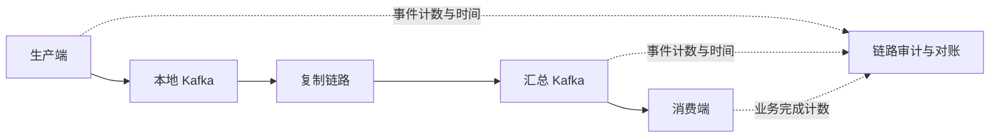

图将审计思想泛化到业务完成端，用于方案讨论，并非声称原文中每个业务服务都采用完全相同的埋点结构。事件延迟到达、重试和时间窗口边界会影响对账，需要区分迟到与永久丢失。

### 消费层的改造

Uber 的 Consumer Proxy 通过 Kafka 协议拉取记录，再向业务 gRPC 端点逐条投递，汇总处理结果后推进可提交的位点。这样业务服务可以围绕无状态请求扩缩容，由代理集中承担分区与消费管理。[Consumer Proxy 设计](https://www.uber.com/us/en/blog/kafka-async-queuing-with-consumer-proxy/)

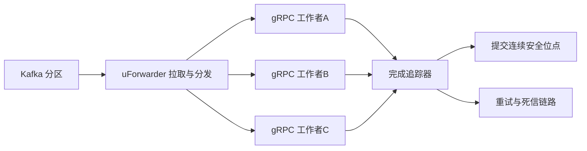

2026-02-05 的后续文章进一步讨论了上下文路由、队头阻塞检测、资源自适应放置和按分区暂停的延迟处理。开源项目名是 `uForwarder`，原文章标题写作 `uFowarder`；本文链接保留其官方地址。[后续改进](https://www.uber.com/us/en/blog/introducing-ufowarder/)、[开源仓库](https://github.com/uber/uForwarder)

### 工程分析

这几项工作的共同点，是把 Kafka 变成更贴近业务的平台：复制控制器管数据去哪，审计系统管是否完整，消费代理管如何交给业务执行。它们不要求把 Kafka Broker 从头重写。

代理也会形成新的状态与故障边界：一条较早记录卡住时，后续记录已经完成，连续位点仍可能无法前移。要设计有限的在途窗口、退避、超时、取消、死信与恢复。强顺序任务还需要独立策略，不能默认享受任意记录并行。

## 字节BMQ的分层与存算分离

### 公开披露

字节消息队列团队的演进文章，把弹性、规模、存储成本与运维压力列为建设 BMQ 的背景。它是面向 Kafka 使用场景演进的云原生消息引擎，不能把文章里的组件直接当成 Apache Kafka 的模块。[消息队列演进背景](https://developer.volcengine.com/articles/7325343303150272539)

后续架构文公开了四个主要模块：Proxy 接入并处理读取；Broker 主要承接写入；Coordinator 独立处理消费协调；Controller 管心跳、放置和故障。数据存入分布式存储，由存储层承担数据冗余。文章还介绍读缓存与文件句柄缓存，减少远端读取及元数据请求。[BMQ 分层架构与缓存](https://developer.volcengine.com/articles/7330942715883945994)

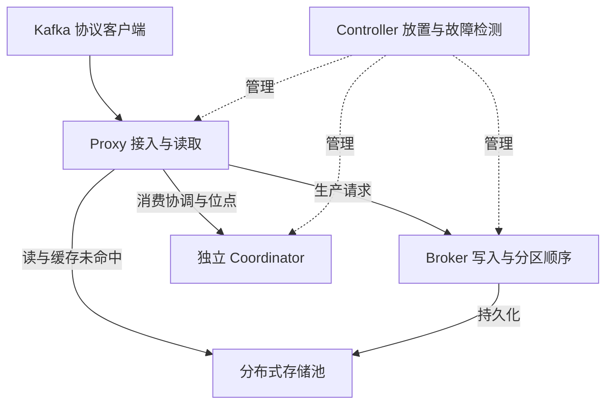

这张图是按公开职责重绘的简化图，省略内部元数据与存储协议；不表示已核验所有 Kafka 新版本协议、事务及插件能力。

### 工程分析

传统本地日志模型把一个分区的历史状态与 Broker 绑定。若要给新 Broker 分配副本，常需复制存量日志。把持久数据放到共享存储后，计算角色切换的目标，是减少这部分历史拷贝对弹性的制约。

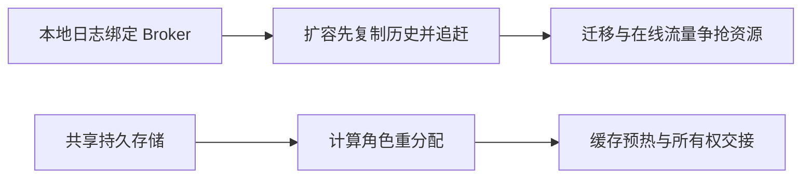

“计算无状态”应理解为大量持久状态已经下沉，不能理解为系统整体没有状态。新的所有者仍需要恢复安全边界，旧所有者必须被 fencing，避免两个写入者同时认为自己拥有同一分区；缓存也不保证立即热起来。这是对该架构模式的工程要求，不是声称原文已经披露其完整 fencing 算法。

存储池还能改变热点影响范围：分区的不同段不必长期集中在同一 Broker 的同一磁盘。但如果每次读取都依赖远端服务，延迟和请求量又会放大。读缓存、文件元数据缓存与后台恢复能力因此成为一等设计问题。

**证据边界**：公开材料能支持“拆分职责与共享存储”的结论；本文没有运行 BMQ，也没有验证其当前商业版本的完整兼容矩阵或性能宣传。对其他大厂是否采用相同四层结构，不做推断。

## Pinterest的Broker外分层存储

### 公开披露

Pinterest 在 2024-09-17 的文章中介绍 Broker 外的分层存储：独立 Segment Uploader 上传关闭的日志段，专用 Tiered Storage Consumer 可以结合 Broker 与远端存储读取。冷读不必全部由 Broker 转发，这是与 Broker 内置分层路径的重要差别。[Pinterest 工程文章](https://medium.com/pinterest-engineering/pinterest-tiered-storage-for-apache-kafka-%EF%B8%8F-a-broker-decoupled-approach-c33c69e9958b)

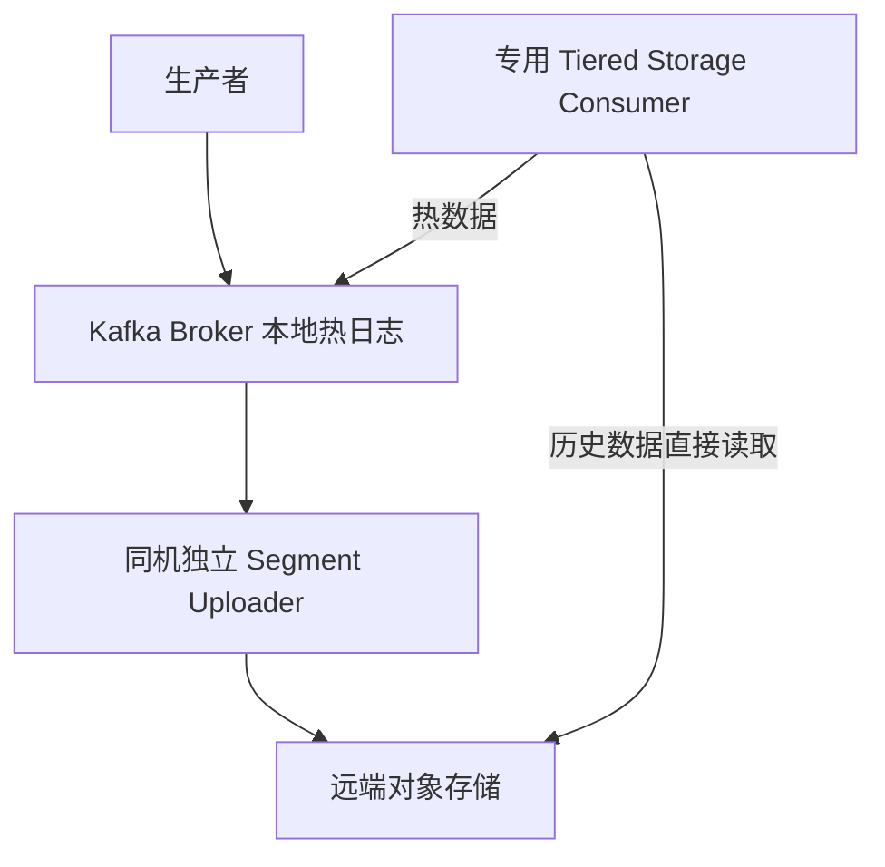

公开项目进一步说明了上传器与消费者组件，并提供代码。文章发布时还提到 KRaft 适配在开发中，所以不能仅凭这篇历史文章证明它已支持所有现代 Kafka 部署；实际采用前应检查项目当前版本。[Pinterest tiered-storage 仓库](https://github.com/pinterest/tiered-storage)

### 工程分析

这条路线不仅把“存储容量”挪走，还尝试把“历史读取服务流量”挪走。对训练、回放、补历史等冷读较重的场景，后者可能更有价值。

代价是客户端不再只理解 Kafka Fetch：还要处理远端对象布局、有效范围、上传进度、索引、热冷切换和权限。使用专用库意味着要管理不同语言的支持范围与应用升级。

上传必须先于本地清理，并确保所有需要的段和索引都已可恢复。如果消费者只看到了一个对象存在，却不知道它是否完整上传、是否属于正确 Leader epoch，就可能错误读取。具体一致性细节应读实现，不能把“上传文件到 S3”当成完整方案。

## Confluent的云平台与存储路线

### Kora 的多租户与弹性

Kora 的官方文章讨论将计算、网络和存储解耦，管理不同存储层的数据局部性，并把租户放在 cell 中以限制故障影响、改善资源利用和升级行为。[Kora 官方架构文章](https://www.confluent.io/blog/cloud-native-data-streaming-kafka-engine/)

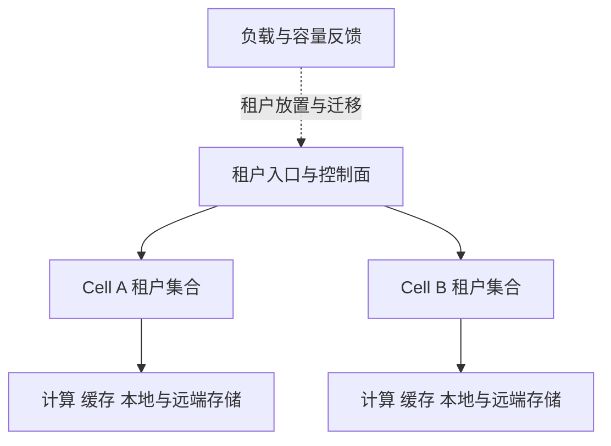

这是 cell 隔离思想的概念图，省略官方内部实现。cell 的作用不是消灭故障，而是控制单次故障与变更影响的范围；同时要避免调度器将同一关键业务的依赖全放在同一个故障单元。

### Freight 的直接写对象存储

Confluent 对 Freight 集群的文章说明，其演进的 Kora 路径可以直接写对象存储，减少 Broker 本地复制及跨 AZ 成本，并接受秒级延迟的权衡。这是特定集群类型的设计，不能推广成“所有 Confluent Kafka 都以秒级延迟直接写 S3”。[Freight GA 说明](https://www.confluent.io/blog/freight-clusters-are-generally-available/)

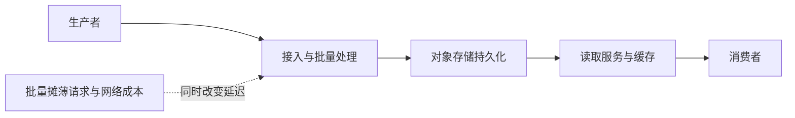

### 工程分析

云环境里，“少用几块磁盘”可能不是最大成本项。跨 AZ 字节、对象请求、最低节点规格、空闲资源、冷读流量和运营人力都会进入账单。一个低成本路径可能选择更大批次和更长等待，另一个低延迟路径则保留更昂贵的热状态，两者都可以是合理的产品选择。

因此评估时应同时记录工作负载、SLO、存储路径和定价边界。不能把产品文章中的最优降本比例，当成对任意流量与任意延迟要求的承诺。

## AutoMQ与Redpanda的不同路线

它们作为技术路线补充，**不作为某家互联网公司内部全面使用的证据**。

| 方向 | 公开架构重点 | 与 Apache Kafka 的关系 | 要继续核验什么 |
| --- | --- | --- | --- |
| AutoMQ | 基于 Kafka 演进，围绕 S3 Stream 等机制重构存储与弹性 | 在 Kafka 代码与协议生态上演进 | 当前版本的存储保证、事务、组协议、运维 API 与迁移支持 |
| Redpanda | 不同的运行时与数据复制实现，每个数据分区形成 Raft group | 提供 Kafka API 兼容的新实现 | API 版本、语义差异、客户端工具与负载表现 |

[AutoMQ 官方仓库](https://github.com/AutoMQ/automq)披露其代码与存储方向；[Redpanda 官方架构](https://docs.redpanda.com/streaming/current/get-started/architecture/)明确说明数据分区的 Raft 复制。二者都不能仅凭“兼容 Kafka”就推导出内部实现与原生 Kafka 相同。

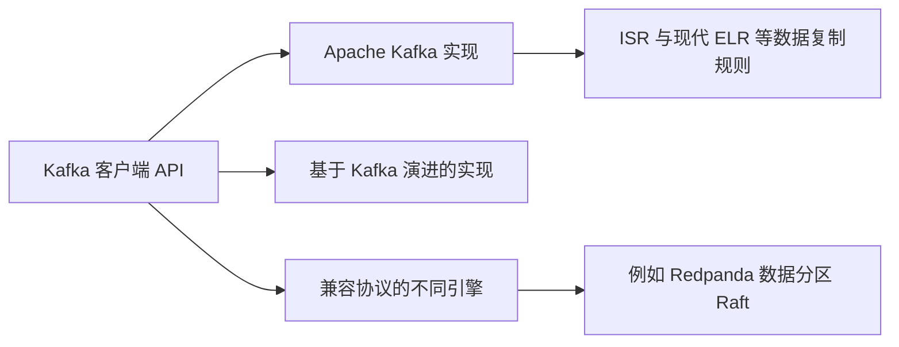

尤其要区分：**Apache Kafka 的 KRaft 负责集群元数据，而 Redpanda 的官方材料中每个业务数据分区使用 Raft。**相同的 Kafka 客户端接口不代表相同的内部共识与确认条件。

## 大规模系统反复遇到的问题

下表是根据上述案例归纳的工程分析，不是声称每家公司都公开采用了全部措施。

| 改造方向 | 原有瓶颈 | 常见手段 | 新增代价 |
| --- | --- | --- | --- |
| 存储 | 长保留、历史搬迁、本地磁盘绑定 | 分层存储、共享日志、对象存储 | 远端 IO、缓存、元数据、删除与恢复 |
| 调度 | 静态分配、热分区、迁移冲击 | 指标模型、目标优化、限速搬迁 | 模型误差、执行安全、控制器复杂度 |
| 消费 | 分区绑定工作者、队头阻塞、多语言 | 消费代理、按键并行、共享消费模型 | 在途状态、顺序、重复与确认边界 |
| 可靠性 | 组件健康不能证明链路完整 | 审计、对账、探针、故障演练 | 额外流量、窗口对齐、假阳性 |
| 隔离 | 合法租户互相干扰 | ACL、配额、资源池、cell | 空闲冗余、资源碎片、跨池迁移 |
| 运维 | 人工变更与多版本复杂性 | 自助平台、策略模板、发布与回退 | 平台自身的状态和版本维护 |
| 数据治理 | 契约变化与历史回放 | Schema、兼容策略、血缘、保留分级 | 治理流程、演进成本与归属管理 |

## 如果要建设自己的Kafka平台

### 先从周边平台开始

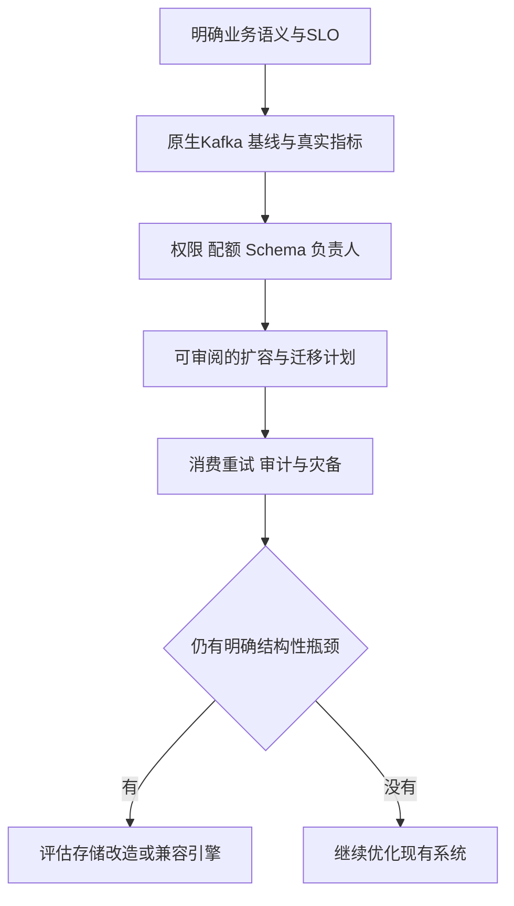

这是一般建设建议，不替任何规模的团队预先做技术选型。对于学习项目，可以先实现一个控制台：创建 Topic 时限制分区与副本，观察组进度，输出迁移计划，再建立消息审计。这样能直接练到大厂案例中的治理与恢复问题。

### 自研内核要回答的问题

如果确实决定实现引擎，就不能只完成 `Produce` 和 `Fetch` 两个接口。可以按下面的契约拆设计：

| 契约 | 必须先回答的问题 |
| --- | --- |
| 数据身份 | Topic、Partition、Offset、epoch 怎样分配和持久化？ |
| 单写者 | 旧 Leader 复活、网络分区与租约过期时，怎样阻止双写？ |
| 确认 | 响应成功究竟对应哪些持久化和故障承诺？ |
| 读取 | 热冷切换、事务边界、保留与压缩后怎样继续定位？ |
| 消费组 | 成员失联、增量分配、提交与重放怎样兼容？ |
| 事务 | Producer fencing、幂等序列、超时中止怎样恢复？ |
| 运维 | 副本或共享存储故障时如何修复、扩容与回退？ |
| 协议 | 支持哪些 API 版本、错误码、压缩与客户端组合？ |

### 兼容性是行为矩阵

“连得上”只证明某条路径可用。还应验证事务、幂等、重平衡、`read_committed`、大批次、压缩、ACL、配额、时间戳查询、管理操作，以及 Connect/Streams 等生态的实际使用路径。未覆盖的功能应写“未确认”，不能用通用兼容宣传代替验证。

## 证据与阅读索引

下列链接均在本次调研中访问。文章年份用于标记证据时间，非现网拓扑承诺。

| 编号 | 一手来源 | 本文使用范围 |
| --- | --- | --- |
| L1 | [LinkedIn 定制 Kafka，2019-10-08](https://www.linkedin.com/blog/engineering/open-source/apache-kafka-trillion-messages) | 企业发行分支与周边生态 |
| L2 | [Cruise Control 仓库](https://github.com/linkedin/cruise-control) | 负载建模、目标优化与组件 |
| L3 | [Cruise Control Overview](https://github.com/linkedin/cruise-control/wiki/Overview) | 执行器、异常和启用条件 |
| L4 | [LinkedIn Brooklin 负载均衡镜像](https://www.linkedin.com/blog/engineering/data-streaming-processing/load-balanced-brooklin-mirror-maker-replicating-large-scale-kaf) | 跨集群复制任务与分区指标 |
| U1 | [Uber uReplicator](https://www.uber.com/us/en/blog/ureplicator-apache-kafka-replicator/) | 历史镜像复制改进 |
| U2 | [Uber Chaperone，2016-12-08](https://www.uber.com/us/en/blog/chaperone-audit-kafka-messages/) | 完整性、重复与延迟审计 |
| U3 | [Uber Consumer Proxy](https://www.uber.com/us/en/blog/kafka-async-queuing-with-consumer-proxy/) | 按记录投递与消费解耦 |
| U4 | [Uber uForwarder 改进，2026-02-05](https://www.uber.com/us/en/blog/introducing-ufowarder/) | 路由、队头阻塞、放置与延迟处理 |
| U5 | [uForwarder 仓库](https://github.com/uber/uForwarder) | 项目实现与公开范围 |
| B1 | [字节消息队列演进之路](https://developer.volcengine.com/articles/7325343303150272539) | BMQ 背景与演进方向 |
| B2 | [字节新一代云原生消息队列实践](https://developer.volcengine.com/articles/7330942715883945994) | 组件分层、存储与缓存；页面未提供本文可稳定核实的统一首发日期 |
| P1 | [Pinterest Broker 外分层存储，2024-09-17](https://medium.com/pinterest-engineering/pinterest-tiered-storage-for-apache-kafka-%EF%B8%8F-a-broker-decoupled-approach-c33c69e9958b) | Uploader、专用客户端与历史兼容边界 |
| P2 | [Pinterest tiered-storage 仓库](https://github.com/pinterest/tiered-storage) | 代码入口与项目组件 |
| C1 | [Confluent Kora](https://www.confluent.io/blog/cloud-native-data-streaming-kafka-engine/) | 云平台、多租户、cell 与存储层次 |
| C2 | [Confluent Freight GA](https://www.confluent.io/blog/freight-clusters-are-generally-available/) | 特定产品的直接写对象存储与延迟权衡 |
| A1 | [AutoMQ 官方仓库](https://github.com/AutoMQ/automq) | 基于 Kafka 演进的存储路线，不作为企业采用证明 |
| R1 | [Redpanda 官方架构](https://docs.redpanda.com/streaming/current/get-started/architecture/) | 不同数据复制实现，不作为企业采用证明 |

进一步阅读可以选一个问题反向追源码：均衡器如何避免破坏高优先级目标；消费代理如何维护连续提交边界；共享存储如何保证单写者。这样比背诵“某公司自研了某 MQ”更容易迁移到自己的设计工作。
