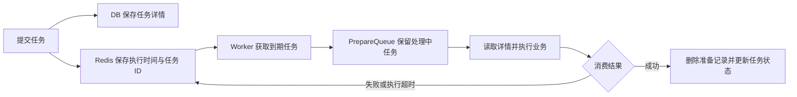

# 大厂延迟关单与超时调度方案：公开资料核验

> 核验日期：2026-10-09。范围：字节跳动、腾讯、美团、阿里及淘宝。依据公司技术团队文章、署名工程师文章和官方产品文档整理，不把通用方案推演写成某公司的线上实现。历史文章说明当时披露的设计，不代表整个公司当前所有系统的架构。

延迟关单至少包含两个不同问题：到期时如何触发一次检查，以及这次检查如何安全地改变订单状态。本文主要调查前者，并标明公开材料是否真的披露了未支付关单业务。

阿里与淘宝有组织和技术体系上的关联，但“阿里技术公开的方案”“阿里云产品能力”和“淘宝交易系统实际部署”属于不同证据范围，分别讨论。

## 目录

- [一、结论与证据范围](#一结论与证据范围)
- [二、字节跳动：BMQ 平台与关单证据边界](#二字节跳动bmq-平台与关单证据边界)
- [三、腾讯：延迟任务需求与 TDMQ 时间轮](#三腾讯延迟任务需求与-tdmq-时间轮)
- [四、美团：Mafka 延迟结算与交易补偿](#四美团mafka-延迟结算与交易补偿)
- [五、阿里：TOC 超时中心与云消息产品](#五阿里toc-超时中心与云消息产品)
- [六、淘宝：可确认的资料与未确认的部署](#六淘宝可确认的资料与未确认的部署)
- [七、直接关单案例：有赞的两份公开设计](#七直接关单案例有赞的两份公开设计)
- [八、如何理解 MQ、Redis 与数据库的分工](#八如何理解-mqredis-与数据库的分工)
- [九、调度可靠性与订单正确性](#九调度可靠性与订单正确性)
- [十、资料索引与核验说明](#十资料索引与核验说明)

------

## 一、结论与证据范围

**公开资料不能支持“大厂统一采用 MQ + Redis 延迟关单”这个结论。** 已披露的设计包括 MQ 服务端定时投递、数据库驱动的任务调度，以及 Redis 保存到期索引的超时中心。具体是否用于某条订单关单链路，需要单独举证。

| 对象 | 本文核实的方案 | 能确认到的范围 | 未支付关单证据 |
| --- | --- | --- | --- |
| 字节跳动 | Kafka 向存算分离 BMQ 演进 | 公司消息基础设施 | 未找到直接披露抖音电商关单链路的一手材料 |
| 腾讯 | TDMQ RocketMQ：RocksDB 多级时间轮 | 云产品服务端定时消息实现 | 官方列出电商超时场景，不等于腾讯内部交易部署 |
| 美团 | Mafka 延迟结算；延迟发券补偿；退款重试 | 酒旅、团购、外卖各自披露的业务 | 找到交易链路延迟处理，但不能确认未支付关单选型 |
| 阿里 | TOC：任务库与 Redis 定时索引；RocketMQ 定时消息 | 阿里技术文章中的设计与阿里云产品能力 | 未说明所有阿里交易业务都采用同一方案 |
| 淘宝 | 淘系官方资料入口；关联 TOC 技术线索 | 淘系技术资料及相关设计讨论 | 未确认淘宝主交易关单的完整部署拓扑 |
| 有赞，补充对照 | Redis 延迟队列；DB 扫描与 NSQ 的 TSP | 明确以超时关单为需求的公开设计 | 有直接场景与任务示例 |

各行依据见对应章节。这里的“未找到”仅表示本次检索未取得充分证据，不表示该公司没有相应系统。

### 证据怎样使用

| 材料类型 | 可以证明什么 | 不能自动证明什么 |
| --- | --- | --- |
| 团队披露某业务的线上实践 | 该业务在文章所述时间采用了相应设计 | 全公司都这样实现，或现在仍未变化 |
| 公司署名技术设计文章 | 公司公开过该设计 | 设计覆盖哪些生产业务、是否全面部署 |
| 官方云产品文档 | 产品支持相应功能、限制和接口 | 公司内部的某个业务使用该产品 |
| 官方工程师方案调研 | 作者的需求背景和调研结论 | 被列举的方案全部进入了生产 |
| 社区问答、转述和面试教程 | 可供继续追踪的线索 | 未经核实的公司内部架构 |

论文或专利中的算法、设计，也需要与实际部署证据区分。本文没有用专利申请代替线上实践证明。

------

## 二、字节跳动：BMQ 平台与关单证据边界

### 已披露的消息基础设施

火山引擎“云原生计算”账号的《一文了解字节跳动消息队列演进之路》介绍了 Kafka 向自研 BMQ 的演进。BMQ 将计算与存储分离：Proxy 接入，Broker 处理写入，Controller 管理分区，Coordinator 协调消费组，CloudFS 保存分区数据。文章未披露订单超时关单链路。[来源 B1](https://developer.volcengine.com/articles/7325343303150272539)

火山引擎官方 RocketMQ Go SDK 概述另外提供了“定时消息和延时消息”的文档入口。这能确认其 RocketMQ 云产品提供相关接入能力，不能将其与 BMQ 混同，也不能据此判定抖音关单实现。概述页标注更新时间为 2025-07-09；具体延时页面本次只取得 JavaScript 页面壳，未核实接口细节。[来源 B2](https://docs.volcengine.com/docs/MessageQueueforRocketMQ/Overview?lang=zh)

### 本次能给出的结论

可以确认字节公开了专门的消息基础设施团队与平台。不能确认抖音电商关单究竟使用 BMQ、另一种 MQ、Redis 超时中心，还是组合方案。BMQ 文中的低时延与消费积压 Lag，也不能直接解释成“消息设置未来时间再投递”的延迟消息能力。

**字节这一项的关单实现保持“未确认”，不补画假定的生产拓扑。**

------

## 三、腾讯：延迟任务需求与 TDMQ 时间轮

### 工程师文章的实际业务背景

腾讯技术工程官方号 2020-10-21 发布《你真的知道怎么实现一个延迟队列吗？》，作者为腾讯 IEG 工程师 xiewang。实际需求是按计划向小程序订阅者推送微信或 QQ 模板消息，并希望抽成通用服务；文章随后调研 Redis ZSet 等方案。“15 分钟未支付取消订单”是列举的适用场景，不是已披露的腾讯关单系统。[来源 T1](https://cloud.tencent.com/developer/article/1724885)

### 云产品披露的定时消息实现

腾讯云中间件 2025-07-23 的《TDMQ RocketMQ 版秒级定时消息原理解析》介绍了由固定延迟级别、文件时间轮到 RocksDB 多级时间轮的演进。增强方案分别管理小时、分钟、秒级 Wheel，借助嵌入式 KV 保存与扫描定时数据，减少对外挂存储的需要。[来源 T2](https://www.cnblogs.com/tengxunzhongjianjian/articles/19000702)

该文报告的压测条件为 8 核、16 GB、1 TB SSD 云盘，发送一亿条、延迟随机 30 秒至 10 分钟、一个下游实时消费；在 14,000 TPS 时，表格给出延迟误差 P999 为 979 ms。该结果属于特定压测条件，不是业务端关单完成的 SLA。[同一来源：压测章节](https://www.cnblogs.com/tengxunzhongjianjian/articles/19000702)

腾讯云官方“定时与延迟消息”文档也说明了服务端时间轮增强及对应发送接口。使用限制按产品版本与规格确认，不能将其对旧开源延迟级别的描述泛化为所有 Apache RocketMQ 版本。[来源 T3](https://intl.cloud.tencent.com/zh/document/product/1113/58502)

### 本次能给出的结论

**可以确认腾讯云有由 MQ 服务端承担定时调度的产品实现。** 这一实现不能推出业务方还必须额外部署 Redis；也不能推出微信支付、微信小店或其他腾讯内部交易系统全部采用它。

------

## 四、美团：Mafka 延迟结算与交易补偿

### 酒旅结算：Mafka 延迟队列

美团技术团队 2018-01-15 的《高性能平台设计——美团旅行结算平台实践》介绍：交易数据通过 Mafka 接入，尚未到结算日期的数据进入延迟队列，到期重新消费；通过处理状态做监控与补偿。执行 Server 集群共享，通过 Topic、Partition、消费组配置分配容量及隔离业务。[来源 M1](https://tech.meituan.com/2018/01/15/high-performance-platform-design.html)

### 团购发券：即时执行与延迟补偿

美团技术团队 2016-12-27 的《美团团购订单系统优化记》披露了两组独立消息队列：支付通知投递到即时队列及另一组 10 秒延迟队列；延迟消费者检查订单是否已发券，未完成时再执行与兜底。这里延迟任务用于支付后的发券补偿。[来源 M2](https://tech.meituan.com/2016/12/27/meituan-tuangou-order.html)

### 外卖退款：延迟重试与幂等

美团技术团队 2016-09-09 的《美团外卖订单中心的演进》介绍：退款先检查是否已经完成；向支付平台发起退款失败时，放入延时队列稍后重试。该段披露了业务语义，没有据此给出队列一定基于 Redis 或某种 MQ 的结论。[来源 M3](https://tech.meituan.com/2016/09/09/mt-waimai-order-evolution.html)

### 本次能给出的结论

**美团确实公开过真实交易业务中的延迟队列实践。** 三篇分别涉及结算、发券、退款，不能拼接成“美团未支付订单统一使用 Mafka + Redis 关单”的证据。共享集群也只按结算文章的范围理解。

------

## 五、阿里：TOC 超时中心与云消息产品

### 阿里技术公开的低延迟 TOC 设计

《一种低延迟的超时中心实现方式》发布于 2021-06-02，署名默达，注明来源为阿里技术公众号。文中比较扫任务库的传统设计与 Redis 定时方案；后者保存任务详情到 DB，将任务 ID 与执行时间写入 Redis ZSet，到期取 ID、查询详情、交给业务处理器。[来源 A1](https://developer.aliyun.com/article/784457)

可靠性设计包含 StoreQueue、PrepareQueue 和 DeadQueue：Lua 将任务移入准备队列，消费成功删除，失败或滞留超时回投；ZooKeeper 分配 Worker 与存储槽。相关键使用 hash tag 以满足 Lua 操作的同节点要求。文章未指明该设计覆盖淘宝全部订单。[同一来源：Redis 存储与消费章节](https://developer.aliyun.com/article/784457)

图是上述文章的简化转述，只表示文中设计。DB 与 Redis 之间如何避免注册遗漏，需要另外审查，不能从图中自动获得原子提交保证。

### 阿里云 RocketMQ 的另一条路径

阿里云 RocketMQ 5.x 官方文档将未支付订单超时检查列为定时消息场景：消息先保存在定时存储中，到期转入普通消息存储，随后由消费者处理。参数采用目标时间戳，默认投递精度为秒级；故障恢复或集中到期可能增加延迟。[来源 A2](https://help.aliyun.com/zh/apsaramq-for-rocketmq/cloud-message-queue-rocketmq-5-x-series/developer-reference/scheduled-and-delayed-messages)

**TOC 与云产品定时消息是两份不同层次的证据。** 前者展示自建超时中心设计，后者展示对外消息服务能力，不能合并为“阿里全部使用 TOC”，也不能合并为“阿里全部使用 RocketMQ 延迟消息”。

------

## 六、淘宝：可确认的资料与未确认的部署

### 淘系官方资料入口

阿里云藏经阁的《2021 技术人的百宝黑皮书》页面标注发布时间为 2022-01-21，介绍其为淘系 2021 年技术内容合集，来源圈子为“大淘宝技术”。本次核实了官方介绍页，没有取得可完整检索的在线书内正文，因此不声称已核对某一章节的书内页码。[来源 TB1](https://developer.aliyun.com/ebook/7436)

### TOC 线索怎样使用

阿里技术的 TOC 文章可以作为相关系统设计资料，但“出现在阿里或淘系技术材料中”不足以确定具体交易业务的部署。

以下问题在本次一手材料中没有得到充分回答：

- 淘宝主交易的未支付关单，是否由上述 Redis 版 TOC 触发？
- 不同订单类型是否走不同超时平台？
- MQ 是保存未到期任务，还是仅分发已经到期的任务？
- 任务注册失败、支付回调与关单竞争，以及支付渠道关闭结果不明时如何恢复？

**因此淘宝项记录为“关联 TOC 设计资料已找到，主交易关单完整部署未确认”。** 不采用“曾在阿里工作的老师说过”等二手转述补齐这些问题，也不将阿里云产品文档当作淘宝内部部署证明。

------

## 七、直接关单案例：有赞的两份公开设计

有赞并非此次五个对象之一，保留它作为证据对照：下面两篇明确关联关单，比只有“适用场景”描述的材料更直接。

### 2016 年：Redis 延迟队列

《有赞延迟队列设计》发布于 2016-03-22，明确以未支付关单和退库存为背景。设计包括任务元信息、ZSet Delay Bucket、Timer、Ready Queue，给出延迟 1,800 秒的 `orderclose` 示例；执行期间利用 TTR 与完成响应管理任务，作者同时列出 Redis 持久化及短轮询不足。[来源 Y1](https://tech.youzan.com/queuing_delay/)

### 2020 年：统一调度平台 TSP

《有赞调度系统 TSP》发布于 2020-03-19，介绍 TOC 从交易需求发展到中间件维护，后与 Watchman 整合。TSP 保存任务到 DB，按索引扫描到期任务，经 NSQ 分发，由 Worker 回调业务；提供失败重新调度、分表、隔离与限流。[来源 Y2](https://tech.youzan.com/tsp_schedule/)

**TSP 中到期判断由调度器完成，NSQ 承接执行任务。** 两份材料说明公开过不同设计，但未证明后者已经完全替换前者的所有部署。

------

## 八、如何理解 MQ、Redis 与数据库的分工

以下是根据已核实材料进行的架构归纳，不作为未披露公司业务的事实。

| 路径 | 保存未来任务或到期索引 | 产生到期触发 | 承接执行 |
| --- | --- | --- | --- |
| 阿里云、腾讯云定时消息产品 | MQ 的定时存储与索引 | MQ 服务端调度 | 消费者 |
| 阿里技术 TOC 设计 | DB 详情与 Redis 定时索引 | Redis Worker | 业务处理器 |
| 有赞 2016 年队列 | Redis 任务池与 ZSet | Timer | Ready Queue 与业务消费者 |
| 有赞 2020 年 TSP | DB 任务表 | Fetcher 扫描 | NSQ 与 Worker |

### 会不会专门建设一整套系统

有专门平台的公开实例：有赞 TOC/TSP 由交易需求逐步演进，字节公开了专门消息团队，美团结算披露了多业务共享与隔离。这些实例支持“能力可以由基础设施团队集中提供”，不足以统计所有公司的普遍比例。

### 用了 MQ，是否还需要 Redis

先明确 Redis 的职责。如果 MQ 已提供满足需求的定时投递，业务侧不必仅为“等待到期”再实现一个 Redis 队列。若采用 Redis 超时中心，则 Redis 本身承担到期索引或队列职责；另有 MQ 时，应说明它负责什么阶段。

“MQ + Redis”只是组件清单，无法说明任务是否能可靠恢复。关键是任务进入哪里、执行中记录在哪里、成功如何确认、失败如何再次执行。

### 数据库扫描是不是一定不能用于生产

有赞 TSP 的公开设计就是数据库任务扫描。它扫描独立任务表并进行索引、分表、隔离和限流，不能与每个业务实例反复全扫订单历史库混为一谈。也不能据此给出“日均多少订单一定该用某方案”的固定阈值。

------

## 九、调度可靠性与订单正确性

这部分是通用设计审查点，**不是上述五家公司未公开的内部实现**。

### 到期通知不等于关单成功

| 故障窗口 | 需要明确的处理规则 |
| --- | --- |
| 订单成功，任务注册失败 | 如何持久记录待注册任务、重试或发现遗漏 |
| 领取任务后 Worker 崩溃 | 如何保留执行中记录、超时重新交付 |
| 支付与关单并发 | 本地状态转换条件及支付渠道结果如何协调 |
| 订单关闭，库存释放失败 | 同库事务或跨服务事件如何恢复 |
| MQ、DB 或 Redis 不可用 | 任务何时恢复，积压如何监控与限流 |

本地消息表 Outbox 可用于解决业务写库与发事件的双写窗口：在同一 DB 事务中保存业务变更与待发事件，后台再发送。投递仍可能重复，消费端需要幂等。这是通用模式，不表示某公司已经采用它。[来源 G1](https://docs.aws.amazon.com/prescriptive-guidance/latest/cloud-design-patterns/transactional-outbox.html)

### 至少一次需要业务幂等

准备队列、执行超时和消费重试可以让任务再次执行，但不能保证支付扣款、退款或库存释放只发生一次。设计中应分别验证“任务会重新交付”和“业务重复执行不会产生重复效果”。

### Redis 过期通知不能等同于可靠任务队列

Redis 官方说明，键空间通知使用 Pub/Sub，订阅者断线期间的事件会丢失；过期通知也不保证恰好在 TTL 到零时产生。因此单独订阅键过期，不具备上述持久任务、处理中记录及完成确认机制。[来源 G2](https://redis.io/docs/latest/develop/pubsub/keyspace-notifications/)

### 需要区分三种时间

- **业务截止时间**：按产品与支付渠道规则确定的最后有效时刻。
- **消息可消费时间**：到期任务或定时消息开始被交付的时刻。
- **关单完成时间**：业务状态与相关资源处理达到所要求结果的时刻。

这是概念区分。投递误差、任务队列积压与业务处理耗时会影响后两者；消息中间件压测的投递精度不能直接换算成业务端到端关单精度。

------

## 十、资料索引与核验说明

以下均为本文实际查阅的资料。未标注日期的页面按核验日期引用，不根据搜索引擎的相对时间猜测发表日期。

| 编号 | 资料与发布主体 | 日期或版本 | 证据用途 |
| --- | --- | --- | --- |
| B1 | [字节消息队列演进之路，火山引擎云原生计算](https://developer.volcengine.com/articles/7325343303150272539) | 页面未显示明确发表日期 | BMQ 消息平台设计 |
| B2 | [RocketMQ Go SDK 概述，火山引擎官方文档](https://docs.volcengine.com/docs/MessageQueueforRocketMQ/Overview?lang=zh) | 更新 2025-07-09 | 定时、延时消息文档入口；未完整取得该子页正文 |
| T1 | [延迟队列方案调研，腾讯技术工程官方号](https://cloud.tencent.com/developer/article/1724885) | 2020-10-21 | 工程师真实需求与调研范围 |
| T2 | [TDMQ 秒级定时消息原理解析，腾讯云中间件](https://www.cnblogs.com/tengxunzhongjianjian/articles/19000702) | 2025-07-23 | 时间轮、RocksDB 与条件化压测结果 |
| T3 | [定时与延迟消息，腾讯云官方文档](https://intl.cloud.tencent.com/zh/document/product/1113/58502) | 更新 2026-05-11 | 产品能力与版本注意事项 |
| M1 | [美团旅行结算平台实践，美团技术团队](https://tech.meituan.com/2018/01/15/high-performance-platform-design.html) | 2018-01-15 | 延迟结算及多业务隔离 |
| M2 | [美团团购订单系统优化记，美团技术团队](https://tech.meituan.com/2016/12/27/meituan-tuangou-order.html) | 2016-12-27 | 发券延迟补偿 |
| M3 | [美团外卖订单中心的演进，美团技术团队](https://tech.meituan.com/2016/09/09/mt-waimai-order-evolution.html) | 2016-09-09 | 退款延迟重试与幂等 |
| A1 | [低延迟超时中心，默达／阿里技术](https://developer.aliyun.com/article/784457) | 2021-06-02 | DB 与 Redis 的 TOC 设计 |
| A2 | [定时／延时消息，阿里云官方文档](https://help.aliyun.com/zh/apsaramq-for-rocketmq/cloud-message-queue-rocketmq-5-x-series/developer-reference/scheduled-and-delayed-messages) | RocketMQ 5.x 系列 | 云产品到期投递能力 |
| TB1 | [2021 技术人的百宝黑皮书，阿里云藏经阁／大淘宝技术](https://developer.aliyun.com/ebook/7436) | 发布 2022-01-21 | 官方淘系资料入口；未核实书内具体页码 |
| Y1 | [有赞延迟队列设计，有赞技术](https://tech.youzan.com/queuing_delay/) | 2016-03-22 | 直接关单任务示例 |
| Y2 | [有赞调度系统 TSP，有赞技术](https://tech.youzan.com/tsp_schedule/) | 2020-03-19 | DB 扫描与 NSQ 执行的统一平台 |
| G1 | [Transactional Outbox，AWS Prescriptive Guidance](https://docs.aws.amazon.com/prescriptive-guidance/latest/cloud-design-patterns/transactional-outbox.html) | 核验 2026-10-09 | 通用双写问题处理模式 |
| G2 | [Redis 键空间通知，Redis 官方文档](https://redis.io/docs/latest/develop/pubsub/keyspace-notifications/) | 核验 2026-10-09 | 过期事件时机与断线丢事件限制 |

本文采用有限摘要与重新组织后的比较，未复制原文全文、代码或插图。流程图为标注来源的简化示意。公开资料没有覆盖的部署关系，保留为未确认。
