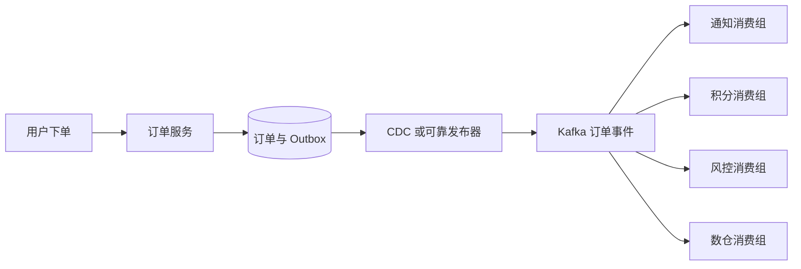
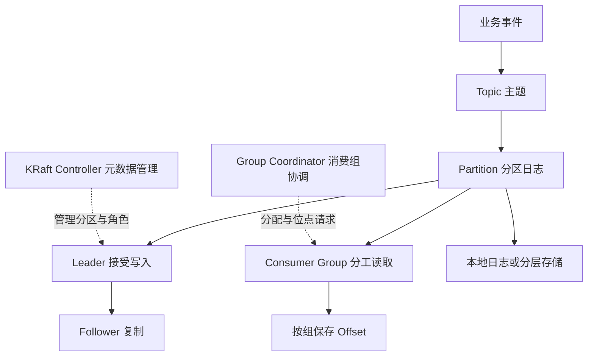
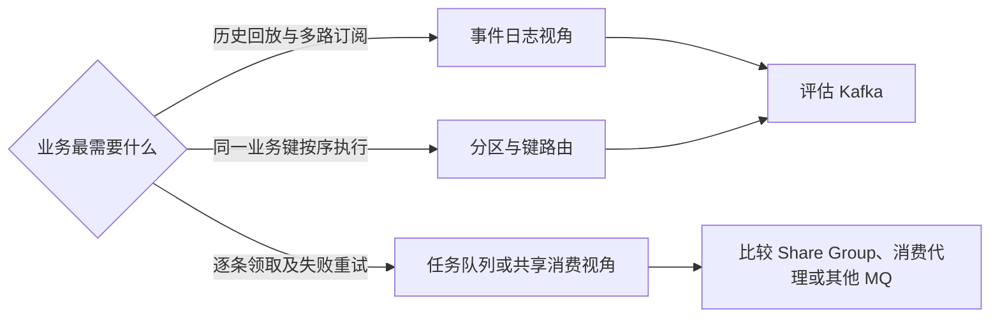

# 消息队列与 Kafka 学习路线

消息队列把一次同步调用，变成一条可以保存、重试、回放的消息。Kafka 进一步把消息组织为**分区日志**：多个下游可以各自记录进度，反复读取同一段历史。

本专题面向 Java 后端学习者，按“业务场景 → 集群架构 → 扩容边界 → 大厂演进 → 源码与实验”展开。已有 RocketMQ 基础，可以先比较日志与任务队列的消费模型；刚接触 MQ，可以先看下面的订单例子。

> 核验日期：2026-10-18。架构说明以 Apache Kafka 4.3 文档为主，源码固定到 `4.3.1` 标签。Kafka 4.x 使用 KRaft；旧文章中的 ZooKeeper 图要按历史版本理解。[官方版本列表](https://kafka.apache.org/community/downloads/)

## 专题目录

| 阅读顺序 | 章节 | 重点问题 |
| --- | --- | --- |
| 1 | [Kafka 架构设计详解](Kafka架构设计详解.md) | 一条消息怎样写入、复制、被读取？Controller、Broker、Coordinator 各管什么？ |
| 2 | [Kafka 可扩展性与容量规划](Kafka可扩展性与容量规划.md) | 加消费者、加分区、加 Broker 分别解决什么？怎样计算积压和迁移时间？ |
| 3 | [大厂 Kafka 改造与自研架构调研](大厂Kafka改造与自研架构调研.md) | LinkedIn、Uber、字节、Pinterest、Confluent 改了哪一层？代价是什么？ |
| 4 | [Kafka 源码导读与实战演练](Kafka源码导读与实战演练.md) | 从哪些类开始读？怎样验证分组、位点、重放和分区扩展？ |
| 配套 | [打开 Kafka 交互式架构实验室](https://jingxu-huan.github.io/learningnote/visualizations/kafka-architecture/) | 逐步看写入复制、操作消费位点、比较扩容方式、计算容量、切换演进架构 |

已有笔记：[Kafka 快速上手](kafka-quickstart.md)、[RocketMQ 学习笔记](RocketMQ学习笔记.md)、[大厂延迟关单与超时调度公开资料](大厂延迟关单与超时调度方案公开资料核验.md)。

------

## 从一笔订单理解消息队列

订单服务如果同步调用短信、积分、风控和数仓，任何慢下游都可能拖住下单接口。加入 MQ 后，订单先可靠地产生事件，各个下游再按自己的速度处理。

图中的 Outbox 是与订单在同一数据库事务内写入的“待发布事件表”。它解决“订单已经保存，但服务在发消息前崩溃”的双写缺口。它仍需要可靠投递、重试、监控和下游幂等，详细过程见架构章节。

把 MQ 放进系统后，需要重新定义接口成功的含义：下单接口成功可以表示“订单已保存”，通知发送与积分到账则可能稍后完成。涉及余额、库存等业务约束时，必须另行设计事务和补偿，不能把“异步”当成一致性方案。

## 一张图建立概念地图

这里最值得建立的四个区分：

- **Topic 与分区**：Topic 是逻辑分类，分区才是有顺序的日志和并行调度单位。
- **副本与分区**：分区用来拆工作，副本用来保可靠性，增加副本不会把同一分区变成多份独立写入能力。
- **业务消费与位点提交**：业务做完与 Kafka 知道做完，是两个动作。
- **数据面与控制面**：Broker 接收消息，Controller 管理元数据；业务消息不会先经过 Controller。

## MQ 解决的问题与需要支付的成本

| 目标 | 可以得到什么 | 仍需处理什么 |
| --- | --- | --- |
| 异步解耦 | 生产者不等待所有下游执行 | 最终状态查询、超时、补偿、消息契约 |
| 削峰填谷 | 高峰先写入日志，下游逐步消化 | 容量、保留期、追赶速度、背压 |
| 多路订阅 | 通知、风控和数仓独立消费 | 多消费组读放大、权限、隔离 |
| 事件回放 | 修复逻辑后重算保留期内的数据 | 重复副作用、Schema 演进、历史依赖 |
| 故障隔离 | 单个下游故障不必立即拖住生产者 | 积压告警、毒消息、重试和死信治理 |

## 两种消费视角

普通 Kafka Consumer Group 按分区分配消费者，适合事件流、回放和按键有序处理。任务队列则更关注“哪一个工作者领取了哪一条任务”，通常需要逐条确认、失败重领、延迟和死信策略。

现代 Kafka 另有 Share Consumer / Share Group，允许按记录共享消费工作，语义和普通 Consumer Group 不同。本文的分区并行上限、连续位点提交等推导，默认针对**普通 Consumer Group**，不要直接套到 Share Group。[官方消费模型说明](https://kafka.apache.org/43/design/design/#the-share-consumer)

## 建议的学习方式

先回答“一条订单消息究竟写在哪”，再跟着写入图走到副本和提交点；接着在交互页处理两条消息而不提交，模拟崩溃，观察重复。最后把消费者数量调到超过分区数，再调 Broker 数，比较哪一个瓶颈真正改变。

进阶阅读可选择三条路径：读架构章节建立全景；读容量章节练习计算与排障；读大厂调研比较方案，然后回源码索引验证实现入口。
