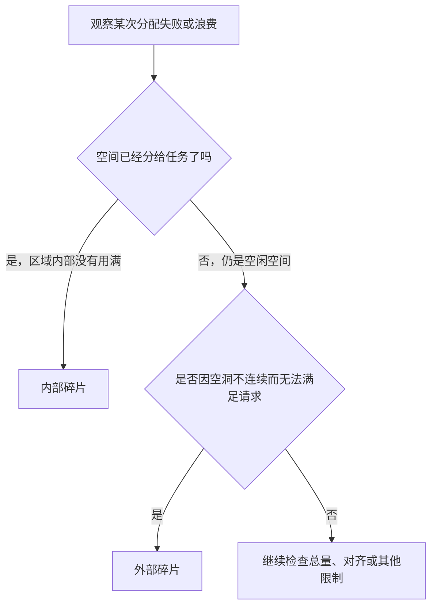
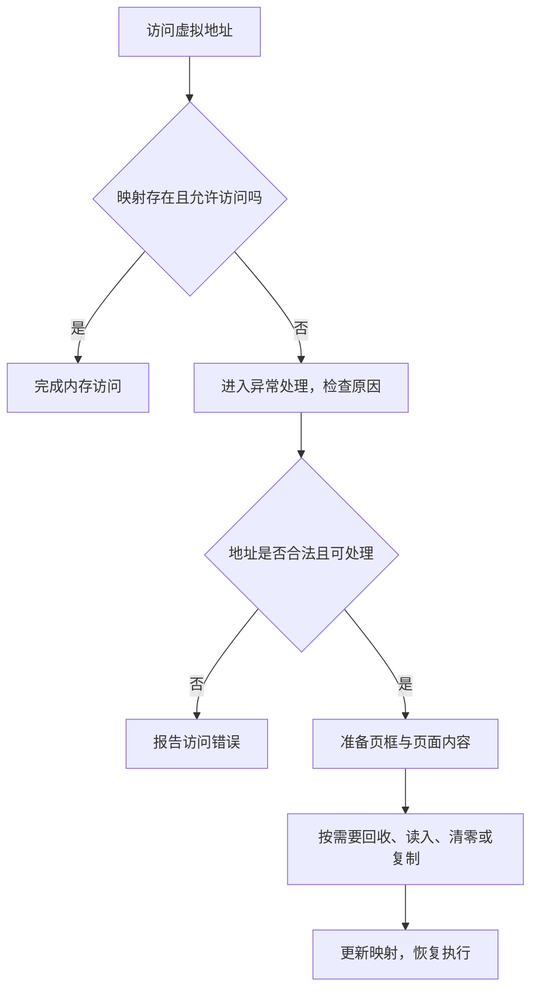

# 14 内存管理答疑：碎片、页表与页面回收

[返回教程目录](操作系统教程.md) · [基础：内存管理与地址转换](06-内存管理与地址转换.md) · [基础：虚拟内存与页面置换](07-虚拟内存与页面置换.md)

> 整理日期：2026-11-10。对应近期讨论中的内外碎片、段页式、512 B 页表题、访问位与修改位、CLOCK、Belady 异常、工作集和空闲页链表。
> 下文先使用本科课程的教学模型，再单独说明实际系统的边界；例题中的位数、页大小和队列规则都是明确假设。

## 阅读目录

- [1 四种管理方式为什么产生不同碎片](#1-四种管理方式为什么产生不同碎片)
- [2 段页式到底怎么找地址](#2-段页式到底怎么找地址)
- [3 页式虚拟存储与请求分页](#3-页式虚拟存储与请求分页)
- [4 512 B 页表题完整推导](#4-512-b-页表题完整推导)
- [5 页面引用串与十六进制地址](#5-页面引用串与十六进制地址)
- [6 访问位和修改位各管什么](#6-访问位和修改位各管什么)
- [7 CLOCK 怎样转一圈](#7-clock-怎样转一圈)
- [8 FIFO 为什么出现 Belady 异常](#8-fifo-为什么出现-belady-异常)
- [9 驻留集和工作集](#9-驻留集和工作集)
- [10 页缓冲队列和空闲页链表](#10-页缓冲队列和空闲页链表)
- [11 自测与答案](#11-自测与答案)
- [12 来源与继续阅读](#12-来源与继续阅读)

------

## 1 四种管理方式为什么产生不同碎片

先记住“浪费发生在分配区域内部，还是空闲区域之间”。讨论碎片时，需要先说清分配单位。

| 方式 | 给进程分配什么 | 内部碎片 | 外部碎片 | 原因 |
| --- | --- | --- | --- | --- |
| 固定分区 | 预先划好的连续分区 | 通常有 | 教材基本模型中没有动态分割形成的外部碎片 | 作业小于分区，剩余部分也不能分给别的作业 |
| 动态分区 | 按需切出一段连续空间 | 理想模型中没有 | 有 | 释放后留下不同大小的空洞，空闲总量够也可能无法拼出连续区 |
| 基本分页 | 大小相同的页框 | 可能有 | 基本按页分配模型中没有 | 页框可离散分配，但末页可能装不满 |
| 基本分段 | 长度不同的逻辑段，各段连续放置 | 理想模型中没有 | 有 | 段按实际长度分配，但释放后会留下空洞 |

“没有内部碎片”使用的是理想的按需精确分配模型。实际分配器会受对齐、最小块和管理信息影响，不能据此断言实际系统一字节都不浪费。

例如，固定分区为 16 KiB，作业只需 10 KiB，剩余 6 KiB 属于已经分配区域内部的浪费。动态分区有两个分别为 6 KiB 和 8 KiB 的空洞，请求连续 10 KiB 时，即使空闲总量为 14 KiB，仍然分配失败：这是外部碎片。

分页中，10 KiB 的区域使用 4 KiB 页，需要 3 页共 12 KiB，末页空出 2 KiB。其物理页框不必相邻，所以不要求找到连续 12 KiB。



基本分页避免了这一层按页分配的外部碎片；实际内核仍可能需要连续的多个物理页，因此大页或连续分配还可能受物理内存碎片影响。两种说法讨论的层次不同。

## 2 段页式到底怎么找地址

段页式保留代码段、数据段等逻辑分组，再把每个段划分成固定大小的页。**段负责逻辑组织，页负责离散安放。**

教学模型中的逻辑地址可以写成：段号 s、段内页号 p、页内偏移 d。


假设页大小 1 KiB，段 2 的页表中，段内第 3 页映射到页框 9。访问 `(段 2，页 3，偏移 100)`，在范围和权限均合法时：

```text
物理地址 = 9 × 1024 + 100 = 9316
```

整个段不再要求占用一大块连续物理内存，但每个段的末页仍可能装不满，并且段表、各级页表都需要空间。不要把段页式说成“完全没有碎片、没有额外成本”。

## 3 页式虚拟存储与请求分页

**分页**说明地址空间如何划分与映射；**请求分页**说明页面什么时候进入内存。基本分页不必然意味着允许一个进程只装入部分页面。

页式虚拟存储系统结合分页映射、部分驻留和缺页处理，让进程按需使用物理内存。进程访问合法但尚未驻留的页时，系统再准备该页；内存紧张时，可选择现有页进行回收或置换。

| 概念 | 问的问题 | 不能混同的概念 |
| --- | --- | --- |
| TLB 未命中 | 地址转换缓存里有没有这条映射 | 未命中后查页表，页面可能已经在内存 |
| 缺页异常 | 这次访问为什么不能直接按当前页表完成 | 实际系统中也可能涉及写时复制、权限等情况 |
| 页面置换 | 是否需要让出一个现有页框 | 有空闲页框时，缺页不一定置换 |
| 磁盘读写 | 是否需要从后备存储取得或保存内容 | 首次分配零页等处理不一定读盘 |



## 4 512 B 页表题完整推导

题设：**按字节编址，32 位虚拟地址，16 位物理地址，页大小 512 B，采用覆盖完整虚拟地址空间的单级页表。**

这里必须是 512 **B**。如果写成 512 KiB，页内偏移就需要 19 位，已经超过题设物理地址的 16 位，无法套用这个普通分页模型。

```text
512 B = 2^9 B
页内偏移：9 位
虚拟页号：32 - 9 = 23 位
页表项数：2^23 = 8,388,608 项

物理地址空间：2^16 B = 64 KiB
物理页框数：2^16 / 2^9 = 2^7 = 128 个
物理页框号：7 位
```

**页表项数由虚拟页数决定，不能用物理页框数 128 代替。** 页表需要描述每个虚拟页的状态；虚拟页不必全部同时驻留，也不要求一一对应到不同的现有物理页框。

题目没有给出页表项大小，因此只能求“多少项”，不能直接求“多少字节”。如果额外规定每项 4 B，则：

```text
页表字节数 = 2^23 × 4 B = 2^25 B = 32 MiB
```

这个完整单级页表比题设的 64 KiB 物理内存还大，说明它不能直接按“整张页表常驻该物理内存”的假设实现。它仍能作为位数推导题；讨论可实现性时，必须进一步改变页表组织或相关假设。不能把数学上算出的项数当成现实可用的配置。

## 5 页面引用串与十六进制地址

页面引用串是程序按时间顺序访问的**页号序列**，不是物理页框列表，也不是源代码行号。

例如页大小 512 B，连续访问字节地址 `0、10、512、1023、1024、0`：

| 字节地址 | 地址除以 512 的整数商 | 页号 |
| --- | --- | --- |
| 0 | 0 | 0 |
| 10 | 0 | 0 |
| 512 | 1 | 1 |
| 1023 | 1 | 1 |
| 1024 | 2 | 2 |
| 0 | 0 | 0 |

引用串为 `0，0，1，1，2，0`。页面置换题要按每一次访问推进，命中也可能更新访问位或 LRU 顺序。

十六进制的 `0A6FH` 中，末尾 `H` 表示十六进制；前导 `0` 不改变数值：

```text
0A6FH = 0x0A6F
       = 10 × 16^2 + 6 × 16 + 15
       = 2671

页大小为 512 B 时：
页号 = 2671 // 512 = 5
偏移 = 2671 % 512 = 111
```

如果字符串写成 `0A6FE`，最后的 E 是一位十六进制数字，而非进制后缀；它与 `0A6FH` 是两个不同的数。

## 6 访问位和修改位各管什么

| 页表信息 | 记录什么 | 主要用途 |
| --- | --- | --- |
| 页框号 | 映射到哪个物理页框 | 地址转换 |
| 驻留或有效状态 | 当前映射是否可按规定使用 | 判断是否需要异常处理，含义依体系结构而定 |
| 读写、用户等权限 | 哪些访问被允许 | 保护检查 |
| 访问位 R / A | 从上次清零以来是否被访问 | 给置换或回收提供近期使用线索 |
| 修改位 M / D | 从相关基准时刻以来是否被写脏 | 判断回收前是否需要保存修改 |

访问位常由硬件在访问时置位，再由操作系统观察和清零；具体更新、清除及 TLB 配合规则依体系结构而定。修改位描述内容是否改变，**不等于“这个页面允许写”**。

所以教材说这两位供置换算法参考，意思是：它们帮助操作系统决定“先回收谁、是否要写回”。它们不负责替普通程序挑选要访问的变量，也不替代读写权限。

## 7 CLOCK 怎样转一圈

基本 CLOCK 维护一组呈环形扫描的页框、每页一个访问位，以及一个指针。课程模型中，页面被访问时把 R 置为 1。

需要淘汰时，检查指针所指页面：R=0 就选择它；R=1 就把它清为 0，给一次机会，然后继续向前。


若初始为 `A:1，B:0，C:1`，指针在 A，则本次淘汰 B。若所有页的 R 都是 1，扫描先给它们清零；期间没有新的访问时，指针绕回来就能选到 R=0 的页。

### 可以用循环队列和双向环形链表吗

可以。CLOCK 要求的是“循环扫描”的逻辑，并不要求某一种容器。

| 实现 | 怎么前移 | 适合的情况 |
| --- | --- | --- |
| 固定数组与下标 | `hand = (hand + 1) % N` | 页框槽位固定，简单且便于展示 |
| 环形单链表 | `hand = hand.next` | 希望显式维护环形节点 |
| 双向环形链表 | 向后继前移，并可方便摘除节点 | 需要额外的插入、移除操作 |

“循环队列”如果采用数组环形缓冲区，可以表达这个扫描过程；但不能只依靠 FIFO 的入队出队而忽略 R 位。双向链表的前驱指针也不是基本 CLOCK 必需的信息。

CLOCK 近似利用近期访问情况，不维护每次访问的完整先后顺序，因此不等于精确 LRU。增强型 CLOCK 还会考虑修改位，具体扫描规则以题设为准。

## 8 FIFO 为什么出现 Belady 异常

FIFO 只看页面**进入内存的先后顺序**。页面命中不会变成“刚入队”，即使刚刚频繁使用，也可能因为入队早而被淘汰。

经典引用串为 `1，2，3，4，1，2，5，1，2，3，4，5`，初始内存为空，首次装入也算缺页。

| 访问步骤 | 访问页 | 3 页框累计缺页 | 4 页框累计缺页 |
| --- | --- | --- | --- |
| 1 | 1 | 1 | 1 |
| 2 | 2 | 2 | 2 |
| 3 | 3 | 3 | 3 |
| 4 | 4 | 4 | 4 |
| 5 | 1 | 5 | 4 |
| 6 | 2 | 6 | 4 |
| 7 | 5 | 7 | 5 |
| 8 | 1 | 7 | 6 |
| 9 | 2 | 7 | 7 |
| 10 | 3 | 8 | 8 |
| 11 | 4 | 9 | 9 |
| 12 | 5 | 9 | 10 |

第 7 步后，按“最早入队到最晚入队”排列：3 页框为 `[1,2,5]`，4 页框为 `[2,3,4,5]`。3 页框保留的页 1，反而不在 4 页框里。随后访问 1、2 时，大内存配置走上了不同的淘汰路径。

因此，多一个页框改变了进入与淘汰的历史，FIFO 又不能保证小容量的驻留页集合包含于大容量集合，最终可能反而增加缺页。这种现象叫 Belady 异常，**不是说 FIFO 每次增加页框都会变差**。

经典 LRU 和 OPT 具有栈性质：对同一引用历史，小容量下的驻留集合可包含在大容量集合内，因此不会出现这种异常。把 CLOCK 与精确 LRU 等同后直接套用这个结论是不成立的。

## 9 驻留集和工作集

**驻留集**：某时刻一个进程实际在物理内存中的页面集合。**工作集**：按照指定窗口，进程近期访问过的不同页面集合。

例如引用串 `1，2，3，2，4`，观察最后 4 次访问 `2，3，2，4`，工作集是 `{2,3,4}`，大小为 3。重复访问 2 不会重复计数。

| 比较 | 驻留集 | 工作集 |
| --- | --- | --- |
| 关注点 | 现在实际留在内存哪些页 | 在某个窗口内用过哪些页 |
| 是否直接取决于分配与回收 | 是 | 主要取决于访问历史和窗口定义 |
| 大小会不会变 | 会 | 会，窗口变化也会改变结果 |
| 能否直接画等号 | 不能保证等于工作集 | 不能保证全部已经驻留 |

工作集可以用“最近 Δ 次访问”作教学例子，实际模型也可以按时间窗口定义。说明窗口后再计算，不能把“程序的全部页”称为工作集。

当可用物理内存长期容纳不下并发任务的活跃需求时，页面可能反复换入换出，形成抖动。工作集是估计活跃需求的方法，不是预知未来的保证。

## 10 页缓冲队列和空闲页链表

### 为什么挂在链表里，还能算回收

物理页框是固定的硬件空间。“释放一个页框”意味着把它从原用途解除，交回可分配的集合；不是让这块内存从机器中消失。

链表通常管理页框的描述信息：页框号、状态、前后指针等。某些实现也可能利用空闲页内存放管理信息。链表节点引用一个页框，不等于原进程还拥有它，也不意味着它不能再分配。


### 页缓冲队列为什么还保留旧内容

教材的页缓冲算法可以保留“已退出某进程驻留集、但内容还没被新用途覆盖”的页框。原进程很快再访问时，如果旧内容仍然有效，可以重新激活，避免重新从磁盘读取。

这里的“空闲”可能指**可以重新分配**，不一定指“字节内容全为零”。一旦页框给了其他用途并改写，旧页面的缓存命中机会就消失了。

| 阶段 | 内容可能还在吗 | 能否立即给新用途覆盖 |
| --- | --- | --- |
| 仍被使用、被固定或有未完成访问 | 在 | 不能直接覆盖 |
| 已选为候选，但脏内容尚未妥善保存 | 在 | 不能无条件覆盖，否则可能丢数据 |
| 满足重用条件的干净缓冲页 | 可能仍在 | 可由分配器按规则重新分配 |
| 重新分配并完成必要初始化 | 旧内容不再属于原页面 | 按新用途访问 |

### 脏页究竟什么时候能复用

“写脏”通常发生在页面仍在使用时，不是淘汰后才产生。简化流程应写成：

```text
页面被写入，变脏
→ 后台写回或回收流程准备保存修改
→ 写回完成，并确认没有新的未保存修改等阻碍
→ 按回收规则解除原用途
→ 页框可分配给新用途
```

后台写回也可以在页面仍驻留、仍被映射时发生；写回本身不等于已经释放。是否启动写回也可能由脏页阈值、定时机制、内存压力或显式同步触发，不能只记成“脏页攒多了才刷盘”。

对于仍有价值的匿名页，若不能丢弃且没有可用的交换后备，不能假设一定能像干净文件缓存一样直接回收。实际内核还要处理共享引用、固定页、I/O 和 TLB 等状态。

最后，“新进程覆盖旧页框”必须经过分配器的所有权、映射与初始化规则。匿名用户页通常要求提供零初始化的内容，文件页则装入对应文件数据，不能让新进程读取前一个进程的私密残留。

## 11 自测与答案

1. 512 B 页、32 位虚拟地址、16 位物理地址，完整单级页表是 128 项吗？
2. CLOCK 使用双向环形链表，会自动变成 LRU 吗？
3. 页面退出驻留集后，物理页框里的字节会立刻消失吗？
4. 脏页完成写回后，一定已经释放了吗？
5. 引用串 `1,2,1,3,2`，最后 3 次访问的工作集是什么？

答案：①不是，是 2²³ 项，128 是物理页框数；②不会，判断逻辑仍取决于 R 位和扫描规则；③不会，是否重用与字节是否残留是两件事；④不一定，写回与解除占用是不同步骤；⑤`{1,2,3}`。

## 12 来源与继续阅读

- [OSTEP：空闲空间管理](https://pages.cs.wisc.edu/~remzi/OSTEP/vm-freespace.pdf)：分配粒度、内外碎片和空闲空间组织。
- [OSTEP：分页简介](https://pages.cs.wisc.edu/~remzi/OSTEP/vm-paging.pdf)：页、页框与页表。
- [OSTEP：置换策略](https://pages.cs.wisc.edu/~remzi/OSTEP/vm-beyondphys-policy.pdf)：FIFO、Belady 异常、LRU、CLOCK 与脏页代价。
- [Linux 内核：内存管理概念](https://docs.kernel.org/admin-guide/mm/concepts.html)：虚拟内存、页缓存、匿名内存与回收。
- [Intel 软件开发手册入口](https://www.intel.com/content/www/us/en/developer/articles/technical/intel-sdm.html)：具体页表格式、访问位、修改位和 TLB 规则需要按体系结构核对。

相关主题：[x86 寄存器与 CPU 时钟](15-x86寄存器与CPU时钟.md)、[I/O 控制与 SPOOLing](16-IO控制与SPOOLing.md)。
