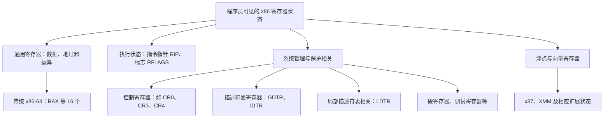
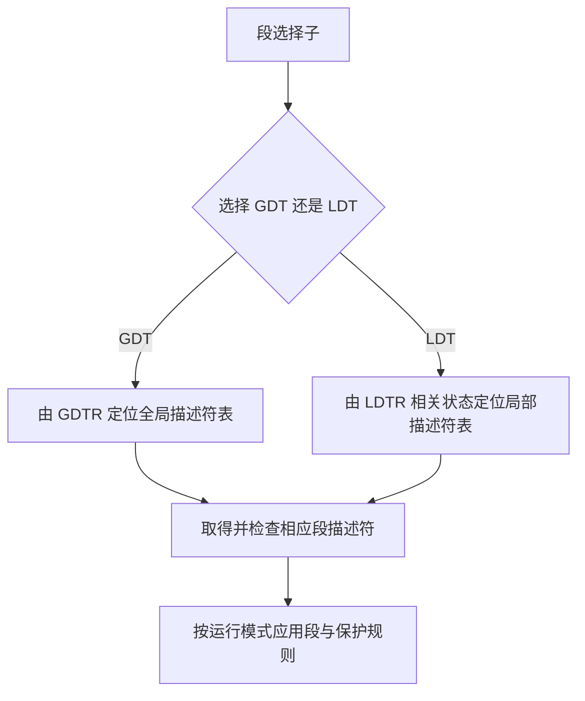

# 15 x86 寄存器与 CPU 时钟

[返回教程目录](操作系统教程.md) · [内存管理答疑](14-内存管理答疑与页面回收.md)

> 整理日期：2026-11-10。对应近期的“CPU 有多少寄存器”“x86 的 16 个是什么”“页表、段表寄存器算不算 CPU 寄存器”“时钟周期能做什么”“频率越高是否越快”。
> 本文讨论程序员可见的体系结构状态。具体数量必须说明处理器架构、运行模式和扩展，不能用一个数字代表所有 CPU。

## 阅读目录

- [1 先画出寄存器分类](#1-先画出寄存器分类)
- [2 传统 x86-64 的 16 个通用寄存器](#2-传统-x86-64-的-16-个通用寄存器)
- [3 页表与段表相关寄存器](#3-页表与段表相关寄存器)
- [4 时钟周期能做什么](#4-时钟周期能做什么)
- [5 为什么频率不能单独代表性能](#5-为什么频率不能单独代表性能)
- [6 自测与来源](#6-自测与来源)

------

## 1 先画出寄存器分类

CPU 寄存器是一个大类；通用寄存器只是其中一组。说“传统 x86-64 有 16 个通用寄存器”，不能缩写成“CPU 总共只有 16 个寄存器”。



这里没有把所有寄存器逐一列完。向量扩展、系统寄存器、微架构内部物理寄存器会引入更多状态；不同名称有时还是同一存储状态的不同宽度视图，不能简单累加。

例如 `RAX、EAX、AX、AL` 是相关的宽度视图，不是四个完全独立、可以各存一份互不影响的数据的寄存器。

## 2 传统 x86-64 的 16 个通用寄存器

| 寄存器 | 常见用途或历史角色 | 理解边界 |
| --- | --- | --- |
| RAX | 运算结果，部分指令使用的累加器；常见 ABI 中保存返回值 | 许多普通运算也可以使用其他通用寄存器 |
| RBX | 通用数据、地址暂存 | “基址寄存器”是历史名称，不代表只能存基址 |
| RCX | 计数、部分移位和循环指令 | 某些指令会隐式使用它或其低位视图 |
| RDX | 某些乘除法中的扩展数据、部分 I/O 指令 | 特殊角色取决于具体指令 |
| RSI | 字符串操作的源地址，其他通用用途 | 普通代码也可用作其他数据或地址 |
| RDI | 字符串操作的目标地址，其他通用用途 | 同上 |
| RBP | 常被用于栈帧基址 | 编译器可以省略帧指针，按 ABI 规则作其他用途 |
| RSP | 栈指针 | 压栈、出栈、调用等与它有关 |
| R8～R15 | 额外的 8 个通用寄存器 | 参数传递与保存规则取决于 ABI |

表中的前 8 个加 R8～R15 的 8 个，共 16 个。传统 32 位 x86 常见的是对应的 8 个 32 位通用寄存器；运行模式不同，不能混算。

函数调用时“第一个参数放哪里”是调用约定问题。例如 Windows x64 与 System V AMD64 ABI 的规则不同，不能把某一套参数寄存器顺序当成 CPU 固定规定。

此外，Intel APX 定义了扩展通用寄存器。讨论支持该扩展的处理器时，“16 个”还要加上传统基础集合这个前提。

## 3 页表与段表相关寄存器

### CR3 是 CPU 寄存器吗

是。x86 的 CR3 是控制寄存器，与分页结构的定位相关；在相应模式下可包含其他控制信息。页表本体通常存放在内存中，CR3 不会把整张页表塞在寄存器里。


不能把 CR3 一律解释成“某张单级页表的唯一基址”。具体地址位与 PCID 等信息，取决于分页模式和配置。

### “段表寄存器”在 x86 里对应什么

本科教材常用抽象的段表基址寄存器说明机制；映射到 x86，需要区分多种状态。

| 名称 | 大致保存或定位什么 | 与其他对象的区别 |
| --- | --- | --- |
| GDTR | 全局描述符表 GDT 的基址和界限 | 定位 GDT，不是直接保存所有段描述符 |
| LDTR | 局部描述符表 LDT 相关的选择子与隐藏状态 | 不是一个可以直接等同于 GDTR 的通用基址变量 |
| CS、DS、SS、ES、FS、GS | 段选择子以及相关隐藏描述符状态 | 与 GDTR、LDTR 属于不同的寄存器角色 |
| IDTR | 中断描述符表 IDT 的基址和界限 | 名称相近，但它定位的是中断描述符表 |



这个流程用于理解传统保护模式的分段机制。64 位模式中，分段有很多简化，FS、GS 等还有特殊作用；不能把教学版段页式地址公式不加区分地套到所有现代 x86-64 用户程序。

## 4 时钟周期能做什么

时钟周期 T 是时钟信号完成一个周期的时间，频率 f 是每秒的周期数，二者满足 `T = 1 / f`。

```text
1 GHz = 每秒 10^9 个周期  → 每周期 1 ns
2.5 GHz                 → 每周期 0.4 ns
4 GHz                   → 每周期 0.25 ns
```

一个周期可以理解为处理器各部件协调推进的时间单位，但不能固定解释成“执行一条完整指令”。取指、译码、执行、访存等工作可以划成流水阶段；一条指令可能经历多个周期，不同指令的不同阶段又可同时推进。

下面只是帮助理解的简化流水线，不代表某个具体 CPU 的真实级数或时序：

| 周期 | 指令 A | 指令 B | 指令 C |
| --- | --- | --- | --- |
| 1 | 取指 | — | — |
| 2 | 译码 | 取指 | — |
| 3 | 执行 | 译码 | 取指 |
| 4 | 写回 | 执行 | 译码 |
| 5 | — | 写回 | 执行 |

现代处理器还可能在一个周期里发射或完成多条指令，但也可能因依赖、缓存未命中等原因停顿。因此：一周期不是固定的一条指令，也不是固定的一次加法。

## 5 为什么频率不能单独代表性能

对于给定程序，可用下式组织思考：

```text
CPU 执行时间 = 指令数 × 平均 CPI / 时钟频率
CPI：平均每条指令花费的周期数
IPC：平均每周期完成的指令数，需使用一致的统计口径
```

同一程序、同一架构、CPI 等条件近似不变时，提高频率通常能缩短 CPU 执行时间。但换了 CPU，指令数和 CPI 可能也变。

| 假设方案 | 动态指令数 | 平均 CPI | 频率 | 推算 CPU 时间 |
| --- | --- | --- | --- | --- |
| A | 10 亿 | 2 | 4 GHz | 0.5 秒 |
| B | 10 亿 | 1 | 3 GHz | 约 0.333 秒 |

在这个明确给定的例子中，3 GHz 的 B 反而更快。实际性能还取决于核心数、并行程度、缓存、内存带宽、功耗温度限制和程序是否在等 I/O。

“最大睿频”“基本频率”“当前监控读数”也不是同一个量。查看某台机器的频率必须读当时的机器信息；历史聊天中的某个数值不能作为它现在每个核心都在持续运行的频率。

## 6 自测与来源

1. 传统 x86-64 的 16 个通用寄存器包含 CR3 吗？
2. 页表在 CR3 里面，还是通常放在内存里？
3. 4 GHz 是否意味着每秒固定完成 40 亿条指令？
4. 同样的指令数下，频率更高但 CPI 也更高，能直接判断谁更快吗？

答案：①不包含，但 CR3 也属于 CPU 寄存器；②页表通常在内存，CR3 提供定位相关信息；③不能；④需要算 `指令数 × CPI / 频率`。

- [Intel 软件开发手册](https://www.intel.com/content/www/us/en/developer/articles/technical/intel-sdm.html)：基础体系结构、通用寄存器、系统寄存器、分页和分段。
- [Intel APX](https://www.intel.com/content/www/us/en/developer/articles/technical/advanced-performance-extensions-apx.html)：扩展通用寄存器的架构背景。
- [Microsoft：x64 调用约定](https://learn.microsoft.com/en-us/cpp/build/x64-calling-convention)：调用约定与硬件寄存器角色的区别。
- [Intel：CPU 时钟速度](https://www.intel.com/content/www/us/en/gaming/resources/cpu-clock-speed.html)：频率含义及性能比较的适用条件。
