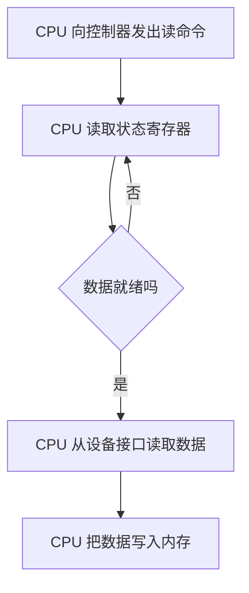
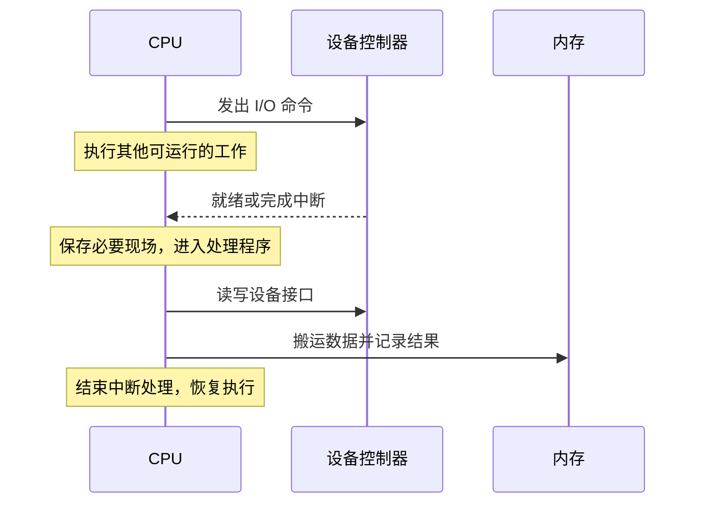
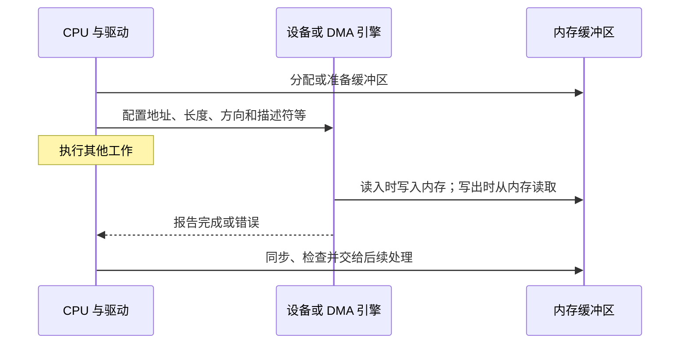
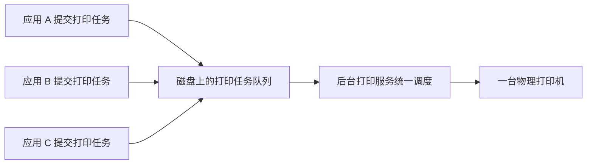

# 16 I/O 控制与 SPOOLing

[返回教程目录](操作系统教程.md) · [基础：I/O、磁盘与网络服务](09-IO磁盘与网络服务.md)

> 整理日期：2026-11-10。对应近期的 DMA、程序查询 I/O、中断驱动 I/O，以及假脱机技术讨论。
> 下文比较的是经典设备控制方式；网络编程中的阻塞、非阻塞、同步与异步属于另一组分类。

## 阅读目录

- [1 三种方式先看谁等待谁搬运](#1-三种方式先看谁等待谁搬运)
- [2 程序查询 IO](#2-程序查询-io)
- [3 中断驱动 IO](#3-中断驱动-io)
- [4 DMA 的完整过程](#4-dma-的完整过程)
- [5 DMA 与中断可以配合](#5-dma-与中断可以配合)
- [6 SPOOLing 为什么叫假脱机](#6-spooling-为什么叫假脱机)
- [7 自测与来源](#7-自测与来源)

------

## 1 三种方式先看谁等待谁搬运

可以用一句话入门：**查询是 CPU 一直问，中断是设备通知，DMA 是 CPU 配置好一批数据的传输。**

| 方式 | 怎么知道设备就绪 | 数据由谁在设备接口与内存之间搬运 | CPU 还做什么 |
| --- | --- | --- | --- |
| 程序查询 I/O | CPU 反复读取设备状态 | 经典程序控制模型中由 CPU 执行读写 | 发命令、查询、搬运、检查 |
| 中断驱动 I/O | 设备控制器发出中断请求 | 经典非 DMA 模型中仍由 CPU 执行读写 | 发命令、运行其他工作、处理中断并搬运 |
| DMA | 完成通知可以使用中断，也可以轮询完成状态 | DMA 控制器或具备相应能力的设备 | 准备缓冲区、配置传输、处理完成与错误 |

这张表比较的是教学模型。现代设备可能组合多种机制，不能把“发生了中断”直接理解为“没有用 DMA”。

## 2 程序查询 IO

假设 CPU 请求设备读取一个数据单元，设备需要等待一段时间：

优点是控制简单；若使用忙等，CPU 在等待期间不断检查，可能消耗很多周期。注意，轮询还可以做成定时检查或批量检查；不能把所有工程轮询都等同于最朴素的无限忙等。

查询方式也不意味着整个系统不能运行其他程序。这里说的是执行该查询循环的 CPU 时间被占用；具体能否被抢占、是否有其他核心，是另外的条件。

## 3 中断驱动 IO

CPU 发出命令后，不必一直检查。设备就绪时，中断机制让 CPU 转去执行对应处理程序。

中断解决的是“不必一直等着问”；在这里的非 DMA 模型中，并没有消除 CPU 搬运数据的工作。中断也有保存现场、分派和处理等开销，事件非常频繁时可能产生明显负担。

发出请求的进程可能等待 I/O 而阻塞，CPU 则可以执行其他就绪任务。因此，“CPU 不忙等”和“这个应用调用立刻返回”不是同一件事。

## 4 DMA 的完整过程

DMA 即 Direct Memory Access，直接存储器访问。其核心是由专门的传输机制在设备与内存之间传送一批数据，减少 CPU 对每个数据单元执行搬运指令的负担。

这意味着 CPU 仍参与准备和收尾。实际驱动还可能处理 DMA 地址映射、可见性与同步；设备使用的 DMA 地址也不应不加区分地当成进程虚拟地址。

一个简化的读盘路径是：应用发请求 → 内核与驱动准备缓冲区 → 控制器传输 → 完成处理 → 应用取得结果。DMA 只说明其中的数据传输机制，不自动说明应用层是否还发生复制。

### DMA 会不会占用总线和内存带宽

会。它减少 CPU 亲自搬运的指令，不会凭空创造带宽。设备 DMA 与 CPU 访存仍使用相关互连和内存资源；高流量下仍可能竞争。

教材中的成组传送、周期挪用等描述，是理解总线仲裁的经典模型。不同现代互连与控制器实现不同，不宜拿一个模型覆盖所有机器。

## 5 DMA 与中断可以配合

把问题拆成两条线就不会混淆：

| 问题 | 可能采用的机制 |
| --- | --- |
| 数据怎样从设备进入内存 | CPU 读写接口、DMA 等 |
| CPU 怎样知道可以处理结果 | 中断、轮询等 |

因此，DMA 搬数据、完成后发中断，是很自然的组合。反过来，使用 DMA 后也可以轮询完成队列，具体取决于驱动和负载设计。

再与网络编程对照：

- 阻塞 / 非阻塞关注调用在条件未满足时如何返回。
- I/O 多路复用关注怎样等待一组对象上的事件或就绪条件。
- DMA 关注设备与内存之间如何传输。

这些机制可以出现在同一条路径上，不能当成互斥选项。

## 6 SPOOLing 为什么叫假脱机

正确拼写是 **SPOOLing**，常译为假脱机。可以把它理解成“先把任务交给磁盘上的队列，再由后台服务按设备能力执行”。打印是典型例子。

应用不必等到上一份文件真正打印完，才有机会提交任务。系统用队列、暂存空间和后台服务，在使用体验上把一台独占设备提供给多个任务。

**共享的是提交入口和调度服务，打印机并没有变成同时打印多份文件的多台设备。** 提交成功也不等于纸张已经打印完成。

| 机制 | 重点 | 常见例子 |
| --- | --- | --- |
| 缓冲 Buffering | 暂存数据，协调速度与批量 | 输入输出缓冲区 |
| 缓存 Caching | 复用已有内容，减少重复获取 | 文件页缓存 |
| SPOOLing | 把设备作业排队，由后台服务统一执行 | 打印任务队列 |
| DMA | 减少 CPU 对设备与内存间数据的逐项搬运 | 块设备或网卡传输 |

它们可以组合使用。打印队列也会占磁盘空间，后台任务可能失败或取消，因此要区分“已提交、排队中、处理中、已完成”等状态。

## 7 自测与来源

1. 中断驱动 I/O 是否意味着 CPU 不搬运任何数据？
2. DMA 完成后能不能再使用中断通知 CPU？
3. 应用的阻塞读操作，底层能不能使用 DMA？
4. SPOOLing 是否使一台打印机能物理同时处理所有作业？

答案：①不能这样推断；②可以；③可以，分类角度不同；④不会，它主要提供暂存、排队和后台调度。

- [OSTEP：I/O 设备](https://pages.cs.wisc.edu/~remzi/OSTEP/file-devices.pdf)：轮询、中断和 DMA 的教学模型。
- [Linux 内核：DMA API HOWTO](https://docs.kernel.org/core-api/dma-api-howto.html)：DMA 地址、映射和同步等实际驱动规则。
- [Microsoft：Print Spooler](https://learn.microsoft.com/en-us/windows/win32/printdocs/print-spooler)：打印假脱机服务。
- [基础章：I/O、磁盘与网络服务](09-IO磁盘与网络服务.md)：继续学习磁盘调度、多路复用和后端场景。
