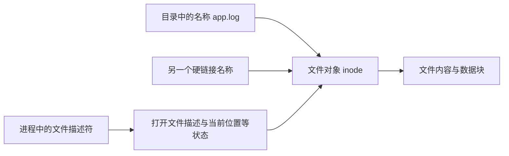
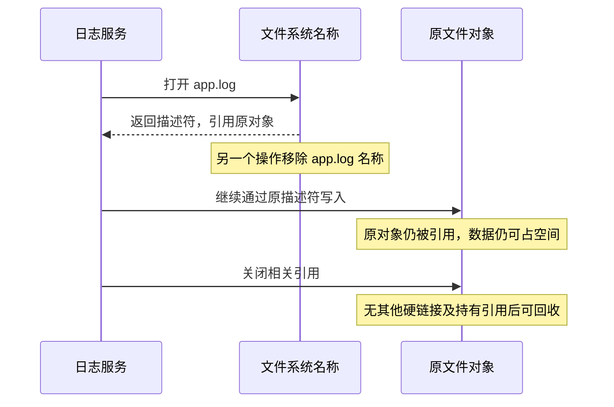
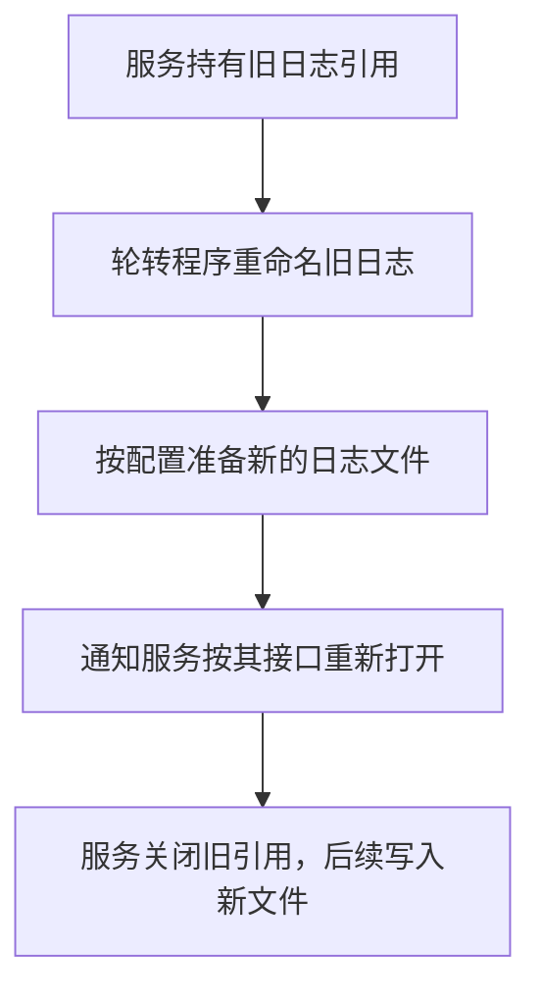

# 17 Linux 文件删除与截断

[返回教程目录](操作系统教程.md) · [基础：文件系统与持久化](08-文件系统与持久化.md)

> 整理日期：2026-11-10。对应近期“删除和截断有什么区别”“如果是 Linux 文件呢”的讨论。
> 本文以 Linux 普通文件和常见本地文件系统语义为主，不把数据库 DELETE / TRUNCATE 的事务规则搬到文件操作上。

## 阅读目录

- [1 删除名称与改变长度](#1-删除名称与改变长度)
- [2 为什么删了日志空间还在](#2-为什么删了日志空间还在)
- [3 截断为什么可能产生稀疏文件](#3-截断为什么可能产生稀疏文件)
- [4 日志轮转为什么需要重新打开](#4-日志轮转为什么需要重新打开)
- [5 怎么选操作](#5-怎么选操作)
- [6 自测与来源](#6-自测与来源)

------

## 1 删除名称与改变长度

文件名、inode、打开文件引用不是一回事。先画出最常用的关系：



| 比较项 | 删除：以 unlink 为例 | 截断：以 truncate 为例 |
| --- | --- | --- |
| 直接改变什么 | 移除一个目录项名称 | 把文件逻辑长度改为指定大小 |
| 文件名还在吗 | 被移除的名称不在，其他硬链接可以仍在 | 已有名称通常仍在 |
| 是否换了一个文件对象 | 不是“自动创建新对象” | 针对同一个已有对象改变长度 |
| 已打开描述符 | 可继续引用原对象 | 继续引用该对象，但会看到长度变化 |
| 何时释放空间 | 需要考虑硬链接和仍然存在的引用 | 缩短通常可回收尾部相应分配，受文件系统等条件影响 |
| 是否等于安全擦除 | 不等于 | 不等于 |

`truncate` 不是只能“清空”：缩短会丢弃超出新长度的内容；设为 0 才是清空；扩展则增加逻辑长度，新增区域读起来为零，具体分配方式由文件系统决定。

另外，shell 的输出重定向 `>` 在打开已有普通文件时通常会截断内容；路径不存在且条件允许时则可能创建文件。因此不能把一条 shell 命令与 `truncate()` 系统调用的全部行为直接画等号。

## 2 为什么删了日志空间还在

假设服务已经打开 `app.log` 并持续写入。删除目录里的 `app.log`，只是去掉这个名称；服务手里的文件描述符仍可能指向原对象。



所以，`ls` 找不到路径，并不表示文件的数据块已经全部释放。`du` 按可访问路径遍历得到的结果，与 `df` 看到的整个文件系统分配情况，也可能不同。

只读排查时，可以在有相应权限的 Linux 环境查看 `lsof +L1`，寻找链接数小于 1 而仍被打开的对象；也可以核对服务的文件描述符、文件系统和日志轮转配置。不要只凭一项现象就认定一定是“文件没删干净”。

如果重新在原路径创建一个新 `app.log`，服务也不一定自动切换过去：它可能继续写旧对象。路径相同不代表文件对象相同。

## 3 截断为什么可能产生稀疏文件

关键规则：**truncate / ftruncate 改变文件长度，不自动把所有已打开引用的当前偏移改成 0。**

假设某个非追加模式的写入者当前偏移在 100 MiB 处，另一个操作把同一文件截断到 0：

```text
原先：逻辑长度 100 MiB，写入者偏移也在 100 MiB
截断：逻辑长度变为 0，但写入者偏移仍在 100 MiB
续写：写入者从原偏移写入 1 KiB
结果：逻辑长度可变为 100 MiB + 1 KiB
```

新文件中间可能出现一个洞：读起来是零，但支持稀疏文件的文件系统不一定为这些零分配对应数据块。此时 `ls -l` 的逻辑长度可以很大，而 `du` 显示的分配量小得多。


若写入者使用 `O_APPEND`，每次写入会按追加语义定位到当时文件尾部，情况不同。是否使用追加模式、是否有并发写入，都应核对实际程序。

## 4 日志轮转为什么需要重新打开

把 `app.log` 重命名为历史日志，再新建一个 `app.log`，只是改了名称关系。服务原先打开的描述符仍指向旧文件对象，因此常见轮转流程需要通过程序支持的方式通知它重新打开日志。



不能随便给所有服务发送同一种信号：有些程序支持特定信号，有些提供管理接口，有些自己完成轮转。需要查服务自身文档。

`copytruncate` 则先复制日志，再把原文件截断，让写入者继续持有同一对象。它避免了必须重新打开的要求，但复制和截断之间存在窗口，期间的日志可能丢失，不能视为无损轮转方案。

## 5 怎么选操作

| 目的 | 优先考虑 | 还需要确认什么 |
| --- | --- | --- |
| 不再保留一个文件名 | 删除该目录项 | 是否有其他硬链接、打开引用或快照等 |
| 保留名称与对象，但缩短内容 | 截断到目标长度 | 是否存在写入者，其偏移和追加模式是什么 |
| 管理运行中的服务日志 | 服务支持的日志轮转流程 | 重开接口、文件权限、轮转策略和保留要求 |
| 找到空间为什么没释放 | 先只读检查文件系统与引用 | 删除仍打开、快照、共享数据块等证据 |

删除和截断都可能使内容不可再正常访问，二者也都不保证底层介质上的安全擦除。这里的例子用于理解语义，不应把正在运行的服务日志当成练习对象。

## 6 自测与来源

1. 删除一个名称后，其他硬链接是否会一并消失？
2. 删除并重新创建同名文件，旧描述符会自动指向新对象吗？
3. 截断到 0 后，其他已打开引用的偏移一定是 0 吗？
4. 逻辑长度很大，是否必然占用等量物理存储块？

答案：①不会；②不会；③不一定，截断不自动重置它们；④不必然，稀疏文件等会使两者不同。

- [Linux man-pages：unlink(2)](https://man7.org/linux/man-pages/man2/unlink.2.html)：名称移除、硬链接和已打开文件的生命周期。
- [Linux man-pages：truncate(2)](https://man7.org/linux/man-pages/man2/truncate.2.html)：长度变化、零填充读取语义以及偏移不变。
- [Linux man-pages：open(2)](https://man7.org/linux/man-pages/man2/open.2.html)：打开文件描述、O_APPEND、O_TRUNC 和偏移。
- [logrotate 上游手册](https://github.com/logrotate/logrotate/blob/main/logrotate.8.in)：copytruncate、轮转与脚本配置语义。
