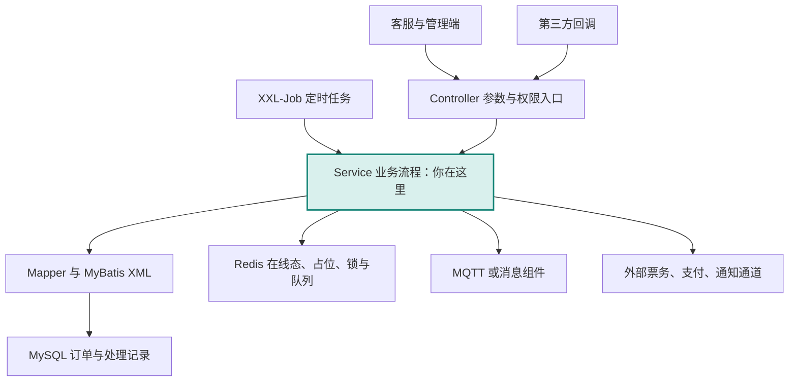
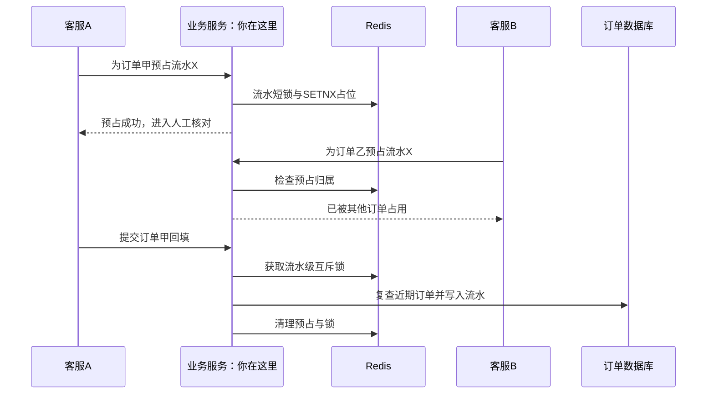
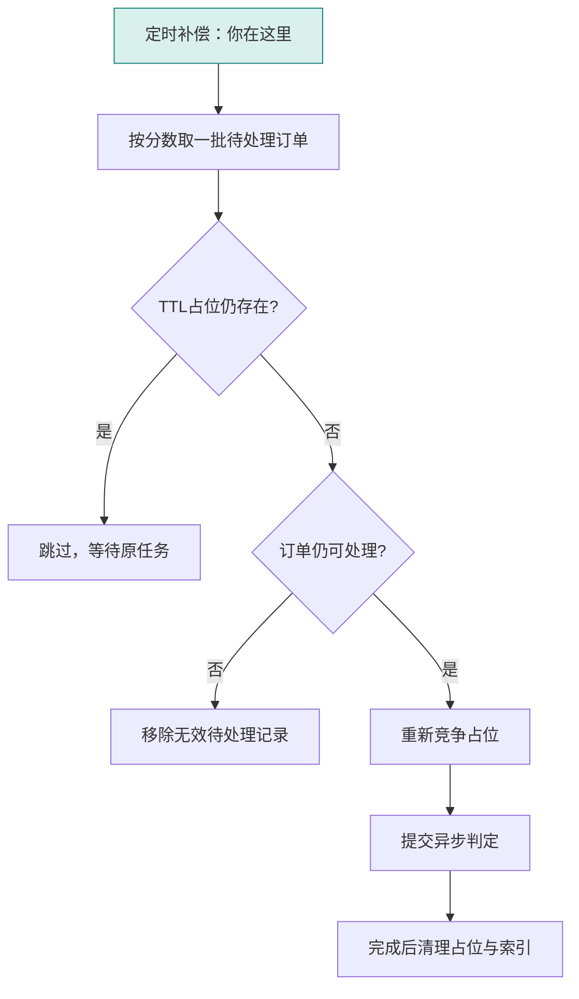

# 票务实习项目贡献与源码设计学习

## 阅读目录

- [1. 贡献归属](#chapter-01)
- [2. 可直接放入简历的版本](#chapter-02)
- [3. 最有价值的技术亮点及证据](#chapter-03)
- [4. 可按岗位需要替换的补充项](#chapter-04)
- [5. 不写入个人成果的数据](#chapter-05)
- [6. 面试准备顺序](#chapter-06)
- [7. 源码学习方法：先找到业务主干，再往下读](#chapter-07)
- [8. 你的五条源码教程](#chapter-08)
- [9. mgg 的贡献地图：挑具体设计学，不靠提交数量评价能力](#chapter-09)
- [10. mgg 设计一：可配置策略与派单诊断](#chapter-10)
- [11. mgg 设计二：从真实 SQL 改写学习查询设计](#chapter-11)
- [12. mgg 设计三：候选边界、任务补标与晚到回调](#chapter-12)
- [13. mgg 设计四：双节点下，分发、去重、锁和补偿各管什么](#chapter-13)
- [14. mgg 设计五：先固定归档集合，再跨多张表处理](#chapter-14)
- [15. 将这些设计变成自己的能力](#chapter-15)
- [16. 官方教程与源码配套阅读](#chapter-16)
- [17. 读完后的自测与下一步](#chapter-17)
- [18. 源码出处索引：在实习项目仓库中定位](#chapter-18)

------

依据本地仓库 “票务实习项目仓库” 的 Git 历史、代表提交与已提交源码整理。主要统计范围为 `develop`，HEAD 为 `e9cfe08b`，该提交时间为 2026-07-31 17:45:13（UTC+08:00）。这是一份本地代码贡献分析，不代表已联网核验最新远端、生产部署或线上收益。

这份文档分为两种用途：前半部分用于整理个人贡献和简历；后半部分用于对照真实源码学习。教程里的例子均为虚构，未执行订单处理、归档、短信发送或数据库变更。

| 阅读目标 | 建议阅读位置 |
| --- | --- |
| 先准备一份简历 | 第 1—6 节：归属、简历、证据和表述边界 |
| 读懂自己做过的功能 | 第 7—8 节：项目地图、Git 溯源、五条源码学习链 |
| 学习 mgg 的设计 | 第 9 节起：策略、诊断、SQL、小票处理、多节点与归档案例 |
| 动手练习和查理论 | 文末：学习计划、练习及官方文档 |

<a id="chapter-01"></a>

## 1. 贡献归属

按用户指定，将 `shb` 与 `jingxu` 两个作者身份合并整理。

| 作者 | 当前 develop 历史中的提交 | 其中非合并提交 | 可见作者提交日期 |
| --- | ---: | ---: | --- |
| shb | 165 | 124 | 2026-04-21 至 2026-07-30 |
| jingxu | 2 | 2 | 2026-06-10 |
| 合计 | 167 | 126 | 2026-04-21 至 2026-07-30 |

这里统计的是不同 commit hash，不是独立功能数量，也不是完整的实际实习起止时间。跨全部本地引用能找到 249 个作者提交，但其中包含侧分支、重复补丁、合并及 stash / 快照，不适合直接当作交付数量。简历无需强调提交数量。

个人工作集中在 `ruoyi-system`、`ruoyi-admin` 及部分公共、框架、SQL 和测试文件。当前统计没有看到这两个身份对 `ruoyi-ui` 前端源码的提交，适合定位为 **Java 后端开发实习**。

<a id="chapter-02"></a>

## 2. 可直接放入简历的版本

**火车票票务运营与客服派单系统｜Java 后端开发实习生**

**技术栈：** Java 8、Spring Boot、MyBatis-Plus、MySQL、Redis、Lock4j、XXL-Job、Maven。

**项目描述：** 基于 RuoYi 开发的票务业务系统，覆盖出票、退票、改签订单处理、客服派单、支付流水核对及运营告警。参与后端接口、业务服务、数据访问、数据库脚本和回归测试开发。

- **派单调度：** 参与日夜派单规则配置化，实现客服个人并发配置、按上线顺序轮询及权重优先派单，结合在线状态和剩余处理容量筛选候选客服；权重配置在事务提交后刷新 Redis，并通过失败重试和 XXL-Job 定时校准处理缓存不一致。
- **支付流水匹配：** 完善支付宝流水匹配及增量对账，使用“交易时间＋流水号”复合游标记录同步进度，支持第三方通道查询与支付宝 SDK 降级查询，并补充查询重试和时间窗口补偿。
- **流水并发防重：** 实现支付流水短期预占与回填校验，通过 Redis `SETNX`＋TTL 记录预占关系，回填时使用流水级互斥锁并复查近期订单，增加多订单重复使用同一流水的拦截能力。
- **失败订单二次分配：** 实现无票拒单后的订单回收与二次派单，根据配置次数和在线客服数限制回收次数，支持排除历史拒单客服、达到上限后最终回调，并记录处理审计与效果统计。
- **运营告警：** 基于 XXL-Job 和支付宝余额查询实现低余额告警，支持阈值、订阅人、短信及微信通知配置，并根据通知通道受理记录和重复间隔抑制重复告警。

公司名称和实际任职时间按真实经历补充。上述“参与”“实现”对应代码贡献，不自动意味着独立承担整个系统设计。

### 简历空间有限时使用三条版

- 参与票务派单调度改造，实现日夜规则配置、客服个人并发控制与权重优先派单；采用事务提交后刷新 Redis、失败重试及 XXL-Job 校准，处理权重配置的缓存一致性问题。
- 完善支付宝流水自动匹配与增量对账，实现复合游标、SDK 降级查询及查询重试；通过 Redis 预占、流水级互斥锁和近期订单复查，处理同一流水被多订单重复选用的问题。
- 实现无票订单有次数上限的回收重派、历史拒单客服排除及最终回调，补充处理审计和统计；开发低余额短信、微信告警，支持阈值、订阅和重复告警间隔配置。

<a id="chapter-03"></a>

## 3. 最有价值的技术亮点及证据

### A. 派单规则配置化，以及数据库与 Redis 配置同步

**业务问题：** 日间和夜间的人力、单人处理能力不同，需要支持调整派单规则，并在派单时考虑在线状态、当前负载和个人容量。

**已核验的本人改动：**

- `b606fdb0`：调度配置表、实体、DTO / VO、Mapper、Service 和配置接口。
- `f9af26c1`：日夜派单模板管理。
- `470cb03b`、`45636988`：候选人并发上限过滤，以及按实际上线时间顺序分配。
- `afbef899`、`de68363e`：客服个人最大并发配置和相关接入。
- `2b44140f`：日夜权重优先派单，新增权重持久化与 Redis 缓存、事务提交后刷新、重试、切换时互斥和测试。
- `970b620c`：将权重缓存校准接入 XXL-Job。

**当前源码入口：**

- [候选客服构建与容量信息 · L730](#source-s01)
- [权重优先选择 · L1555](#source-s01)
- [事务提交后刷新与失败重试 · L186](#source-s02)
- [Redis Hash 原子替换 · L234](#source-s02)
- [权重切换与派单共享锁 · L296](#source-s02)

**面试应能讲清：** 为什么在数据库事务提交之后刷新缓存；刷新失败如何恢复；权重切换与正在进行的派单如何协调。

**表述边界：** 当前权重先派是优先级选择，不是按权重比例分摊流量的加权轮询。候选人过滤本身也不能证明所有并发路径都绝不超派。不写“自研高并发调度引擎”“吞吐提升 X%”。

### B. 支付流水防重：人工操作阶段与提交阶段分别处理

**业务问题：** 多个客服可能同时看到、选中同一条支付流水；人工核对期间又不适合一直持有互斥锁。

**已核验的本人改动：**

- `4376585c`：增加预占接口、DTO、候选流水过滤和回填时的重复使用校验。
- `6ff9a70a`：在已用流水查询中复用现有索引条件。

实现包括流水维度的短锁、Redis `setIfAbsent` 加过期时间、同订单预占续期，以及回填阶段的数据库与预占记录复查。源码预占 TTL 为 3 分钟。

**当前源码入口：**

- [预占与 TTL · L2331](#source-s03)
- [回填时获取流水级互斥锁 · L663](#source-s04)
- [数据库和预占记录复查 · L846](#source-s04)

**面试应能讲清：** 为什么不能从用户打开页面开始一直持锁；用户关闭页面后如何释放占用；为什么预占后还需要查数据库。

**表述边界：** 当前数据库复查限定近 1 小时创建的订单，不是全生命周期唯一约束。不能据此写“全局资金一致性”“支付流水绝对不会重复”“实现 exactly-once”。

### C. 增量对账与第三方查询降级

**业务问题：** 本地账单存在同步延迟；任务暂停后需要保留进度；同一交易时间可能有多条流水。

**已核验的本人改动：**

- `fabda55c`：增加支付宝 SDK 降级查询与对应测试。
- `f6328b96`：增加拉取游标、自动匹配与同步进度相关实现。
- `4331e6fd`：将游标更新调整为 `REQUIRES_NEW` 独立事务。
- `cd4d5d2d`：增加 SDK 查询重试、查询结束时间补偿与诊断接口。

**当前源码入口：**

- [逐页推进交易时间与流水号游标 · L1033](#source-s05)
- [游标独立事务与版本冲突重试 · L43](#source-s06)
- [支付流水查询业务入口](#source-s03)

**面试应能讲清：** 单独使用时间游标有什么问题；为什么需要流水号作为第二排序条件；本地数据未同步时如何获取候选流水。

**表述边界：** 游标独立事务不等于账单落库与游标推进原子提交。简历可以写增量拉取、断点进度与降级能力，不写“保证任何故障下零漏单”。

### D. 失败订单有界回收与二次派单

**业务问题：** 一名客服无票拒单后，订单可能仍有被其他客服处理的机会；也需要防止无限重试和反复派回同一人。

**已核验的本人改动：**

- `e747bc59`：新增拒票反刍业务、记录表、回收判定、派单接入、统计接口与测试。
- `53882096`：支持日夜配置分别生效。
- `5fd9e8a1`：增加历史拒单客服硬排除开关，并接入候选选择和锁单检查。
- `e11d5b82`：完善兜底策略，将回收上限限制为 `min(配置次数, max(在线客服数 - 1, 0))`。
- `00fa6d08`：在已有策略上增加专岗客服二次分票配置。
- `4e978972`：连续拒单计数支持按策略隔离。

**当前源码入口：**

- [回收判定与审计落库 · L69](#source-s07)
- [候选客服过滤与历史拒单排除 · L279](#source-s07)
- [动态回收上限 · L571](#source-s07)

**面试应能讲清：** 什么条件允许重派；什么时候最终回调；没有新候选人时如何处理；硬排除开关与默认优先改派有什么区别。

**归属边界：** 原因细粒度策略的基础实现 `83ad7742` 作者为 mgg；本人是在现有机制上参与后续扩展，不能把整个细粒度策略模块都说成自己独立完成。工作区未提交的拒单策略修改也没有计入本次已交付贡献。

### E. 可配置的低余额告警

**业务问题：** 支付账户余额不足会影响业务；定时检查又可能重复通知运营人员。

**已核验的本人改动：**

- `1eec343a`：余额查询、短信通道、告警配置、订阅人、日志、XXL-Job、SQL 与测试。
- `1520ac0e`、`bd08fb50`：余额微信告警接入与补齐。
- `54321a08`、`9f4a51a1`：开放短信发送接口相关实现。

**当前源码入口：**

- [定时检查入口 · L102](#source-s08)
- [双通道通知与间隔判断 · L271](#source-s08)
- [短信发送服务](#source-s09)

**面试应能讲清：** 配置、模板、订阅人和通道如何分层；如何利用通道受理记录抑制重复告警。

**表述边界：** `ACCEPTED` 表示通道受理，不等于用户已收到。当前间隔判断中任一通道存在受理记录即可抑制重复通知，不宜写成失败通道必定单独重试或通知保证送达。

<a id="chapter-04"></a>

## 4. 可按岗位需要替换的补充项

| 方向 | 贡献与代表提交 | 可用于简历的表述 |
| --- | --- | --- |
| 退票隐私处理 | shb：`32325e40`、`52f32247` | 完善退票完成后的联系方式、证件图片引用和外部处理痕迹脱敏，补充跨表字段映射与处理规则。 |
| 日志治理 | jingxu：`5a8cc7d5` | 完善 Logback 日志滚动、归档压缩、保留数量与总容量配置，区分生产和开发环境输出。 |
| 接口日志与 MQTT | jingxu：`55ac47ad` | 调整接口审计日志采集范围，并配置 MQTT 同步调用等待超时。 |
| Jenkins 回滚脚本 | shb：`e4d7df9f`、`f07ab4ee`、`c15add67` | 完善票务服务回滚脚本，支持测试与生产环境选择、前后端历史产物分别选择，并修复同版本多产物保留问题。 |

其中 Jenkins 只能表述为脚本实现或完善；本次没有验证其线上执行记录、恢复时间或生产成功率。`jingxu` 的两项日志改动是明确贡献，但相较派单、流水与订单状态处理，适合作为补充工程经验。

<a id="chapter-05"></a>

## 5. 不写入个人成果的数据

- 仓库中 2026-07-24 的多项慢 SQL 优化：`43b96a92`、`993f5196`、`188b6a23` 作者为 **mgg**。根目录说明中的“秒级降至毫秒级”不能归到 shb / jingxu。
- 没有可核验的个人 QPS、订单吞吐、线上延迟、派单效率提升百分比、出票成功率提升或告警成本下降数据，不补造数字。
- 项目使用 RocketMQ、MQTT、WebSocket 等组件，不自动意味着本人从零设计了整套消息架构。
- Git 作者记录证明账号归属下的代码改动，不能单独证明需求由本人独立设计、独立上线或独立负责。
- 本次进行提交、差异、归属和源码核验，没有运行构建、测试、压测或生产验证。

<a id="chapter-06"></a>

## 6. 面试准备顺序

优先准备三条完整的讲述链：**支付流水预占与最终回填 → 派单权重的数据库 / Redis 同步 → 失败订单的有界回收与最终回调**。每条都能按“出现什么业务问题、原来哪里不够、我改了哪些层、如何处理失败、还有什么边界”讲清楚，通常比罗列大量接口更有说服力。


<a id="chapter-07"></a>

## 7. 源码学习方法：先找到业务主干，再往下读

### 7.1 一句话概括与业务背景

这个系统把票务订单交给合适的客服处理，并负责处理完成后的结果回填、外部通知、支付核对和历史数据管理。

核心参与者有客服、运营管理员、第三方票务通道和后台定时任务。对同一个订单，客服可能手动操作，第三方可能异步回调，后台也可能做超时或补偿处理。因此，不能只沿着 Controller 看一个请求；还要查同一笔数据会被哪些异步入口修改。

### 7.2 项目全景图：你在这里



图表示阅读时的职责关系，不能据此推断每个框都独立部署。当前后端是 Maven 多模块工程，模块拆分不等于微服务拆分。

### 7.3 核心模块与阅读优先级

| 模块 | 在本项目里的作用 | 阅读优先级 |
| --- | --- | --- |
| `ruoyi-admin` | 启动与接口入口，接收操作请求；也放了部分测试 | 必看：先找到接口方法 |
| `ruoyi-system` | 订单服务、派单规则、AI 小票处理、定时任务、Mapper | 必看：业务决策主要在这里 |
| `ruoyi-common` | DTO 之外的公共结构、常量、通用工具等 | 按调用查阅，不从头通读 |
| `ruoyi-framework` | 鉴权、切面、线程池等框架配置 | 涉及权限、日志、异步时再深入 |
| `sql` | 新表、字段、索引和配置初始化脚本 | 与对应需求一起读 |
| `ruoyi-ui` | 项目前端 | 本文后端主线可先跳过 |

DTO 可以理解为“这次请求要提交的表单”；VO 是“返回给页面的展示结构”；Mapper 是“业务逻辑与 SQL 之间的接口”；Service 负责把多个查询、规则和更新组织成业务流程。

### 7.4 如何验证某段代码是谁改的

在 PowerShell 中先进入内层 Git 仓库：

```powershell
Set-Location '你的实习项目仓库目录'
git log HEAD --author='mgg' --no-merges --date=short --format='%h %ad %s'
git show --format=fuller --stat 83ad7742
git show 83ad7742 -- ruoyi-system/src/main/java/com/ruoyi/system/service/impl/TicketIssueRuminationStrategyServiceImpl.java
```

读提交前后版本，而不是只读当前文件：

```powershell
git show '83ad7742^:ruoyi-system/src/main/java/com/ruoyi/system/service/impl/TicketIssueRuminationStrategyServiceImpl.java'
git show '83ad7742:ruoyi-system/src/main/java/com/ruoyi/system/service/impl/TicketIssueRuminationStrategyServiceImpl.java'
```

如果父提交里不存在这个文件，第一条命令报“文件不存在”是正常现象，往往说明该提交新增了文件。

看某几行最后由谁改动：

```powershell
git blame HEAD -L 186,215 -- ruoyi-system/src/main/java/com/ruoyi/system/service/impl/TicketAgentDispatchWeightServiceImpl.java
git merge-base --is-ancestor 83ad7742 HEAD
$LASTEXITCODE
```

`merge-base --is-ancestor` 成功时通常没有文字输出，退出码 0 代表该 hash 在当前 HEAD 历史中。退出码 1 不一定意味着功能未合入，也可能使用了另一个 cherry-pick hash，需要继续比对差异。`blame` 说明某行最后一次变化的归属，不能单独证明整个方法从零由该作者设计。

**源码定位规则：** 本文新增教程的行为分析以 `e9cfe08b` 为准。链接通常带起始行号，并提供方法名，便于以后文件变化时搜索。`TicketRejectStrategyServiceImpl.java` 已有未提交修改，涉及该文件的教程使用 HEAD 代码，优先按方法名定位，避免把本地改动算到历史作者名下。

### 7.5 读一条业务链时固定问这六件事

1. **谁触发？** 页面、外部回调、定时任务还是消息消费者。
2. **拿什么认同一笔业务？** 订单 ID、分配 ID、流水号还是批次号。
3. **什么条件允许继续？** 状态、在线人数、额度、权限和规则开关。
4. **改哪些存储？** MySQL、Redis 和外部系统分别做了什么。
5. **重复执行会怎样？** 是否重复回填、重复派单、重复通知。
6. **执行一半失败会怎样？** 回滚、过期释放、补偿任务还是人工处理。

这六个问题，比先给代码贴“策略模式”“模板模式”的标签更容易帮助你理解实际设计。

<a id="chapter-08"></a>

## 8. 你的五条源码教程

### 8.1 派单调度：把“谁该接单”与“配置怎样生效”分开

**为什么要这样拆：** 运营修改权重是低频管理动作，派单读取权重是高频业务动作。把保存配置和选择客服全部写在一个方法里，会同时混合参数校验、持久化、缓存刷新与候选排序。

**源码阅读顺序：**

| 跳数 | 源码入口 | 重点看什么 |
| --- | --- | --- |
| 1 | [TicketAgentInProgressController.saveWeights · L58](#source-s10) | 接口只把时段和权重交给业务服务 |
| 2 | [TicketAgentDispatchWeightServiceImpl.saveBatch · L88](#source-s02) | 规范化时段、校验权重、组织批量保存 |
| 3 | [executeAfterCommit · L186](#source-s02) | 数据库事务提交之后再启动缓存刷新 |
| 4 | [replaceHashAtomically · L234](#source-s02) | Redis Hash 替换与独立事务的区别 |
| 5 | [WebSocketManager.resolveWeightedPriorityUserId · L1555](#source-s01) | 筛掉无容量客服，再按权重和时间选择 |

第 2—4 跳是配置的“写路径”，第 5 跳是派单的“读路径”。另外，日夜模板的配置更新在 [TicketSwitchDispatchSettingsService.updateTemplateSettings · L367](#source-s11)。

以下是 `executeAfterCommit` 的源码摘录，归属已通过 `git blame` 核实为 shb 的 `2b44140f`：

```java
TransactionSynchronizationManager.registerSynchronization(new TransactionSynchronization() {
    @Override
    public void afterCommit() {
        safeCallback.run();
    }
});
```

**把时间顺序想清楚：** 如果先把新权重写进 Redis，而数据库事务后来回滚，派单可能读到数据库不存在的规则。这里使用提交后回调，先确认数据库保存成功，再尝试刷新缓存。`afterCommit` 的时点由 Spring 的 [TransactionSynchronization 文档](https://docs.spring.io/spring-framework/docs/5.3.39/javadoc-api/org/springframework/transaction/support/TransactionSynchronization.html) 定义。

但“提交后刷新”仍有第二个问题：数据库成功后 Redis 可能失败。源码通过三次刷新重试，以及 [ScheduledTasks 的权重校准入口 · L302](#source-s12) 做后续修复。这是**最终一致性**：允许短时间不同步，但提供重新对齐的路径；不是两个存储一起原子提交。

Redis 中的 `MULTI/EXEC` 用于组织一次缓存替换，不会同时提交 MySQL。Redis 的事务也不提供关系数据库式的执行错误回滚，因此不要把“用了 MULTI”理解为所有写操作失败后自动恢复旧值。参见 [Redis Transactions](https://redis.io/docs/latest/develop/using-commands/transactions/)。

**手算例子：** 假设 A 权重 10、剩余并发 0；B 权重 5、剩余并发 1；C 权重 5、剩余并发 2。在指定并发模式下，A 即使权重最高，也应先被容量条件过滤。B、C 再按源码比较器的其他条件决定先后，不能简单说剩余并发更多的 C 一定优先。当前比较器在同权重时看上一次处理时间，再看用户 ID。

**值得迁移到其他项目的做法：** 配置保存、缓存发布、运行时读取分开；写数据库之后，明确处理缓存失败；规则切换和派单使用一致的互斥边界。

**练习：** 只在纸上设计“日间客服优先级”功能，列出保存接口、数据表、缓存 key、运行时读取点和失败补偿点。不要一开始就写派单算法。

### 8.2 流水防重：预占状态与互斥锁不是同一件事

**一句话解释：** 预占是“客服正在核对这条流水，请其他订单稍后再选”；互斥锁是“这一小段确认代码同时只允许一个执行者进入”。

| 阶段 | 当前实现 | 对应源码 |
| --- | --- | --- |
| 获取候选 | 查询流水，并过滤近期已回填的流水；预占信息也会影响候选展示 | [ApiService.getAliPayNumber · L2140](#source-s03) |
| 选择预占 | 以流水号加短锁，检查已用和占用状态，建立 3 分钟 Redis 预占 | [ApiService.reserveAliPayNumber · L2331](#source-s03) |
| 提交回填 | 对同一流水获取互斥锁，再检查近期数据库订单和预占归属 | [OrderDetailServiceImpl 的回填锁 · L663](#source-s04) |
| 写入之后 | 更新订单流水，删除预占并释放对应锁 | [回填后的清理 · L755](#source-s04) |



真实预占的关键语句：

```java
redisCache.redisTemplate.opsForValue().setIfAbsent(
    reservationKey, reservationValue,
    ALI_PAY_MATCH_RESERVATION_TTL_MINUTES, TimeUnit.MINUTES)
```

该调用把“只在不存在时建立占用”和过期时间一起提交给 Redis；概念上对应 `SET ... NX EX ...`。`NX` 是“不存在才写”，TTL 是“到期自动失效”。参见 [Redis SET 命令](https://redis.io/docs/latest/commands/set/)。

**为什么仍然查数据库：** 预占可能过期；进程可能重启；这条流水也可能已经在之前的操作中回填成功。Redis 临时状态不代替业务最终记录。

**本实现的边界也要读：** [assertAliPayNumberAvailableForOrder · L846](#source-s04) 只查询近 1 小时创建的订单；回填流程中锁的释放还早于整个外层方法退出。学习时应继续问“锁是否覆盖数据库真正提交的时刻”，不能把这套代码当成已经证明全局强一致的方案。

**练习与答案：** 甲预占成功后关闭浏览器，其他订单会不会永久不能使用该流水？不会，仅预占会按 TTL 过期；如果甲已经回填，是否允许再用还需要依靠数据库业务校验，不能因为 Redis key 消失就直接判定可用。

### 8.3 流水查询与账单同步：两条链路要分别理解

上一版的概要把几种取数能力放在同一个亮点中。本节按源码把它们分清：

| 链路 | 业务目的 | 源码与分支 |
| --- | --- | --- |
| 给客服找候选支付流水 | 为当前订单寻找可关联的流水 | [ApiService.queryAliPayNumber · L2210](#source-s03)：先查询第三方票务通道，无结果且开关允许时再查询支付宝 SDK |
| 定时拉取支付宝账单 | 持续同步交易记录，用于后续核对 | [AlipayBillCompareServiceImpl.pullBills · L374](#source-s05)：拉取、去重、组织新增和更新、记录批次结果 |
| 展示同步进度或核对本地数据 | 了解游标之后仍有哪些记录 | [本地游标范围查询 · L311](#source-s05)：按时间与流水号过滤 |

因此，不能把候选查询直接讲成“固定先查本地表，查不到就 SDK”。当前 `ApiService` 的候选主链实际是第三方票务通道优先。

**复合游标是什么：** 游标就是“上次读到哪里”。只用时间不够，因为多条记录可能有相同交易时间。这里用 `(tradeTime, flowNo)` 表示进度。

例如同在 10:00:00，有流水 `F100`、`F101`、`F102`。上次只处理到 `F101`：

```text
错误的单时间筛选：tradeTime > 10:00:00
问题：同秒尚未处理的 F102 也被跳过。

复合条件：
tradeTime > lastTime
或者 tradeTime = lastTime 且 flowNo > lastFlowNo
```

`F100` 等仅用于解释，实际流水号的比较规则以源码为准。阅读 [isAfterCursor · L2068](#source-s05)，可以看到先比较时间，再使用 `compareFlowNo` 比较第二部分。

**三处重点源码：**

1. [分页读取与推进游标 · L1033](#source-s05)：一页内计算新进度。
2. [AlipayPullCursorServiceImpl.updateCursor · L43](#source-s06)：使用版本号处理更新冲突，冲突后重新读取版本并重试。
3. [ApiService 的 SDK 查询重试 · L2612](#source-s03)：区分无匹配结果和查询异常，并限制尝试次数。

`REQUIRES_NEW` 的含义是新建独立的物理事务，里面的游标更新可以独立提交；它不是“整个外层流程一起提交”的意思。参见 [Spring 5.3 事务传播](https://docs.spring.io/spring-framework/docs/5.3.39/reference/html/data-access.html#tx-propagation-requires_new)。

**为什么这个例子适合学习设计取舍：** 独立提交使进度能单独保存，但如果进度已推进而之后账单写入失败，还要考虑如何补拉、回放或重新核对。版本号主要防止并发覆盖，不自动保证任何故障下都不漏数据。

**练习与答案：** 两个任务同时读到版本 5，是否都能按预期推进？需要查看乐观锁更新结果；第二次更新可能因版本冲突失败后重读版本。但“重读版本再写”也不自动保证新游标永远大于旧游标，是否单调推进要继续检查比较逻辑，不能只看 `@Version`。

### 8.4 拒票反刍：把失败分成可重试与最终结束

**通俗类比：** 一名客服处理不了某张票，不一定代表整个系统都处理不了。把票交给另一名合适的人再试一次，就是这里的“回收重派”；设置上限则是避免订单无限兜圈。

最短源码链：

```text
OrderDetailServiceImpl 接收处理结果
    → TicketIssueRejectRuminationServiceImpl.decideAndRecord 判断并记录
    → 决定重新回票池，或进入最终失败回调
    → WebSocketManager 构建下一次候选客服
    → filterCandidates 排除或优先避开历史拒单客服
```

| 文件入口 | 读完要能回答的问题 |
| --- | --- |
| [处理结果中的反刍分支 · L692](#source-s04) | 本次失败最终应该回调，还是仍有重派机会？ |
| [decideAndRecord · L69](#source-s07) | 怎样计算次数，并把决策记录为可查询的数据？ |
| [filterCandidates · L279](#source-s07) | 哪些客服允许接下一轮？ |
| [resolveEffectiveRecycleLimit · L571](#source-s07) | 在线人数变化如何限制重派上限？ |
| [finalizeRuminationPoolOrder · L2172](#source-s04) | 不能继续重派时如何收尾？ |

**手算上限：** 配置允许重派 5 次，当前在线客服只有 3 人，则动态上限为 `min(5, 3 - 1) = 2`。这里计算的是额外回收次数，不是把首次处理也算作一次回收。兼容调用未提供实际在线人数时还有特殊分支，见源码中的 `Integer.MAX_VALUE` 判断。

**两个容易混淆的开关：** 默认模式是“优先换人”；没有其他合适客服时可能允许派回历史客服。硬排除开启后，历史拒单客服不会进入返回集合，没有其他候选时可以暂留票池。不能在不说明开关的情况下概括成“绝不派回”。

**审计数据为什么重要：** 表里记录订单、处理日志、客服、尝试序号、处理时长、快速拒单标记和本次回收/回调决定。以后统计“重派有没有帮助”，应该查业务决策记录，而不只是搜索一段文本日志。

**从本人贡献走到 mgg 的扩展：** shb 的早期工作解决重派次数、历史客服排除和基础统计；mgg 后来增加按失败原因配置细粒度策略；shb 又扩展专岗客服等配置。读这段演进，比把整块功能归给一个人更能理解协作中的设计变化。

**练习与答案：** 配置 3 次、仅 1 人在线，应该继续反复把单派给此人吗？动态上限按当前规则计算为 0，应进入终止或最终处理路径，而不是因为配置值为 3 就强行执行三轮。

### 8.5 余额告警：把判定、模板、通道和记录分开

**核心区别：** “余额低于阈值”是业务判定；“短信怎么签名发送”是通道适配；“谁接收、多久重复一次”是运营配置。它们变化的原因不同，值得分开组织。

```text
AlipayBalanceAlertJob.queryBalance
    → 分布式任务锁
    → AlipayBalanceAlertService.executeAlertCheck
    → IAlipayBalanceQueryService 查询余额
    → 判断开关、阈值与重复间隔
    → ISmsSendService / WeChatTemplateService 发送
    → 保存通道受理或错误记录，供下次判断与排查
```

| 源码 | 教程重点 |
| --- | --- |
| [AlipayBalanceAlertJob.queryBalance · L24](#source-s13) | 调度层组织执行，不负责具体短信拼接 |
| [AlipayBalanceAlertService.queryBalance · L107](#source-s08) | 手工查询与定时查询的通知行为不同 |
| [sendLowBalanceAlertIfNeeded · L271](#source-s08) | 先决定是否发送，再构造模板变量 |
| [canSendLowBalanceAlert · L303](#source-s08) | 根据时间范围内的受理日志判断重复间隔 |
| [SmsChannel 接口](#source-s14) | 业务层不直接依赖某一家短信协议 |
| [SmsSendServiceTest · L44](#source-s15) | 模板渲染、订阅号码和发送日志可以脱离真实通道测试 |

**适合仿写的小练习：** 用内存对象模拟一个 `SmsChannel`，只返回成功或失败，不连接真实服务。分别模拟余额正常、低余额首次告警、间隔内重复检查、短信失败而微信受理四种情况，先写预期结果表，再考虑实现。

**当前规则的答案：** 余额正常不发送；低余额首次满足条件时尝试发送；间隔内存在受理记录时跳过；任一启用通道有 `ACCEPTED` 记录时，当前全局间隔判定会抑制再次发送。通知“受理”和最终“送达”要分开看。

<a id="chapter-09"></a>

## 9. mgg 的贡献地图：挑具体设计学，不靠提交数量评价能力

在同一 `develop` 历史范围，mgg 有 266 个提交，其中 211 个非合并提交，可见作者日期从 2025-09-15 到 2026-07-31。这只能用于定位参与跨度；与 shb 的时间窗口、任务安排不同，不适合用数量直接比较能力。

| 建议顺序 | 代表提交 | 学习主题 | 能迁移到其他项目的思路 |
| --- | --- | --- | --- |
| 1 | `83ad7742`、`27e213ef`、`fc1892c1` | 失败原因细粒度策略 | 配置模型、运行时匹配、候选筛选分别承担职责 |
| 2 | `b9bc71b4` | 派单诊断 | 把“不派给某人”的原因组织为可观察数据 |
| 3 | `43b96a92`、`993f5196`、`188b6a23` | 慢 SQL 与索引 | 先降低进入关联的数据量，再看索引与语义等价 |
| 4 | `342050e9`、`9fc44534`、`e1ef23f2`、`56e8c443` | 小票处理与晚到回调 | 同一业务的多个异步入口需要统一结果保护 |
| 5 | `54eb3035`、`adbdf33d`、`0fd7ab74` | 双节点与异步补偿 | 区分负载分发、短期去重、业务互斥和失败恢复 |
| 6 | `cc64938e`、`2200fb74` | 冷数据归档 | 先固定本批数据集合，再跨表复制、脱敏与清理 |

下面的“设计价值”是根据代码职责和分支作出的分析，不是对原作者意图的直接引述。每个案例都同时指出适用前提和当前实现的局限；学习设计也包括识别边界，而不是把现有代码当成标准答案。


<a id="chapter-10"></a>

## 10. mgg 设计一：可配置策略与派单诊断

本节按 `develop` 已提交快照 `e9cfe08b` 核验；先看作者提交 diff，再对照 HEAD 源码。`83ad7742`、`27e213ef`、`fc1892c1`、`b9bc71b4`、`00fa6d08` 均已确认是 HEAD 祖先。下文标出的收益是代码结构分析，没有线上效果数据或压测结论。

先分清归属：**shb 已先完成拒单反刍基础链路；mgg 在其上新增“按日夜时段、失败原因、处理人员配置”的细粒度策略；shb 再扩展专岗、证件类型及未核验订单规则。** mgg 的细粒度策略模块与派单诊断不能直接写成 shb 从零设计。工作区另有未提交的 `TicketRejectStrategyServiceImpl.java` 改动，本节只读取 `git show HEAD:...`，不把这部分当作已提交贡献。

### 10.1 先拆业务职责，再读类名

假设同一订单第一次被客服拒单：票售完、网络故障、证件核验异常，对应的处理能力并不相同。旧链路主要按固定无票原因回收；mgg 的新增实现允许运营维护“什么时候、什么原因、交给谁”，运行时再在真正符合接单条件的人中选人。

| 职责 | 源码入口 | 实际做什么 |
|---|---|---|
| 配置管理 | [XieChengChannelController.java:158](#source-s16) | 列表、增改删、摘要、阻塞单查询；控制器负责接口、权限及操作审计 |
| 配置校验及保存 | [TicketIssueRuminationStrategyServiceImpl.java:73](#source-s17) | 规范化时段、检查客服、补名称快照、启停及软删除等 |
| 派单时过滤 | [TicketIssueRejectRuminationServiceImpl.java:279](#source-s07) | 结合订单最近失败原因、当前时段、历史处理人，返回候选人列表 |
| 找待处理订单 | [OrderPushServiceImpl.java:777](#source-s18) | 给配置人员优先找命中自身策略的反刍单，失败后回到原队列扫描 |
| 解释派单阻断 | [WebSocketManager.java:262](#source-s01) | 产出接单资格、通道、持单上限、权重/普通策略等诊断结果 |

这里值得学的是“配置是什么”和“这张票现在能给谁”分开。前者是维护数据；后者还要看在线、接单状态、通道和并发。**给用户配置了策略，不等于他此刻一定能接到这张票。** 从结构上推断，这种分工使配置接口不必承担实际落单事务；这是设计收益分析，不是运行性能结论。

### 10.2 数据模型：一行配置不是一个 Java 策略类

原始建表来自 mgg `83ad7742`：[20260728_ticket_issue_rumination_strategy.sql:4](#source-s19)。真实字段包括：

| 字段 | 业务含义 |
|---|---|
| `shift_scope` | `day` / `night`，策略在哪个时段生效 |
| `fail_reason` / `fail_reason_name` | 对应 `order_log.fail_reason` 的失败编码和展示名称 |
| `user_id` | 用于实际派单过滤的 `sys_user.user_id` |
| `customer_service_id` / `customer_name` | 关联客服资料及名称快照，方便展示与追踪 |
| `enabled` / `is_delete` | 启停与软删除，停用和删除都不再参与运行时筛选 |
| `create_by` 等 | 谁维护、何时维护 |

原始 SQL 配了时段/原因/人员、时段/原因/启用、人员维度索引，**没有唯一约束**。mgg 初版保存前在业务层查重复；shb 在 `00fa6d08` 才为新增引入“时段+用户”的 Redis 锁与锁内再次查询，已存在则返回现有配置（当前 [TicketIssueRuminationStrategyServiceImpl.java:79](#source-s17)）。不能把这个防并发重复新增也算到 mgg 初版。

**教学假设，非真实生产配置：**

```text
shift_scope=day, fail_reason=8, user_id=101, enabled=1, is_delete=0
shift_scope=night, fail_reason=8, user_id=102, enabled=1, is_delete=0
```

含义：网络/票机临时问题（原因 8）在日间交给 101 的配置、夜间交给 102 的配置。不是“给订单写死处理人”；运行时还要与合格候选集合求交集。座席售完的历史编码 `0` / `1` 在查询中互相兼容，见 [TicketIssueRuminationStrategyMapper.xml:123](#source-s20)。

当前实体的 `certificate_types`、`country_code_restricted` 是 shb 后续扩展，见 [TicketIssueRuminationStrategy.java:46](#source-s21)。不能拿 HEAD 全字段倒推 mgg 建表时已经有这些功能。

### 10.3 运行时怎样算候选人：按集合手算一次

先读调用链：

```text
基础在线/接单/通道/容量筛选
    → WebSocketManager.filterRuminationCandidates(...)
    → TicketIssueRejectRuminationService.filterCandidates(order, candidates)
    → 按当前时段及最近失败原因筛选配置人员
    → 排除历史拒单处理人，必要时降级到普通人员
    → 返回给既有派单策略继续选人
```

连接点在 [WebSocketManager.java:770](#source-s01)。运行时只接收已有的合格人员，不能把离线或满额用户因为配了规则重新加进来。最近失败原因来自反刍审计记录关联 `order_log`，不是遍历所有历史原因随便命中，见 [TicketIssueRuminationStrategyMapper.xml:24](#source-s20)。

mgg `27e213ef` 修正了“按原因选出的人员全部处理过这张票，导致无其他选择”的问题；`fc1892c1` 又用 `ReasonStrategyFilterResult(candidates, matched)` 明确表示是否命中策略，并引入当前时段专属人员集合。这个结果对象很关键：**返回全量候选人和命中规则后恰巧候选人仍为全量，业务含义不同；不能只比较集合大小来猜是否命中。** 当前类后来又被 shb 加上 `dedicatedOnly`，见 [TicketIssueRejectRuminationServiceImpl.java:455](#source-s07)。

下面按 mgg `fc1892c1` 的普通原因逻辑手算；当前 HEAD 对普通反刍仍保留这段主要流程，见同文件 [279 行 · L279](#source-s07)。假设反刍已开、日间、原因 8：

```text
C = [101, 102, 103]        // 已满足基础资格的候选人
D = {101, 102}            // 当前时段配置到策略中的专属人员
A = {101}                 // 当前原因匹配到的人员
H = {101}                 // 该单历史拒单处理人

1. 命中原因策略：effective = C ∩ A = [101]
2. 优先排历史：preferred = effective - H = []
3. 原因策略人员均处理过：尝试 C - H - D = [103]
4. 得到 [103]，由原派单链路继续校验及落单
```

这说明“原因策略优先”在该实现中带普通人员兜底，不是所有场景都严格锁死为该策略人员。再比较三个分支：

| 条件变化 | 结果 | 为什么 |
|---|---|---|
| `H={}` | `[101]` | 优先匹配原因策略人员 |
| 该原因无可接策略人员，`C=[103]` | `[103]` | 没有实际匹配时，排除专属人员后走普通候选 |
| `C=[101]`、`H={101}`、硬排除开启 | `[]` | 无普通兜底，历史人不能回派，留待后续处理 |
| 同上但硬排除关闭 | `[101]` | 普通排除模式允许没人时回派，维持旧行为 |

硬排除本身来自更早 shb `5fd9e8a1`，mgg 这里是在新原因策略上整合它。当前 shb 的“专岗满额等待单”通过 `dedicatedOnly` 禁止上述普通人员兜底；它是后来的额外语义，不能和 mgg 最初的降级混为一谈。

还有一个容易混淆的门槛：`isRuminationFailReasonEnabled` 决定**拒单后是否进入回收**，`filterCandidates` 决定**已经进入派单流程的订单交给谁**。当前时段没维护任何细粒度策略时，入口兼容原来的售完原因；有策略后按原因配置判断，查配置异常时退回旧售完原因口径，见 [TicketIssueRejectRuminationServiceImpl.java:151](#source-s07)。

### 10.4 不只过滤人，还要找到这个人该处理的单

如果 Redis 队列前面大量普通订单与专属人员不匹配，仅过滤候选人仍可能让该人员一直碰不到自己的单。mgg `83ad7742` 在普通队列扫描前加了 `tryAssignPreferredRuminationOrderToUid`，当前入口在 [OrderPushServiceImpl.java:685](#source-s18)：

```text
按 uid 取用户 → 当前 day/night
    → SQL 找命中该人员策略的待派反刍单（最多 20 单）
    → 逐单检查当前状态及 canCurrentUidPullOrder
    → 复用 assignPreparedOrderToUid，成功后移出等待队列
    → 无匹配/不能分配/查询异常，则回原 Redis 队列扫描
```

SQL 要求未终结反馈、未分配、未删除，按最近拒单时间、订单创建时间及 ID 排序；当前 [TicketIssueRuminationStrategyMapper.xml:347](#source-s20)。当前 `WaitingOrderMatchesStrategy` 中的证件/国家码条件是后续 shb 扩展；mgg 原提交只有时段、原因及人员匹配。

这里能学到：**过滤回答“这张票能给谁”，优先查询回答“这个人先看哪张票”**，两者相互补足。避免匹配订单被队列顺序长期拖延是实现意图；没有线上统计，不能写“滞留减少 XX%”。SQL 只是找候选订单，仍复用现有校验和落单；不能把这次查询写成新的原子抢单机制。

配置摘要与阻塞订单查询也是 mgg `83ad7742` 添加。摘要统计启用策略数、配置人员数、没有匹配配置的待派反刍单数；当前 [TicketIssueRuminationStrategyServiceImpl.java:130](#source-s17)。**`blockedOrderCount` 是 SQL 判定的“无匹配策略”，不是“所有派单失败订单”**，没有覆盖用户离线、容量满、通知失败等运行状态。

### 10.5 派单诊断：把 false 解释为具体阻断原因

mgg `b9bc71b4` 的设计重点是补充决策证据。原本前端看到“没派单”，后台布尔返回 `false`，无法区分没人上线、没开接单、持单已满、通道不符还是策略把单优先给了别人。新增代码保留普通布尔判断，再在需要记录时生成诊断对象。

| 检查层 | 关键函数及代码入口 | 可解释的信息 |
|---|---|---|
| 入队后是否唤醒 | [OrderAssignQueueServiceImpl.java:279](#source-s22) | `ENQUEUE_WAKEUP_RESULT`，队列积压、在线数、可唤醒候选数、通知结果 |
| 用户能否接单 | [WebSocketManager.java:262](#source-s01) | 活跃接单状态、连接证据、持单数与硬上限；例如 `DISPATCH_HARD_CAP` |
| 用户能否拉这张单 | [WebSocketManager.java:284](#source-s01) | 例如 `CHANNEL_UNSUPPORTED`、`WEIGHTED_PRIORITY_OTHER_USER`、`LEAST_LOAD_OTHER_USER`，并记录最佳候选人 |
| 队列扫描无匹配 | [OrderPushServiceImpl.java:1244](#source-s18) | `SCAN_LIMIT_NO_MATCH`，扫描/跳过数量；最多取前 10 个跳过订单聚合原因 |
| 上游开关调节 | [TicketSwitchDispatchReconciler.java:164](#source-s23) | `SWITCH_RECONCILE_DECISION`，在线人数、未完成订单、容量、实际/期望状态、开启延迟 |

真实开关来自 `sys_config`，见 [20260726_dispatch_diag_log_config.sql:1](#source-s24)：

```text
ticket.order.dispatchDiag.enabled = 1
ticket.order.dispatchDiag.logIntervalMillis = 60000
ticket.order.dispatchDiag.queueWarnSize = 10
```

默认值为缓存配置 60 秒、同键日志间隔 60 秒、队列预警阈值 10；日志间隔低于 10000 毫秒会退回 60000。入队唤醒失败无需达到积压阈值也可触发日志，仍受限频控制。限频键因入口而异：拉单为事件/uid/原因，入队为事件/唤醒结果原因/通道，调节器为调节原因/期望状态/实际状态。它们使用进程内 `ConcurrentHashMap`，**是各实例低频记录，不是全分布式严格限流或告警系统**。

教学诊断例子：某日客服 101 的当前持单为 3，上限为 3，则接单诊断应返回 `allowed=false, reason=DISPATCH_HARD_CAP, currentInProgress=3, maxHoldOrderCount=3`。入口读取这个结果后只负责记录；这不等于“诊断日志代替了并发锁”。再如 `WEIGHTED_PRIORITY_OTHER_USER` 说明存在可接的权重优先人，当前用户未被选中；不能据此认定订单丢失。

从结构上推断，可配置开关、限频及最多 10 单诊断控制了额外日志和查询成本；没有性能数据，不能写“零性能损耗”。诊断会重新读状态，也未必与刚才被阻断的瞬间完全一致，排障应结合订单时间线与落单结果。当前诊断类未专门生成“反刍原因策略不匹配”的细分原因，不能把它描述成覆盖每一条业务规则的完整追踪系统。

### 10.6 怎样把这部分学到手：三道练习及答案

**练习 1：找清数据与人员能力的区别。** 创建 `day/8/101`、`night/8/102` 两条启用配置，当前 `night`，101 在线但 102 离线。能否因为配了策略把订单直接分给 102？若基础候选里还有普通人员 103，按普通原因兜底流程会怎样？

答案：不能。基础候选已经排掉离线 102；配置集合与基础候选交集为空，mgg 的普通原因逻辑可回到普通人员集合，因此可能保留 103。是否进入回收还需先满足反刍开关、原因和次数等入口条件。若是 shb 后来的专岗等待专用单，则还要看 `dedicatedOnly`，不能套用这道普通原因答案。

**练习 2：解释结果对象为什么有 `matched`。** `C=[101]`，当前原因策略也只配 101。`filterByReasonStrategy` 返回的列表和输入一样，是否说明没命中规则？

答案：不是，交集相同仍可能真实命中。用集合大小判断会丢失规则语义；`ReasonStrategyFilterResult.matched([101])` 明确告诉上层这是命中结果。继续设 `H={101}` 且硬排除开，无其他普通人员，最终为空；硬排除关时允许回派 101。

**练习 3：读一次“没有派单”的证据。** 日志含 `event=ACCEPT_BLOCKED, reason=DISPATCH_HARD_CAP, currentInProgress=2, maxHold=2`，队列仍有 15 单。应该先去改 Redis 队列弹出脚本吗？开关从 0 改 1 后为何不一定立即打印？

答案：现有证据先指向用户持单上限，应先核对在途订单与生效容量；不能仅因队列有单就推断弹出脚本有错。诊断开关在进程里缓存 60 秒，而且存在日志限频；开启后仍需相关阻断事件触发。日志是当时诊断状态，后续还应核对订单实际分配结果。

### 10.7 与 shb 简历怎样衔接

可以准确写：“在既有按失败原因配置的反刍策略上，扩展专岗客服与证件类型匹配，增加日夜班资格校验、并发新增防重及未核验订单满额等待策略。”对应 `00fa6d08`、`d13fbd6c`；`ff66c77f` 增加护照国家码约束，`54f62acc` 补充相关诊断查询与日志。

不要写：“独立从零设计了按失败原因、日夜班、专属人员的全部策略模块及派单诊断”。其中原因配置模块和上述通用诊断分别由 mgg `83ad7742` / `b9bc71b4` 完成；shb 的贡献应按后续扩展以及更早基础反刍链路分别描述。


<a id="chapter-11"></a>

## 11. mgg 设计二：从真实 SQL 改写学习查询设计

这部分属于学习笔记，不能放进 shb/jingxu 的个人成果。已核验以下提交作者均为 `mgg`，且均为当前 `develop` / `HEAD e9cfe08b` 的祖先：

| 提交 | 实际改动 | 建议学习重点 |
| --- | --- | --- |
| `43b96a92` | 出票归档脱敏改选批路径；拆分主表/票明细取票号候选集；补索引 | 先找真正需要处理的小集合，再关联大表 |
| `993f5196` | 退票成功统计拆分时间来源；特定退票列表增加快速查询路径；补复合索引 | 把跨表时间表达式拆成可单独筛选的业务分支 |
| `188b6a23` | 退票报表取消原先最新处理记录的全表窗口物化；退票脱敏分支取批；补索引 | 把筛选提前，但必须验证去掉去重/排序后业务口径是否一致 |

本次只读核验了 Git diff、HEAD 源码和 SQL 脚本，没有连接数据库，也没有执行 EXPLAIN 或性能测试。仓库 AGENTS.md 和 commit message 里的毫秒数字属于当时的开发库说明记录，不是本次实测，也不是生产指标。尤其不能写成“本人将 SQL 从 10 秒优化到毫秒级”。

### 11.1 案例一：脱敏任务先查未处理数据，避免反复扫描已经处理的历史数据

**先理解业务**

`BusinessArchiveServiceImpl.maskPrivacy()` 默认在业务完成 48 小时后脱敏证件号，15 天后脱敏取票号；批量大小从配置读取，HEAD 默认值是 1000。不要把旧慢日志里某次 `LIMIT 200` 当成当前固定批量。

入口：[BusinessArchiveServiceImpl.java:43](#source-s25)。

证件号处理链路是：取一批乘客 ID → 按 ID 把证件号改为 `***` → 继续取批，直到更新行数为 0。取票号则先取订单 ID，再分别更新订单表和票明细表。循环见 [BusinessArchiveServiceImpl.java:297](#source-s25) 和 [BusinessArchiveServiceImpl.java:318](#source-s25)。

**证件号：换起点**

`43b96a92^` 中的原查询：

```sql
SELECT pi2.id
FROM order_detail od FORCE INDEX (idx_od_ret_feedback_time_id)
JOIN passenger_info pi2 ON pi2.order_id = od.id
WHERE od.ret_feedback_time IS NOT NULL
  AND od.ret_feedback_time <= #{cutoffTime}
  AND pi2.passport_number IS NOT NULL
  AND pi2.passport_number != ''
  AND pi2.passport_number != '***'
ORDER BY od.ret_feedback_time, od.id, pi2.id
LIMIT #{limit};
```

提交后的 HEAD 查询：

```sql
SELECT pi2.id
FROM passenger_info pi2 FORCE INDEX (idx_passport_number)
JOIN order_detail od ON od.id = pi2.order_id
WHERE pi2.passport_number IS NOT NULL
  AND pi2.passport_number != ''
  AND pi2.passport_number != '***'
  AND od.ret_feedback_time IS NOT NULL
  AND od.ret_feedback_time <= #{cutoffTime}
LIMIT #{limit};
```

位置：[BusinessArchiveMapper.xml:435](#source-s26)。

旧思路是“从很早以前完成的订单开始，逐个看有没有没脱敏的乘客”。如果历史订单很多，而且其中多数乘客已经脱敏，每一轮都可能重复经过大量无效候选。新思路是“从还留着原始证件号的乘客开始，再按订单主键判断是否到期”。这里的收益来自数据分布和访问路径的配合，不能概括成“JOIN 换顺序一定更快”。普通 JOIN 的书写顺序也不等于数据库执行顺序；这里必须结合 `FORCE INDEX` 和实际执行计划判断。

`idx_passport_number` 是代码依赖的既有索引，这个提交没有新建它。本次未拿到实际库的 `SHOW INDEX`，不能仅根据名字确认其列序、前缀长度和当前有效性。

**取票号：把 OR EXISTS 拆成两个候选来源**

同一提交的 `selectIssueOrderIdsForEOrderMask` 原先从订单时间索引扫描，再判断：

```sql
-- 旧查询的核心条件，省略了相同的非空和截止时间条件。
WHERE order_has_unmasked_e_order_number
   OR EXISTS (
       SELECT 1 FROM ticket_info ti2
       WHERE ti2.order_id = od2.id
         AND ticket_has_unmasked_route_e_order_number
   )
ORDER BY od2.ret_feedback_time, od2.id
LIMIT #{limit}
```

这里的 `order_has_...` / `ticket_has_...` 是讲解用条件名，不是项目里的字段。真实新 SQL 的骨架如下，非空/空串/`***` 判断与源码一致：

```sql
SELECT x.id
FROM (
    (SELECT od2.id
     FROM order_detail od2
          FORCE INDEX (idx_od_archive_e_order_mask_300ms)
     WHERE od2.e_order_number IS NOT NULL
       AND od2.e_order_number != ''
       AND od2.e_order_number != '***'
       AND od2.ret_feedback_time IS NOT NULL
       AND od2.ret_feedback_time <= #{cutoffTime}
     LIMIT #{limit})
    UNION DISTINCT
    (SELECT ti2.order_id AS id
     FROM ticket_info ti2
          FORCE INDEX (idx_ti_archive_route_e_mask_300ms)
     JOIN order_detail od3 ON od3.id = ti2.order_id
     WHERE ti2.route_e_order_number IS NOT NULL
       AND ti2.route_e_order_number != ''
       AND ti2.route_e_order_number != '***'
       AND od3.ret_feedback_time IS NOT NULL
       AND od3.ret_feedback_time <= #{cutoffTime}
     LIMIT #{limit})
) x
LIMIT #{limit};
```

位置：[BusinessArchiveMapper.xml:491](#source-s26)。这里保留 MyBatis 占位符便于对应源码；在数据库客户端执行前必须绑定具体时间和整数，不能直接粘贴 `#{...}`。

对应新增索引的有效 DDL 为：

```sql
ALTER TABLE order_detail
  ADD INDEX idx_od_archive_e_order_mask_300ms
  (e_order_number, ret_feedback_time, id);

ALTER TABLE ticket_info
  ADD INDEX idx_ti_archive_route_e_mask_300ms
  (route_e_order_number, order_id);
```

位置：[20260724_业务脱敏慢SQL优化.sql:54](#source-s27) 和 [同文件:79](#source-s27)。脚本实际还包含列存在性、索引名字存在性检查，以及 PREPARE/EXECUTE，不是直接重复执行以上两句裸 DDL。

订单本身的取票号和票明细的取票号是两个不同的未处理入口，拆开后，各分支可以选择自己的索引。一个订单可能两个分支都命中，所以用 `UNION DISTINCT` 合并 ID，外层再限制一批订单数量。两边各有 LIMIT 并不代表每轮更新两倍订单；外层仍有限制。更不能认为 `LIMIT 1000` 就只扫描 1000 行：过滤掉的候选和关联探测也要付出成本。

索引第一列上的 `!=` 属于范围型条件；不要背成“复合索引列都写进 WHERE，就都能用于精确定位”。后续时间列能怎样参与范围、过滤或覆盖，要看实际计划，不能只看索引名字。增加字段也会增加索引体积和写入维护成本。

**等价性边界**

新旧 SQL 的截止时间和“非空、非空串、非 `***`”条件保留了，但新 SQL 删除了 `ORDER BY`，因此每批 ID 及先后顺序不保证相同。对“最终把所有到期隐私字段改成 `***`”的循环任务，只要业务不要求最旧优先、输入集合稳定且循环能持续取得进展，批内顺序通常不影响最终目标。必须把这一前提说出来，不能称为逐批结果完全一致。

如果业务后来要求“严格先处理最早完成的数据”，就要重新评估排序、索引和游标设计；不能继续用当前无序选批来证明顺序保证。

### 11.2 案例二：跨表 COALESCE 时间筛选，拆成互斥业务分支

**旧查询为什么值得怀疑**

`TicketStatChartMapper.selectRefundRows` 生成退票成功统计。`993f5196^` 的核心结构为：

```sql
FROM tk_pool tk
LEFT JOIN refund_ticket_info rti
       ON tk.refund_assign_id = rti.refund_assign_id
LEFT JOIN tk_pool_and_tk_user_total tka ON tk.id = tka.tk_pool_id
-- 省略客服/供应商关联
WHERE tk.is_delete = 0
  AND UPPER(COALESCE(rti.route_process_target, '')) <> 'PENDING'
  AND (
       (tka.is_success = 'SUCCESS' AND tka.is_delete = 0)
       OR (tka.id IS NULL AND COALESCE(rti.refund_status, 0) = 1)
  )
  AND COALESCE(tka.update_time, rti.last_notify_time, tk.update_time)
      BETWEEN #{startTime} AND #{endTime}
```

它要先拼出一行，才能知道这行应该用哪张表的时间。一个普通单表索引无法直接为这个跨表表达式提供统一的时间范围入口，因此应检查是否先扫描大量票池，再逐行关联和计算表达式。注意这是诊断方向，不是本次已经跑出的 EXPLAIN 结论。

**新结构：按“客服成功 / 外部成功”分别查，再合并统计**

以下是源码的结构摘录，省略了相同的分组投影和供应商关联：

```sql
-- 客服处理成功：从处理记录的完成时间范围进入。
FROM tk_pool_and_tk_user_total tka
     FORCE INDEX (idx_tka_update_success_pool_300ms)
JOIN tk_pool tk ON tk.id = tka.tk_pool_id AND tk.is_delete = 0
LEFT JOIN refund_ticket_info rti
       ON tk.refund_assign_id = rti.refund_assign_id
WHERE tka.update_time BETWEEN #{startTime} AND #{endTime}
  AND tka.is_success = 'SUCCESS'
  AND tka.is_delete = 0
  AND UPPER(COALESCE(rti.route_process_target, '')) <> 'PENDING'

UNION ALL

-- 没有客服处理记录的外部成功：从外部通知时间范围进入。
FROM refund_ticket_info rti
     FORCE INDEX (idx_rti_notify_status_channel_300ms)
JOIN tk_pool tk
     ON tk.refund_assign_id = rti.refund_assign_id AND tk.is_delete = 0
LEFT JOIN tk_pool_and_tk_user_total tka ON tka.tk_pool_id = tk.id
WHERE rti.last_notify_time BETWEEN #{startTime} AND #{endTime}
  AND rti.refund_status = 1
  AND tka.id IS NULL
  AND UPPER(COALESCE(rti.route_process_target, '')) <> 'PENDING'
```

完整方法：[TicketStatChartMapper.xml:510](#source-s28)。客服分支起点为 528 行，外部分支为 550 行。原有 `COUNT(DISTINCT tk.id)` 在各分支保留，再由外层按桶/供应商/客服汇总 SUM。

`UNION ALL` 不负责去重。这里之所以能够采用它，是外部分支要求 `tka.id IS NULL`，客服分支则必须存在成功的 tka 记录，两个分支按票是否存在客服处理记录区分。任何时候修改这个条件，都要重新证明分支互斥；若改成互相重叠的来源，分支内 DISTINCT 也无法阻止分支之间重复计数。

`993f5196` 配套脚本中的定义为：

```sql
ALTER TABLE tk_pool_and_tk_user_total
  ADD INDEX idx_tka_update_success_pool_300ms
  (update_time, is_success, is_delete, tk_pool_id, tk_user_total_id);

ALTER TABLE refund_ticket_info
  ADD INDEX idx_rti_notify_status_channel_300ms
  (last_notify_time, refund_status, selected_refund_channel_code, refund_assign_id);
```

位置：[20260724_剩余慢SQL优化.sql:109](#source-s29) 与 [同文件:93](#source-s29)。以时间为前导列，有利于按统计区间进入候选数据；其余列的具体作用要结合过滤、关联和回表情况判断。

**不要漏掉 NULL 语义**

这次改写并不是无条件的严格等价变换：旧 SQL 在 `tka.update_time` 为 NULL 时会回落 `rti.last_notify_time`，再回落 `tk.update_time`；新客服分支直接要求 `tka.update_time` 落在区间。外部分支也删掉了通知时间为 NULL 时回落票池更新时间的路径。

因此只有在业务保证成功的客服记录有完成时间、成功外部记录有通知时间，或明确接受去掉旧回落口径时，才能认为正常业务数据的统计口径一致。本次没有真实数据库内容或完整 NOT NULL 约束证明这一前提，应写成“需要确认”，不能替作者自动证明。

检查时要专门准备：客服成功但完成时间 NULL、外部成功但通知时间 NULL、只有 tk.update_time 有值、同票存在多条处理记录等边界数据。只对比正常样本，容易把语义变化当作性能提升。

### 11.3 案例三：报表先按时间取候选，减少全表窗口计算，但核对“最新记录”的含义

`188b6a23` 修改的 `RefundChannelReportMapper.sourceRows` 被 `insertDaily/insertHourly` 共用。旧 SQL 为每票找最新有效处理记录，核心是：

```sql
SELECT *
FROM (
    SELECT tka_src.*,
           ROW_NUMBER() OVER (
               PARTITION BY tka_src.tk_pool_id
               ORDER BY tka_src.update_time DESC, tka_src.id DESC
           ) AS rn
    FROM tk_pool_and_tk_user_total tka_src
    WHERE tka_src.is_success IS NOT NULL OR tka_src.is_delete = 1
) latest_tka
WHERE latest_tka.rn = 1
```

再从票池关联这个派生表，根据客服完成时间或外部完成时间做区间筛选。该结构可能先对大量历史记录做窗口排名、再处理小时间窗口，是值得从执行计划中寻找的工作量。

新 SQL 改为：

```sql
-- 客服处理分支：按更新时间范围或创建时间回落取数据。
FROM tk_pool_and_tk_user_total tka
     FORCE INDEX (idx_tka_update_success_pool_300ms)
STRAIGHT_JOIN tk_pool tk ON tk.id = tka.tk_pool_id
LEFT JOIN refund_ticket_info rti ON rti.refund_assign_id = tk.refund_assign_id
WHERE tk.is_delete = 0
  AND (tka.is_success IS NOT NULL OR tka.is_delete = 1)
  AND (
       tka.update_time BETWEEN #{startTime} AND #{endTime}
       OR (tka.update_time IS NULL
           AND tka.create_time BETWEEN #{startTime} AND #{endTime})
  )
UNION ALL
-- 外部回调分支，从 rti 开始；只有没有有效 tka 时才计入。
```

入口：[RefundChannelReportMapper.xml:56](#source-s30)，客服分支 [同文件:118](#source-s30)，外部分支 [同文件:172](#source-s30)。日报/小时报写入位置分别是 [同文件:206](#source-s30) 和 [同文件:246](#source-s30)。

可学习的思路是让完成时间的来源先决定分支，各自限制候选数据，再做关联和聚合。`STRAIGHT_JOIN` 用于约束关联顺序；`FORCE INDEX` 用于影响访问索引，两者解决的问题不同，不能把它们当成“通用加速开关”。时间为空时的回落分支仍需看执行计划，不能说全部情况都已变成单纯时间范围扫描。

但旧版每票只取最新有效 tka，新版直接关联所有满足条件的 tka。若同票先失败、后成功，两个有效记录分布在不同天，新版可能把两次处理分别归入不同日期或状态；旧版只取最新一条。即使 `COUNT(DISTINCT ticket_key)` 能处理同一个分组内的一部分重复，也不能消除跨分组重复。HEAD 后续还统计处理时长 SUM/COUNT，直接重复源行也会影响这些聚合。

所以要学习“提前缩小候选集”，同时保留“最新状态还是处理事件”的业务问题：报表到底统计每票最终结果，还是每次处理事件？只有证明每票至多一条有效记录，或确认报表口径允许多事件，才能说去掉 ROW_NUMBER 不改变结果。若要保留最新结果，应设计候选票集合与最新记录查找的配合，并验证边界；不能先把历史裁成时间窗口再取最新，就当作全历史最新。

还有一处时间口径变化：旧版输出的 `complete_time` 是 `COALESCE(tka.update_time, rti.last_notify_time, tk.update_time)`，新版客服分支改为 `COALESCE(tka.update_time, tka.create_time)`。即使每票只有一条 tka，只要其更新时间可能为空，两版的分桶时间也可能不同；“保留了 WHERE 的创建时间回落”不等于输出时间完全一致。

**两份 SQL 脚本同名索引不同定义**

这是本项目很适合练习“检查真实库，而非只看脚本”的地方：

| 索引 | 993f5196 的剩余优化脚本 | 188b6a23 的 P3P4 脚本 |
| --- | --- | --- |
| `idx_tka_update_success_pool_300ms` | `(update_time,is_success,is_delete,tk_pool_id,tk_user_total_id)` | `(update_time,is_delete,is_success,tk_pool_id)` |
| `idx_rti_notify_status_channel_300ms` | `(last_notify_time,refund_status,selected_refund_channel_code,refund_assign_id)` | `(refund_status,last_notify_time,selected_refund_channel_code,refund_assign_id)` |

P3P4 位置：[20260724_P3P4慢SQL优化.sql:59](#source-s31) 和 [同文件:73](#source-s31)。

两份脚本都按“名字是否存在”决定跳过，因此执行顺序不同，实际得到的列序可能不同。索引名带着 `300ms` 也不代表数据库保证 300ms。部署/复现前应运行只读 `SHOW INDEX` 或查询 `information_schema.statistics`，按 `SEQ_IN_INDEX` 核对真实列序；不要看到名字存在就认定定义正确。

### 11.4 实操：如何读这几条 SQL 的 EXPLAIN

先在有代表性数据的开发/测试库练习，不需要先改业务源码。保存 Git 提交、数据库版本、实际表结构与索引、具体参数、返回结果和计划；旧版查询可从 `git show 43b96a92^:ruoyi-system/src/main/resources/mapper/system/BusinessArchiveMapper.xml` 等命令读取。此命令只展示历史文件，不切换工作区。

第一步：用 `SELECT VERSION()`、`SHOW CREATE TABLE`、`SHOW INDEX` 确认真实环境。上面的 SQL 含 MyBatis 占位符和 XML 转义，必须变成绑定具体值的实际 SQL。统计窗口选择固定时间区间，旧新查询保持同一数据快照和参数。

第二步：对只读选批/统计 SELECT 运行 `EXPLAIN FORMAT=JSON`，先看从哪张表开始、实际选了哪个 key、估计访问多少行、哪个位置产生排序/物化，以及过滤条件在哪一层。传统 EXPLAIN 里的 `rows` 是估算值，不是刚刚真实扫描的行数；`type=index` 也可能意味着遍历大量索引记录，并不能仅凭“用了索引”认定快。

第三步：在版本支持的测试环境对相同 SELECT 运行 `EXPLAIN ANALYZE`。它会实际执行查询并提供运行时间、实际返回行数及 loops，而不是只展示估算计划。不要把会写业务数据的 UPDATE/INSERT 当成随手测试对象，先提取对应候选 SELECT 来研究。

读到类似 `actual time=a..b rows=r loops=n` 时，a/b 分别关注首行/该迭代器完成输出的耗时；多轮时是每轮平均值，不能把所有父子节点耗时直接相加。嵌套循环里一个内层节点每次都很快，也可能因为 loops 很大而累计大量工作。优先找“候选行很多但输出很少”“内表被探测很多次”“排序/物化覆盖全历史”这些形状。

这几个案例应该重点比较：

| 案例 | 旧计划要观察什么 | 新计划期望什么 | 不能省的正确性检查 |
| --- | --- | --- | --- |
| 出票脱敏 | 已脱敏历史订单是否被反复访问；订单→乘客的探测次数 | 未脱敏字段成为更小的候选入口；达到批量后停止 | 无序选批可接受；最终待脱敏集合正确 |
| 退票成功图表 | 是否先读大票池，再计算跨表时间表达式 | tka/rti 各从自己的时间窗口入手，减少关联行数 | NULL 回落、分支互斥、跨表一对多 |
| 退票渠道报表 | ROW_NUMBER 派生表是否物化大量历史记录 | 限制时间候选后关联；减少全量窗口工作 | 最新记录与处理事件口径，不能只比耗时 |

第四步：先验证结果，再比耗时。无序选批不应直接比较前 1000 个 ID；应在测试副本中比较最终候选全集/脱敏结果，以及循环是否收敛。统计查询要按分组键比较计数，还要覆盖 NULL、同票多记录、跨日、失败后成功和删除记录。比较时使用同一份数据，分别保留首次和后续执行结果，说明缓存状态；开发库少量数据的单次毫秒值不能代表线上稳定收益。

### 11.5 练习与参考答案

1. 旧脱敏 SQL 有 LIMIT，为什么可能仍然很慢？

   **答：** LIMIT 约束返回行数，并不限制扫描和关联探测。为了找到少量未脱敏乘客，旧路径可能先经过大量已经脱敏的历史订单。要看实际访问候选、过滤比例、内表 loops，而不是只看 LIMIT。

2. 取票号两个来源为什么用 UNION DISTINCT？改成 UNION ALL 有什么代价？

   **答：** 同一个订单可能主表和票明细都未脱敏，会在两边各出现一次。DISTINCT 让外层 LIMIT 更接近“一批不同订单”。ALL 会让重复订单占用批量名额，可能降低每批不同订单数；是否影响最终正确性要结合幂等更新和循环进度另行证明。DISTINCT 自身也有去重成本，并非永远优于 ALL。

3. 退票成功统计的两个分支为什么反而使用 UNION ALL？

   **答：** 客服分支需要有成功 tka；外部分支要求不存在 tka，逻辑上互斥。各分支内部 COUNT DISTINCT 后，外层合计不会因为来源重叠而重复同一票。这个结论依赖互斥条件，不能复制到任意两条 SELECT。

4. 构造一条新旧 selectRefundRows 结果可能不同的数据。

   **答：** 一张未删除的票没有 tka，外部状态成功、不是 PENDING，rti.last_notify_time 为 NULL，而 tk.update_time 在统计区间。旧 COALESCE 使用 tk.update_time，可能计入；新外部分支要求 last_notify_time 在区间，因此不计入。需要非空数据约束或明确的口径变更才能接受。

5. ROW_NUMBER 去掉后，COUNT DISTINCT 是否足够保证报表一致？

   **答：** 不够。一张票 7 月 23 日失败、7 月 24 日成功，旧版选最新成功，新版可能两天分别计入；DISTINCT 只在当前分组内去重。时长 SUM/COUNT 也可能累加多次，必须先明确统计最终结果还是处理事件。

6. 同名索引已经存在，为什么不能直接说优化已部署？

   **答：** 本仓库两份脚本给出了不同列序，同名存在检查不会纠正已有定义。必须核验实际列序、当前计划，以及有代表性参数下的正确性和执行数据。代码和 SQL 文件存在，只证明提交中有设计与脚本，不证明生产执行过。

### 11.6 面试时怎样讲学习所得

可以说：“我阅读了团队的慢 SQL 优化提交，学习了先按未处理状态取候选、按不同时间来源拆分统计分支，以及用执行计划验证关联工作量的方法；同时注意核对 NULL 回落、批次顺序和最新记录口径，避免性能优化改变业务结果。”

不能说：“我完成了这些慢 SQL 优化，并把性能从秒级提升到毫秒级。”这些提交属于 mgg，而且本次没有个人复现实测。若之后确实做了独立实验，应单独保留环境、样本量、SQL、索引、计划、结果一致性与测量数据，再描述为自己的学习/验证工作。


<a id="chapter-12"></a>

## 12. mgg 设计三：候选边界、任务补标与晚到回调

本文只读核验 `develop` 的已提交版本 `e9cfe08be1ba4d3ee3d2b67023c7cd95b5c9fb03`。源码内容来自 `git show HEAD:路径`，没有把工作区尚未提交的修改计入，也没有运行测试或验证生产环境。

### 12.1 先说归属与结论

小票识别模块不是 mgg 一个人从零实现的。模块早期的 `8ba6cb7f`、`e692a454` 作者为刘东，后续还有 shb 等成员参与。可以确认为 mgg 本人提交并保留在当前 HEAD 中的三个学习点是：

| 提交 | mgg 实际改动 | 适合学习的设计问题 |
| --- | --- | --- |
| `342050e94c4b70221c32a33b40a26f5a315e561f` | 候选查询有内部订单 ID 时不再同时使用合作方订单号；新增两个优先级测试 | 多种标识共同传入时，怎样避免意外扩大匹配范围 |
| `9fc445347b2aa4c3f1ce7669354ddf6f268c2a15` | 已出票订单增加同批晚完成识别任务的确认状态补标 | 业务已经成功，但异步任务展示还没追上时，应该更新什么 |
| `56e8c443c7ebea3d2f8aa2c81b03a72bf952740e` | 外部回调写入前检查订单状态和反馈状态；处理日志必须仍为处理中；不满足时返回跳过结果 | 两条异步路径都可能完成同一订单时，怎样保护已有业务结果 |

三个提交的作者均为 `mgg`，均已用 `git merge-base --is-ancestor 提交 HEAD` 核验处于当前 HEAD 历史。下面介绍的服务分层、既有 Redis 锁和回调生命周期控制属于当前团队代码，不能全部归为这三个提交的新增设计。

### 12.2 先看必要的架构主干

```text
上传图片
  → RecognitionService.createTask：保存识别任务和候选范围
  → RecognitionTaskDispatcher：交给本机线程池
  → RecognitionService.processTask
       → AiRecognitionProvider：调用具体识别供应商
       → Normalizer：统一供应商输出
       → OrderContextService + MatchService：在候选中找业务归属
       → 保存识别/匹配结果
       → AutoIssueService：按整张订单评估是否满足出票条件
            → OrderDetailService.autoConfirmTicketReceipt：进入统一业务回填入口

外部查询回调
  → QueryCallbackService：重复结果判断、领取 FINISHING 处理权
  → ExternalAutoIssueService：检查订单是否仍可回填、组装结果
  → OrderDetailService.autoConfirmTicketReceipt：复用同一业务回填入口
```

这里有四层不同含义：图片里读到了字段；字段能唯一对应到本系统某个行程；整个订单的乘客小票是否齐全且满足校验；订单回填是否已经执行成功。识别成功不会直接等于出票成功。

如果你熟悉 Java 常见的 Controller、Service、Mapper：`AiRecognitionProvider` 可以理解为对外部识别 SDK 的适配接口；`MatchService` 负责业务规则判断；`AutoIssueService` 负责协调多项条件与调用顺序；最终的订单 Service 和 Mapper 才修改核心订单。拆开之后，更换识别供应商通常只需修改适配层，不必复制一套订单回填规则。

真实源码摘录，`TicketReceiptRecognitionServiceImpl.java:271`、`:279`、`:281`，省略中间的进度保存代码：

```java
TicketReceiptNormalizedData normalizedData = ticketReceiptNormalizer.normalize(providerResult);
TicketReceiptMatchResult matchResult = buildMatchResult(task, normalizedData);
finishTask(task, matchResult);
triggerAutoIssueEvaluation(task);
```

同文件 `:514` 会检查任务成功、匹配成功及订单号，再触发自动出票；触发评估异常会记录日志，不会把已经保存的识别结果直接抹掉。因此故障发生在哪一层，应当由对应层的状态解释。

### 12.3 mgg 的改动一：候选订单先确定范围，再执行识别匹配

**业务问题**

列表页可能同时上传 `candidateOrderIds`（内部订单 ID）和 `candidatePartnerOrderIds`（合作方订单号）。改动前，两组条件可以按 OR 合并：

```sql
-- 教学简化 SQL，表达旧查询语义
WHERE id IN (候选内部ID)
   OR partner_order_id IN (候选合作方订单号)
```

如果一个合作方订单号在本系统对应多个记录，或者前端带着另一组旧订单号，用户明明只选了内部记录 A，查询却可能把 B 一起纳入。后面的识别算法再准确，也是在一个已经被扩大了的集合里找结果。

**mgg 实际改动**

`342050e9` 新增 `resolvePartnerOrderIdsForCandidateLookup`，并在 `loadCandidateContexts` 里调用；没有重新实现整套匹配器。当前 `TicketReceiptOrderContextService.java:179` 的真实代码：

```java
Set<String> resolvePartnerOrderIdsForCandidateLookup(Set<Long> normalizedOrderIds,
                                                     List<String> partnerOrderIds) {
    if (normalizedOrderIds != null && !normalizedOrderIds.isEmpty()) {
        return new LinkedHashSet<>();
    }
    return normalizePartnerOrderIds(partnerOrderIds);
}
```

查询 Wrapper 虽然仍保留拼接 OR 的结构，但内部 ID 非空时，合作方订单号集合已被清空，所以实际只按内部 ID 查询。只有内部 ID 为空，才回退到合作方订单号。两种标识都为空时，直接拒绝空候选范围，避免演变成全表匹配。

后续当前团队实现会批量读取候选订单的行程、乘客，并按“内部订单 ID + 行程 ID”组织快照，再交给 `MatchService`。匹配器核对车次、日期、出发站、到达站、脱敏证件号；脱敏证件号碰撞时再尝试姓名消歧。多个候选仍同时匹配时返回 `NEED_REVIEW`，不默认选第一个。

**一个具体例子**

假设内部订单 `101` 与 `102` 都有合作方订单号 `P-A`。上传请求明确带 `orderIds=[101]`、`partnerOrderIds=[P-A]`。改动前候选可能是 101、102；改动后只查 101。如果内部 ID 查询不到，也不会自动扩大到 102，因为“内部 ID 优先”不是“内部 ID 查不到再悄悄换范围”。

可以学习到：确定输入标识优先级，是业务边界设计；不要先扩大候选，再期待后面的算法修补不清晰的查询语义。

### 12.4 mgg 的改动二：同批晚完成任务只补状态，不重复出票

**业务问题**

一张订单可能上传多张图片，线程池中各张图片完成的时间不同，也可能重复上传同一张小票。第一轮评估已经成功回填订单后，同一批上传中的另一个任务才完成。旧逻辑看见订单已经出票，只给晚完成任务标 `SKIPPED`；用户可能看到同一批小票一条成功、一条跳过，不容易理解。

**mgg 实际改动**

`9fc44534` 在“订单已经出票成功”的分支中，先尝试 `markLatestOrderTaskConfirmedForSameBatch`。它不再调用出票接口，而是读取已出票结果，为符合条件的识别任务补 `CONFIRMED`。

当前 `TicketReceiptAutoIssueService.java:790` 和 `:803` 的真实检查，省略中间读取快照代码：

```java
if (latestTask == null || latestTask.getId() == null || latestTask.getCreateTime() == null
        || latestTask.getCreateTime().after(successTime)) {
    return false;
}
String latestTicketNo = trimToNull(TicketReceiptNormalizer.normalizeOrderNoValue(latestTask.getOrderNo()));
if (!Objects.equals(normalizeComparable(latestTicketNo), normalizeComparable(issuedSnapshot.getTicketNo()))) {
    return false;
}
```

完整判断过程可以整理为以下教学伪代码：

```text
订单已出票成功：
  读取订单回填成功时间 successTime
  读取已识别成功且匹配成功的小票，按 updateTime DESC、id DESC 排序
  只取第一个 latestTask
  若 latestTask 创建于 successTime 之后：不做同批补标
  若 latestTask 已 CONFIRMED：直接结束
  从已出票行程中取得取票号与流水号快照
  若小票取票号与已出票取票号不一致：不做同批补标
  用已出票快照补写 latestTask 的 autoIssue.status=CONFIRMED
  不再次调用订单出票接口
```

几个细节不能讲错：这里的“同批”通过任务创建时间和取票号做判断，没有独立的批次 ID；`latestTask` 依据更新时间和 ID 排序，不是单纯按创建时间；每次补标方法只处理所取到的一条任务，不是扫描并补标全部历史任务；金额尝试复用已有 `CONFIRMED` 记录里的 `autoIssue.totalFare`，取不到时可为空。

**一个时间线例子**

```text
10:00:00 任务 A、任务 B 均已创建
10:00:02 A 先完成识别，订单已有全部所需乘客小票，回填成功
10:00:03 B 才完成；B 的取票号与已出票快照一致
           → B 可以补 CONFIRMED；订单不再出票一次
10:00:10 新上传任务 C，创建时间晚于成功时间
           → 不按这一规则补成同批成功
```

可以学习到：幂等不能只理解成“碰到重复请求就返回”。业务结果已成功时，辅助任务状态可能需要按既有事实修复；修辅助状态和重做核心业务必须明确分开。

### 12.5 mgg 的改动三：外部回调晚到时保护已有小票回填

**业务问题**

外部查询和小票识别都能推动订单回填。外部请求先发出去，并不意味着它必定先完成：小票路径可能已经填好正确座位、取票号、流水号，外部回调几秒后才到。如果回调仍按原始请求无条件写入，就会覆盖已经确认的业务数据。

**mgg 实际改动**

`56e8c443` 在 `IssueExternalAutoIssueService.autoComplete` 中增加两道门禁：

1. 核心订单必须仍是 `LOCK`，且 `retFeedbackResultStatus` 为 `null` 或 `UNKNOWN`；否则构建跳过结果，保留当前订单上的流水号和取票号。
2. 查询处理日志时必须过滤 `PROCESSING`；如果已经没有这样的日志，就返回“订单已不在处理中，忽略外部回调”。

当前 `IssueExternalAutoIssueService.java:225` 的真实代码：

```java
boolean feedbackUnknown = orderDetail.getRetFeedbackResultStatus() == null
        || Objects.equals(orderDetail.getRetFeedbackResultStatus(), RetFeedbackResultEnums.UNKNOWN.getEnumValue());
return Objects.equals(orderDetail.getOrderStatus(), OrderStatusEnum.LOCK.getCode()) && feedbackUnknown;
```

`buildSkippedResult` 从当前订单读取原有 `payTradeNumber` 与 `eOrderNumber`，没有按晚到回调去替换它们。这里跳过被视为已消费这个外部结果：调用者拿到返回值后仍会把外部查询跟踪单标记成功。它不代表这次回调又执行了一次订单出票。

**三种时间顺序**

| 时间顺序 | 当前设计怎样处理 |
| --- | --- |
| 小票先回填，外部后回调 | 订单已不是待外部回填状态，返回跳过结果，保留现有业务结果 |
| 外部回调先到，订单仍 LOCK、反馈未知且日志处理中 | 继续组装并调用统一回填入口 |
| 外部同一结果重复到达 | 回调服务先比较跟踪单终态；已成功且结果相同就忽略，结果冲突则要求人工核查 |

**并发、状态门禁与幂等要分开理解**

当前团队代码不止使用上述两个查询。`IssueExternalQueryCallbackService` 会先执行 `claimFinishing`，其核心语义是以下教学简化 SQL：

```sql
UPDATE issue_external_order
SET status = FINISHING
WHERE id = :id AND status IN (REQUESTED, EXCEPTION);
-- 以受影响行数 > 0 判断是否领取到处理权。
```

这是对外部查询跟踪单的有条件状态迁移，可防止同一跟踪单被两次同时领取。小票自动出票评估使用按合作方订单号的 Redis 锁，租期 3 分钟、等待 100ms；拿不到锁或同单还有识别任务时，以本机调度器间隔 1 秒重试，最多追加 5 次；成功后写 24 小时的 Redis done 标记。最终订单更新也有原有订单锁。

这些层次分别解决不同问题：锁限制同时执行，状态检查判断现在是否仍应执行，done/终态判断抑制重复执行，补标修复异步辅助状态。不能把所有能力都归为 `56e8c443` 新增，也不能把“查询后判断”本身说成数据库级原子保证。跟踪单状态与核心订单状态是两套状态，跨路径的所有极端并发结果还需要专项验证。

### 12.6 处理失败的边界

| 失败位置 | 当前代码行为 | 应怎样解释 |
| --- | --- | --- |
| 识别线程池拒绝任务 | Dispatcher 抛忙碌异常；创建服务把已保存任务标记失败后向上抛出 | 有失败任务记录，不代表一定进入自动重试 |
| 识别供应商失败或输出无法处理 | processTask 捕获并保存失败原因；有返回体时保留识别侧信息 | 图像识别失败，不等于订单出票失败 |
| 候选不唯一 | 匹配状态 NEED_REVIEW，停止自动绑定 | 保留歧义交人工处理 |
| 乘客小票未齐且还有任务运行 | 安排有限次数的延迟评估 | 是本机 ScheduledExecutorService，不是持久化 MQ 或跨重启可靠任务 |
| 自动出票条件不满足、没有流水号或确认接口异常 | 标记小票自动出票 BLOCKED，保留人工处理原因 | 不应宣称“识别成功就一定自动出票” |
| 外部出票处理异常 | 回调服务进入回退人工/异常标记逻辑 | 接收回调和业务出票成功应分别理解 |

### 12.7 建议按这个顺序阅读的 12 个源码入口

下面均为当前 HEAD 中核对的实际行号。绝对路径是本地工作区文件，阅读时请留意未提交改动；本文证据以提交版本为准。

| 顺序 | 源码入口 | 阅读目的 |
| --- | --- | --- |
| 1 | [RecognitionService.createTask · L87](#source-s32) | 任务先持久化，再异步派发 |
| 2 | [AiRecognitionProvider · L9](#source-s33) | 供应商适配接口，不混入订单回填 |
| 3 | [RecognitionService.processTask · L246](#source-s32) | 识别、规范化、匹配、评估四阶段 |
| 4 | [触发自动出票的门禁 · L514](#source-s32) | 识别任务状态和业务出票解耦 |
| 5 | [候选订单批量装载 · L94](#source-s34) | 限定范围、批量读取、组装快照 |
| 6 | [mgg 的候选标识优先级 · L179](#source-s34) | 内部 ID 优先，避免 OR 扩大集合 |
| 7 | [匹配多个候选的规则 · L92](#source-s35) | 唯一结果自动通过，多结果交人工 |
| 8 | [自动出票订单锁与评估 · L123](#source-s36) | 并发、终态、done 标记以及整单条件 |
| 9 | [mgg 的同批延迟任务补标 · L777](#source-s36) | 用成功事实修复辅助状态 |
| 10 | [mgg 的晚到回调检查 · L94](#source-s37) | 待回填订单门禁；处理日志检查在同文件 175 行，判断函数在 221 行 |
| 11 | [外部重复回调与处理权领取 · L98](#source-s38) | 先 claim，再执行；异常回退人工 |
| 12 | [有条件领取 FINISHING · L101](#source-s39) | 根据 SQL 受影响行数判断是否取得处理权 |

### 12.8 三道理解练习与参考答案

**练习一：两个标识应该取并集吗？**

请求携带 `orderIds=[101]`、`partnerOrderIds=[P-A]`，数据库中 101、102 都属于 `P-A`。当前代码会返回哪条？如果 101 不存在，会不会自动回退到 102？

答案：按内部 ID 只查 101；101 不存在则候选为空，不会在这一调用里回退到 102。因为回退条件是“输入的内部 ID 集合为空”，不是“第一次查询没有结果”。这使前端选择的候选范围更可预测。

**练习二：任务状态应该补成功还是再出票？**

任务 B 在 10:00:00 创建，订单 10:00:02 成功，B 在 10:00:03 才识别完成，且 B 取票号等于已出票取票号。应该再调用一次出票接口吗？如果 B 创建于 10:00:04 呢？

答案：第一种场景可以走同批补标，只修改识别任务的 `autoIssue` 信息，不重新出票。第二种场景不满足创建时间要求，补标返回 false，外层按已出票订单标记跳过。该规则不使用额外批次表，也不承诺一次补齐全部历史任务。

**练习三：只有一把锁是否足够？**

外部回调和小票识别都可能完成订单。假设外部跟踪单已经成功 claim 到 FINISHING，但核心订单此前已经由小票路径回填成功，外部流程应该继续回填吗？为什么状态门禁和 claim 都要存在？

答案：应该跳过核心订单回填。claim 保护的是同一外部跟踪单的处理权，不能证明核心订单仍待处理；订单 LOCK + 反馈未知门禁保护当前业务阶段，处理中日志再做一道有效性判断。相反，仅做门禁读取也不是原子领取，不能替代并发控制。两者对象和目的不同。

### 12.9 可用于学习总结的表达

“从团队的小票识别与自动出票模块中，学习按识别供应商、数据规范化、候选匹配、整单评估和统一回填拆分职责；重点理解内部订单 ID 优先的候选边界、同批晚完成任务的状态补偿，以及晚到外部回调的终态保护。”

这段是学习内容，不应直接写成 shb 的个人交付。若用于说明 mgg 的贡献，可准确写为：“完善小票候选查询优先级、同批延迟任务补标和外部晚到回调保护”，无需将整个模块归为个人从零设计。

<a id="chapter-13"></a>

## 13. mgg 设计四：双节点下，分发、去重、锁和补偿各管什么

### 13.1 为什么单机正常，两个节点却可能出问题

单机内存里的一个 `Set` 可以避免本进程重复提交同一个用户的任务，但节点 A 看不到节点 B 的内存。两个节点同时订阅消息、同时运行定时任务时，可能对同一用户重复拉单，也可能重复做同一项后台处理。

已核验 mgg 的三笔代表改动：

| 提交 | 做了什么 | 本节要学习的区别 |
| --- | --- | --- |
| `54eb3035` | 增加 `XxlJobDistributedLockSupport`，并为 WSBus 拉单加 Redis 去重 | 定时任务互斥与短时间合并请求不同 |
| `adbdf33d` | 增加 MQTT 共享订阅配置、主题构造与消费者接入 | 消息交给一个节点，不等于业务结果恰好执行一次 |
| `0fd7ab74` | 为低票量异步判定增加待处理索引、占位 TTL 和定时补偿 | 有线程池不代表进程退出后任务仍可恢复 |

### 13.2 四种机制不要混为一谈

| 机制 | 解决的问题 | 本项目源码 |
| --- | --- | --- |
| 共享订阅 | 同一组后端中，哪一个节点接这条消息 | [WsBusMqttClient.sharedSubscribeTopic · L164](#source-s40) |
| 短期去重 | 一小段时间内，同一个用户的多次拉单触发能否合并 | [WsBusPullDispatcher.acquireDistributedDedup · L77](#source-s41) |
| 业务互斥 | 同名定时任务是否允许两个节点同时进入临界区 | [XxlJobDistributedLockSupport.runWithLock · L30](#source-s42) |
| 异常补偿 | 节点异常、提交失败之后，未完成工作如何重新被发现 | [ScheduledTasks.reconcileLowStockAutoRejectPending · L552](#source-s12) |

**互斥**是限制同时进入；**幂等**是同一个业务动作重复执行也不产生不期望的重复结果；**补偿**是在失败后重新推进。三者需要分别设计，不能因为存在一个 Redis key 就认为都解决了。

### 13.3 定时任务锁：把公共保护放在包装层

`runWithLock` 的真实结构，省略日志与参数解析：

```java
LockInfo lockInfo = lockTemplate.lock(
    LOCK_KEY_PREFIX + handler, lockExpireMillis,
    LOCK_ACQUIRE_MILLIS, RedisTemplateLockExecutor.class);
if (lockInfo == null) {
    return null;
}
try {
    return action.execute();
} finally {
    lockTemplate.releaseLock(lockInfo);
}
```

任务名决定锁 key。锁时长先读 `ticket.xxlJob.lockExpireMillis.<handler>`，没有合法配置才读全局默认，最后回落代码默认 300000 毫秒；获取锁等待 100 毫秒。读配置的位置在 [resolveLockExpireMillis · L53](#source-s42)。

可以把 `JobAction<T>` 理解为“把每个任务真正要做的工作作为参数传进来”。这样，归档、报表、切换等任务可以共用获取锁、跳过、异常处理和释放逻辑。它是一个很具体的复用边界，不需要先背一个设计模式名字。

**可学习的取舍：** 没拿到锁直接跳过，适合“另一个节点已经在做，本节点这次不必重复”的任务。它不是可靠任务队列，也不保证跳过的这一轮单独留下待重试记录。若任务时间超过锁租期且没有有效续租，仍需重新分析互斥边界；这个封装本身没有展示续租过程。

### 13.4 WSBus 拉单：Redis 去重加本机 pending 集合

完整阅读入口是 [WsBusPullDispatcher.submit · L43](#source-s41)：

```text
检查 uid
  → Redis SETNX 建立 wsbus:pull:<uid>，默认 1500ms
  → 本机 pendingUids.add(uid)
  → 提交到 wsBusPullTaskExecutor
  → 调用 orderPushService.pullOneMessage(uid)
  → finally 删除本机 pending 标记
```

Redis key 依靠窗口过期，不是在每次处理完成时立即删除。本机集合则在处理完成或提交异常时清理。这两层生命周期不同：一层控制时间窗口，一层控制本进程里是否还有同用户任务在跑。

**失败时怎么做也属于设计：** Redis 操作异常时，`acquireDistributedDedup` 返回 `true`，退化到本机去重，继续尝试拉单。这是可用性优先的选择；相应代价是此时不再由该层提供跨节点去重。不能把它讲成“Redis 挂了仍然保证两个节点绝不重复拉单”，后续实际派单仍需要自己的状态和锁保护。

线程池拒绝提交时会清除本机 pending，但 Redis 短期去重 key 仍可能保留到过期。因此本实现是合并频繁触发，不是每次提交失败都立即重试。

### 13.5 共享订阅只改变消息分发范围

`sharedSubscribeTopic` 根据开关把原主题变成：

```text
$share/<group>/<原主题过滤器>
```

实际消费者从 [WsClientMsgConsumer](#source-s43) 订阅消息，收到符合协议的 pong 后再触发拉单。源码会兼容旧协议与新协议，不是把客户端上传的任意消息都当成可拉单事件。

同组两个后端订阅 `$share/worker/ticket/client/msg/+` 时，消息在这个组中分给其中一个订阅者；另一个组仍有自己的消息副本。共享订阅的组语义可对照 [EMQX 官方说明](https://docs.emqx.com/en/emqx/latest/get-started/messaging/mqtt-shared-subscription.html)。

因此，配置同一个组可用于分摊客户端消息的处理；两个节点配成不同组，则可能各收到一份。这仍不代替业务去重和终态判断，也不能据此宣称订单“恰好执行一次”。本文没有读取实际运行的 Broker 或验证线上订阅配置。

### 13.6 异步补偿：占位会过期，但任务还要能被找到

低票量判定中有两个不同的数据结构：

| 数据结构 | 存什么 | 为什么需要 |
| --- | --- | --- |
| 带 TTL 的 `ticket_reject:low_stock:pending:<orderId>` | 当前有人正在处理该订单 | 正常情况下避免重复提交，节点退出后可自动失效 |
| `ticket_reject:low_stock:pending_zset` | 待处理订单 ID，score 为记录时的时间戳 | 扫描器能找出还没有完成的工作，不必枚举所有业务订单 |

入口在 [TicketRejectStrategyServiceImpl](#source-s44)，按 `markLowStockAsyncPending`、`submitLowStockAsync`、`reconcileLowStockAsyncPending`、`clearLowStockAsyncPending` 四个方法名搜索。HEAD 对应方法起点分别是 1043、677、379、1061；当前工作区已有修改，实际编辑器行号可能不同。

补偿器的主干是：



ZSet 是“每个成员带一个分数的有序集合”，这里用时间作为分数，方便范围扫描；参见 [Redis ZRANGEBYSCORE](https://redis.io/docs/latest/commands/zrangebyscore/)。它并不自动执行任务，实际执行来自定时扫描和线程池。当前 score 记录的是写入时间，不能直接套成“到期时间精确调度”的延迟队列。

**节点异常示例：** A 已写 pending 和 ZSet，但还没运行任务就退出。TTL 先到期，ZSet 成员仍保留；下一次补偿发现无占位、订单仍可处理，就重新占位并提交。只有 TTL 而没有可扫描记录，过期后只能知道“没有人占用”，却找不到究竟哪些订单需要恢复。

**边界：** 两次 Redis 写入不是跨系统原子事务，线程池也不是持久任务存储；Redis 数据丢失、索引记录缺失等场景不由这个流程自动证明可恢复。当前例子展示的是有补偿入口的设计，不是已验证的零丢失保证。

### 13.7 三道练习与答案

1. **A、B 都订阅同一个业务主题，却用了不同共享组名，会发生什么？** 两个组各有消息分发，可能各处理一次；先核对分发组，不能只看有没有 `$share` 前缀。
2. **给每个任务只加本机 `ConcurrentHashMap` 是否足够支持双节点？** 不够。它只能约束本进程；跨节点需要共享状态或业务数据库约束等协调手段。
3. **pending key 到期是否就代表任务已成功？** 不代表。它也可能是进程退出、超时或未提交成功；需要结合业务终态和待处理索引决定是否补偿。

<a id="chapter-14"></a>

## 14. mgg 设计五：先固定归档集合，再跨多张表处理

### 14.1 为什么归档不能只删旧订单

一张票务订单可能关联票明细、乘客、推送信息和处理日志。只清理主表会留下关联数据；只复制主表又无法完整查历史。归档要回答三个问题：这批到底是谁、需要带走哪些关联数据、什么时候才允许删除热表记录。

mgg 的 `cc64938e` 新增业务归档服务、Mapper、接口与定时任务；`2200fb74` 继续调整为循环批处理并明确复制列。后续还有其他作者的字段维护，不把 HEAD 全部列定义都归为这两笔提交。

### 14.2 一次归档的主干

| 顺序 | 代码入口 | 需要理解的事 |
| --- | --- | --- |
| 1 | [BusinessArchiveServiceImpl.archiveColdData · L63](#source-s25) | 读批量和截止时间配置，检查报表覆盖情况 |
| 2 | [archiveIssue · L170](#source-s25) | 一批出票订单的复制、脱敏、删除顺序 |
| 3 | [prepareTempArchiveIds · L290](#source-s25) | 先固定这批订单 ID，后面的 SQL 复用 |
| 4 | [临时 ID 表与选批 SQL · L87](#source-s26) | 临时表主键去重，按完成时间和 ID 选出一批 |
| 5 | [copyRowsByIds · L156](#source-s26) | 主表复制使用明确列清单 |
| 6 | [关联乘客复制 · L198](#source-s26) | 用同一批 ID 关联乘客，而不重新独立算截止条件 |
| 7 | [deleteRowsByIds · L346](#source-s26) | 按同一批 ID 删除热表主记录 |

```text
读取配置与确认统计覆盖
  → 本轮选一批订单 ID 放入临时表
  → 复制主表及票、乘客、推送、日志到历史表
  → 对历史数据执行相应脱敏
  → 按关联顺序清理热表
  → 继续下一批，没有候选时结束
```

### 14.3 为什么“同一批 ID”是关键

假设每张表都独立执行“完成时间小于某天”的条件，再分别 LIMIT 1000，它们未必选中同一批订单。临时 ID 表把本批对象固定下来，让后续多条 SQL 按同一集合处理。

临时表定义是：

```sql
CREATE TEMPORARY TABLE IF NOT EXISTS tmp_business_archive_ids (
    id BIGINT NOT NULL PRIMARY KEY
) ENGINE = InnoDB;
```

它是会话范围的表，同名并不意味着所有数据库连接共用同一个批次。反过来，也要求创建、选批、复制、删除使用同一物理数据库会话；如果未来把复制工作随意拆到异步线程、新连接或不同数据源，不能假定仍看得到原来的临时表。

### 14.4 三个值得学的边界

**第一，先确认数据还能被哪里使用。** [assertReportCoverage · L150](#source-s25) 会先取归档日期范围，再检查是否有缺失的统计日期。它体现的是先考虑下游报表，再移走热数据；不意味着已经证明所有其他业务查询都兼容冷表。

**第二，列清单也属于数据迁移协议。** 主表复制不是无差别 `SELECT *`，而是按 `<sql id="cols_order_detail">` 和相应 `src` 列清单复制。好处是源目标的列对应可审查；代价是新增字段时，要同步核对历史表与映射。不能只给热表加字段，就默认冷表会自动跟进。

**第三，重复键忽略不等于数据内容正确。** 复制使用 `INSERT IGNORE`。如果历史表已存在同主键但内容过旧，跳过重复写入并不能证明历史数据已经与热表一致。做迁移学习时，应区分“没有重复键错误”“复制内容正确”“可以删除原始记录”三个层级。

### 14.5 事务教程：注解、批量与数据库真实行为分开看

`archiveColdData` 标注了 `@Transactional`，循环位于方法内部。因此，“每批 1000 条”本身不能证明“每批单独提交”，批量只描述每次 SQL 的数据集合大小。

还需要继续读 Mapper：[clearTempArchiveIds · L93](#source-s26) 使用 `TRUNCATE TABLE tmp_business_archive_ids` 清理临时表。MySQL 官方将 `TRUNCATE TABLE` 列为会隐式提交的 DDL；`CREATE TEMPORARY TABLE` 不隐式提交的特殊规则，不能直接推广到其他临时表操作。参见 [MySQL TRUNCATE](https://dev.mysql.com/doc/refman/8.0/en/truncate-table.html) 和 [隐式提交规则](https://dev.mysql.com/doc/refman/8.0/en/implicit-commit.html)。

**由源码和官方规则作出的推断：** 不能仅凭 Service 上的事务注解，就宣称整段复制、脱敏和删除能在任何位置失败时全部回滚。实际 MySQL 版本、同连接事务状态及 DDL 行为需要用隔离实验确认。本文没有运行归档；这是需要继续验证的设计边界，不是生产数据损坏结论。

如果以后自己设计类似流程，可以先比较“固定批 ID、只使用 DML 的单批事务”“独立批事务与恢复记录”“跨库迁移后的核对流程”等方案，再决定实现方式。这里提供的是练习方向，没有替换本项目实现。

### 14.6 两道练习与答案

1. **主表一批选了 A、B，但乘客复制又按条件独立 LIMIT，可能有什么问题？** 乘客集合可能属于另一批订单，导致本批历史数据不完整。应该从统一批 ID 派生关联集合，并核对主外关联。
2. **把循环参数从 1000 改成 100，能否马上宣称锁持有时间缩短十倍？** 不能。单次 SQL 的量可能变小，但总事务边界、查询计划、循环次数和隐式提交行为都要另外分析，不能只按参数比例推导耗时。

<a id="chapter-15"></a>

## 15. 将这些设计变成自己的能力

### 15.1 对照学习：同一个问题，在你的代码和 mgg 的代码里怎样出现

| 工程问题 | 你的已核验代码 | mgg 的案例 | 应形成的理解 |
| --- | --- | --- | --- |
| 规则经常变 | 日夜派单模板、个人并发、权重 | 按失败原因和人员配置策略 | 区分配置持久化、运行时解释和当前业务状态 |
| 重复或并发请求 | 流水预占、流水级锁 | 异步回调状态门禁、处理权领取 | 占位、互斥、幂等、终态分别解决不同问题 |
| 执行一半失败 | 权重缓存重试和校准 | 低票量 pending / ZSet / 补偿任务 | 除了重试函数，还要能重新发现未完成工作 |
| 查得慢 | 本人流水查询的索引条件调整 | 选批入口、时间来源分支与索引 | 先减少候选工作量，再验证索引和业务口径 |
| 用户说没反应 | 反刍记录与余额发送记录 | 结构化派单诊断、跳过原因 | 留下能解释决策的数据，而不是只有失败字符串 |
| 数据逐渐变多 | 退票隐私字段处理 | 热冷归档与多表批次协调 | 生命周期和下游依赖要一起考虑 |

表格用于比较问题和处理方法，不用于给作者排能力等级，也不把学习他人代码转换成个人交付。

### 15.2 七次学习安排

每次建议先用约 45—90 分钟读一条链，能讲清之后再扩展；时间只是学习安排，不是完成保证。

| 次数 | 阅读范围 | 要留下的学习产物 | 验证理解的问题 |
| --- | --- | --- | --- |
| 1 | 第 7 节与本人派单 | 一张接口→服务→Mapper→Redis 的地图 | 修改配置与读取配置是不是同一条路径？ |
| 2 | 本人流水预占与回填 | 两个客服竞争同一流水的时间线 | 为什么有占位之后仍需最终校验？ |
| 3 | 本人反刍与 mgg 原因策略 | 三组输入候选与预期输出 | 没有命中规则和命中后集合恰好相同有什么区别？ |
| 4 | 派单诊断与日志 | 一份“没派单”的排查记录模板 | 每一个结论对应哪个字段，哪些仍未确认？ |
| 5 | mgg SQL 三个案例 | 旧新查询结构、索引和等价前提表 | 更快的查询是否可能改了统计口径？ |
| 6 | 小票候选、补标与回调 | 核心订单与辅助任务两套状态时间线 | 为什么修任务状态不等于再执行业务？ |
| 7 | 双节点与归档 | 失败位置→已有保护→仍缺什么 的表 | 线程池、Redis key、临时表各能跨越什么边界？ |

### 15.3 一个可以独立完成的小练习：做纯内存派单决策器

这个练习不需要连接项目数据库，也不修改实习代码。新建独立的学习目录时再实施即可，本文只给任务说明。

输入用普通 Java 对象表示：当前日夜时段、订单失败原因、在线候选人、当前持单数、个人上限、权重、原因策略、历史拒单用户。输出不要只有一个用户 ID，可以用：

```java
// 教学模型，不是项目已有类；仅用于练习职责划分。
class DispatchDecision {
    Long selectedUserId;
    String reason;
    List<Long> eligibleUserIds;
    Map<Long, String> excludedReasons;
}
```

建议按以下顺序拆成纯函数：

```text
过滤不在线或不接单的用户
  → 过滤达到个人上限的用户
  → 应用当前时段、失败原因规则
  → 处理历史拒单用户和硬排除
  → 按权重与明确的同分规则选择
  → 返回结果及排除原因
```

**这里是重点：** 先形成决策规则，不急着加入数据库和 Redis。纯函数可以理解为“只依据输入算结果，不发消息、不写数据库”，便于用小样本手算核验。真正接到业务系统时，再把并发落单、数据新鲜度和失败恢复放到外层处理。

至少准备这些情形：没人在线；全部满额；最高权重者满额；同权重；时段切换；原因策略命中；所有策略人都处理过；硬排除开关不同；输入用户重复；规则配置存在但用户不具备当前资格。预期结果表比大段模拟数据更重要。

### 15.4 以后怎样记录一项真实改进

每做一项自己的实验，保留以下记录：

| 内容 | 记录示例 |
| --- | --- |
| 明确问题 | 哪个业务条件下出现什么错误或额外工作量 |
| 代码基线 | commit、文件和函数，区分原实现与自己的修改 |
| 环境与输入 | 数据库版本、数据规模、配置和具体测试参数 |
| 正确性 | 正常、异常、重复、并发或 NULL 情形的预期与结果 |
| 观测 | SQL 计划、业务日志、受影响行数或响应数据 |
| 结论范围 | 已验证什么，哪些仍需要 CI、环境或线上确认 |

完成这种记录后，才能把“我读懂了团队设计”进一步变成“我独立验证并完成了某项改进”。

<a id="chapter-16"></a>

## 16. 官方教程与源码配套阅读

以下链接在本次整理时已打开核验。优先读项目对应的具体概念，不需要从框架手册第一页开始。Redis、MyBatis、EMQX 页面可能展示更新版本的能力，应以本项目实际依赖和部署配置为准；本文没有升级项目组件。

| 官方资料 | 配套看哪个案例 | 建议重点 |
| --- | --- | --- |
| [Spring 5.3 事务传播](https://docs.spring.io/spring-framework/docs/5.3.39/reference/html/data-access.html#tx-propagation-requires_new) | 游标独立事务 | REQUIRED 与 REQUIRES_NEW 的事务关系；不要把独立提交理解成一起提交 |
| [TransactionSynchronization](https://docs.spring.io/spring-framework/docs/5.3.39/javadoc-api/org/springframework/transaction/support/TransactionSynchronization.html) | 权重刷新 | afterCommit 与 afterCompletion 的调用时机 |
| [Redis SET](https://redis.io/docs/latest/commands/set/) | 流水预占、拉单去重 | NX 和过期时间如何一起设置 |
| [Redis Transactions](https://redis.io/docs/latest/develop/using-commands/transactions/) | 权重 Hash 替换 | MULTI/EXEC 的执行边界，以及与 MySQL 事务的区别 |
| [Redis ZRANGEBYSCORE](https://redis.io/docs/latest/commands/zrangebyscore/) | 异步任务扫描 | 分数区间、批量范围，命令本身不会调度业务 |
| [MyBatis 动态 SQL](https://mybatis.org/mybatis-3/dynamic-sql.html) | 策略查询、归档映射 | if、choose、foreach 如何组织 SQL，而不是组织业务事务 |
| [MyBatis 字符串替换](https://mybatis.org/mybatis-3/sqlmap-xml.html#String_Substitution) | 归档动态表名 | `#{}` 是参数绑定；`${}` 是原样替换。动态表名必须保持受控来源 |
| [MySQL 复合索引](https://dev.mysql.com/doc/refman/8.0/en/multiple-column-indexes.html) | SQL 三个案例 | 列序、左侧前缀以及过滤条件和索引访问的区别 |
| [MySQL EXPLAIN](https://dev.mysql.com/doc/refman/8.0/en/explain.html) | 查询计划练习 | 估算计划与实际执行，ANALYZE 会运行查询 |
| [MySQL EXPLAIN 输出字段](https://dev.mysql.com/doc/refman/8.0/en/explain-output.html) | 识别扫描与关联成本 | key、rows、filtered 等字段不能单独证明快慢 |
| [MySQL Index Hints](https://dev.mysql.com/doc/refman/8.0/en/index-hints.html) | FORCE INDEX 案例 | 索引提示影响优化器选择，不是通用性能保证 |
| [MySQL TRUNCATE](https://dev.mysql.com/doc/refman/8.0/en/truncate-table.html) | 归档事务边界 | DDL、隐式提交和回滚边界 |
| [MySQL 隐式提交](https://dev.mysql.com/doc/refman/8.0/en/implicit-commit.html) | 临时表清理 | 不把创建临时表的特殊规则推广到所有操作 |
| [EMQX 共享订阅](https://docs.emqx.com/en/emqx/latest/get-started/messaging/mqtt-shared-subscription.html) | 双节点 WSBus | 共享组内分发、不同组之间的区别 |

归档 Mapper 的动态表名使用 `${tableName}` / `${hisTableName}`，当前 Service 调用点传入固定表名常量。学习复用这类方法时，不要把用户请求中的任意字符串直接接到这些参数上；上述 MyBatis 官方说明解释了原样替换与参数绑定的差别。

<a id="chapter-17"></a>

## 17. 读完后的自测与下一步

不翻代码时，尝试回答：

1. 权重保存成功但缓存刷新失败，当前已有哪两种恢复路径？
2. 为什么流水的人工预占不能代替最终回填校验？
3. 原因策略的 `matched` 为什么不能用候选列表大小推断？
4. 为什么某些 SQL 改写用 UNION DISTINCT，而另一些用 UNION ALL？
5. 小票任务变成 CONFIRMED，是否一定代表刚刚又执行了一次出票？
6. 共享订阅、TTL 去重和分布式任务锁各自限制什么？
7. 归档每批 1000 条，为什么仍不能直接证明单批独立事务？

可以选择三个方向继续练习：完整追踪一次失败订单的状态变化；在纯内存练习中实现带原因的派单决策；在有代表性测试数据的隔离库复现一条查询的计划和结果对比。本文已经提供对应源码入口和练习前提，不需要先改实习项目或执行归档。

本文扩写保留了个人贡献与他人代码学习的归属区分。核验范围是 Git、源码、链接与文档结构；没有运行生产任务、发送通知、执行数据库变更或声称通过项目测试。


<a id="chapter-18"></a>

## 18. 源码出处索引：在实习项目仓库中定位

正文源码链接跳转到本节。路径均相对于实习项目 Git 仓库根目录，行号以提交 `e9cfe08b` 为准；本站发布学习笔记及文中的代码摘录，不托管整个实习项目的源码文件。具备原仓库访问权限时，可按路径、方法名和提交定位。

```powershell
git show "e9cfe08b:ruoyi-system/src/main/java/com/ruoyi/system/components/WebSocketManager.java"
git show --stat 2b44140f
```

<a id="source-s01"></a>

### SOURCE-S01: WebSocketManager.java

仓库相对路径：`ruoyi-system/src/main/java/com/ruoyi/system/components/WebSocketManager.java`

定位：候选客服构建与容量信息（L730）；权重优先选择（L1555）；WebSocketManager.resolveWeightedPriorityUserId（L1555）；WebSocketManager.java:262（L262）；WebSocketManager.java:770（L770）；WebSocketManager.java:284（L284）。

<a id="source-s02"></a>

### SOURCE-S02: TicketAgentDispatchWeightServiceImpl.java

仓库相对路径：`ruoyi-system/src/main/java/com/ruoyi/system/service/impl/TicketAgentDispatchWeightServiceImpl.java`

定位：事务提交后刷新与失败重试（L186）；Redis Hash 原子替换（L234）；权重切换与派单共享锁（L296）；TicketAgentDispatchWeightServiceImpl.saveBatch（L88）；executeAfterCommit（L186）；replaceHashAtomically（L234）。

<a id="source-s03"></a>

### SOURCE-S03: ApiService.java

仓库相对路径：`ruoyi-system/src/main/java/com/ruoyi/system/service/api/ApiService.java`

定位：预占与 TTL（L2331）；支付流水查询业务入口（按文件与方法名查找）；ApiService.getAliPayNumber（L2140）；ApiService.reserveAliPayNumber（L2331）；ApiService.queryAliPayNumber（L2210）；ApiService 的 SDK 查询重试（L2612）。

<a id="source-s04"></a>

### SOURCE-S04: OrderDetailServiceImpl.java

仓库相对路径：`ruoyi-system/src/main/java/com/ruoyi/system/service/impl/OrderDetailServiceImpl.java`

定位：回填时获取流水级互斥锁（L663）；数据库和预占记录复查（L846）；OrderDetailServiceImpl 的回填锁（L663）；回填后的清理（L755）；assertAliPayNumberAvailableForOrder（L846）；处理结果中的反刍分支（L692）；finalizeRuminationPoolOrder（L2172）。

<a id="source-s05"></a>

### SOURCE-S05: AlipayBillCompareServiceImpl.java

仓库相对路径：`ruoyi-system/src/main/java/com/ruoyi/system/service/impl/AlipayBillCompareServiceImpl.java`

定位：逐页推进交易时间与流水号游标（L1033）；AlipayBillCompareServiceImpl.pullBills（L374）；本地游标范围查询（L311）；isAfterCursor（L2068）；分页读取与推进游标（L1033）。

<a id="source-s06"></a>

### SOURCE-S06: AlipayPullCursorServiceImpl.java

仓库相对路径：`ruoyi-system/src/main/java/com/ruoyi/system/service/impl/AlipayPullCursorServiceImpl.java`

定位：游标独立事务与版本冲突重试（L43）；AlipayPullCursorServiceImpl.updateCursor（L43）。

<a id="source-s07"></a>

### SOURCE-S07: TicketIssueRejectRuminationServiceImpl.java

仓库相对路径：`ruoyi-system/src/main/java/com/ruoyi/system/service/impl/TicketIssueRejectRuminationServiceImpl.java`

定位：回收判定与审计落库（L69）；候选客服过滤与历史拒单排除（L279）；动态回收上限（L571）；decideAndRecord（L69）；filterCandidates（L279）；resolveEffectiveRecycleLimit（L571）；TicketIssueRejectRuminationServiceImpl.java:279（L279）；TicketIssueRejectRuminationServiceImpl.java:455（L455）；279 行（L279）；TicketIssueRejectRuminationServiceImpl.java:151（L151）。

<a id="source-s08"></a>

### SOURCE-S08: AlipayBalanceAlertService.java

仓库相对路径：`ruoyi-system/src/main/java/com/ruoyi/system/service/impl/AlipayBalanceAlertService.java`

定位：定时检查入口（L102）；双通道通知与间隔判断（L271）；AlipayBalanceAlertService.queryBalance（L107）；sendLowBalanceAlertIfNeeded（L271）；canSendLowBalanceAlert（L303）。

<a id="source-s09"></a>

### SOURCE-S09: SmsSendServiceImpl.java

仓库相对路径：`ruoyi-system/src/main/java/com/ruoyi/system/sms/service/impl/SmsSendServiceImpl.java`

定位：短信发送服务（按文件与方法名查找）。

<a id="source-s10"></a>

### SOURCE-S10: TicketAgentInProgressController.java

仓库相对路径：`ruoyi-admin/src/main/java/com/ruoyi/web/controller/system/TicketAgentInProgressController.java`

定位：TicketAgentInProgressController.saveWeights（L58）。

<a id="source-s11"></a>

### SOURCE-S11: TicketSwitchDispatchSettingsService.java

仓库相对路径：`ruoyi-system/src/main/java/com/ruoyi/system/dispatch/TicketSwitchDispatchSettingsService.java`

定位：TicketSwitchDispatchSettingsService.updateTemplateSettings（L367）。

<a id="source-s12"></a>

### SOURCE-S12: ScheduledTasks.java

仓库相对路径：`ruoyi-system/src/main/java/com/ruoyi/system/components/ScheduledTasks.java`

定位：ScheduledTasks 的权重校准入口（L302）；ScheduledTasks.reconcileLowStockAutoRejectPending（L552）。

<a id="source-s13"></a>

### SOURCE-S13: AlipayBalanceAlertJob.java

仓库相对路径：`ruoyi-system/src/main/java/com/ruoyi/system/components/AlipayBalanceAlertJob.java`

定位：AlipayBalanceAlertJob.queryBalance（L24）。

<a id="source-s14"></a>

### SOURCE-S14: SmsChannel.java

仓库相对路径：`ruoyi-system/src/main/java/com/ruoyi/system/sms/service/SmsChannel.java`

定位：SmsChannel 接口（按文件与方法名查找）。

<a id="source-s15"></a>

### SOURCE-S15: SmsSendServiceTest.java

仓库相对路径：`ruoyi-system/src/test/java/com/ruoyi/system/sms/SmsSendServiceTest.java`

定位：SmsSendServiceTest（L44）。

<a id="source-s16"></a>

### SOURCE-S16: XieChengChannelController.java

仓库相对路径：`ruoyi-admin/src/main/java/com/ruoyi/web/controller/system/XieChengChannelController.java`

定位：XieChengChannelController.java:158（L158）。

<a id="source-s17"></a>

### SOURCE-S17: TicketIssueRuminationStrategyServiceImpl.java

仓库相对路径：`ruoyi-system/src/main/java/com/ruoyi/system/service/impl/TicketIssueRuminationStrategyServiceImpl.java`

定位：TicketIssueRuminationStrategyServiceImpl.java:73（L73）；TicketIssueRuminationStrategyServiceImpl.java:79（L79）；TicketIssueRuminationStrategyServiceImpl.java:130（L130）。

<a id="source-s18"></a>

### SOURCE-S18: OrderPushServiceImpl.java

仓库相对路径：`ruoyi-system/src/main/java/com/ruoyi/system/service/impl/OrderPushServiceImpl.java`

定位：OrderPushServiceImpl.java:777（L777）；OrderPushServiceImpl.java:685（L685）；OrderPushServiceImpl.java:1244（L1244）。

<a id="source-s19"></a>

### SOURCE-S19: 20260728_ticket_issue_rumination_strategy.sql

仓库相对路径：`sql/20260728_ticket_issue_rumination_strategy.sql`

定位：20260728_ticket_issue_rumination_strategy.sql:4（L4）。

<a id="source-s20"></a>

### SOURCE-S20: TicketIssueRuminationStrategyMapper.xml

仓库相对路径：`ruoyi-system/src/main/resources/mapper/system/TicketIssueRuminationStrategyMapper.xml`

定位：TicketIssueRuminationStrategyMapper.xml:123（L123）；TicketIssueRuminationStrategyMapper.xml:24（L24）；TicketIssueRuminationStrategyMapper.xml:347（L347）。

<a id="source-s21"></a>

### SOURCE-S21: TicketIssueRuminationStrategy.java

仓库相对路径：`ruoyi-system/src/main/java/com/ruoyi/system/domain/TicketIssueRuminationStrategy.java`

定位：TicketIssueRuminationStrategy.java:46（L46）。

<a id="source-s22"></a>

### SOURCE-S22: OrderAssignQueueServiceImpl.java

仓库相对路径：`ruoyi-system/src/main/java/com/ruoyi/system/service/impl/OrderAssignQueueServiceImpl.java`

定位：OrderAssignQueueServiceImpl.java:279（L279）。

<a id="source-s23"></a>

### SOURCE-S23: TicketSwitchDispatchReconciler.java

仓库相对路径：`ruoyi-system/src/main/java/com/ruoyi/system/dispatch/TicketSwitchDispatchReconciler.java`

定位：TicketSwitchDispatchReconciler.java:164（L164）。

<a id="source-s24"></a>

### SOURCE-S24: 20260726_dispatch_diag_log_config.sql

仓库相对路径：`sql/20260726_dispatch_diag_log_config.sql`

定位：20260726_dispatch_diag_log_config.sql:1（L1）。

<a id="source-s25"></a>

### SOURCE-S25: BusinessArchiveServiceImpl.java

仓库相对路径：`ruoyi-system/src/main/java/com/ruoyi/system/service/impl/BusinessArchiveServiceImpl.java`

定位：BusinessArchiveServiceImpl.java:43（L43）；BusinessArchiveServiceImpl.java:297（L297）；BusinessArchiveServiceImpl.java:318（L318）；BusinessArchiveServiceImpl.archiveColdData（L63）；archiveIssue（L170）；prepareTempArchiveIds（L290）；assertReportCoverage（L150）。

<a id="source-s26"></a>

### SOURCE-S26: BusinessArchiveMapper.xml

仓库相对路径：`ruoyi-system/src/main/resources/mapper/system/BusinessArchiveMapper.xml`

定位：BusinessArchiveMapper.xml:435（L435）；BusinessArchiveMapper.xml:491（L491）；临时 ID 表与选批 SQL（L87）；copyRowsByIds（L156）；关联乘客复制（L198）；deleteRowsByIds（L346）；clearTempArchiveIds（L93）。

<a id="source-s27"></a>

### SOURCE-S27: 20260724_业务脱敏慢SQL优化.sql

仓库相对路径：`sql/20260724_业务脱敏慢SQL优化.sql`

定位：20260724_业务脱敏慢SQL优化.sql:54（L54）；同文件:79（L79）。

<a id="source-s28"></a>

### SOURCE-S28: TicketStatChartMapper.xml

仓库相对路径：`ruoyi-system/src/main/resources/mapper/system/TicketStatChartMapper.xml`

定位：TicketStatChartMapper.xml:510（L510）。

<a id="source-s29"></a>

### SOURCE-S29: 20260724_剩余慢SQL优化.sql

仓库相对路径：`sql/20260724_剩余慢SQL优化.sql`

定位：20260724_剩余慢SQL优化.sql:109（L109）；同文件:93（L93）。

<a id="source-s30"></a>

### SOURCE-S30: RefundChannelReportMapper.xml

仓库相对路径：`ruoyi-system/src/main/resources/mapper/system/RefundChannelReportMapper.xml`

定位：RefundChannelReportMapper.xml:56（L56）；同文件:118（L118）；同文件:172（L172）；同文件:206（L206）；同文件:246（L246）。

<a id="source-s31"></a>

### SOURCE-S31: 20260724_P3P4慢SQL优化.sql

仓库相对路径：`sql/20260724_P3P4慢SQL优化.sql`

定位：20260724_P3P4慢SQL优化.sql:59（L59）；同文件:73（L73）。

<a id="source-s32"></a>

### SOURCE-S32: TicketReceiptRecognitionServiceImpl.java

仓库相对路径：`ruoyi-system/src/main/java/com/ruoyi/system/ai/receipt/service/TicketReceiptRecognitionServiceImpl.java`

定位：RecognitionService.createTask（L87）；RecognitionService.processTask（L246）；触发自动出票的门禁（L514）。

<a id="source-s33"></a>

### SOURCE-S33: AiRecognitionProvider.java

仓库相对路径：`ruoyi-system/src/main/java/com/ruoyi/system/ai/receipt/provider/AiRecognitionProvider.java`

定位：AiRecognitionProvider（L9）。

<a id="source-s34"></a>

### SOURCE-S34: TicketReceiptOrderContextService.java

仓库相对路径：`ruoyi-system/src/main/java/com/ruoyi/system/ai/receipt/service/TicketReceiptOrderContextService.java`

定位：候选订单批量装载（L94）；mgg 的候选标识优先级（L179）。

<a id="source-s35"></a>

### SOURCE-S35: TicketReceiptMatchService.java

仓库相对路径：`ruoyi-system/src/main/java/com/ruoyi/system/ai/receipt/service/TicketReceiptMatchService.java`

定位：匹配多个候选的规则（L92）。

<a id="source-s36"></a>

### SOURCE-S36: TicketReceiptAutoIssueService.java

仓库相对路径：`ruoyi-system/src/main/java/com/ruoyi/system/ai/receipt/service/TicketReceiptAutoIssueService.java`

定位：自动出票订单锁与评估（L123）；mgg 的同批延迟任务补标（L777）。

<a id="source-s37"></a>

### SOURCE-S37: IssueExternalAutoIssueService.java

仓库相对路径：`ruoyi-system/src/main/java/com/ruoyi/system/service/issue/IssueExternalAutoIssueService.java`

定位：mgg 的晚到回调检查（L94）。

<a id="source-s38"></a>

### SOURCE-S38: IssueExternalQueryCallbackService.java

仓库相对路径：`ruoyi-system/src/main/java/com/ruoyi/system/service/issue/IssueExternalQueryCallbackService.java`

定位：外部重复回调与处理权领取（L98）。

<a id="source-s39"></a>

### SOURCE-S39: IssueExternalOrderLifecycleService.java

仓库相对路径：`ruoyi-system/src/main/java/com/ruoyi/system/service/issue/IssueExternalOrderLifecycleService.java`

定位：有条件领取 FINISHING（L101）。

<a id="source-s40"></a>

### SOURCE-S40: WsBusMqttClient.java

仓库相对路径：`ruoyi-system/src/main/java/com/ruoyi/system/wsbus/WsBusMqttClient.java`

定位：WsBusMqttClient.sharedSubscribeTopic（L164）。

<a id="source-s41"></a>

### SOURCE-S41: WsBusPullDispatcher.java

仓库相对路径：`ruoyi-system/src/main/java/com/ruoyi/system/wsbus/WsBusPullDispatcher.java`

定位：WsBusPullDispatcher.acquireDistributedDedup（L77）；WsBusPullDispatcher.submit（L43）。

<a id="source-s42"></a>

### SOURCE-S42: XxlJobDistributedLockSupport.java

仓库相对路径：`ruoyi-system/src/main/java/com/ruoyi/system/components/XxlJobDistributedLockSupport.java`

定位：XxlJobDistributedLockSupport.runWithLock（L30）；resolveLockExpireMillis（L53）。

<a id="source-s43"></a>

### SOURCE-S43: WsClientMsgConsumer.java

仓库相对路径：`ruoyi-system/src/main/java/com/ruoyi/system/wsbus/WsClientMsgConsumer.java`

定位：WsClientMsgConsumer（按文件与方法名查找）。

<a id="source-s44"></a>

### SOURCE-S44: TicketRejectStrategyServiceImpl.java

仓库相对路径：`ruoyi-system/src/main/java/com/ruoyi/system/service/impl/TicketRejectStrategyServiceImpl.java`

定位：TicketRejectStrategyServiceImpl（按文件与方法名查找）。
